<p align="center">
  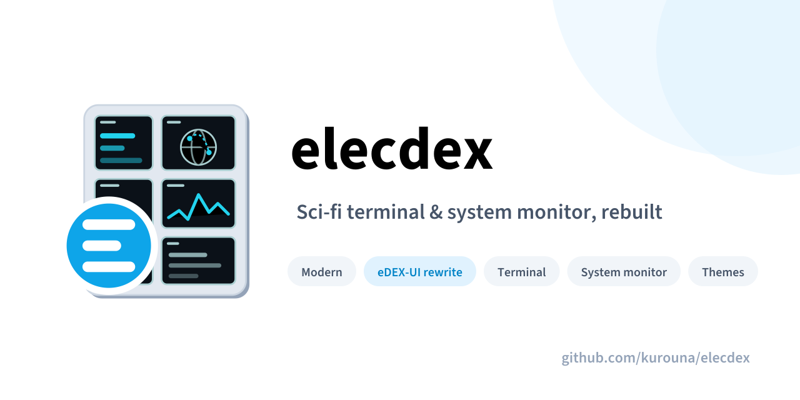
</p>

[](https://github.com/kurouna/elecdex/actions/workflows/ci.yml)
[](https://github.com/kurouna/elecdex/releases)
[](https://www.gnu.org/licenses/gpl-3.0)
[](https://zenn.dev/kurouna)
[](https://x.com/elecxzy)

**English** | [日本語](README.ja.md) | [简体中文](README.zh-CN.md)

# elecdex

A sci-fi terminal emulator and system monitor for Windows, macOS and Linux that also lays out
weather, markets, earthquakes, Git, Docker, AI chat and more as panes on one screen, beside your
shells. An alternative to [eDEX-UI](https://github.com/GitSquared/edex-ui) (archived in 2021), rewritten from the ground up on a
current, secure stack.

<p align="center">
  <a href="https://youtu.be/JlCZzLhp_PM">
    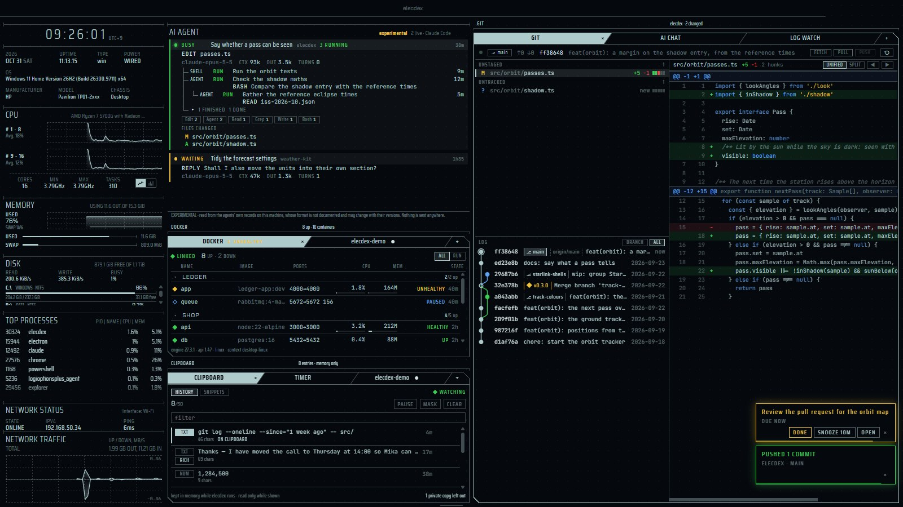
  </a>
  <br>
  ▶ <a href="https://youtu.be/JlCZzLhp_PM">Watch the 3-minute tour</a> · <a href="https://youtube.com/shorts/K-Is8LihR1w">Shorts (vertical)</a>
</p>

> **v0.0.51 — pre-release.** Everything below works today; builds are unsigned. What is marked
> *unreleased* is on `main` and arrives with the next release.
>
> **Developed and used on Windows.** macOS and Linux are built for every release, but they have
> only been run by the automated end-to-end tests on GitHub Actions - nobody has used them by hand
> for any length of time, so **macOS and Linux are not sufficiently verified**. Expect rough edges
> there, and please [report](https://github.com/kurouna/elecdex/issues) what you find.
>
> Design notes: [docs/architecture.md](docs/architecture.md); every decision with its reason:
> [docs/decisions.md](docs/decisions.md).

## What it is

elecdex is a desktop application that arranges 40 built-in panes in splits and tabs on one
screen, in the look of a science-fiction terminal: the shells and system monitors eDEX-UI is known
for, and beside them network diagnostics, the world outside, development tools, AI, desk tools,
media and two machines of its own. It began as a ground-up rewrite of eDEX-UI (archived in 2021),
is built on Electron 45, Svelte 5 and TypeScript 7, and is released under the GPL-3.0.

- **Shells**: PowerShell, bash, zsh and fish in tabs and splits through node-pty, with shell
  integration (OSC 7 / OSC 9;9) that follows each shell's folder - on Windows too.
- **Panes**: 40 built-in panes plus web panes (Browser, YouTube, X), arranged in a persisted tree of
  splits and tabs; ten layout presets, saved layouts, an action palette.
- **System and network**: CPU, memory, GPU, disks, processes, every TCP socket by program, Wi-Fi
  and Ethernet diagnostics - read without a process per reading on Windows.
- **The world**: weather (JMA, NWS, MET Norway), markets, RSS, earthquakes and tsunamis, satellites
  computed locally (SGP4), a globe of connections placed with a bundled GeoIP database.
- **Work and AI**: Git (read, FETCH/PULL/PUSH), Docker, Log Watch, Claude Code sessions, AI chat over
  any OpenAI-compatible or Anthropic endpoint with keys kept encrypted by the OS.
- **Desk and media**: notes, tasks, a timer, the clipboard, a calendar and a calculator; a sound
  spectrum, a mixer and Now Playing.
- **Machines of its own**: a CHIP-8 emulator and ELEC-16, an original 16-bit pocket computer with
  BASIC, a game model and a scientific calculator.
- **Security model**: the page is sandboxed with no Node and no network (`connect-src 'self'`);
  every request is made by the main process, only while a pane needs it; no telemetry. Plugins run
  in a sandboxed worker with only the permissions granted.

## Layout presets

Ten presets switch the whole screen at a key (**Ctrl+Shift+F1** to **F10**); all but cockpit and
blank keep the system column on the left. Each picture is that preset in a different theme;
details are in [Layout presets](docs/guide/presets.md).

<table>
  <tr>
    <td align="center" width="50%"><a href="docs/guide/presets.md#standard">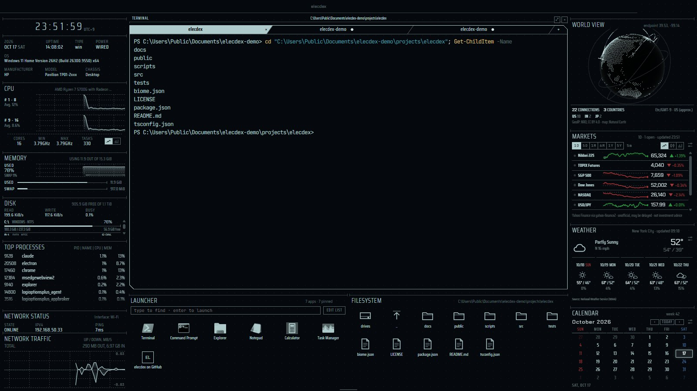</a><br><sub><b>standard</b> · Ctrl+Shift+F1 · the shells, this machine and the world outside</sub></td>
    <td align="center" width="50%"><a href="docs/guide/presets.md#network">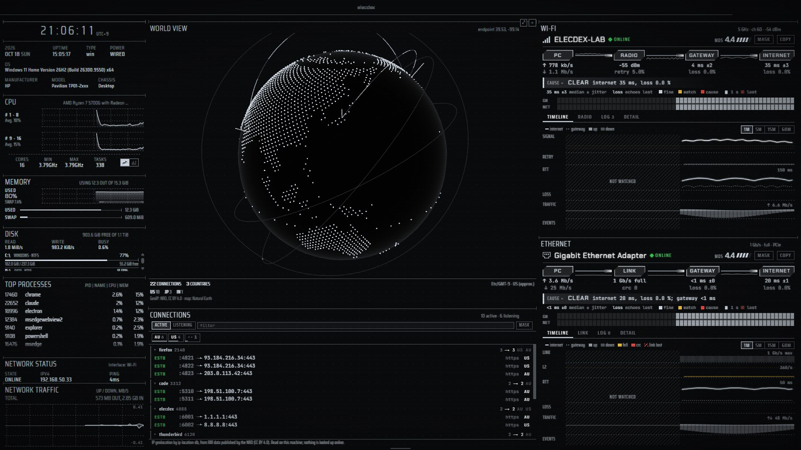</a><br><sub><b>network</b> · Ctrl+Shift+F2 · sockets by program, Wi-Fi, Ethernet, the world view</sub></td>
  </tr>
  <tr>
    <td align="center" width="50%"><a href="docs/guide/presets.md#earth">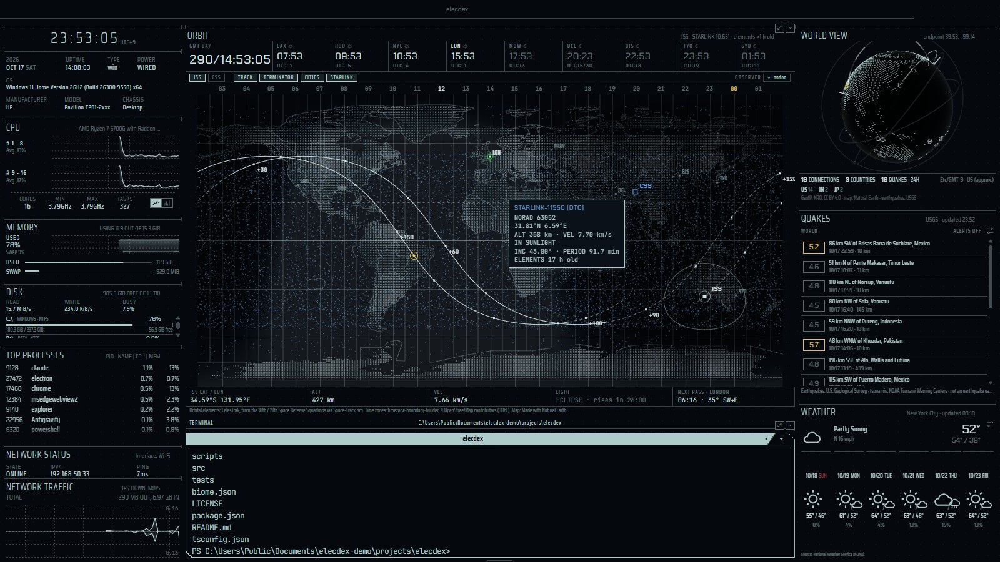</a><br><sub><b>earth</b> · Ctrl+Shift+F3 · satellites overhead, earthquakes underfoot, weather</sub></td>
    <td align="center" width="50%"><a href="docs/guide/presets.md#dev">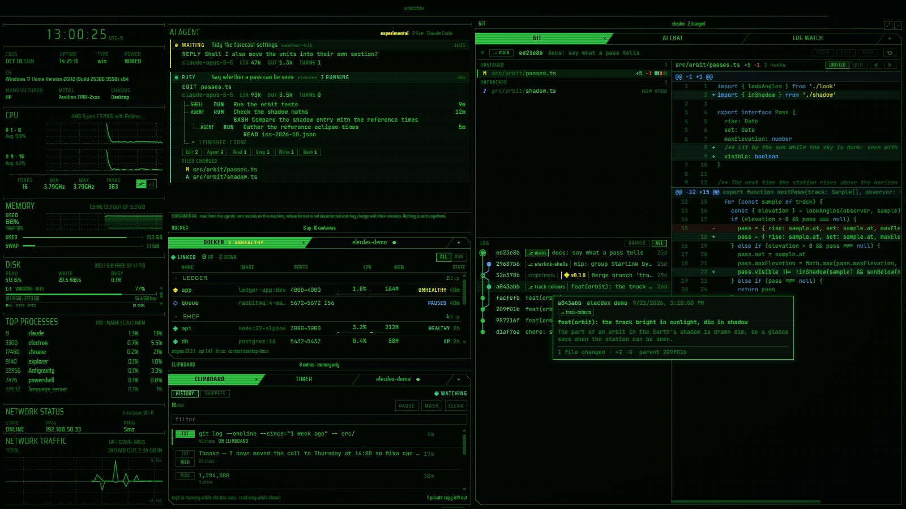</a><br><sub><b>dev</b> · Ctrl+Shift+F4 · AI agents at work, Docker, Git, Log Watch</sub></td>
  </tr>
  <tr>
    <td align="center" width="50%"><a href="docs/guide/presets.md#media">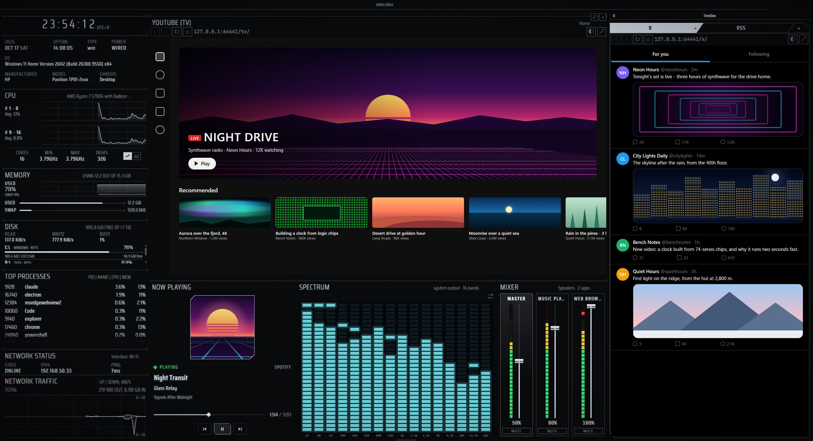</a><br><sub><b>media</b> · Ctrl+Shift+F5 · web panes, the sound spectrum, mixer, now playing</sub></td>
    <td align="center" width="50%"><a href="docs/guide/presets.md#desk">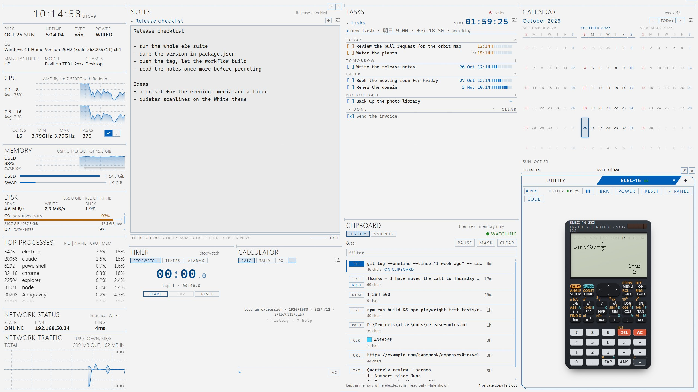</a><br><sub><b>desk</b> · Ctrl+Shift+F6 · notes, tasks, timer, clipboard, calendar, utility</sub></td>
  </tr>
  <tr>
    <td align="center" width="50%"><a href="docs/guide/presets.md#ai">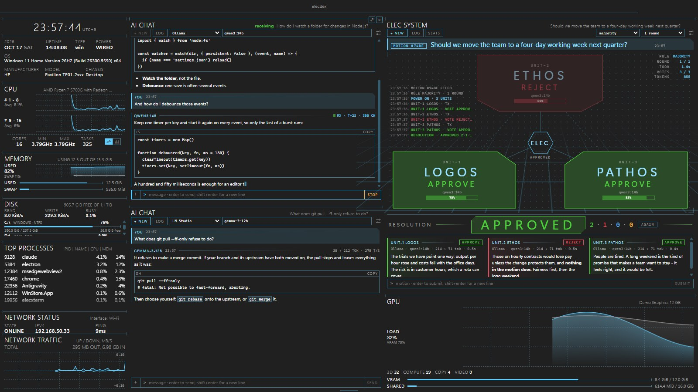</a><br><sub><b>ai</b> · Ctrl+Shift+F7 · two AI chats, the ELEC council, the GPU</sub></td>
    <td align="center" width="50%"><a href="docs/guide/presets.md#cockpit">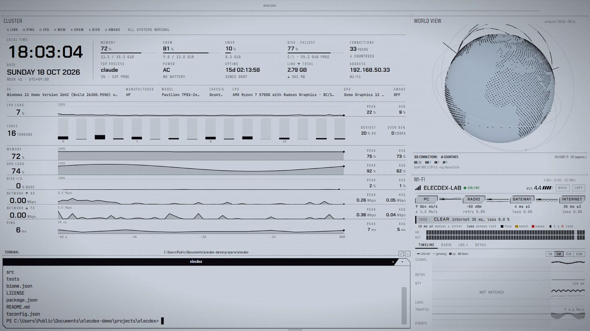</a><br><sub><b>cockpit</b> · Ctrl+Shift+F8 · the whole machine on one CLUSTER pane</sub></td>
  </tr>
  <tr>
    <td align="center" width="50%"><a href="docs/guide/presets.md#retro">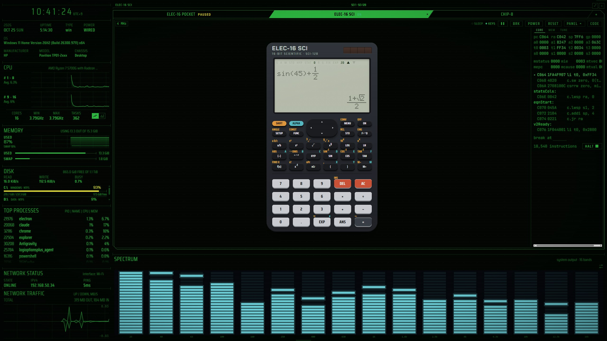</a><br><sub><b>retro</b> · Ctrl+Shift+F9 · CHIP-8, the ELEC-16 machines and the SCI-128 calculator</sub></td>
    <td align="center" width="50%"><a href="docs/guide/presets.md#blank">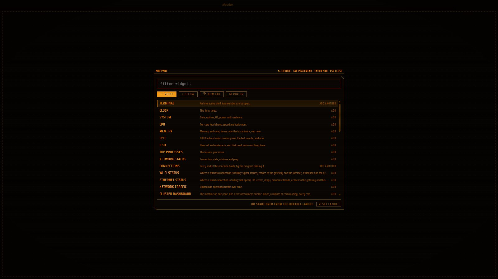</a><br><sub><b>blank</b> · Ctrl+Shift+F10 · no pane yet: build a layout of your own</sub></td>
  </tr>
</table>

## Panes

| Group | Panes | Guide |
| --- | --- | --- |
| System | Terminal, Clock, System, CPU, Memory, GPU, Disk, Top processes, Cluster, Launcher, Filesystem | [System panes](docs/guide/panes-system.md) |
| Network | Network status, Network traffic, World view, Connections, Wi-Fi, Ethernet | [Network panes](docs/guide/panes-network.md) |
| Development | AI Agent, Git, Docker, Log Watch | [Development panes](docs/guide/panes-dev.md) |
| World | Orbit, Markets, Weather, RSS, Quakes, earthquake and tsunami alerts | [World panes](docs/guide/panes-world.md) |
| AI | AI chat, ELEC system | [AI panes](docs/guide/panes-ai.md) |
| Desk | Calculator, Notes, Tasks, Timer, Clipboard, Calendar, Utility | [Desk panes](docs/guide/panes-desk.md) |
| Media | Spectrum, Browser, YouTube, X, Mixer, Now playing | [Media panes](docs/guide/panes-media.md) |
| Retro | CHIP-8, ELEC-16 (POCKET, HANDHELD, PLAY-320, SCI-128) | [Retro panes](docs/guide/panes-retro.md) |

## Install

Download the installer for your platform from
[Releases](https://github.com/kurouna/elecdex/releases):

| Platform | File |
| --- | --- |
| Windows x64 / arm64 | `elecdex-win-x64-<version>.exe` / `elecdex-win-arm64-<version>.exe` |
| macOS Apple silicon / Intel | `elecdex-mac-arm64-<version>.dmg` / `elecdex-mac-x64-<version>.dmg` |
| Linux x64 | `elecdex-linux-x86_64-<version>.AppImage` or `elecdex-linux-amd64-<version>.deb` |
| Linux arm64 | `elecdex-linux-arm64-<version>.AppImage` or `elecdex-linux-arm64-<version>.deb` |

The Windows builds are the ones the author runs. The macOS and Linux builds come out of the same
release workflow and pass the end-to-end tests on GitHub's runners, but have had no hands-on
testing: treat them as not sufficiently verified.

### If a warning appears

The installers are not code-signed: a certificate costs more than a personal project can carry. So
Windows and macOS warn before the first run. The warnings mean the publisher is unknown to them, not that
anything was found in the file. If you want to check a download first, the release page lists every
file's SHA-256 checksum. Each installer is built from the tagged source by the
[release workflow](.github/workflows/release.yml) on GitHub's runners. These steps are needed once
per install.

**Windows**

1. The browser may hold the download back ("isn't commonly downloaded"). In Edge, open the download's
   *⋯* menu → *Keep* → *Show more* → *Keep anyway*. In Chrome, choose *Keep*.
2. Run the `.exe`. SmartScreen shows **"Windows protected your PC"**: click **More info**, then
   **Run anyway**.
3. The installer installs for your user only, so it asks for no administrator rights.

If Windows says the file was blocked and offers no *Run anyway*, right-click the `.exe` →
*Properties* → tick **Unblock** → *OK*, and run it again.

**macOS** (15 Sequoia and later; older versions in the last step)

1. Open the `.dmg` and drag **elecdex** into *Applications*.
2. Open elecdex from *Applications*. macOS says it **"could not verify 'elecdex' is free of
   malware"**: click **Done** (not *Move to Trash*).
3. Open **System Settings → Privacy & Security**, scroll to *Security*, and click **Open Anyway**
   beside the line about elecdex. Confirm with your password or Touch ID, then **Open Anyway** again.
4. On macOS 14 or earlier, right-click the app → **Open** → **Open** does the same.

If macOS instead says **"elecdex is damaged and can't be opened"**, the file is not damaged. The
quarantine mark from the download is what stops it. Remove the mark and open the app again:

```bash
xattr -dr com.apple.quarantine /Applications/elecdex.app
```

**Linux** (no warning, but two things to know)

- **deb** (Debian, Ubuntu): `sudo apt install ./elecdex-linux-amd64-<version>.deb`. It also installs
  the AppArmor profile that Ubuntu 24.04 and later need before Electron's sandbox can start.
- **AppImage**: `chmod +x elecdex-linux-*.AppImage` and run it. It needs FUSE 2 (`libfuse2`, or
  `libfuse2t64` on Ubuntu 24.04). On Ubuntu 24.04 and later it may stop with a message about the
  *SUID sandbox helper*, because AppArmor blocks the sandbox there. Use the deb in that case. Do not
  start it with `--no-sandbox`: the sandbox is what keeps the renderer away from your files.

elecdex starts fullscreen. **F11** leaves fullscreen and **Ctrl+Shift+Q** quits; `--windowed`
starts in a window and `--no-intro` skips the boot sequence.

### Build from source

```bash
git clone https://github.com/kurouna/elecdex.git
cd elecdex
npm ci
npm run dev -- -- --windowed --no-intro
```

`npm ci` downloads Electron and, on macOS, fixes node-pty; on Linux, approve node-pty's install
script so it can compile. Tests, builds and the other commands are in the
[Develop guide](docs/guide/develop.md).

## First steps

| Key | Action |
| --- | --- |
| Ctrl+Shift+A | Add a pane (the picker) |
| Ctrl+Shift+F1 … F10 | Go to a layout preset |
| Ctrl+Shift+G | Saved layouts |
| Ctrl+Shift+P | Find any action, layout, theme or setting (the action palette) |
| Ctrl+Shift+Z | Show the focused pane enlarged over the others; again to put it back |
| Ctrl+Shift+. | Settings |
| F11 / Ctrl+Shift+Q | Leave fullscreen / quit |

Every shortcut can be rebound in *Settings → Keyboard*; the full list is in
[Keyboard shortcuts](docs/guide/keyboard.md).

## Documentation

| Page | What it covers |
| --- | --- |
| [User guide](docs/guide/index.md) | The index of the pages below |
| [Layout presets](docs/guide/presets.md) | The ten presets, pane by pane |
| [Workspace](docs/guide/workspace.md) | Panes, splits, tabs, saved layouts, the palette, themes and motion, running in the background |
| [Keyboard shortcuts](docs/guide/keyboard.md) | Every default chord, rebinding, global shortcuts |
| [Themes and settings](docs/guide/themes-settings.md) | The seven themes, `settings.json` |
| [Plugins](docs/guide/plugins-use.md) | Installing plugins and what they may do ([API](docs/plugins.md)) |
| [Network access and data sources](docs/guide/data-sources.md) | Every service elecdex contacts, how often, and its terms |
| [Develop](docs/guide/develop.md) | Building, testing, releasing, and why a rewrite |
| [ELEC-16 manuals and guides](docs/guide/panes-retro.md#elec-16) | BASIC, the E16 machine, e16c, the SOFT CARD, PLAY-320, SCI-128, and HTML quick guides with screenshots for the pocket computer and the calculator |
| [Architecture](docs/architecture.md) · [Decisions](docs/decisions.md) | The design and every decision with its reason (in Japanese) |

## Third-party assets

| Asset | Source | License |
| --- | --- | --- |
| Display font | [Chakra Petch](https://fonts.google.com/specimen/Chakra+Petch) | SIL OFL 1.1 |
| UI font | [Saira Condensed](https://fonts.google.com/specimen/Saira+Condensed) | SIL OFL 1.1 |
| Monospace font | [JetBrains Mono](https://www.jetbrains.com/lp/mono/) | SIL OFL 1.1 |
| ELEC-16 keytop fonts | [Barlow Condensed](https://fonts.google.com/specimen/Barlow+Condensed), [IBM Plex Sans Condensed](https://fonts.google.com/specimen/IBM+Plex+Sans+Condensed), [Inter Tight](https://fonts.google.com/specimen/Inter+Tight), [M PLUS Rounded 1c](https://fonts.google.com/specimen/M+PLUS+Rounded+1c), [Albert Sans](https://fonts.google.com/specimen/Albert+Sans); for the カナ key, its two letters from [BIZ UDPGothic](https://fonts.google.com/specimen/BIZ+UDPGothic), [IBM Plex Sans JP](https://fonts.google.com/specimen/IBM+Plex+Sans+JP), [Noto Sans JP](https://fonts.google.com/noto/specimen/Noto+Sans+JP) and M PLUS Rounded 1c (via [Fontsource](https://fontsource.org/)) | SIL OFL 1.1 |
| IP geolocation | [`@ip-location-db/geo-whois-asn-country-mmdb`](https://github.com/sapics/ip-location-db), data by the [NRO](https://www.nro.net/) | [CC BY 4.0](https://creativecommons.org/licenses/by/4.0/) (the npm package is labelled CC0-1.0; its bundled NRO_LICENSE requires attribution to nro.net) |
| Globe land and country shapes | [Natural Earth](https://www.naturalearthdata.com/) via [world-atlas](https://github.com/topojson/world-atlas) | Public domain / ISC (build time only) |
| Country codes and time zones | [i18n-iso-countries](https://github.com/michaelwittig/node-i18n-iso-countries), [countries-and-timezones](https://github.com/manuelmhtr/countries-and-timezones) | MIT (build time only) |
| README banner font | [Source Sans 3](https://fonts.google.com/specimen/Source+Sans+3) | SIL OFL 1.1 (outlined into the SVG at build time) |
| Market data client | [yahoo-finance2](https://github.com/gadicc/yahoo-finance2) | MIT (bundled into the main process) |
| Time zone boundaries (ORBIT) | [timezone-boundary-builder](https://github.com/evansiroky/timezone-boundary-builder) 2026d, from OpenStreetMap data | [ODbL 1.0](https://opendatacommons.org/licenses/odbl/1-0/), © OpenStreetMap contributors. The derived lines in `src/renderer/widgets/orbit/tz-lines.json` (made by `npm run gen:orbit-map`) are under the ODbL too; credited in the pane. |
| Land for the ORBIT map | [Natural Earth](https://www.naturalearthdata.com/) 50m land via world-atlas | Public domain ("Made with Natural Earth", credited in the pane) |
| Orbit propagation (SGP4) | [satellite.js](https://github.com/shashwatak/satellite-js) | MIT |
| Syntax colours in the git pane's diffs | [highlight.js](https://highlightjs.org/) | BSD-3-Clause |
| Calculator's expression evaluator | [elecxzy](https://github.com/kurouna/elecxzy) `src/utils/calc`, copied unmodified into `src/shared/calc/vendor` | MIT |
| CHIP-8 fonts | [Octo](https://github.com/JohnEarnest/Octo) `js/emulator.js`, copied into `src/shared/chip8/fonts.ts` | MIT |
| CHIP-8 programs | [chip8Archive](https://github.com/JohnEarnest/chip8Archive), by their authors, in `resources/chip8/archive` | [CC0 1.0](https://creativecommons.org/publicdomain/zero/1.0/); credited in the pane |
| CHIP-8 test programs (DIAG) | [chip8-test-suite](https://github.com/Timendus/chip8-test-suite) by Timendus, in `resources/chip8/test-suite` with their Octo sources | GPL-3.0 |

The geolocation database is bundled, so there is no account, no API key and no first-run
download, and IP lookups never leave the machine.

Every package the app is built from, and the data above, are listed with their licence texts in
`THIRD_PARTY_NOTICES.txt`, beside the executable in each release (written by `npm run build`).

---

## License / ライセンス

This software is released under the [GNU General Public License v3.0](./LICENSE), the same license
as eDEX-UI.  
本ソフトウェアは、eDEX-UI と同じ [GNU General Public License v3.0](./LICENSE) のもとで公開されています。

## Acknowledgements / 謝辞

This application is deeply inspired by the design and philosophy of the following pioneering
project. We express our utmost respect and gratitude to its creator and contributors:

本アプリケーションは、以下の先駆的なプロジェクトの設計と哲学に深くインスパイアされています。
この優れたソフトウェアを生み出した開発者およびコミュニティの皆様に、最大限の敬意と謝意を表します。

- **[eDEX-UI](https://github.com/GitSquared/edex-ui)**
  - Copyright (c) 2017-2021 Gabriel "Squared" Saillard
  - Created by Gabriel "Squared" Saillard ([gaby.dev](https://gaby.dev))
  - Licensed under the GNU General Public License v3.0

---

<p align="center">Copyright © 2026 elecxzy project</p>
