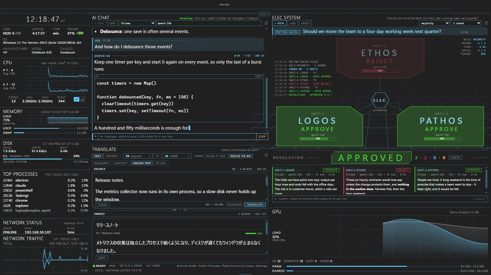
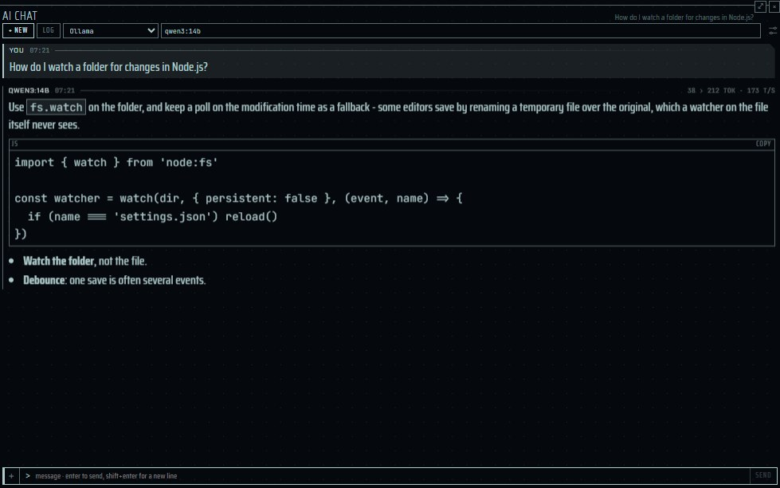
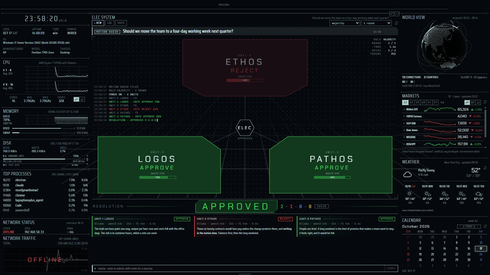
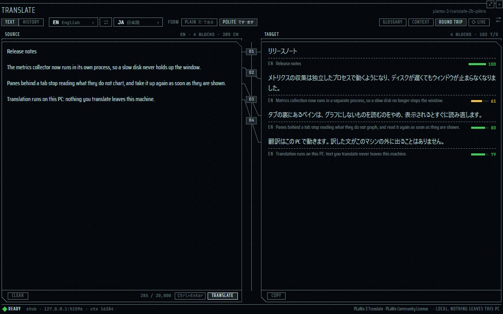

[English](panes-ai.md) | 日本語 | [简体中文](panes-ai.zh-CN.md)

# AI のペイン — elecdex

elecdex は Windows・macOS・Linux 向けの SF 風ターミナルエミュレータ兼システムモニタです。このページは、言語モデルを使うペインを説明します。自分で動かすモデル（Ollama、LM Studio、llama.cpp、そのほか OpenAI 互換のサーバー）や API キーを持っているホスト型サービス（Anthropic、OpenAI、Gemini、OpenRouter）と話す **AI chat** と、はい／いいえで答える議題を 3 つのモデルの評議会にかけて票を議決する **ELEC system**、この PC で動かす PLaMo 3 Translate で 53 言語とやさしい日本語の間を訳す **TRANSLATE** *(unreleased)* です。プロバイダーと 2 つの方言、API キーの置き場所、長い会話をモデルのコンテキストウィンドウに収める方法、添付ファイルとその上限、あえて持たせていない機能を扱います。elecdex は Windows で開発・使用しています。macOS と Linux は自動テストでビルド・実行しただけで、人の手による確認は十分ではありません。

**このページの内容**

- [ai プリセット](#ai-プリセット)
- [AI chat](#ai-chat)
- [ELEC system](#elec-system)
- [TRANSLATE](#translate)
- [関連項目](#関連項目)

## ai プリセット

  
   ai · Business (Dark) — 回答は撮影用に用意した代役のもの

**ai** プリセット（Ctrl+Shift+F7）には、上下に並んだ 2 つの AI チャットペインと、右側に ELEC system、その下に [GPU](panes-system.ja.md#gpu) ペインがあります。GPU ペインは GPU の負荷と GPU 自身のメモリの埋まり具合を示します。この機械で動かすモデルが頼るものです。どちらの AI ペインも送信したときにだけプロバイダーに問い合わせるので、それまでこのプリセットは何も費やしません。2 つ目のチャットの裏のタブには [TRANSLATE](#translate) *(unreleased)* があります。PLaMo 3 Translate をこの PC で動かすペインで、エンジンは最初の翻訳で初めて起動します。

- **AI チャット** — 自分で動かす言語モデル（Ollama、LM Studio、llama.cpp など、OpenAI のチャット API を話すもの）や、API キーを持っているサービス（Anthropic、OpenAI、Gemini、OpenRouter）と会話できます。回答はストリーミングで届き、推論部分は折りたたまれます。キーは OS によって暗号化されてページには渡らず、会話はこのコンピューターの中にとどまります。テキストファイル・画像・PDF を質問に添えられます。**+** で選ぶか、ペインにドロップするか、画像を貼り付けます。画像は送る前に小さく描き直すので、カメラがファイルに書き込んだ情報（撮影場所など）は外に出ません。
- **ELEC system** — はい／いいえで答える議題を 3 つのモデルの評議会にかけます。LOGOS（論理）、ETHOS（倫理）、PATHOS（感情）がそれぞれの立場から判断して APPROVE、REJECT、ABSTAIN のいずれかに投票し、ペインが多数決または全会一致で議決します。各席は AI チャットのプロバイダーを使います。3 席すべてが同じモデルでも構いません。

## AI chat

  
   AI chat・代役のモデル

| | |
| --- | --- |
| 場所 | **ai** プリセット（Ctrl+Shift+F7）に 2 つ、**dev** プリセット（Ctrl+Shift+F4）の GIT の後ろに 1 つ。ピッカー（Ctrl+Shift+A、"ai chat"）からいくつでも追加できます。前面に出してウィンドウいっぱいに広げられます（Ctrl+Shift+Z）。既定のレイアウトにはありません。 |
| 読むもの・データ源 | *Settings → AI* で登録したプロバイダー（このコンピューターやネットワーク上のサーバー、またはホスト型の API）。会話はアプリのデータフォルダー（userData）の `chats/` に、1 会話 1 ファイルで保存します。 |
| 更新 | 回答は書かれる間ストリーミングで届き、main が 100 ms ごとにまとめてペインに渡します。メッセージを送るか、**test** を押すか、モデル一覧を開くまで、どこにも何も送りません。 |
| プラットフォーム | キーは OS の仕組みで暗号化します（Windows は DPAPI、macOS はキーチェーン、Linux はデスクトップの keyring）。keyring のない Linux ではキーをメモリにだけ持ち、elecdex の終了まで有効で、設定画面にそう表示します。macOS と Linux は人の手による確認が十分ではありません。 |
| プライバシー | API キーはページに渡らず、`settings.json` にも書きません。キーは入力したときのアドレスにだけ送り、平文の http では、このコンピューターとローカルネットワークの外へは送りません。画像はページで描き直すので EXIF（撮影場所の GPS を含む）は残りません。ファイルはバイト列で渡し、パスでは渡しません。モデルはこのコンピューター上のツールを持たず、ファイルを読んだり、コマンドを実行したりできません。Claude（Anthropic の方言）は、1 回の回答で最大 5 回まで Anthropic の側でウェブを検索することがあります。検索は Anthropic で行われ、ここでは何も動きません。検索はそれぞれ自分のアカウントに課金されます。 |
| 設定 | *Settings → AI*：プロバイダー（プリセット、アドレス、API キー、*context window*）、任意のシステムプロンプト、*summarise what no longer fits*（既定はオフ）。ペインでは：プロバイダーとモデル。 |

### プロバイダーの登録

1. *Settings → AI* を開いてプロバイダーを追加します。プリセットを選び、アドレスを調整し、ホスト型のサービスなら API キーを貼り付けます。
2. キーは他の設定と同じく、フィールドを離れたとき（または Enter を押したとき）に保存されます。それまでは **show** で入力内容を確認でき、保存済みのキーは黒丸で表示され、二度と表示されません。
3. **test** を押します。プロバイダーにモデルを問い合わせ、その結果がモデル欄の候補になります。
4. ペインでプロバイダーとモデルを選びます。

プロバイダーは「アドレス + 方言」です。方言は 2 つで、OpenAI 互換の `chat/completions`（素の fetch と Server-Sent Events）と、Anthropic の Messages API（Anthropic の公式 SDK 経由）です。新しいサービスはコードではなくプリセットで足します。プリセットは次のとおりで、追加した後はどの項目も編集できます。

| プリセット | 方言 | 既定のアドレス | PDF を送るか |
| --- | --- | --- | --- |
| Ollama | OpenAI 互換 | `http://localhost:11434/v1` | 送らない |
| LM Studio | OpenAI 互換 | `http://localhost:1234/v1` | 送らない |
| llama.cpp | OpenAI 互換 | `http://localhost:8080/v1` | 送らない |
| Anthropic | Anthropic | `https://api.anthropic.com` | 送る |
| OpenAI | OpenAI 互換 | `https://api.openai.com/v1` | 送る |
| Gemini | OpenAI 互換 | `https://generativelanguage.googleapis.com/v1beta/openai` | 送らない |
| OpenRouter | OpenAI 互換 | `https://openrouter.ai/api/v1` | 送る |
| Custom | OpenAI 互換 | `http://localhost:8000/v1` | PDF を読むプリセットと同じアドレスのときだけ |

- アドレスは http か https で、ユーザー名・パスワード・クエリ・フラグメントを含まないものに限ります。それ以外には一切問い合わせません。手で書き間違えたアドレスは、そのプロバイダーだけが使えなくなり、`settings.json` 全体が既定に戻ることはありません。
- **Anthropic のキー。** ワークスペースを指定して作ったキー（Console → API keys で Default などのワークスペースを選ぶ）を使ってください。ワークスペースを指定せずに作った、ユーザーに紐づくキー（`sk-ant-usr-`）は、そのキーに要る `anthropic-workspace-id` ヘッダーを elecdex が送らないため、「the request was not accepted (400): This API key is not scoped to a workspace...」で断られます。キーを持たない Anthropic のプロバイダーでは、SDK の通常の探し方（`ANTHROPIC_API_KEY`、`ant auth login` のプロファイル）に任せます。
- **再試行。** OpenAI 互換の方言で、ホスト型のサービスが 408・429・500・502・503・504 を返したときや、応答の前に接続が切れたときは、0.5 秒後と 1.5 秒後の 2 回まで再試行します。回答が少しでも届いた後は再試行しません。`Retry-After` が 5 秒以内なら従い、それより長ければ待たずにその失敗を伝えます。このコンピューターやネットワーク上のサーバーには再試行しません。そこでの失敗（起動していない、メモリ不足、モデルがない）はそのまま伝えます。Anthropic の SDK は自分で再試行します。
- **Anthropic のフォールバック。** Anthropic 自身のエンドポイントで `claude-opus-5` と `claude-fable-5-1` に問い合わせるときは、サーバー側のフォールバックを付けます。安全分類器が断った要求には同じ呼び出しの中で別の Claude モデルが答え、メッセージには実際に答えたモデルの名前が残ります。

### 質問する

- 入力して Enter を押します。Shift+Enter で改行します。Esc か **stop** で回答を終わらせ、それまでに書かれた分は残ります。
- 回答は Markdown として描かれ、コードブロックごとにコピーボタンが付きます。モデルの文章は信頼できないものとして扱い、既知の要素だけの木に解析してから描きます。HTML としては描かないので、スクリプトもスタイルも画像のリクエストも載りません。リンクは http と https だけです。
- プロバイダーがモデルの推論を返す場合（Claude の要約された thinking、`reasoning_content`、`reasoning`、またはインラインの `<think>`）は、**reasoning** の下に折りたたまれます。履歴として送り返すのは回答の本文だけで、推論は送り返しません。
- 回答を書いている間は見出しに経過秒数と文字数が表示され、書き終わると、プロバイダーが報告する場合は入力・出力のトークン数と毎秒のトークン数が表示されます。
- メッセージにポインターを重ねると、**copy** でコピー、**edit** で以前の質問を編集（その質問とそれ以降が置き換わります）、**again** で質問し直せます。
- 普通に終わらなかった回答は、どう終わったかを、プロバイダー自身の言葉を添えて示します。

| コード | 意味 |
| --- | --- |
| `STOPPED` | 利用者が止めた。 |
| `TRUNCATED` | 回答が長さの上限に達した。 |
| `DECLINED` | モデルが断った。 |
| `LINK ERROR` | プロバイダーがエラーを返した。 |
| `NO CARRIER` | そのアドレスで誰も応答しなかった。 |

- **+ new** で新しい会話を始め、**log** で既存の会話を新しい順に一覧します。会話にポインターを合わせると Markdown で書き出したり削除したりできます。
- 開き直した会話は、それに回答したプロバイダーとモデルで続きます（プロバイダーを削除して追加し直した場合は名前で探します）。何も送れないときは、ペインがその理由を示します（たとえば `NO MODEL`）。
- 空のペインは接続先（`LINK STANDBY`、プロバイダーとモデル、アドレス）を表示し、プロバイダーがなければ `NO LINK` を表示します。モデル欄はプロバイダーの一覧を読んでいる間は `QUERYING`、読めないときは理由とともに `NO LIST` を表示します。
- 会話はペインではなくアプリのものです。ペインを動かしても、タブの裏に回しても、ページを再読み込みしても回答は途切れません。誰も見ていない回答は 3 秒後に止めるので、ペインを閉じるとリクエストは止まります。
- 設定で任意のシステムプロンプトを指定すると、すべての会話の先頭に付きます。
- Anthropic の方言のプロバイダは、質問に必要なときウェブを検索することがあります（Anthropic の `web_search` ツール、1 回の回答で最大 5 回、検索ごとに Anthropic が課金）。検索の後の回答は新しい段落から始まり、引用したページが **Sources** として下に並びます。Anthropic の検索のループが回答を途中で止めたときは、その回答に残った検索回数で続きを頼み（最大 3 回）、それでも止まっているか、残りがないまま止まれば理由を添えて `TRUNCATED` で終わります。検索の前と後の推論は別の段落で表示します。OpenAI 互換の方言のプロバイダには検索を頼みません。

### 添付ファイル

質問にファイルを添えられます。行頭の **+** を押すか、ペインにファイルをドロップするか、画像を貼り付けます（テキストを含む貼り付けはテキストのまま）。添えたファイルは入力行の上にチップとして並び（**PAYLOAD**。件数・サイズ・推定トークン数）、チップにポインターを置くとカードが残りを示します（ファイル名の全体、正確なサイズ、画像のピクセル数と縮小前の大きさ）。ファイルだけの質問も送れます。

| 上限 | 値 |
| --- | --- |
| 1 つの質問のファイル数 | 5 件 |
| 1 つの質問のファイルの合計 | 15 MB |
| テキストファイル | 256 KB。質問の中にそのまま全文を入れて送ります。長いものは切らずに断ります |
| 選んだ時点の画像 | 40 MB |
| 送る画像 | 長辺 1568 ピクセル以内・1.15 メガピクセル以内に描き直し、PNG か JPEG で 3.75 MB まで |
| PDF | 10 MB・100 ページまで。送り先は Anthropic の API、OpenAI、OpenRouter だけ |
| 1 回のリクエストの画像と PDF（履歴を含む） | 20 MB |

- **パスからは何も読みません。** 選んだもの・ドロップしたもの・貼り付けたものをページが読み、バイト列として main に渡します。main は名前や OS のファイルの種類ではなく、中身の先頭のバイトで種類を判定します。
- **画像** はページの中でデコードして描き直し、エンコードし直します（元が PNG なら PNG にしてスクリーンショットの文字をつぶさず、それ以外は JPEG）。このためカメラの EXIF は残りません。EXIF や PNG のテキストチャンクが残っている画像は main が断ります。
- **テキストファイル** は、UTF-8 として読め、NUL を含まず、制御文字が 1% 以下のものをテキストとして扱います。質問の中に `<file name="…">…</file>` として入れ、画像と PDF の後、質問の前に置きます。
- **PDF** は、Anthropic の方言にはドキュメントのブロックとして送り、OpenAI 互換の方言には PDF を読むプリセット（OpenAI、OpenRouter）と同じアドレスのときだけ送ります（アドレスで判定します）。それ以外のプロバイダーには、質問を送る前に `NO DOCUMENT` と表示し、履歴にある PDF は名前を示す行（たとえば `[paper.pdf (PDF, 3 pages, 90 KB) - not sent: …]`）に置き換えます。黙って落とすことはありません。
- 画像を受け付けないモデルは、その旨を自分の言葉で返します。elecdex はモデルの名前から推測しません。
- 送る前のファイルは main のメモリにだけ置きます。送ったファイルは会話の横（`chats/<id>.files/`、SHA-256 の名前）に保存され、会話と一緒に消えます。質問を編集すると、残したファイルはそのまま引き継がれます。
- そのほかの拒否は、ファイル名とともにコードで示します：`TOO LARGE`、`UNREADABLE`、`PAYLOAD FULL`。

### コンテキストウィンドウと NOT SENT

ローカルサーバーは起動時に指定された数千トークンで応答し、それより長いものは先頭から（システムプロンプトから）黙って切り捨てます。そのため、どのプロバイダーにも *Settings → AI* に *context window* があります。

| プロバイダー | 別の値を入力するまでの context window |
| --- | --- |
| このコンピューターやローカルネットワーク上のアドレス（平文の http） | 8192 トークン |
| ホスト型のサービス | 無制限（会話を全文送る） |

Ollama では、設定しているコンテキスト長を入力してください（Ollama 自体の既定は 4096 です）。`0` は「すべて送る」を意味します。

- トークンはトークナイザーを使わずに見積もります。ASCII 文字は 4 文字で 1 トークン、それ以外の文字は 1 文字で 1 トークンと数えます（日本語や中国語はおおむねこの比率です）。プロバイダーが報告するトークン数で見積もりを補正しますが、補正は上方向だけです。
- 送るのはウィンドウの 4 分の 3 までで、残りは回答とその推論のためにとっておきます。それを超えると、古いメッセージをウィンドウの半分まで一度に大きく区切って送らなくなり、その位置を次に超えるまで保ちます。1 ターンごとに少しずつではなく、まれに大きく区切るので、サーバーのプロンプトキャッシュ（Anthropic のものも）が生き残ります。
- ログの `NOT SENT · n ABOVE` の行が、モデルに見えている範囲の始まりを示します。
- 会話そのものと、その書き出しは欠けずに残ります。区切るのは送る分だけです。
- 最後の質問は、それだけで収まらなくても必ず送ります。何が起きたかはプロバイダーの返事で分かります。
- 添付ファイルも数に入ります。画像は 2 つの方言の数え方の大きいほう、PDF は 1 ページ 2500 トークン、テキストファイルはその文章で数えます。1 回のリクエストの画像と PDF（履歴を含む）は、ウィンドウが無制限のホスト型サービスでも 20 MB に抑え、同じ方法で区切ります。

### 要約

*summarise what no longer fits* をオンにすると（*Settings → AI*、既定はオフ）、まずモデルに、送らなくなる部分の要約を頼みます。

- 会話が区切られるたびに、同じプロバイダーとモデルへのリクエストが 1 回増え、`TX · COMPACTING` と表示されます。回答の後やタイマーで要約することはありません。
- 要約はそれ以降、メッセージとしてではなく、システムプロンプトの後に送られます。このとき行は `SUMMARISED · n ABOVE` となり、開くとモデルに何を伝えたかが見られます。
- 要約に使えるのはウィンドウの 10 分の 1、最大 600 トークンです。
- 要約に失敗しても失うのは要約だけで、質問はそのまま送られます。失敗した要約は次の質問でもう 1 回だけ頼み、次の区切りまではそれ以上頼みません。
- 添付ファイルは名前だけが要約に伝わります。設定をオフにしても、既にある要約は送り続けます。

### 持たせていない機能

- **ツールはありません。** MCP もツール呼び出しもなく、モデルはファイルを読んだり、コマンドを実行したりできず、自分からファイルを読みに行くこともありません。唯一の例外は Claude のウェブ検索で、このコンピューターではなく Anthropic のサーバーで行われます。プロセスを起動したりファイルを読んだりできるモデルには、まずプラグインと同じ水準の同意の仕組みが要ります。
- 会話の分岐も、名前を付けて切り替えるプロンプトのプロファイルもありません。任意のシステムプロンプト 1 つがすべての会話に付きます。
- 置いただけでは問い合わせません。レイアウトにあるだけのチャットペインはどこにも問い合わせません。

| 上限 | 値 |
| --- | --- |
| プロバイダー | 12 |
| 保存する会話 | 200（超えると古いものを消すのではなく、新しい会話を断ります） |
| 1 つの会話のメッセージ | 400 |
| 1 つのメッセージの文字数 | 400,000 |
| システムプロンプト | 8000 文字 |

## ELEC system

  
   ELEC system · Tron

| | |
| --- | --- |
| 場所 | **ai** プリセット（Ctrl+Shift+F7）、またはピッカー（Ctrl+Shift+A、"elec system"）。前面に出せます（Ctrl+Shift+Z）。既定のレイアウトにはありません。 |
| 読むもの・データ源 | *Settings → AI* のプロバイダーを、各席の指定どおりに使います。審議はアプリのデータフォルダーの `elec/` にファイルで保存します。 |
| 更新 | 議題を提出したとき（またはモデル一覧を開いたとき）だけ。各ユニットには立場、投票の指示、議題を送り、第 2 回では他のユニットの最初の所見も送ります。1 回につき 3 リクエスト、1 回か 2 回です。 |
| プラットフォーム | AI chat と同じです。macOS と Linux は人の手による確認が十分ではありません。 |
| プライバシー | ページが送るのは議題だけで、席と規則は main が設定から読みます。キーは AI chat と同じ規則に従います。 |
| 設定 | ペインのバーで：**seats**、規則、ラウンド数（設定に保存され、すべての ELEC system ペインで共有）。立場：*Settings → AI → elec system · standpoints*。 |

### 席と立場

**seats** で各ユニットのプロバイダーとモデルを選び、**all** で 1 つの席の選択を 3 つすべてに適用します。各ユニットにはそれぞれの立場が伝えられるので、全席が同じモデルでも構いません。既定の立場は次のとおりです。

| ユニット | ステージ上の位置 | 既定の立場 |
| --- | --- | --- |
| UNIT-1 LOGOS | 左下 | 科学者：根拠、実現性、費用、リスク。 |
| UNIT-2 ETHOS | 上 | 守り手：義務、公正、決定が影響する人々。 |
| UNIT-3 PATHOS | 右下 | 心：感情、欲求、直感、決定がそれとともに生きる人にとって持つ意味。 |

立場は *Settings → AI → elec system · standpoints* で編集します（1 つ 2000 文字まで。空なら既定の立場）。審議はかけられたときの席の構成を保持し、後で設定を変えても書き換わりません。

### 投票

1. 賛否で答えられる議題（4000 文字まで）を入力して Enter を押します。
2. 各ユニットは議題と同じ言語で短い所見（120 語以内）を書き、最後に `VERDICT` の行（APPROVE、REJECT、ABSTAIN）と `CONFIDENCE` の行（0〜100）を、どちらも英語で添えます。
3. 票は回答の最後の `VERDICT` 行から寛容に読み取ります（たとえば `**Verdict:** reject`）。構造化出力は使いません。ローカルモデルでは対応がそろわないためです。

投票が進むにつれてプレートが光ります（`TX`、`RX`、そして評決）。ユニットは議題が来るまで電源が落ちており、1 基ずつ（ETHOS、LOGOS、PATHOS の順に）電源が入ります。審議の間は、問い合わせ中のプレートの周りと動くグリッドの床の上を光が走り、回答の断片は届くたびにそれぞれのスポークを流れ下ります。そのため速いモデルは光が流れ続け、じっくり考えているモデルのスポークは暗いままです（動きを減らす設定ではどれも表示されません）。隅のコンソールが各ステップを記録します。最後の投票で明かりが消え、少しして **resolution**（議決）が点灯します。それを支持しなかったユニットは後ろに下がります。

### 議決

規則はバーで選びます。議決は表示のたびに票から計算し、保存しません。

| 規則 | 可決 | 否決 | それ以外 |
| --- | --- | --- | --- |
| **majority** | 2 席が承認 | 2 席が否決 | `DEADLOCK`（たとえば 1-1-1、または承認 1 と棄権 2） |
| **unanimous** | 3 席すべてが承認 | 1 席でも否決 | `NO CONSENSUS` |

- 数えられない票は **棄権ではなく無効票** です。接続に失敗したもの（`LINK ERROR`、`NO CARRIER`）、利用者が止めた回答、評決のない回答（`NO VERDICT`）がこれにあたります。長さの上限で切れた回答は、評決が読めれば数えます。
- 有効票が 2 票未満なら `QUORUM NOT MET` になります。
- 確信度は表示するだけで、集計には使いません。
- アプリが終了して中断された審議は `INTERRUPTED` と表示します。

### ラウンド

**2 rounds** にすると、各ユニットは他のユニットの最初の所見を読んでもう一度投票します。リクエストは 2 倍（6 回）になり、変わった票は `REJECT › APPROVE` のように表示されます。渡す所見は小さいコンテキストウィンドウに収まるよう、プロバイダーのウィンドウの 10 分の 1、最大 800 トークンに切り詰めます。接続に失敗したユニットは、所見がないものとして渡します。既定は 1 回です。

### 動かし方

- このコンピューターやネットワーク上の同じサーバーにあるユニットには 1 基ずつ順に問い合わせます（1 枚の GPU を 3 件で分け合うと全員が遅くなるため。順番待ちの席は `QUEUED`）。ホスト型のサービスには同時に問い合わせます。
- Esc か **stop** で審議を終わらせ、それまでに書かれた分は残ります。まだ問い合わせていない席は無効票になり、議決は実際に行われた回の票で決まります。
- **again** で同じ議題を今の席の構成の評議会にかけ直し、**log** で過去の審議を議決とともに一覧して、開き直したり、Markdown で書き出したり、削除したりできます。保存する審議は 200 件までで、超えると新しい審議を断ります。
- 審議の間、光の演出はディスプレイのリフレッシュレートで動き、1 コアの約 70% を使います（開発者の機械での実測）。議題を待っている間は何も動かず、約 0.5% です。既定のレイアウトにはありません。

## TRANSLATE

*(unreleased)*

  
   TRANSLATE · 代わりのエンジンと架空の文

TRANSLATE は、Preferred Networks の PLaMo 3 Translate を llama.cpp の `llama-server` でこの PC で動かし、53 言語とやさしい日本語の間を訳すペインです。原文は空行でブロックに分け、ブロックごとに順に訳します。どのブロックも前の 2 ブロックを履歴として渡すので、用語と文体がそろいます。左右の間の背骨が、各ブロックとその訳をつなぎます。エンジンは最初の翻訳で main が起動し、しばらく使わなければ止めます。ページがエンジンと直接話すことはありません。

| | |
| --- | --- |
| 場所 | **ai** プリセット（Ctrl+Shift+F7）の 2 つ目の AI chat の裏のタブ。またはピッカー（Ctrl+Shift+A、「translate」）から追加。**Ctrl+Shift+Y** でクリップボードの文を持って呼び出し、すぐに訳す（レイアウトに TRANSLATE ペインがなければポップアップ）。ウィンドウいっぱいに前へ出せる（Ctrl+Shift+Z）。既定のレイアウトにはない。 |
| 読むもの / データソース | エンジン: elecdex が取得する llama-server（llama.cpp b12110）、自分の llama-server（b7563 以降、エンジンの設定で選ぶ）、またはほかのアドレスの llama-server。モデル: PLaMo 3 Translate の GGUF ファイル 1 つ（0.8B・2B・8B・31B、Q4_K_M・Q4_0・Q3_K_M・Q2_K）をセットアップで 1 度だけ取得する。ファイルはアプリのデータフォルダ（userData）の `translate/` にある: `engine.json`、`engine/`、`models/`、`glossaries.json`、`history.json`、`llama-server.pid`、`licence-consents.txt`。 |
| 更新 | 何か訳すまで何も動かない。エンジンは最初の翻訳で起動し（読み込みの間はそのログを出す）、10 分使わなければ止まる（5・10・30 分・止めない）。訳文は書かれるそばから届き、main が 100 ms ごとにペインへ渡す。**LIVE** がオンなら、打ち終えて 0.6 秒で頼み、変わったブロックだけを訳し直す。 |
| プラットフォーム | 取得するエンジン: Windows は Vulkan 版と CPU 版（x64。Arm64 は CPU 版だけ）、macOS は Metal 版（Apple シリコン。Intel は CPU 版）、Linux は Vulkan 版と CPU 版（x64）。デバイスが AUTO なら GPU 版を先に試し、起動できなければ CPU 版に替える。macOS と Linux は手で十分に確かめていない。 |
| プライバシー | 訳す文はこの PC から出ない: エンジンは 127.0.0.1 だけで待ち受け、ページが知らない専用のキーを持つ。ほかのアドレスの llama-server を選んだときだけ文がそこへ送られ、ペインの足元にそう出る（「sent to …」）。原文と文脈はレイアウトに書かない。履歴はこの PC のファイルで、保存しないこともできる。クリップボードは Ctrl+Shift+Y を押したときだけ読み、非公開の印が付いたコピー（パスワードマネージャーのもの）は読まない。 |
| 設定 | `settings.json` → `translate`: `modelId`（既定 `plamo3-2b-q4km`）、`ctx`（4096・8192・16384・32768、既定 16384）、`device`（`auto` か `cpu`）、`idleMinutes`（5・10・30、0 で止めない。既定 10）、`live`（既定 true）、`saveHistory`（既定 true）。エンジンの入手先は別に `translate/engine.json` に持ち、ペインの中でだけ変わる。ペインでは: 言語、文体、用語集、ROUND TRIP。 |

### セットアップ

最初は **> set up translation** が 5 つの段を案内します: **ENGINE**（取得する版、自分の llama-server、アドレス）、**MODEL**（4 つの大きさと、この PC のメモリにどれだけ合うか）、**LICENCE**（下に書く）、**FETCH**（エンジンとモデル。PAUSE・RESUME・CANCEL があり、止めた・切れたダウンロードは続きから取る）、そして **READY** で、エンジンを通して 1 文を試しに訳します。どのファイルも elecdex が固定した sha256 と合うことを確かめてから使います。

**LICENCE** では 2 つに同意します。1 つ目は PLaMo コミュニティライセンスです。ペインには要約を出しますが、効力があるのは Preferred Networks のサイトにあるライセンスで、変わることもあるため、ペインからそのページを開くまでチェックできません。仕事での利用、組織の中での利用、製品やサービスを作るための利用は商用で、年商 10 億円以下なら利用を登録すれば無料です（ペインに登録フォームへのリンクがあります）。2 つ目はダウンロードです。**Agree and fetch** が取得するもの、つまり huggingface.co のモデルのファイルと、elecdex がエンジンを取得するときは github.com の llama.cpp のビルド（MIT）を、大きさとともに示します。同意するたびに、日時、ライセンスのアドレス、そのページを開いた日時、ファイル、elecdex の版を `translate/licence-consents.txt` に追記します（追記だけで書き換えません）。llama.cpp のライセンスと、llama-server に組み込まれたコードのライセンスは elecdex に同梱し、エンジンの横に `LICENSE-llama.cpp` として書き出します。エンジンの設定に両方のライセンスへのリンクがあり、ペインの足元には Built with PLaMo と出します。

### 訳す

- **言語** — 翻訳元は 53 言語か **AUTO**（モデルに判定させる）、訳先は 53 言語かやさしい日本語。AUTO では、文字から言語が確かなとき（仮名・ハングルなどの文字、または一つの言語の頻出語が明らかに多いとき）に `AUTO ≈ EN` と出し、そのとき言語を入れ替えられる。どちらの一覧も最近使った言語が先。
- **文体** — PLAIN（だ・である）か POLITE（です・ます）。日本語へ訳すときだけ。
- **TRANSLATE**（Ctrl+Enter）は全ブロックを訳し直す。**STOP**（Ctrl+.）で止まる: 書いている途中のブロックは印を付けて残り、その後ろは訳さない。コンテキストに収まらないほど長いブロックはそう言って飛ばし、長さの上限で切れたブロックには印が付く。**CLEAR** は原文と一緒に訳文も消す。
- **用語集** — 名前の付いた用語の一覧。訳先の言語ごとか、全言語向け（日本語の用語集はやさしい日本語にも使う）。ブロックには含む用語だけを、長い順に 50 件まで送る。空白で語を区切る文字で終わる用語は、語全体として当てる。TSV か CSV で貼り付けられる。ほかの言語向けの用語集は使わず、ペインがそう言う。
- **文脈** — 文が何で誰が読むかを 2,000 字まで。毎ブロックに送り、訳さない。
- **ROUND TRIP** — 訳した各ブロックを原文の言語へ訳し戻し、chrF で原文と比べる。70 未満は警告の色。
- **ブロックのボタン** — RETRY はその場で訳し直す。EDIT は手で直し、その後に訳すブロックが直した文を履歴に使う。COPY はコピー。背骨の番号にポインタを置くと、そのブロックのトークン数・時間・履歴が出る。
- **HISTORY** — 原文の下書きごとに 1 件（打ち足せば書き換え、別の文なら新しく 1 件）、200 件・4 MB まで、古いものから消える。途中で止めた翻訳は、どこまで訳したかの印を付けて残る。行を押すと TEXT で開き直す。CLEAR は 2 度押し。

### しないこと

- ファイルは訳さない。文は打つか貼り付ける（20,000 字まで）。
- 外部のサービスは使わない: モデルはこの PC か、名前を挙げた llama-server で動く。
- 外部の llama-server のキーは持たない。キーを求めるサーバーは断る。

## 関連項目

- [プリセット：ai](presets.ja.md#ai)
- [ネットワークの利用とデータソース](data-sources.ja.md) — AI のペインが何をどこへ送るか。
- [設計：§5.7 AI チャットペイン、§5.8 ELEC システムペイン](../architecture.md)
- [設計：TRANSLATE](../translate.md)
- [決定の記録](../decisions.md)
