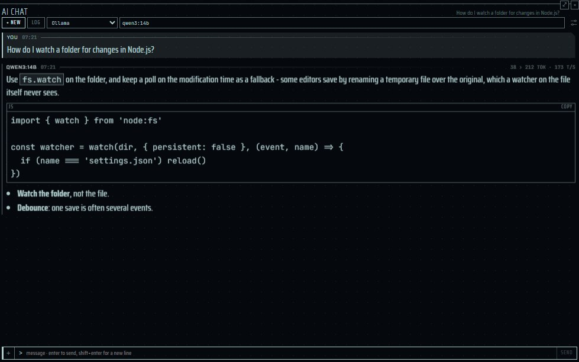
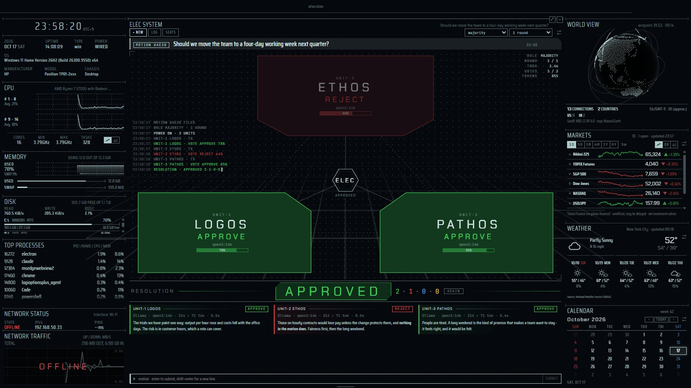
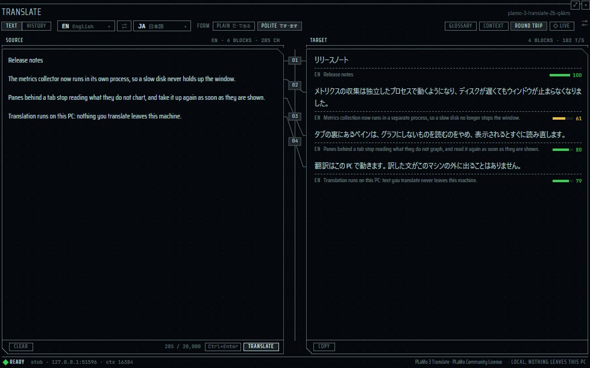

English | [日本語](panes-ai.ja.md) | [简体中文](panes-ai.zh-CN.md)

# AI panes — elecdex

elecdex is a science-fiction terminal emulator and system monitor for Windows, macOS and Linux. This page covers its language-model panes: **AI chat**, which talks to a model you run yourself (Ollama, LM Studio, llama.cpp or any OpenAI-compatible server) or to a hosted service you have an API key for (Anthropic, OpenAI, Gemini, OpenRouter), the **ELEC system**, which puts a yes-or-no motion to a council of three models and resolves their votes, and **TRANSLATE** *(unreleased)*, which translates between 53 languages and Easy Japanese with PLaMo 3 Translate run on this computer. It describes the providers and their two dialects, where API keys are kept, how a long conversation is fitted to a model's context window, attached files and their limits, and what the panes deliberately do not do. elecdex is developed and used on Windows; on macOS and Linux it has been built and run only by the automated tests and is not sufficiently verified by hand.

**On this page**

- [ai preset](#ai-preset)
- [AI chat](#ai-chat)
- [ELEC system](#elec-system)
- [TRANSLATE](#translate)
- [See also](#see-also)

## ai preset

  
   ai · Business (Dark) — the answers are a stand-in's, made for the picture

The **ai** preset (Ctrl+Shift+F7) holds an AI chat pane over a [TRANSLATE](#translate) *(unreleased)* pane, and on the right the ELEC system over the [GPU](panes-system.md#gpu) pane, which shows the GPU's load and how full its own memory is: what a model run on this machine leans on. Both kinds of AI pane ask a provider only when you send something, and TRANSLATE runs PLaMo 3 Translate on this computer, its engine started only by the first translation, so the preset costs nothing until then.

- **AI chat** — talk to a language model you run yourself (Ollama, LM Studio, llama.cpp - anything that speaks the OpenAI chat API) or to a service you have an API key for (Anthropic, OpenAI, Gemini, OpenRouter). Answers stream in with their reasoning folded away, keys are encrypted by the operating system and never reach the page, and conversations stay on your computer. Text files, images and PDFs go with a question - picked with **+**, dropped on the pane or pasted as a picture; an image is made small and drawn again before it is sent, so what a camera wrote into the file (where a photo was taken) never leaves.
- **ELEC system** — put a yes-or-no motion to a council of three models: LOGOS (logic), ETHOS (ethics) and PATHOS (feeling) each judge it from their own standpoint and vote APPROVE, REJECT or ABSTAIN, and the pane resolves it by majority or unanimity. The seats use the providers of the AI chat - the same model in all three will do.

## AI chat

  
   AI chat · a stand-in model

| | |
| --- | --- |
| Where | Two in the **ai** preset (Ctrl+Shift+F7), one behind GIT in the **dev** preset (Ctrl+Shift+F4); or add it from the picker (Ctrl+Shift+A, "ai chat"), as many as you like. Can be brought forward to fill the window (Ctrl+Shift+Z). Not in the default layout. |
| Reads / data source | The providers you list in *Settings → AI*: a server on your computer or network, or a hosted API. Conversations are files in `chats/` in the app's data folder (userData), one file per conversation. |
| Updates | An answer streams while it is written; main passes it to the pane in batches every 100 ms. Nothing is sent anywhere until you send a message, press **test**, or open the model list. |
| Platforms | Keys are encrypted with the operating system's store (DPAPI on Windows, the Keychain on macOS, the desktop keyring on Linux). On Linux without a keyring the key is kept in memory only, until elecdex quits, and the settings say so. macOS and Linux are not sufficiently verified by hand. |
| Privacy | An API key never reaches the page and is never written to `settings.json`. A key is sent only to the address it was entered for, and never over plain http beyond this computer and the local network. Images are re-encoded in the page, which leaves EXIF (including GPS position) behind. Files are passed as bytes, never by path. The model has no tools on this computer: it cannot read files or run commands. Claude (Anthropic's dialect) may search the web on Anthropic's side, at most 5 times an answer; the search runs at Anthropic, nothing runs here, and each search is billed to your account. |
| Settings | *Settings → AI*: providers (preset, address, API key, *context window*), an optional system prompt, *summarise what no longer fits* (off by default). In the pane: provider and model. |

### Setting up a provider

1. Open *Settings → AI* and add a provider: pick a preset, adjust the address, and - for a hosted service - paste its API key.
2. The key is kept as you leave the field (or press Enter), like every other setting. **show** lets you look at what you typed before that; a key that is held reads as dots and is never shown again.
3. Press **test**. It asks the provider for its models, which then complete the model field.
4. In the pane, choose the provider and the model.

A provider is an address and a dialect. There are two dialects: OpenAI-compatible `chat/completions` (plain fetch with server-sent events) and Anthropic's Messages API (through Anthropic's official SDK). A new service is a preset, not new code. The presets, each editable once added:

| Preset | Dialect | Default address | PDFs sent |
| --- | --- | --- | --- |
| Ollama | OpenAI-compatible | `http://localhost:11434/v1` | No |
| LM Studio | OpenAI-compatible | `http://localhost:1234/v1` | No |
| llama.cpp | OpenAI-compatible | `http://localhost:8080/v1` | No |
| Anthropic | Anthropic | `https://api.anthropic.com` | Yes |
| OpenAI | OpenAI-compatible | `https://api.openai.com/v1` | Yes |
| Gemini | OpenAI-compatible | `https://generativelanguage.googleapis.com/v1beta/openai` | No |
| OpenRouter | OpenAI-compatible | `https://openrouter.ai/api/v1` | Yes |
| Custom | OpenAI-compatible | `http://localhost:8000/v1` | Only at the address of a preset that takes PDFs |

- An address must be http or https, with no user name, password, query or fragment; anything else is never fetched. A wrong address typed by hand costs that provider, not the whole `settings.json`.
- **Anthropic keys.** Use a key created in a workspace (Console → API keys, choosing a workspace such as Default). A key linked to your user rather than a workspace (`sk-ant-usr-`, made without choosing one) is refused with "the request was not accepted (400): This API key is not scoped to a workspace...", because elecdex does not send the `anthropic-workspace-id` header such a key needs. An Anthropic provider with no key of its own uses the SDK's usual places (`ANTHROPIC_API_KEY`, an `ant auth login` profile).
- **Retries.** On the OpenAI-compatible dialect, a hosted service that answers 408, 429, 500, 502, 503 or 504, or drops the connection before answering, is retried up to twice (after 0.5 s and 1.5 s), never once any of the answer has arrived. A `Retry-After` of up to 5 seconds is honoured; a longer one is reported instead. A server on this computer or network is not retried: its failure (not started, out of memory, no such model) is reported as it is. The Anthropic SDK retries on its own.
- **Anthropic fallbacks.** On Anthropic's own endpoint, `claude-opus-5` and `claude-fable-5-1` are asked with server-side fallbacks, so a request their safety classifiers decline is answered by another Claude model in the same call; the message names the model that actually answered.

### Asking

- Type and press Enter; Shift+Enter starts a new line. Esc or **stop** ends an answer and keeps what was written.
- Answers are drawn as markdown with a copy button on every code block. A model's text is treated as untrusted: it is drawn from a parsed tree of known elements, never as HTML, so it carries no scripts, styles or image requests; links are http or https only.
- A model's reasoning, where the provider shows it (Claude's summarized thinking, `reasoning_content`, `reasoning`, or inline `<think>`), is folded under **reasoning**. Only the answer's text is sent back as history, never the reasoning.
- While an answer is written its heading counts the seconds and the characters; once it lands it shows the tokens read and written and the tokens a second, where the provider reports them.
- Hover a message to **copy** it, **edit** an earlier question (which replaces it and what followed) or ask **again**.
- An answer that did not simply finish says how it ended, with the provider's own words beside it:

| Code | Meaning |
| --- | --- |
| `STOPPED` | You stopped it. |
| `TRUNCATED` | The answer reached its length limit. |
| `DECLINED` | The model refused. |
| `LINK ERROR` | The provider answered with an error. |
| `NO CARRIER` | Nobody answered at the address. |

- **+ new** starts a new conversation and **log** lists the ones you have, newest first; point at one to export it as markdown or delete it.
- A conversation reopened goes on with the provider and model that answered it (by name, if the provider was removed and added again), and when nothing can be sent the pane says why (for example `NO MODEL`).
- An empty pane shows where it points (`LINK STANDBY`, the provider and model, the address); with no provider it shows `NO LINK`. The model field shows `QUERYING` while a provider's list is read, or `NO LIST` with the reason when it cannot be.
- A conversation belongs to the app, not the pane: moving the pane, putting it behind a tab or reloading the page does not interrupt an answer. An answer nobody is following any more is stopped after 3 seconds, so closing the pane stops the request.
- An optional system prompt in the settings goes ahead of every conversation.
- A provider on Anthropic's dialect may search the web when a question needs it (Anthropic's `web_search` tool, at most 5 searches an answer, each billed by Anthropic). The answer after a search starts a new paragraph, and the pages it cited are listed under it as **Sources**. If Anthropic's search loop pauses an answer, the app asks it to go on (at most 3 times) with the searches the answer has left, and an answer still paused, or paused with none left, ends `TRUNCATED` with the reason. Reasoning before and after a search is shown as separate paragraphs. Providers on the OpenAI-compatible dialect are not asked to search.

### Attached files

Files go with a question: press **+** at the start of the line, drop files on the pane, or paste a picture (a paste that carries text stays text). They wait as chips above the line - **PAYLOAD** with their count, size and estimated tokens - and a chip's card, when the pointer rests on it, says the rest: the whole name, the exact size, the picture's pixels and what it was made smaller from. A question may be only its files.

| Limit | Value |
| --- | --- |
| Files per question | 5 |
| All files of one question | 15 MB |
| Text file | 256 KB, sent whole inside the question; a longer one is refused, never cut |
| Image as picked | 40 MB |
| Image as sent | At most 1568 pixels on the longest side and 1.15 megapixels, re-encoded as PNG or JPEG, at most 3.75 MB |
| PDF | 10 MB and 100 pages; sent to Anthropic's API, OpenAI and OpenRouter only |
| Images and PDFs in one request, history included | 20 MB |

- **Nothing is read from a path.** The page reads what you picked, dropped or pasted, and passes the bytes to main; main judges each file by its first bytes, not by its name or the system's file type.
- **Images** are decoded and drawn again in the page, then encoded again (PNG when the original was PNG, so a screenshot's text stays sharp; otherwise JPEG). This leaves the camera's EXIF behind; main refuses an image that still carries EXIF or PNG text chunks.
- **Text files** count as text when they read as UTF-8, contain no NUL and have no more than 1% control characters. They are sent inside the question as `<file name="…">…</file>`, after any images and PDFs and before the question.
- **PDFs** go to Anthropic's dialect as a document block, and to the OpenAI-compatible dialect only at the address of a preset that reads them (OpenAI, OpenRouter), judged by the address. For any other provider, `NO DOCUMENT` says so before the question is sent, and a PDF already in the history is sent as a line naming it (for example `[paper.pdf (PDF, 3 pages, 90 KB) - not sent: …]`), never dropped silently.
- A model that does not take images says so in its own words; elecdex does not guess from the model's name.
- Files waiting to be sent are kept in main's memory only. Sent, they are written beside the conversation (`chats/<id>.files/`, named by their SHA-256) and go with it: deleting the conversation deletes them. Editing a question keeps the files you leave on it.
- Other refusals are named with the file: `TOO LARGE`, `UNREADABLE`, `PAYLOAD FULL`.

### Context window and NOT SENT

A local server answers with the few thousand tokens it was started with and silently drops the beginning of anything longer, system prompt first. So every provider has a *context window* in *Settings → AI*:

| Provider | Context window until you type another |
| --- | --- |
| An address on this computer or local network (plain http) | 8192 tokens |
| A hosted service | Unlimited (conversations sent whole) |

For Ollama, type the context length it is set to (Ollama's own default is 4096). `0` means "send everything".

- Tokens are estimated without a tokenizer: four ASCII characters count as one token, and every other character as one token (Japanese and Chinese run at about that). Token counts the provider reports correct the estimate, upwards only.
- Up to three quarters of the window is sent; the rest is left for the answer and its reasoning. Past that, the oldest messages stay behind in one large step, down to half the window, and the place is kept until the window fills again. Cutting rarely and by a lot, rather than one message a turn, keeps the server's prompt cache (and Anthropic's) valid.
- A `NOT SENT · n ABOVE` line in the log marks where the model's view begins.
- The conversation itself, and its export, stay whole. Only what is sent is cut.
- The last question is always sent, even when it does not fit by itself; the provider's answer then shows what happened.
- Attached files count: an image as the larger of the two dialects' counts, a PDF as 2500 tokens a page, a text file by its text. Images and PDFs in one request (history included) are held to 20 MB even for a hosted service with an unlimited window, cut the same way.

### Summaries

With *summarise what no longer fits* on (*Settings → AI*; off by default), the model is first asked for a summary of what stays behind.

- It is one more request to the same provider and model each time the conversation is cut, shown as `TX · COMPACTING`. It is never made after an answer or on a timer.
- The summary is sent after the system prompt from then on, never as a message. The line then reads `SUMMARISED · n ABOVE` and opens to show what the model was told.
- A summary may take a tenth of the window, at most 600 tokens.
- A summary that fails costs only the summary: the question is still asked. A failed summary is asked for once more with the next question, and not again until the next cut.
- Attached files reach the summary as their names only. Turning the setting off keeps sending a summary already made.

### What it does not do

- **No tools.** No MCP, no tool calls: the model cannot read your files or run commands, and never reads a file of its own accord. The one exception is Claude's web search, which runs on Anthropic's servers, not on this computer. A model that could start processes or read files would first need a consent design like the plugins'.
- No branching of conversations, and no named prompt profiles: one optional system prompt applies to every conversation.
- No request on mount: a chat pane sitting in a layout calls nobody.

| Limit | Value |
| --- | --- |
| Providers | 12 |
| Conversations kept | 200 (a new one is refused past this, rather than an old one dropped) |
| Messages in one conversation | 400 |
| Characters in one message | 400,000 |
| System prompt | 8000 characters |

## ELEC system

  
   ELEC system · Tron

| | |
| --- | --- |
| Where | The **ai** preset (Ctrl+Shift+F7), or the picker (Ctrl+Shift+A, "elec system"). Can be brought forward (Ctrl+Shift+Z). Not in the default layout. |
| Reads / data source | The providers of *Settings → AI*, as each seat names them. Deliberations are files in `elec/` in the app's data folder. |
| Updates | Only when you submit a motion (or open a model list). Each unit is sent its standpoint, the voting instructions and the motion; in a second round, the other units' first statements too. Three requests a round, one or two rounds. |
| Platforms | As AI chat. macOS and Linux are not sufficiently verified by hand. |
| Privacy | The page sends only the motion; main reads the seats and rule from the settings. Keys follow the AI chat's rules. |
| Settings | In the pane's bar: **seats**, the rule, and the number of rounds (kept in the settings, shared by every ELEC system pane). Standpoints: *Settings → AI → elec system · standpoints*. |

### Seats and standpoints

**seats** chooses the provider and model of each unit, and **all** puts one seat's choice in all three. The same model in every seat is fine, since each unit is told its own standpoint. The default standpoints:

| Unit | Place on the stage | Default standpoint |
| --- | --- | --- |
| UNIT-1 LOGOS | lower left | The scientist: evidence, feasibility, cost and risk. |
| UNIT-2 ETHOS | top | The guardian: duty, fairness and the people the decision touches. |
| UNIT-3 PATHOS | lower right | The heart: feeling, desire, intuition and what the decision means to the person who lives with it. |

Edit them under *Settings → AI → elec system · standpoints* (up to 2000 characters each; an empty one is the default). A deliberation keeps the seats it was put to: changing the settings later does not rewrite it.

### Votes

1. Type a motion that can be answered yes or no (up to 4000 characters) and press Enter.
2. Each unit writes a short statement (at most 120 words), in the motion's language, ending with a `VERDICT` line (APPROVE, REJECT or ABSTAIN) and a `CONFIDENCE` line (0 to 100), both in English.
3. The vote is read from the answer's last `VERDICT` line, leniently (for example `**Verdict:** reject`), never from structured output, which local models do not support alike.

The plates light as they vote (`TX`, `RX`, then the verdict). The units sit powered off until a motion comes and power on one after another (ETHOS, LOGOS, PATHOS). While the council sits, light runs round the plates being asked and over a moving grid floor, and each piece of an answer runs down its spoke as it arrives, so a quick model streams and one thinking it over leaves its spoke dark (none of it with motion reduced). A console in the corner logs each step. The last vote puts the lights out, and a moment later the **resolution** powers on; the units that did not carry it step back.

### Resolution

The rule is chosen in the bar. The resolution is computed from the votes each time it is shown, never stored.

| Rule | Approved | Rejected | Otherwise |
| --- | --- | --- | --- |
| **majority** | Two seats approve | Two seats reject | `DEADLOCK` (for example 1-1-1, or one approval and two abstentions) |
| **unanimous** | All three approve | Any one rejects | `NO CONSENSUS` |

- A vote that does not count is **invalid, not an abstention**: a link that failed (`LINK ERROR`, `NO CARRIER`), an answer stopped by you, or an answer with no verdict (`NO VERDICT`). An answer cut off by its length still counts if its verdict can be read.
- Fewer than two valid votes is `QUORUM NOT MET`.
- Confidence is shown, never counted.
- A deliberation interrupted by the app closing shows `INTERRUPTED`.

### Rounds

With **2 rounds** each unit then reads the others' first statements and votes again - twice the requests (six) - and a changed vote shows as `REJECT › APPROVE`. Each statement passed on is cut to fit a small context window: a tenth of the provider's window, at most 800 tokens. A unit whose link failed is passed on as having no statement. One round is the default.

### Running it

- Units on one server of your computer or network are asked one after another (a single GPU shared by three requests slows them all; a waiting seat shows `QUEUED`); hosted services are asked at once.
- Esc or **stop** ends a deliberation, keeping what was written; seats not yet asked get an invalid vote, and the resolution is that of the round actually held.
- **again** puts the same motion to the council as it is seated now; **log** lists past deliberations with their resolutions, to reopen, export as markdown or delete. Up to 200 deliberations are kept; a new one is refused past this.
- While the council sits, its light runs at the display's rate and costs about 70% of one CPU core (measured on the developer's machine); waiting for a motion, nothing moves and the pane costs about 0.5%. It is not in the default layout.

## TRANSLATE

*(unreleased)*

  
   TRANSLATE · a stand-in engine with made-up text

TRANSLATE runs Preferred Networks' PLaMo 3 Translate on this computer through llama.cpp's `llama-server`, between 53 languages and Easy Japanese (やさしい日本語). The source is cut into blocks at blank lines and translated block by block, in order, each with the two blocks before it as history, so terms and tone stay consistent; the spine between the two sides joins each block to its translation. Main starts the engine on the first translation and stops it after a while unused; the page never talks to the engine itself.

| | |
| --- | --- |
| Where | Under the AI chat in the **ai** preset (Ctrl+Shift+F7); or add it from the picker (Ctrl+Shift+A, "translate"). **Ctrl+Shift+Y** brings it up with the clipboard's text and translates it at once (a pop-up when no TRANSLATE pane is in the layout). Can be brought forward to fill the window (Ctrl+Shift+Z). Not in the default layout. |
| Reads / data source | The engine: the llama-server build elecdex fetches (llama.cpp b12110), your own llama-server (b7563 or later, chosen in the engine settings), or a llama-server at another address. The model: one PLaMo 3 Translate GGUF file (0.8B, 2B, 8B or 31B, in Q4_K_M, Q4_0, Q3_K_M or Q2_K), fetched once in the setup. Files live in `translate/` in the app's data folder (userData): `engine.json`, `engine/`, `models/`, `glossaries.json`, `history.json`, `llama-server.pid`, `licence-consents.txt`. |
| Updates | Nothing runs until something is translated. The engine starts with the first translation (its log is shown while it loads) and stops after 10 minutes unused (5, 10, 30 or never). A translation streams in; main passes it to the pane every 100 ms. With **LIVE** on, a translation is asked 0.6 s after the typing stops, and only the blocks that changed are written again. Opening the engine settings asks Hugging Face for newer versions of the models in place, at most once every 24 hours. |
| Platforms | The fetched engine: Vulkan and CPU builds on Windows (x64; CPU only on Arm64), Metal on macOS (Apple silicon; CPU on Intel), Vulkan and CPU on Linux (x64). With the device on AUTO a GPU build is tried first, and the CPU build takes over when it cannot start, and when it stops answering (nothing for a minute, longer for a bigger model) the server is stopped and started on the CPU build until RESTART or a change of settings; when that keeps happening, the engine stops at FAULT. macOS and Linux are not sufficiently verified by hand. |
| Privacy | What you translate stays on this computer: the engine listens on 127.0.0.1 only, with a key of its own the page never sees. Only a llama-server you choose at another address receives the text, and the pane's footer says so ("sent to …"). The source and the context are never written into the layout; the history is a file on this computer and can be turned off. The clipboard is read only when you press Ctrl+Shift+Y, and a copy marked private (a password manager's) is never read. |
| Settings | `settings.json` → `translate`: `modelId` (default `plamo3-2b-q4km`), `ctx` (4096, 8192, 16384 or 32768; default 16384), `device` (`auto` or `cpu`), `idleMinutes` (5, 10, 30 or 0 for never; default 10), `live` (default true), `saveHistory` (default true). Where the engine comes from is kept apart, in `translate/engine.json`, and changes only in the pane. In the pane: the languages, the form, the glossary, ROUND TRIP. |

### Setting up

The first time, **> set up translation** walks through five steps: **ENGINE** (the fetched build, your own llama-server, or an address), **MODEL** (four sizes, each with how well it fits this computer's memory), **LICENCE** (see below), **FETCH** (the engine and the model, with PAUSE, RESUME and CANCEL; a paused or broken download resumes where it stopped) and **READY**, which translates one sentence through the engine as a test. The engine is a build elecdex pins and checks against its own sha256. A model is the newest version of its repository: Hugging Face is asked for it as the licence is agreed to, and the file is checked against the size and sha256 Hugging Face gives for that version before it is used.

**Updates.** Opening the engine settings asks Hugging Face, at most once every 24 hours and only for the models in place, whether a newer version came out. A model whose file changed shows **Update** with the version's date (a version that changed only other files, such as the README, is no reason to fetch gigabytes again); nothing is fetched by itself. **Update** makes that model the pane's, as setting it up does, and goes through **LICENCE** again (the licence may have changed, and each download is agreed to), then **FETCH** replaces the file in place and **READY** tests it. **Delete** removes a model and its file; the agreements and their log are kept.

**LICENCE** asks for two agreements. The first is to the PLaMo Community License: the pane shows a summary, but the licence on Preferred Networks' site is the one that holds and may change, so its page must be opened from the pane before the box can be ticked. Use at work, in an organisation, or in making a product or service counts as commercial, which is free under ¥1 billion of revenue a year after registering the use (the pane links the form). The second is to the download: the pane lists what **Agree and fetch** brings - the model file from huggingface.co and, when elecdex fetches the engine, the llama.cpp build from github.com (MIT) - with their sizes. Each agreement is added, with its time, the licence's address, when its page was opened, the files and the elecdex version, to `translate/licence-consents.txt`, which is only ever added to. llama.cpp's licence, and those of the code built into llama-server, come with elecdex and are written beside the engine as `LICENSE-llama.cpp`; the engine settings link both licences, and the pane's footer says Built with PLaMo.

### Translating

- **Languages** — the source is one of the 53 or **AUTO**, which lets the model judge; the target is one of the 53 or Easy Japanese. On AUTO the pane writes `AUTO ≈ EN` when the letters make the language certain (kana, hangul and other scripts, or clearly more of one language's common words), and then the languages can be swapped. The recent languages come first in each list.
- **Form** — PLAIN (だ・である) or POLITE (です・ます), into Japanese only.
- **TRANSLATE** (Ctrl+Enter) writes every block again; **STOP** (Ctrl+.) stops: the block being written stays, marked, and the ones after it are left untranslated. A block too long for the context is said and skipped; one cut at the length limit is marked. **CLEAR** empties the source and the translation with it.
- **Glossary** — named lists of terms, each for one target language or for any (a Japanese glossary is used into Easy Japanese too). Only the terms a block holds go with it, longest first, 50 at most; a term ending in a letter of a spaced script is matched as a whole word. Terms can be pasted as TSV or CSV. A glossary for another language is not used, and the pane says so.
- **Context** — up to 2,000 characters of what the text is and who reads it, sent with every block and never translated.
- **ROUND TRIP** — every translated block is put back into the source language and compared with the source by chrF, after numbers are written one way (kanji numerals as digits, full-width as half-width); a block put back into Japanese keeps the source's form (だ・である or です・ます). A score under 50 is shown in the warning colour, or under 30 for a language written without spaces between words (Japanese, Chinese, Thai, Khmer, Burmese), where a good paraphrase scores lower. A round trip that changed a number (5000万 against 500万, which differ by one character and score high) is marked **numbers differ** in the warning colour, whatever its score. The lines were measured with the 2B model: a good round trip mostly scores 50 to 100 in English and 30 to 100 in Japanese, another sentence's meaning under 25.
- **A block's buttons** — RETRY writes it again in its place; EDIT mends it by hand, and the blocks written after it take the mended text as history; COPY copies it. Resting on a number of the spine shows the block's tokens, time and history.
- **HISTORY** — one entry for each draft of the source (typing on replaces it, a new text adds one), 200 entries and 4 MB at most, the oldest going first. A translation stopped part way is kept marked with how far it got. A row opens the translation again in TEXT; CLEAR asks by its second press.

### What it does not do

- It does not translate files; text is typed or pasted, up to 20,000 characters.
- It does not use a hosted service: the model runs on this computer, or on a llama-server you name.
- It does not keep a key for an external llama-server; one that asks for a key is refused.

## See also

- [Presets: ai](presets.md#ai)
- [Network access and data sources](data-sources.md) — what the AI panes send, and to whom.
- [Design: §5.7 AI chat and §5.8 ELEC system](../architecture.md) (Japanese).
- [Design: TRANSLATE](../translate.md) (Japanese).
- [Decision log](../decisions.md) (Japanese).
