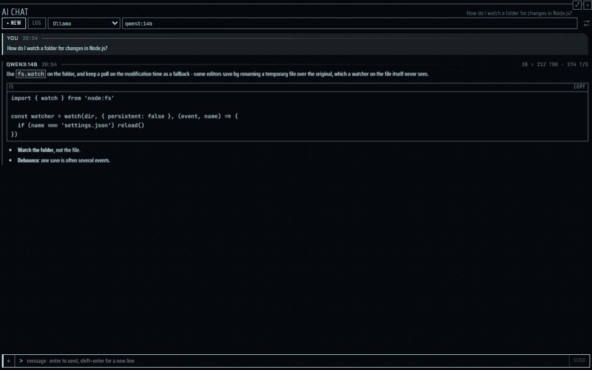
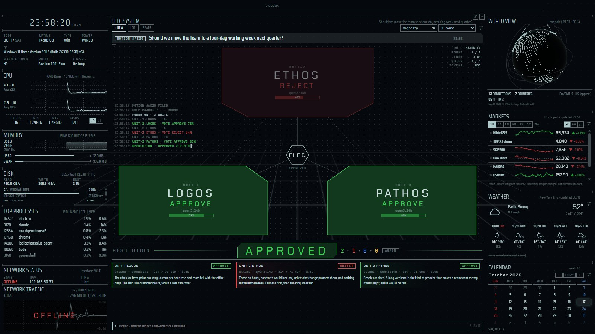

[English](panes-ai.md) | [日本語](panes-ai.ja.md) | 简体中文

# AI 窗格 — elecdex

elecdex 是面向 Windows、macOS 和 Linux 的科幻风格终端模拟器兼系统监视器。本页介绍它的两个语言模型窗格：**AI chat**，与你自己运行的模型（Ollama、LM Studio、llama.cpp 或任何兼容 OpenAI 的服务器）或你持有 API 密钥的托管服务（Anthropic、OpenAI、Gemini、OpenRouter）对话；以及 **ELEC system**，把一个是非题形式的议案交给由三个模型组成的评议会，并根据它们的投票作出决议。本页说明提供方及其两种协议、API 密钥保存在哪里、长对话如何适应模型的上下文窗口、附件及其限制，以及这两个窗格有意不做的事情。elecdex 在 Windows 上开发和使用；macOS 和 Linux 只经过自动化测试的构建和运行，尚未经过充分的人工验证。

**本页内容**

- [ai 预设](#ai-预设)
- [AI chat](#ai-chat)
- [ELEC system](#elec-system)
- [另请参阅](#另请参阅)

## ai 预设

  
   ai · Business (Dark) — 回答来自为截图准备的替身

**ai** 预设（Ctrl+Shift+F7）包含上下排列的两个 AI 聊天窗格，右侧是 ELEC system，其下是 [GPU](panes-system.zh-CN.md#gpu) 窗格。GPU 窗格显示 GPU 的负载和它自身显存的占用：在本机运行的模型所依赖的东西。两种 AI 窗格都只在你发送内容时才询问提供方，所以在那之前这个预设没有任何开销。

- **AI 聊天** — 与你自己运行的语言模型对话（Ollama、LM Studio、llama.cpp——任何支持 OpenAI chat API 的服务），或与你持有 API 密钥的服务对话（Anthropic、OpenAI、Gemini、OpenRouter）。回答以流式到达，推理过程默认折叠；密钥由操作系统加密，永远不会传到页面；对话保存在你的电脑上。提问时可以附上文本文件、图片和 PDF：用 **+** 选择、拖放到窗格上，或粘贴图片。图片在发送前会被缩小并重新绘制，所以相机写入文件的信息（例如拍摄地点）不会被发送出去。
- **ELEC system** — 把一个是非题形式的议案交给由三个模型组成的评议会：LOGOS（逻辑）、ETHOS（伦理）和 PATHOS（情感）各自从自己的立场评判，投票 APPROVE、REJECT 或 ABSTAIN，窗格按多数决或全体一致作出决议。席位使用 AI 聊天的提供方——三个席位都用同一个模型也可以。

## AI chat

  
   AI 聊天・替身模型

| | |
| --- | --- |
| 位置 | **ai** 预设（Ctrl+Shift+F7）中有两个，**dev** 预设（Ctrl+Shift+F4）的 GIT 后面有一个；也可以从选择器（Ctrl+Shift+A，"ai chat"）添加，想加多少都行。可以放大到占满窗口（Ctrl+Shift+Z）。不在默认布局中。 |
| 读取的内容 / 数据来源 | 你在 *Settings → AI* 中列出的提供方：本机或局域网中的服务器，或托管 API。对话以文件形式保存在应用数据文件夹（userData）的 `chats/` 中，每段对话一个文件。 |
| 更新 | 回答在生成过程中以流式到达，main 每 100 ms 汇总一次传给窗格。在你发送消息、按 **test** 或打开模型列表之前，不会向任何地方发送任何东西。 |
| 平台 | 密钥用操作系统的机制加密（Windows 为 DPAPI，macOS 为钥匙串，Linux 为桌面的 keyring）。在没有 keyring 的 Linux 上，密钥只保存在内存中，直到 elecdex 退出，设置界面会说明这一点。macOS 和 Linux 尚未经过充分的人工验证。 |
| 隐私 | API 密钥永远不会传到页面，也不会写入 `settings.json`。密钥只发送到输入它时的地址；使用明文 http 时，不会发送到本机和局域网之外。图片在页面中重新绘制，因此 EXIF（包括拍摄地点的 GPS）不会保留。文件以字节传递，从不通过路径。模型在这台电脑上没有工具：无法读取文件或运行命令。*unreleased*：Claude（Anthropic 方言）在一次回答中最多可在 Anthropic 一侧进行 5 次网络搜索；搜索在 Anthropic 进行，这里不运行任何东西，每次搜索都计入你的账户费用。 |
| 设置 | *Settings → AI*：提供方（预设、地址、API 密钥、*context window*）、可选的系统提示词、*summarise what no longer fits*（默认关闭）。窗格中：提供方和模型。 |

### 添加提供方

1. 打开 *Settings → AI*，添加一个提供方：选一个预设，调整地址；如果是托管服务，再粘贴它的 API 密钥。
2. 和其他设置一样，密钥在离开输入框时（或按 Enter 时）保存。在此之前可以用 **show** 查看你输入的内容；已保存的密钥显示为圆点，不会再被显示出来。
3. 按 **test**。它会向提供方请求模型列表，随后可用于补全模型字段。
4. 在窗格中选择提供方和模型。

提供方就是“地址 + 协议”。协议有两种：兼容 OpenAI 的 `chat/completions`（直接用 fetch 和 Server-Sent Events），以及 Anthropic 的 Messages API（通过 Anthropic 的官方 SDK）。新的服务以预设添加，而不是新写代码。预设如下，添加后每一项都可以编辑：

| 预设 | 协议 | 默认地址 | 是否发送 PDF |
| --- | --- | --- | --- |
| Ollama | 兼容 OpenAI | `http://localhost:11434/v1` | 否 |
| LM Studio | 兼容 OpenAI | `http://localhost:1234/v1` | 否 |
| llama.cpp | 兼容 OpenAI | `http://localhost:8080/v1` | 否 |
| Anthropic | Anthropic | `https://api.anthropic.com` | 是 |
| OpenAI | 兼容 OpenAI | `https://api.openai.com/v1` | 是 |
| Gemini | 兼容 OpenAI | `https://generativelanguage.googleapis.com/v1beta/openai` | 否 |
| OpenRouter | 兼容 OpenAI | `https://openrouter.ai/api/v1` | 是 |
| Custom | 兼容 OpenAI | `http://localhost:8000/v1` | 仅当地址与读取 PDF 的预设相同时 |

- 地址必须是 http 或 https，且不含用户名、密码、查询或片段；其他任何地址都不会被请求。手工写错的地址只会让该提供方不可用，不会让整个 `settings.json` 回到默认值。
- **Anthropic 的密钥。** 请用在工作区中创建的密钥（Console → API keys，选择 Default 等工作区）。未选择工作区而创建、关联到用户的密钥（`sk-ant-usr-`）会被拒绝，提示 "the request was not accepted (400): This API key is not scoped to a workspace..."，因为 elecdex 不发送这种密钥所需的 `anthropic-workspace-id` 请求头。没有自己密钥的 Anthropic 提供方会使用 SDK 的常规来源（`ANTHROPIC_API_KEY`、`ant auth login` 的配置）。
- **重试。** 在兼容 OpenAI 的协议下，托管服务返回 408、429、500、502、503 或 504，或在应答前断开连接时，最多重试两次（0.5 秒和 1.5 秒后）；一旦回答已有内容到达就不再重试。`Retry-After` 不超过 5 秒时会遵守，更长时则不等待、直接报告该失败。本机或局域网中的服务器不重试：那里的失败（未启动、内存不足、没有该模型）会如实报告。Anthropic 的 SDK 会自行重试。
- **Anthropic 的回退。** 在 Anthropic 自己的端点上询问 `claude-opus-5` 和 `claude-fable-5-1` 时会附带服务器端回退：被其安全分类器拒绝的请求会在同一次调用中由另一个 Claude 模型回答，消息中会记下实际回答的模型名称。

### 提问

- 输入后按 Enter；Shift+Enter 换行。Esc 或 **stop** 结束回答并保留已写出的部分。
- 回答以 markdown 呈现，每个代码块都有复制按钮。模型的文字被视为不可信内容：先解析成只含已知元素的树再绘制，从不作为 HTML 绘制，因此不会带有脚本、样式或图片请求；链接只允许 http 和 https。
- 模型的推理过程（在提供方提供的情况下：Claude 的摘要式思考、`reasoning_content`、`reasoning` 或内联的 `<think>`）折叠在 **reasoning** 下。作为历史回传的只有回答正文，从不回传推理。
- 回答生成过程中，其标题会计数秒数和字符数；完成后显示读入和写出的 token 数以及每秒 token 数（在提供方报告这些数据的情况下）。
- 悬停在消息上可以 **copy** 复制、**edit** 编辑之前的提问（会替换它及其后的内容），或 **again** 重新提问。
- 没有正常结束的回答会注明结束方式，并在旁边附上提供方自己的原话：

| 代码 | 含义 |
| --- | --- |
| `STOPPED` | 你停止了它。 |
| `TRUNCATED` | 回答达到了长度上限。 |
| `DECLINED` | 模型拒绝了。 |
| `LINK ERROR` | 提供方返回了错误。 |
| `NO CARRIER` | 该地址无人应答。 |

- **+ new** 开始新对话，**log** 列出已有对话，最新的在前；指向某个对话可以将它导出为 markdown 或删除。
- 重新打开的对话会继续使用当初回答它的提供方和模型（如果提供方被删除后又重新添加，则按名称匹配）；无法发送时窗格会说明原因（例如 `NO MODEL`）。
- 空窗格会显示它指向哪里（`LINK STANDBY`、提供方和模型、地址）；没有提供方时显示 `NO LINK`。读取提供方的模型列表时模型字段显示 `QUERYING`，读不到时显示 `NO LIST` 及原因。
- 对话属于应用而不属于窗格：移动窗格、把它放到标签页后面或重新加载页面都不会中断回答。无人关注的回答会在 3 秒后停止，所以关闭窗格会停止请求。
- 设置中可选的系统提示词会放在每段对话的最前面。
- *unreleased*：使用 Anthropic 方言的提供方在问题需要时可能会搜索网络（Anthropic 的 `web_search` 工具，一次回答最多 5 次，每次搜索由 Anthropic 计费）。搜索之后的回答从新的段落开始，引用的网页以 **Sources** 列在下方。不会请 OpenAI 兼容方言的提供方进行搜索。

### 附件

提问可以附带文件：按输入行开头的 **+**、把文件拖放到窗格上，或粘贴图片（带文本的粘贴仍作为文本）。文件以芯片的形式排在输入行上方（**PAYLOAD**，显示数量、大小和估算的 token 数），鼠标停在芯片上时，卡片会说明其余信息：完整的文件名、精确的大小、图片的像素以及缩小前的尺寸。提问可以只有文件。

| 限制 | 值 |
| --- | --- |
| 每个提问的文件数 | 5 个 |
| 一个提问的全部文件 | 15 MB |
| 文本文件 | 256 KB，完整地放在提问中发送；更长的会被拒绝，而不是截断 |
| 选择时的图片 | 40 MB |
| 发送的图片 | 重新绘制为长边不超过 1568 像素、面积不超过 115 万像素，以 PNG 或 JPEG 编码，不超过 3.75 MB |
| PDF | 10 MB、100 页；只发送给 Anthropic 的 API、OpenAI 和 OpenRouter |
| 一次请求中的图片和 PDF（含历史） | 20 MB |

- **不会从路径读取任何东西。** 页面读取你选择、拖放或粘贴的内容，并以字节交给 main；main 根据文件开头的字节判断类型，而不看文件名或系统的文件类型。
- **图片** 在页面中解码并重新绘制，然后重新编码（原图是 PNG 时用 PNG，以免截图中的文字模糊；否则用 JPEG）。因此相机的 EXIF 不会保留；仍带有 EXIF 或 PNG 文本块的图片会被 main 拒绝。
- **文本文件**：能作为 UTF-8 读取、不含 NUL、控制字符不超过 1% 的文件视为文本。它们以 `<file name="…">…</file>` 的形式放在提问中，位于图片和 PDF 之后、问题之前。
- **PDF**：对 Anthropic 协议以文档块发送；对兼容 OpenAI 的协议，只在地址与读取 PDF 的预设（OpenAI、OpenRouter）相同时发送（按地址判断）。对其他提供方，会在发送提问前显示 `NO DOCUMENT`；历史中的 PDF 会换成一行写明其名称的文字（例如 `[paper.pdf (PDF, 3 pages, 90 KB) - not sent: …]`），从不悄悄丢弃。
- 不接受图片的模型会用它自己的话说明；elecdex 不根据模型名称猜测。
- 尚未发送的文件只保存在 main 的内存中。发送后，文件保存在对话旁边（`chats/<id>.files/`，以 SHA-256 命名），随对话一起删除。编辑提问时，留下的文件会被沿用。
- 其他拒绝情况会连同文件名以代码说明：`TOO LARGE`、`UNREADABLE`、`PAYLOAD FULL`。

### 上下文窗口与 NOT SENT

本地服务器只能处理启动时设定的几千个 token，超出部分会从开头被悄悄丢掉，首先丢的就是系统提示词。因此 *Settings → AI* 中每个提供方都有一个 *context window*：

| 提供方 | 在你输入其他值之前的 context window |
| --- | --- |
| 本机或局域网中的地址（明文 http） | 8192 token |
| 托管服务 | 不限（整段对话发送） |

对于 Ollama，请填写它所设置的上下文长度（Ollama 自身的默认值是 4096）。`0` 表示“全部发送”。

- token 数不用分词器，而是估算：ASCII 字符 4 个算 1 个 token，其他字符每个算 1 个 token（日文和中文大致如此）。提供方报告的 token 数会修正这一估算，但只向上修正。
- 最多发送窗口的四分之三，其余留给回答及其推理。超出后，最早的消息一次性留到后面不发，直到只剩窗口的一半，并记住这个位置，直到窗口再次被填满。很少裁剪、一次裁很多，而不是每轮少一条，这样服务器的提示词缓存（以及 Anthropic 的）得以保留。
- 日志中的 `NOT SENT · n ABOVE` 行标出模型视野的起点。
- 对话本身及其导出始终完整。被裁剪的只是发送的内容。
- 最后一个问题即使单独也放不下，也总会发送；发生了什么由提供方的回答体现。
- 附件也计入：图片按两种协议计算方式中较大的一种，PDF 每页 2500 token，文本文件按其文字计算。一次请求中的图片和 PDF（含历史）即使对窗口不限的托管服务也限制在 20 MB 以内，用同样的方式裁剪。

### 总结

开启 *summarise what no longer fits*（*Settings → AI*；默认关闭）后，会先请模型总结留在后面的内容。

- 每次对话被裁剪时向同一提供方和模型多发一次请求，显示为 `TX · COMPACTING`。从不在回答之后或按定时器做总结。
- 此后该总结会紧跟在系统提示词之后发送，而不是作为一条消息。那一行随之变为 `SUMMARISED · n ABOVE`，展开可看到告诉了模型什么。
- 总结最多占窗口的十分之一，上限 600 token。
- 总结失败只会损失总结本身：问题照样会被提出。失败的总结会在下一个问题时再请求一次，之后直到下一次裁剪都不再请求。
- 附件只以名称传给总结。关闭该设置后，已有的总结仍会继续发送。

### 不做的事

- **没有工具。** 没有 MCP，也没有工具调用：模型无法读取你的文件或运行命令，也从不主动读取文件。唯一的例外是 Claude 的网络搜索（*unreleased*），它在 Anthropic 的服务器上进行，而不是在这台电脑上。能启动进程或读取文件的模型，首先需要一套和插件同等水平的授权设计。
- 没有对话分支，也没有可命名切换的提示词配置：一个可选的系统提示词适用于所有对话。
- 放着不动不会发出请求：只是放在布局中的聊天窗格不会询问任何人。

| 限制 | 值 |
| --- | --- |
| 提供方 | 12 |
| 保存的对话 | 200（超出后拒绝新对话，而不是删除旧对话） |
| 一段对话中的消息 | 400 |
| 一条消息的字符数 | 400,000 |
| 系统提示词 | 8000 字符 |

## ELEC system

  
   ELEC system · Tron

| | |
| --- | --- |
| 位置 | **ai** 预设（Ctrl+Shift+F7），或选择器（Ctrl+Shift+A，"elec system"）。可以放大（Ctrl+Shift+Z）。不在默认布局中。 |
| 读取的内容 / 数据来源 | *Settings → AI* 中的提供方，按各席位的指定使用。评议以文件形式保存在应用数据文件夹的 `elec/` 中。 |
| 更新 | 只在你提交议案（或打开模型列表）时。每个单元收到它的立场、投票说明和议案；第二轮还会收到其他单元第一轮的陈述。每轮 3 个请求，一轮或两轮。 |
| 平台 | 与 AI chat 相同。macOS 和 Linux 尚未经过充分的人工验证。 |
| 隐私 | 页面只发送议案；席位和规则由 main 从设置中读取。密钥遵循 AI chat 的规则。 |
| 设置 | 窗格的栏中：**seats**、规则和轮数（保存在设置中，所有 ELEC system 窗格共用）。立场：*Settings → AI → elec system · standpoints*。 |

### 席位与立场

**seats** 为每个单元选择提供方和模型，**all** 把一个席位的选择应用到全部三个。因为每个单元都会被告知它自己的立场，三个席位用同一个模型也没问题。默认的立场：

| 单元 | 在舞台上的位置 | 默认立场 |
| --- | --- | --- |
| UNIT-1 LOGOS | 左下 | 科学家：证据、可行性、成本和风险。 |
| UNIT-2 ETHOS | 上方 | 守护者：责任、公平，以及决定所影响的人。 |
| UNIT-3 PATHOS | 右下 | 心：感受、欲望、直觉，以及决定对与之共处的人意味着什么。 |

在 *Settings → AI → elec system · standpoints* 中编辑（每个最多 2000 字符；留空即为默认立场）。每次评议会保留它当时所用的席位：之后更改设置不会改写它。

### 投票

1. 输入一个可以用是或否回答的议案（最多 4000 字符），按 Enter。
2. 每个单元用议案的语言写一段简短的陈述（不超过 120 个词），以一行 `VERDICT`（APPROVE、REJECT 或 ABSTAIN）和一行 `CONFIDENCE`（0 到 100）结尾，这两行都用英文。
3. 票从回答中最后一行 `VERDICT` 宽松地读取（例如 `**Verdict:** reject`），不使用结构化输出，因为本地模型对它的支持不一致。

面板随着投票亮起（`TX`、`RX`，然后是表决结果）。各单元在议案到来前处于断电状态，之后逐个通电（ETHOS、LOGOS、PATHOS 的顺序）。评议期间，光沿着正在被询问的面板和移动的网格地面流动，回答的每一段到达时都会沿着它的辐条流下，所以快速的模型会源源不断地流动，而正在思考的模型会让辐条保持黑暗（减少动效时这些都没有）。角落里的控制台记录每一步。最后一票投出后灯光熄灭，片刻之后**决议**（resolution）通电亮起，未能左右结果的单元退后。

### 决议

规则在栏中选择。决议每次显示时都根据投票计算，从不保存。

| 规则 | 通过 | 否决 | 其他情况 |
| --- | --- | --- | --- |
| **majority** | 两个席位赞成 | 两个席位反对 | `DEADLOCK`（例如 1-1-1，或一票赞成两票弃权） |
| **unanimous** | 三个都赞成 | 任何一票反对 | `NO CONSENSUS` |

- 不计入的票**算作无效票而非弃权**：连接失败（`LINK ERROR`、`NO CARRIER`）、被你停止的回答，或回答中没有表决结果（`NO VERDICT`）。因长度上限而被截断的回答，只要能读出表决结果就计入。
- 有效票少于两张则为 `QUORUM NOT MET`。
- 置信度只显示，从不计入。
- 因应用关闭而中断的评议显示为 `INTERRUPTED`。

### 轮次

选择 **2 rounds** 时，每个单元随后会阅读其他单元的第一轮陈述并再次投票——请求数翻倍（6 个）——改变的票会显示为 `REJECT › APPROVE`。传递的每段陈述都会截短以适应小的上下文窗口：提供方窗口的十分之一，上限 800 token。连接失败的单元会作为没有陈述传递。默认为一轮。

### 运行

- 位于你电脑或局域网中同一台服务器上的单元会依次询问（三个请求共用一块 GPU 会让所有请求都变慢；排队的席位显示 `QUEUED`），托管服务则同时询问。
- Esc 或 **stop** 结束评议并保留已写出的内容；尚未询问的席位记为无效票，决议以实际进行的那一轮为准。
- **again** 把同一议案交给当前就座的评议会；**log** 列出过去的评议及其决议，可重新打开、导出为 markdown 或删除。最多保存 200 次评议，超出后拒绝新的评议。
- 评议期间，光效以显示器的刷新率运行，约占一个 CPU 核心的 70%（在开发者机器上实测）；等待议案时没有任何动画，约 0.5%。不在默认布局中。

## 另请参阅

- [预设：ai](presets.zh-CN.md#ai)
- [网络访问与数据来源](data-sources.zh-CN.md) — AI 窗格发送什么、发给谁。
- [设计：§5.7 AI 聊天窗格、§5.8 ELEC 系统窗格](../architecture.md)（日文）
- [决策记录](../decisions.md)（日文）
