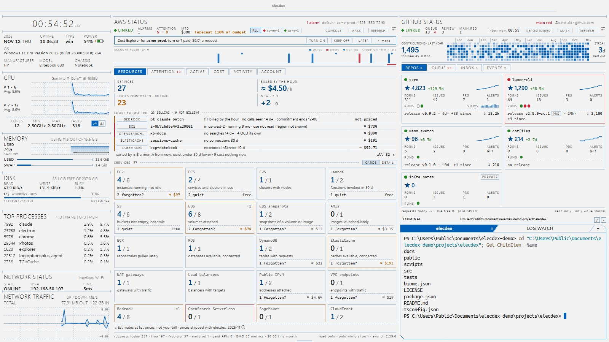
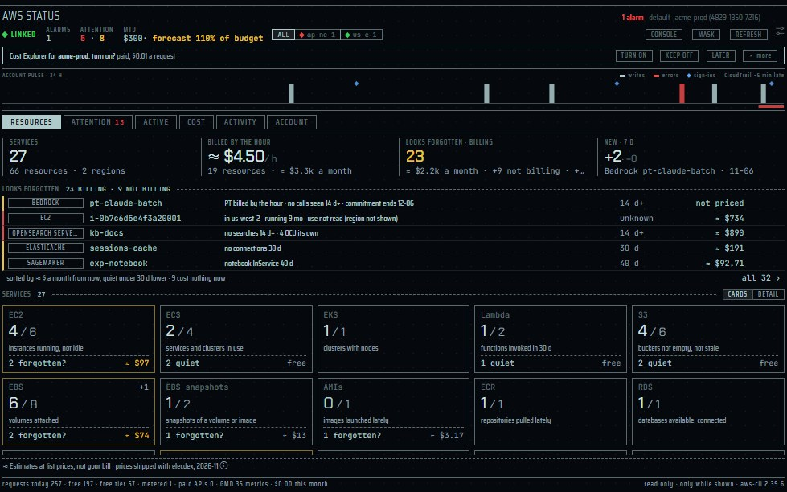
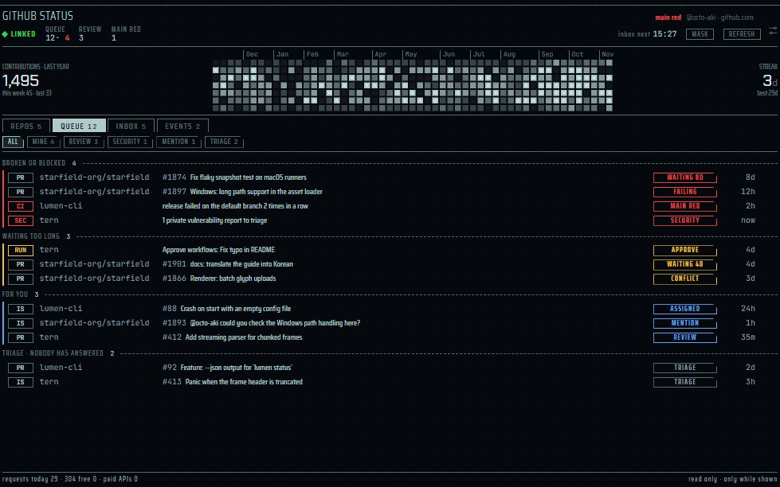

[English](panes-cloud.md) | 日本語 | [简体中文](panes-cloud.zh-CN.md)

# クラウドのペイン: AWS STATUS・GITHUB STATUS — elecdex

elecdex は SF 風のターミナルエミュレーター兼システムモニターで、eDEX-UI を Electron・Svelte・TypeScript で作り直したものです。このページでは、クラウドの仕事のための 2 つのペイン を説明します。**AWS STATUS**（AWS のアカウントで手を要するもの、いま動いていて料金のかかっているもの、今月の費用、誰が何を変えたか）と **GITHUB STATUS**（GitHub で自分を待っているもの、通知、自分のリポジトリで起きたこと、リポジトリそのもの）です。どちらも、すでに使っているコマンドラインのツール AWS CLI v2 と GitHub CLI を通して、ペインが見えている間だけ読み、何も変えません。それぞれについて、何を読むか、どのくらいの頻度か、費用、何を決して読まず何をしないか、設定を示します。elecdex は Windows・macOS・Linux で動きます。開発と利用は Windows で行っており、macOS と Linux は自動テストでビルドと実行をしただけなので、十分には確認されていません。

このページの内容:

- [cloud プリセット](#cloud-プリセット)
- [2 つのペインの読み方](#2-つのペインの読み方)
- [AWS STATUS](#aws-status)
- [GITHUB STATUS](#github-status)
- [公開ステータスと障害のトースト](#公開ステータスと障害のトースト)
- [共通の振る舞い](#共通の振る舞い)
- [設計文書](#設計文書)

## cloud プリセット

  
   cloud · Business (Light) · 代役の AWS CLI と gh、架空のアカウントと利用者

cloud プリセット（Ctrl+Shift+F10）は、アカウント、リポジトリ、2 つの CLI のためのシェルを並べたレイアウトです。

| 場所 | ペイン |
| --- | --- |
| 左の列 | cockpit と blank 以外のプリセットに共通のシステムの列 |
| 中央（舞台の 0.58） | AWS STATUS |
| 右の上（高さの 0.62） | GITHUB STATUS |
| 右の下 | シェルが前面、その後ろのタブに LOG WATCH |

- 2 つの CLI のペインは見えている間だけ読むので、プリセットは画面に出るまで何も読みません。タブの後ろの LOG WATCH も、選ぶまで何も読みません。
- AWS STATUS は プロファイル `default` で無料の読み取りを始め（どの呼び出しも `--profile` でプロファイルを名指しするので、`AWS_PROFILE` では選ばれません。選ぶのは ⚙）、Cost Explorer については、あるアカウントを初めて表示したときに尋ねます（*未リリース:* RESOURCES の `GetMetricData` は既定で ON、アカウントごとに月 1.00 USD の上限付き。⚙ で OFF にできます）。CLI が無ければ、どちらのペインも **NO CLI** と入れ方を出します。
- プリセットはひな形です。選ぶと保存レイアウトが 1 つ加わり、以後はその変更に付いていきます。新しくインストールしたときは 11 個のプリセットがすべて入り、先頭の 10 個に番号のキーが付きます。既存のレイアウトの一覧に後から足されることはありません。

## 2 つのペインの読み方

| | |
| --- | --- |
| 起動するもの | 自分の AWS CLI v2（`aws`）と GitHub CLI（`gh`）。elecdex の main プロセスが直接起動します。シェルも PowerShell も通さず、引数は配列で渡します。 |
| 見つけ方 | `PATH` の絶対パスの項目だけ（elecdex が動いているフォルダーは探しません）、次にインストール先: Windows では `%LOCALAPPDATA%\Programs\Amazon\AWSCLIV2\aws.exe` か `%ProgramFiles%\Amazon\AWSCLIV2`、`C:\Program Files\GitHub CLI\gh.exe`。ほかでは `/opt/homebrew/bin`、`/usr/local/bin`、`/usr/bin`。elecdex の起動後に入れた CLI は、elecdex を起動し直すまで見つからないことがあります。 |
| サインイン | しません。elecdex は資格情報もトークンも見ず、サインインは CLI がいつもどおり行います。サインインしていなければ、コピーするコマンド（`aws login --profile=<名前>`、`aws sso login --profile=<名前>`、`gh auth login`）を出すだけで実行はせず、**REFRESH** を押すまで読みません。 |
| 書き込み | アカウントのどこにも何も書きません。読むだけです。GITHUB STATUS は通知を既読にもしません。 |
| 更新 | ペインが見えている間だけ。タブの後ろ、ウィンドウの最小化中や非表示のときは読みません。バックグラウンドでは何も読まず、通知も例外ではありません。 |

- **壁時計の区切り。** 読み取りはそれぞれ自分の周期（5 分、15 分、1 時間…）の区切りに、読み取りごとの小さなずれを足して起きます。同じ周期の読み取りが一斉に始まらないためです。
- **CLI の同時起動は 2 本まで**（2 つのペインの全体で）。20 秒走ったものは子プロセスごと止めます。
- **失敗したら退きます**（読み取りごとに 1、2、4…最大 30 分）。最後に良かった結果は、古いと印を付けて画面に残します。
- **REFRESH** はすべてを今読み直します。30 秒に 1 度まで（制限は main が持ちます）。
- **MASK** は、アカウント ID、エイリアス、ARN、ログイン名、プライベートのリポジトリの名前、アドレス、バケットの名前を画面で伏せ、ペインの副題も伏せます。
- **台帳。** ペインの足元に今日の要求の数（無料、無料枠、304（変化なし。GitHub のレート制限を減らしません）、有料）を出し、カードで読み取りごとの周期、費用の分類、今日の数と、CLI のパスと版を示します。数はメモリにだけ持ちます。
- **リンクの語**（上段）: STANDBY（見えていない）、LINKING、LINKED、PARTIAL（読み取りが拒まれた。操作名だけを出します）、NO CLI / OLD CLI、SIGNED OUT、THROTTLED / RATE LOW、OFFLINE、LINK ERROR。CLI 自身のエラーの文は、画面にもログにもトーストにも出しません。
- どちらも前面表示（Ctrl+Shift+Z、ウィンドウいっぱい）とポップアップができ、行には詳しいカードがあります。

## AWS STATUS

  
   AWS STATUS · RESOURCES · 代役の AWS CLI、架空のアカウント

| | |
| --- | --- |
| 場所 | cloud プリセット（Ctrl+Shift+F10）、ピッカー（Ctrl+Shift+A）の "aws status"。いくつでも置けます。ポップアップと前面表示（Ctrl+Shift+Z）ができます。 |
| 読むもの | ペインごとに 1 つの AWS のプロファイル（⚙ に `aws configure list-profiles` の一覧）、リージョンは 4 つまで（選ばなければプロファイル自身のリージョン）。グローバルなサービスは us-east-1 に尋ねます。無料の API と、CloudWatch の無料枠の中の呼び出し、それに有効にしたときだけの Cost Explorer。*未リリース:* RESOURCES は、表示するサービスすべての一覧、S3 のバケットの一覧、CloudWatch Logs のロググループ、月の上限付きの CloudWatch の有料の `GetMetricData`（既定で ON）を足します。 |
| 更新 | ペインが見えている間だけ。読み取りごとに自分の周期で（下の表）。 |
| プラットフォーム | AWS CLI v2 が動く環境。macOS と Linux では手で確かめていません。 |
| プライバシー | 読むだけです。Secrets Manager、Health、Support は呼ばず、S3 と CloudWatch Logs はバケットの一覧とロググループだけ（*未リリース*）で、オブジェクト、ログ、メッセージは読みません。MASK は RESOURCES と掘り下げのリソース名をすべて伏せ、1 件の ID・VPC・サブネット、ATTENTION の行の名前、ACTIVE の増えた・消えたの行の ID も伏せます（*未リリース*）。CloudTrail からは、時刻、誰、操作、リージョン、エラーと、コンソールのサインインの結果と MFA だけを残します。アカウントの情報はプラグインに届きません。 |
| 設定 | ペインごと（⚙）: プロファイル、リージョン、ACCOUNT PULSE の ON / OFF、ACTIVITY（CloudTrail）の ON / OFF、SLOW ×4。アカウントごと: Cost Explorer とコストの QUOTA（`aws-billing.json`）。*未リリース:* GetMetricData とその上限（`aws-billing.json`）、ELSEWHERE と KEEP の印（`aws-inventory.json`）。全ペイン共通: 障害のトースト（`settings.json` の `aws.incidents`）。 |

上段: リンクの語、**ALARMS**、**ATTENTION**（danger · warn）、**MTD**（請求メトリクスによる今月ここまでの額と、予算の予測、QUOTA に対する割合。押すと COST）、リージョンのランプ（ALL か 1 つのリージョン。各ランプはそのリージョンでいちばん重いものの色）、**MASK**、**REFRESH**、⚙。

**ACCOUNT PULSE** は、直近 24 時間の CloudTrail の書き込みのイベントを 15 分ごとの棒にした帯です。エラーは danger、コンソールのサインインは菱形、鳴っているアラームは帯で描きます。CloudTrail は約 5 分遅れて届き、帯がそう書きます。⚙ で消せ、ペインの高さが足りないときは出しません。

タブ:

| タブ | 見せるもの |
| --- | --- |
| **RESOURCES**（*未リリース*、先頭のタブ） | アカウントに何があり、何を忘れていそうか（下） |
| **ATTENTION** | 手を要するものを重い順に: アラーム（複合アラームも）、状態の確認に落ちたインスタンス、失敗したバックアップ、失敗した CloudFormation のスタック。MFA の無い・アクセスキーのある・直近 24 時間に使われたルートユーザー。GuardDuty の重大な検出。インスタンスが使っていて 22・3389・全ポートを世界に開いたセキュリティグループ。MFA の無いコンソールのユーザー。15 分に 10 回以上拒まれた操作。使っている証明書の期限（7 日以内は danger、30 日以内は warn）。自動更新が OFF で期限の来るドメイン。30 日以内に終わる Savings Plans と リザーブドインスタンス。90 日より古いアクセスキー。標準サポートが 90 日以内に終わる・終わった EKS。すでに非推奨の Lambda のランタイム。付いていない EBS ボリュームと Elastic IP。30 日より長く止めたままのインスタンス。延長サポートの EKS。予測が 100% を超える・実績が 80% を超える予算。30 日以内に切れる無料プランのクレジット、または 85% を超えた旧来の無料枠。*未リリース:* 忘れていそうでお金のかかるものの 1 行（押すと RESOURCES の一覧） |
| **ACTIVE** | いま動いていて料金のかかっているもの: 定価での ≈ $/時と ≈ $/月、サービスごとの積み上げの帯、サービスごとの行（高い順）と、**IDLE**（7 日の CPU の平均が 2% 未満かつ最大が 10% 未満の動いているインスタンス）と **WASTE** の数。*NOT BILLING NOW* の行。その日最初の読み取りから増えたもの・消えたもの。下には必ず固定の 1 行 *≈ Estimates at list prices, not your bill · prices shipped with elecdex, 2026-11* |
| **COST** | UTC の今月、先月の同じ日まで、済んだ日から月末まで引いた直線、予算、コストの QUOTA のゲージと USD の入力欄、請求メトリクスの `ServiceName` によるサービス別（Cost Explorer が ON なら Cost Explorer から） |
| **ACTIVITY** | CloudTrail の書き込みのイベント、リージョンごとに直近 50 件。絞り込みは ALL、WRITES、LOGINS、ERRORS。AWS 自身の自動の操作は除きます |
| **ACCOUNT** | アカウント、エイリアス、ユーザーとロール、サインインしている ARN。ルートユーザーの MFA・キー・最後のサインイン。MFA の無いコンソールのユーザー。90 日を超えたキー。GuardDuty の件数。リージョン |

### RESOURCES

*未リリース。* 先頭のタブで、新しいペインはここで開きます。アカウントに何があるか、作って置いたままのものは何かに答えます。止めも消しもせず、読んだことを言うだけです。

- **数字**: SERVICES（リソースとリージョンの数も）、BILLED BY THE HOUR（時間課金のものの ≈ $/時と ≈ $/月。押すと ACTIVE）、LOOKS FORGOTTEN · BILLING（数、≈ $/月、お金のかからないものの数。押すと全件の一覧）、NEW 7 D（7 日で現れたものと消えたもの。押すとその一覧）。
- **LOOKS FORGOTTEN**: 上位 5 件を、これからの ≈ $/月の順に（静かな日数より短い日数での判定は下げます）。1 行: 種類、名前、理由の文（「no traffic 30 d」「not attached since 11-01」）、静かな期間、≈ $/月。カードには何で判定したかを出します。**keep**（「わざと置いている」）でその行をこのアカウントの一覧から外します。額が 2 倍を超えるとまた出ます。上下の矢印で行を移ります。
- **SERVICES** の見出しと、その右の **CARDS · DETAIL** の切り替え（*未リリース*。選んだほうをペインが覚え、既定は CARDS）。**CARDS**: サービスごとに 1 枚のカードを、いつも同じ順（コンピュート、ストレージ、データベース、ネットワーク、AI、エッジと API、連携、セキュリティ、ログ）に並べます。1 枚: 名前と 7 日の増減、表示しているリージョンでの **使用中 / 総数**（`9 / 12`）、使用中が何を指すか（`instances running, not idle`）、そして使用中でないものがあるときだけ、その残り（`2 forgotten? · 1 stopped · 1 quiet · 1 kept`）と忘れていそうなものの ≈ $/月（残りがすべて静かなだけなら `free`）。使用中は、止まっておらず LOOKS FORGOTTEN にも無い（KEEP したものでもない）もので、カードと一覧は食い違いません。ほかのリージョンのものは ELSEWHERE に残ります。枠はタイルと同じく warn と danger になります。Bedrock のカードは、置いてあるもののうち 30 日に使われたものを数え、モデルとそのトークンも出します。読み取り中のサービスは `–` と *reading…*、拒まれて何も読めていないサービスは、DETAIL にタイルが無いのと同じくカードを出さず、**Denied** の行に名前を出します。カードの詳細カードには、状態、容量、リージョンごとの数、≈ $/月、静かの意味を出します。矢印キーでいちばん近いカードへ、Enter で開きます。
- **DETAIL**: **タイル**を分類ごとに（コンピュート、ストレージ、データベース、ネットワーク、AI、エッジと API、連携、セキュリティ、ログ）、忘れものの額の大きい分類から並べます。1 枚: 数と名詞、状態の細い線、リージョン、凡例、忘れていそうな数と ≈ $/月。忘れものが ≈ $50/月 以上で枠が warn、≈ $500/月 以上で danger になります。Bedrock のタイルは 2 段で、30 日に使ったモデルと、置いてあるもの（プロビジョンドスループット、カスタムモデルと取り込んだモデル、ナレッジベース、エージェント、ガードレール、推論プロファイル、AgentCore のランタイム）。矢印キーでその向きのいちばん近いタイルへ、Enter で開きます。
- カードやタイルの下に: **Also here**（VPC、証明書、スタック、アラーム）、**Checked, none here**、**Denied**（拒まれた操作）、**ELSEWHERE**（ペインが表示しないリージョンにあるもの。週 1 回の見回りで読み、その一覧に *check other regions now*）、**Billed this month, not read here**（請求メトリクスにあり、どのタイルにも当たらないサービス。押すと COST）。
- サービス: EC2、ECS、EKS、Lambda、S3、EBS、EBS のスナップショット、AMI、ECR、RDS、DynamoDB、ElastiCache、OpenSearch、Redshift、NAT ゲートウェイ、ロードバランサー、パブリック IPv4、VPC エンドポイント、Transit Gateway のアタッチメント、Site-to-Site VPN、CloudFront、API Gateway、SQS、SNS、Kinesis Data Streams、Transfer Family、Bedrock、OpenSearch Serverless、SageMaker、KMS、Route 53 のホストゾーン、CloudWatch Logs。
- 忘れていそうかは読んだものから判定します: 使用のメトリクスに静かな日数（30 日）データ点が無い（通信、要求、接続、呼び出し、メッセージが無い）、30 日より長く止めたままのインスタンス、付いていないボリュームやアドレス、空のバケット、関数の無くなったロググループ、ボリュームの無くなったスナップショット、無くなったものを見張るアラーム。`GetMetricData` が OFF なら、`ListMetrics` の 14 日で判定します。プロビジョンドスループットは、それ自身にも元のモデルにも呼び出しが無いときだけ忘れものにします。
- ペインが狭いほどカード（1 枚 13 rem 以上、狭いペインでは 2 列）やタイルの列が減り、低いペインではタイルが 1 行ずつになり、とても低いペインでは数字と一覧だけが残ります。

### 掘り下げ

RESOURCES、ACTIVE、ATTENTION の行から、サービスをペインの中で開けます。

- **サービス**: ファセットの棒（クリックでその値に絞り、ほかの群もその絞り込みで数え直します。クロスフィルター）と一覧（見出しのクリックで並べ替え）。
- **1 つのリソース**: その欄、関係するもの（インスタンスのボリューム・Elastic IP・アラーム、ボリュームのインスタンス）、その検出、**HISTORY**（そのリソースの CloudTrail。押したときに読みます。無料）、**↗ CONSOLE**（main が自分の読み取りから組んだ AWS のコンソールのページを開きます）。
- パンくずの ‹ で戻ります。フォーカスがペインにあるとき、Enter で 1 段下へ、Escape か Backspace で 1 段上へ。*未リリース:* ATTENTION の行から開いたリソースは ATTENTION へ戻ります（LOOKS FORGOTTEN から開いたものが RESOURCES へ戻るのと同じ）。アラームの一覧はすべてのアラームを持ち（STATE のファセットで ALARM のものが分かります）、ロードバランサーの一覧はクラシックのものも持ちます。
- 掘れるサービス: EC2、EBS、パブリック IPv4（Elastic IP）、S3、NAT ゲートウェイ、ロードバランサー、RDS、EKS、Lambda、CloudFormation、ACM、アラーム。*未リリース:* RESOURCES のサービスすべてと、サービスをまたぐ一覧（forgotten、new、elsewhere。サービスの列付き）。RESOURCES から開いたリソースには、静かな期間、その判定の根拠、**KEEP** も出ます。S3 の容量は CloudWatch の 1 日ごとの `BucketSizeBytes` から読み、S3 自身の API はバケットの一覧だけを 1 日 1 回まで呼びます（*未リリース*）。

### 費用

- **無料の API** と、CloudWatch の `GetMetricStatistics`・`ListMetrics`・`DescribeAlarms`。後者はアカウント全体で共有する CloudWatch の無料枠（月 100 万要求）に数えられます（台帳では *free tier*）。
- **GetMetricData**（*未リリース*、RESOURCES だけ）は常に有料で、1,000 メトリクスあたり 0.01 USD。既定で ON、本数で数え、アカウントごとの月の上限（⚙ で 25,000 · 100,000（既定、1.00 USD）· 500,000 本）で止まり、そのあとは無料枠の呼び出しで判定します。台帳に今月の本数と額、*GMD CAP REACHED* を出します。
- **S3 のバケットの一覧**（*未リリース*）は LIST の要求として課金されうるので、1 日 1 回、月 31 回まで。
- **Cost Explorer**（1 要求 0.01 USD）は有効にするまで OFF で、あるアカウントを初めて表示したときに、ペインの中の 1 行のカードで尋ねます: **TURN ON**、**KEEP OFF**、**LATER**（elecdex を起動し直したあと、1 日に 1 度まで、また尋ねます）、**▸ more**（頻度 MANUAL · ONCE A DAY（既定）· EVERY 12 H と、月の上限 10 · 50 · 100（既定、1.00 USD）· 200 · 500 · 1,000 要求を、月の見込み（1 日 1 回 ≈ 60 要求、0.60 USD）とともに選べます）。
- Cost Explorer の 1 回の読み取りは 2 要求（月のサービス別と、AWS の予測）。上限に達したら、次の UTC の月まで呼びません。拒まれたら（`ce:GetCostAndUsage` が無い、Cost Explorer が有効でない）自分で OFF に戻り、理由を出します。
- 答え、上限、数、QUOTA は、アカウントごとに `aws-billing.json` に持ちます。

### コストの QUOTA

- アカウントごとの USD の金額（0 = OFF、既定）と、知らせる段（80% と 100%、または 100% だけ）。
- UTC の今月の請求メトリクスが段を初めて超えたときにトースト。段ごとに月に 1 度で、ディスクに覚えます。
- ペインが見えている間、6 時間ごとに確かめるので、トーストは半日遅れることがあり、ペインが見えていなければもっと遅れます。AWS の Budgets は AWS 自身の警報で、こちらは elecdex の、画面の中のものです。
- 請求の設定で *Receive CloudWatch billing alerts*（無料）を ON にしておく必要があります。支払いのアカウントでは、請求メトリクスは組織全体の請求です。

### 定価

ACTIVE の推定は elecdex に同梱した単価（`src/shared/aws/list-prices.ts`）を使います。米国東部のオンデマンドの定価（Linux、共有テナンシー）で、よく使う EC2 と RDS の型、EBS、S3 のストレージクラス、NAT ゲートウェイ、パブリック IPv4、ロードバランサー、EKS。ほかのリージョンはそのリージョンのふつうの比率で換算します。おおよその値で、請求額ではありません。Price List API は呼びません。

### 周期

| 読み取り | 周期 |
| --- | --- |
| 誰として入っているか | 15 分 |
| アラーム、状態の確認に落ちたインスタンス | 5 分 |
| CloudFormation のスタック、CloudTrail | 15 分 |
| 在庫: インスタンス、ボリューム、アドレス、NAT ゲートウェイ、ロードバランサー、セキュリティグループ、RDS、Lambda、バックアップ、GuardDuty | 1 時間 |
| アカウントの概要 | 1 時間 |
| 請求メトリクス、予算、認証情報レポート | 6 時間 |
| 無料プラン | 12 時間 |
| 証明書、ドメイン、Savings Plans、リザーブドインスタンス、EKS、S3 の容量、EC2 の 7 日の CPU | 1 日 |
| Cost Explorer（ON のとき） | 1 日 1 回か 12 時間ごと、または REFRESH のときだけ（MANUAL） |
| RESOURCES（*未リリース*）: ECS、Bedrock のプロビジョンドスループット、OpenSearch Serverless | 1 時間 |
| RESOURCES: たいていの一覧（ロググループ、テーブル、キュー、トピック、API、キャッシュ、ストリーム…） | 6 時間 |
| RESOURCES: バケット、イメージ、リポジトリ、鍵、使用のメトリクスと GetMetricData | 1 日 |
| RESOURCES: ELSEWHERE（表示しないリージョン） | 1 週間 |

RESOURCES の読み取りは同じアカウントのペインすべてで共有し、`aws-inventory.json` に持つので、2 枚目のペインは読み直しません。

⚙ の **SLOW ×4** で、請求メトリクスのほかは周期がすべて 4 倍になります。

### 権限

AWS 管理ポリシーの `ReadOnlyAccess`（または `ViewOnlyAccess` と `AWSBillingReadOnlyAccess`）で、読み取りはすべてまかなえます。拒まれた読み取りは **PARTIAL** と操作名だけを出します。*未リリース:* その横の **COPY POLICY** で、拒まれた読み取りだけを許す IAM ポリシーをコピーできます（操作だけで、アカウントや ARN は含みません）。RESOURCES は拒まれたサービスの名前を、タイルの下に 1 度だけ出します。自分でポリシーを作るための操作の一覧は [ネットワークの利用とデータソース](data-sources.ja.md#aws-status-の権限) にあります。

## GITHUB STATUS

  
   GITHUB STATUS · REPOS · 代役の gh、架空の利用者

| | |
| --- | --- |
| 場所 | cloud プリセット（Ctrl+Shift+F10）、ピッカー（Ctrl+Shift+A）の "github status"。ポップアップと前面表示（Ctrl+Shift+Z）ができます。 |
| 読むもの | `gh` を通した github.com（`gh api -X GET …`、読み取りだけの GraphQL のクエリ、`gh auth status --json hosts`） |
| 更新 | ペインが見えている間だけ。読み取りごとに自分の周期で（下の表）。GitHub が 304 を返すものは条件付きの要求で。 |
| プラットフォーム | GitHub CLI が動く環境。github.com だけ（GitHub Enterprise Server は対象外）。macOS と Linux では手で確かめていません。 |
| プライバシー | 読むだけです。既読にもマージにもコメントにも承認にもしません。本文、コメント、差分、ファイルは読みません。ディスクに書くのは、公開リポジトリのスターの日ごとの数（`github-stars.json`、90 日）だけです。 |
| 設定 | ペインごと（⚙）: リポジトリの AUTO か PINNED、貢献の帯の ON / OFF。全ペイン共通: 障害のトースト（`settings.json` の `github.incidents`）。 |

上段: リンクの語、**QUEUE**（数と danger の数）、**REVIEW**（自分を待つ PR）、**MAIN RED**（既定ブランチが赤いリポジトリの数）、少なくなったときだけのレート制限の残り、次の受信箱の読み取りの時刻、**MASK**、**REFRESH**、⚙。その下に**貢献の帯**: 直近 1 年を格子にし、1 年の数とストリークを添えます。⚙ で消せ、ペインの高さが足りないときは出しません。

タブ:

| タブ | 見せるもの |
| --- | --- |
| **REPOS**（*未リリース:* 先頭のタブで、ペインはここで開きます） | リポジトリごとのタイル: スターとその 7 日の増減、フォーク、Issue、PR、警告、既定ブランチの直近の実行、最新のリリース（プレリリースを含む）とそれ以後のコミット数、push 権のあるものは 14 日の訪問。タイルから、その実行、開いた PR、リリースへ掘れます |
| **QUEUE** | 自分を待っているものを、1 つにつき 1 行、重い順に: 赤い既定ブランチ、非公開の脆弱性報告、失敗・衝突・変更依頼のある自分の PR、承認待ちのワークフローの実行、レビュー依頼（3 日で warn、7 日で danger）、メンション、アサイン、そして TRIAGE（自分のリポジトリで誰も答えていない Issue）。絞り込みは ALL、MINE、REVIEW、SECURITY、MENTION、TRIAGE |
| **INBOX** | 生の通知。ペインは何も既読にしません。fine-grained のトークンでは通知を読めず、タブがそう書きます |
| **EVENTS** | 見張るリポジトリの直近 24 時間を、リポジトリと種類（スター、フォーク、Issue、PR、リリース、プッシュ）で畳んで |

- **スターの 7 日の増減**は、GitHub が日ごとの数を持たないため、elecdex 自身の日ごとの記録から出します。公開リポジトリだけを `github-stars.json` に 90 日分。
- **見張るリポジトリ**: AUTO（自分のリポジトリのうちフォークでもアーカイブでもないものを、スターの多い順に 8 つ）か PINNED（`owner/name` の一覧、12 まで、組織のものも可）。
- **開く**: 行の ↗（行にフォーカスがあれば Enter）でブラウザーに開きます。ページが送るのは行の id だけで、main が自分の読んだものからリンクを組みます。github.com（と githubstatus.com）だけ。リポジトリを掘った先では、‹ か Escape か Backspace で戻ります。

| 読み取り | 呼び方 | 周期 |
| --- | --- | --- |
| サインイン | `gh auth status --json hosts` | 15 分 |
| レート制限 | `gh api -X GET rate_limit` | 5 分 |
| 通知 | `gh api -i -X GET notifications`、If-Modified-Since 付き | 60 秒（GitHub の `X-Poll-Interval` のとおり）。304 はレート制限を減らしません |
| キュー | GraphQL の検索 1 本 | 5 分 |
| リポジトリ | GraphQL のクエリ 1 本 | 15 分 |
| イベント、ワークフローの実行 | リポジトリごとの `gh api -i -X GET`、If-None-Match 付き | 5 分 |
| 貢献 | GraphQL のクエリ 1 本 | 1 時間 |
| 非公開の脆弱性報告 | リポジトリごとの `gh api -i -X GET`、If-None-Match 付き（*未リリース*） | 1 時間 |
| リリース以後のコミット | すべてのリポジトリで GraphQL のクエリ 1 本（*未リリース*） | 1 時間 |
| トラフィック（訪問） | push 権のあるリポジトリごとの `gh api -i -X GET`、If-None-Match 付き（*未リリース*） | 6 時間 |

読み取りに要るスコープがトークンに無ければ、その読み取りだけを **PARTIAL** にします。

## 公開ステータスと障害のトースト

あるサービスのペインが見えている間、main はそのサービスの公開ステータスも、CLI を使わず、サインインもせずに、5 分ごとに取ります。

| | AWS STATUS | GITHUB STATUS |
| --- | --- | --- |
| 取得先 | `https://status.aws.amazon.com/rss/all.rss`（約 60 KB。条件付き要求が効きません） | `https://www.githubstatus.com/api/v2/incidents/unresolved.json` と `…/scheduled-maintenances/active.json` |
| 帯 | ペインのリージョンかグローバルなサービスに障害が起きている間だけ | 障害が起きている間だけ（計画保守は info の帯で、トーストにはしません） |
| トーストにする重さ | warn 以上（`aws.incidents.minSeverity`） | danger 以上、Copilot を除く（`github.incidents.minSeverity`、`skip`） |

- 帯を押すと障害の一覧のカードが開き、↗（か Enter）でステータスのページを開きます。カードには、これはサービスの公開ステータスで、自分のアカウントの状態ではないと書きます。
- トーストは、新しい障害か重くなった障害のときに、出どころごとに 15 分に 1 度までまとめて出します。ペインの最初の読み取りで既に起きていた障害は帯だけです。知らせた障害は `cloud-alerts.json` に 30 日覚えるので、起動し直しても繰り返しません。
- elecdex が前に無いときは、`system` が ON なら代わりに OS の通知を出します。アカウントの名前は書きません。
- 既定は ON です。ステータスを読むのはペインが見えている間だけだからです。どちらのペインの ⚙ でも、*Every AWS STATUS pane* / *Every GITHUB STATUS pane* の欄で変えられます。鍵は [テーマと設定](themes-settings.ja.md#settingsjson) にあります。
- ペインが隠れている間は何も読まないので、その間に起きた障害や超えた QUOTA は、次にペインが見えたときに知らせます。

## 共通の振る舞い

- **見えている間だけ読みます。** あるボードの最後のペインが見えなくなると main の読み取りは止まり、ページを再読み込みしたときも手放します。トーストのための例外もありません。
- **CLI のサインインは CLI のものです。** 鍵もトークンも資格情報も elecdex に入りません。`credential_process` でサインインするプロファイルも、ペインを見ている間しか CLI は起動しません。
- **プラグイン API** はどちらにも届きません。
- **文字は文字として描きます。** 件名、ブランチ・ワークフロー・アラーム・スタックの名前は他人が書いたもので、HTML として挿すことはありません。
- **リンクは main が組みます。** AWS のコンソール、github.com、ステータスのページを、自分の直前の読み取りから。ページが送る URL は使いません。
- **開発者向け:** テストは本物の CLI を走らせず、アカウントにも届きません。`ELECDEX_CLOUD_STUB=1` が代役の `aws` と `gh` を置き（スクリーンショットには `=demo`、ほかに `=signedout`、`=nocli`、`=offline` など）、公開ステータスの URL は閉じたポートに向けます。

## 設計文書

- [cloud-cli.md](../cloud-cli.md): 2 つのペインに共通するもの（CLI の起動、許可リスト、時刻表、台帳、公開ステータス）
- [aws.md](../aws.md): AWS STATUS（すべての呼び出し、掘り下げ、Cost Explorer、QUOTA、権限）
- [github.md](../github.md): GITHUB STATUS（すべての呼び出し、キュー、リポジトリ）
- [decisions.md](../decisions.md): 決定とその理由、測定値
- [ネットワークの利用とデータソース](data-sources.ja.md)
