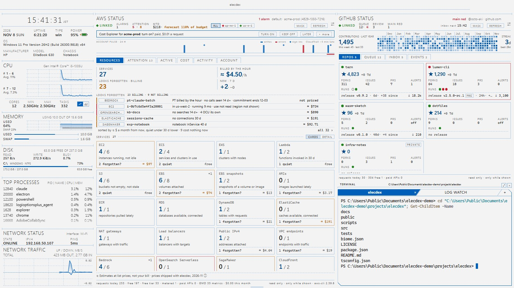
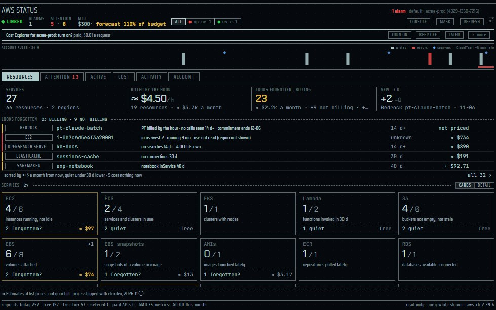
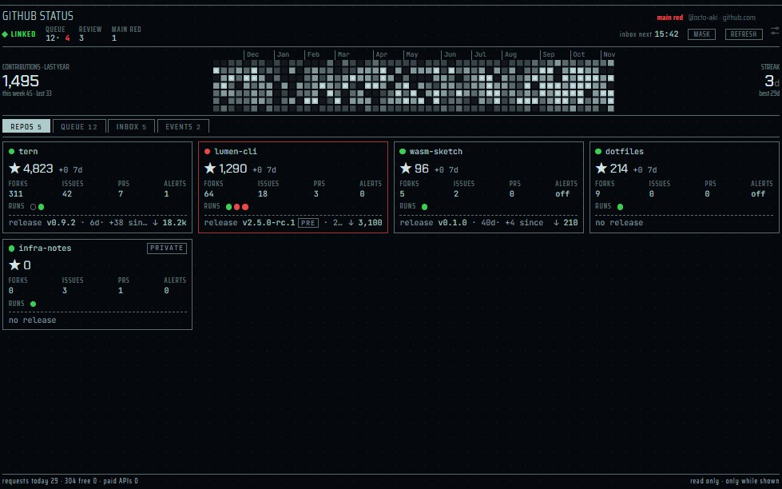

[English](panes-cloud.md) | [日本語](panes-cloud.ja.md) | 简体中文

# 云窗格：AWS STATUS 和 GITHUB STATUS — elecdex

elecdex 是一个科幻风格的终端模拟器和系统监视器，是用 Electron、Svelte 和 TypeScript 重写的 eDEX-UI。本页介绍它面向云端工作的两个窗格：**AWS STATUS**（AWS 账户中需要人处理的事、此刻正在运行并计费的资源、本月的费用，以及谁改了什么）和 **GITHUB STATUS**（GitHub 上等你处理的事、你的通知、你的仓库中发生的事，以及仓库本身）。两者都通过你已在使用的命令行工具 AWS CLI v2 和 GitHub CLI 读取，只在窗格可见时读取，且不做任何更改。对每个窗格，本页说明它读取什么、多久一次、费用、从不读取或从不做什么，以及它的设置。elecdex 可在 Windows、macOS 和 Linux 上运行；它在 Windows 上开发和使用，macOS 和 Linux 只经过自动化测试的构建和运行，因此尚未得到充分验证。

本页内容：

- [cloud 预设](#cloud-预设)
- [两个窗格如何读取](#两个窗格如何读取)
- [AWS STATUS](#aws-status)
- [GITHUB STATUS](#github-status)
- [公开状态与故障通知](#公开状态与故障通知)
- [共同的行为](#共同的行为)
- [设计文档](#设计文档)

## cloud 预设

  
   cloud · Business (Light) · 替身 AWS CLI 和 gh，虚构的账户和用户

cloud 预设（Ctrl+Shift+F10）摆放的是：账户、仓库，以及供两个 CLI 使用的 shell。

| 位置 | 窗格 |
| --- | --- |
| 左列 | 除 cockpit 和 blank 外所有预设共用的系统列 |
| 中间（舞台的 0.58） | AWS STATUS |
| 右侧上方（高度的 0.62） | GITHUB STATUS |
| 右侧下方 | shell 在前，其后的标签页是 LOG WATCH |

- 两个 CLI 窗格只在可见时读取，所以在预设显示到屏幕上之前它什么也不读；标签页后面的 LOG WATCH 在被选中之前也什么都不读。
- AWS STATUS 以配置文件 `default` 开始免费读取（每次调用都用 `--profile` 指明配置文件，因此 `AWS_PROFILE` 不起作用；在 ⚙ 中选择），并在第一次显示某个账户时询问 Cost Explorer（*未发布：* RESOURCES 的 `GetMetricData` 默认开启，每个账户每月上限 1.00 美元；可在 ⚙ 中关闭）。没有 CLI 时，两个窗格都显示 **NO CLI** 以及安装方法。
- 预设是模板：选择一个预设会添加一个已保存的布局，此后它跟随你的改动。新安装时包含全部十一个预设，前十个有数字键；已有的布局列表不会被追加。

## 两个窗格如何读取

| | |
| --- | --- |
| 运行什么 | 你自己的 AWS CLI v2（`aws`）和 GitHub CLI（`gh`），由 elecdex 的主进程直接启动：不经过 shell，也不经过 PowerShell，参数以列表传递。 |
| 如何找到 | 在 `PATH` 中，只看绝对路径的条目（从不搜索 elecdex 所在的文件夹），然后是安装位置：Windows 上为 `%LOCALAPPDATA%\Programs\Amazon\AWSCLIV2\aws.exe` 或 `%ProgramFiles%\Amazon\AWSCLIV2`，以及 `C:\Program Files\GitHub CLI\gh.exe`；其他系统为 `/opt/homebrew/bin`、`/usr/local/bin`、`/usr/bin`。在 elecdex 启动之后安装的 CLI，可能要重启 elecdex 才能找到。 |
| 登录 | 从不代为登录。elecdex 从不接触凭据或令牌：由 CLI 按其惯常方式登录。未登录时，窗格只显示可复制的命令（`aws login --profile=<名称>`、`aws sso login --profile=<名称>`、`gh auth login`），从不执行它，并在按下 **REFRESH** 之前停止读取。 |
| 写入 | 不在账户的任何地方写入任何内容：只读。GITHUB STATUS 也不会把通知标为已读。 |
| 更新 | 只在窗格可见时：不在标签页后面，窗口未最小化也未隐藏。后台什么都不读，通知也不例外。 |

- **墙上时钟的整点。** 每项读取在其周期（5 分钟、15 分钟、1 小时……）的边界上进行，并加上各自的小偏移，使同一周期的读取不会同时开始。
- **同时最多启动两个 CLI**（两个窗格合计）；运行 20 秒的会连同子进程一起被停止。
- **失败后退避**：每项读取 1、2、4……最长 30 分钟；最后一次成功的结果留在屏幕上，并标记为过时。
- **REFRESH** 立即重新读取全部内容，最多每 30 秒一次（限制由主进程掌握）。
- **MASK** 在屏幕上隐藏账户 ID、别名、ARN、登录名、私有仓库名称、地址和存储桶名称，窗格的副标题也一并隐藏。
- **台账。** 每个窗格底部统计今天的请求——免费、免费额度、304（未变化，不消耗 GitHub 的速率限制）和付费——并为每项读取提供一张卡片：它的周期、费用类别和今天的次数，以及 CLI 的路径和版本。这些计数只保存在内存中。
- **链接状态**（顶行）：STANDBY（不可见）、LINKING、LINKED、PARTIAL（某项读取被拒绝：只显示操作名）、NO CLI / OLD CLI、SIGNED OUT、THROTTLED / RATE LOW、OFFLINE、LINK ERROR。CLI 自身的错误文本从不显示在屏幕上、写入日志或放进通知。
- 两者都可以前置显示（Ctrl+Shift+Z，铺满窗口）和弹出；各行都有详情卡片。

## AWS STATUS

  
   AWS STATUS · RESOURCES · 替身 AWS CLI，虚构账户

| | |
| --- | --- |
| 位置 | cloud 预设（Ctrl+Shift+F10）；选择器（Ctrl+Shift+A）中的 "aws status"。可以添加多个。可以弹出和前置显示（Ctrl+Shift+Z）。 |
| 读取 | 每个窗格一个 AWS 配置文件（⚙ 中列出 `aws configure list-profiles`），最多 4 个区域（未选时为该配置文件自身的区域）；全局服务向 us-east-1 查询。只用免费 API，加上 CloudWatch 免费额度内的调用，以及你开启后的 Cost Explorer。*未发布：* RESOURCES 增加它显示的所有服务的列表、S3 的存储桶列表、CloudWatch Logs 的日志组，以及有每月上限的 CloudWatch 付费 `GetMetricData`（默认开启）。 |
| 更新 | 只在窗格可见时，每项读取按各自的周期（见下表）。 |
| 平台 | AWS CLI v2 能运行的地方。未在 macOS 或 Linux 上手动验证。 |
| 隐私 | 只读；从不调用 Secrets Manager、Health 或 Support，S3 和 CloudWatch Logs 只读取存储桶列表和日志组（*未发布*），从不读取对象、日志或消息。MASK 隐藏 RESOURCES 和下钻中的所有资源名称（*未发布*）。CloudTrail 只保留时间、操作者、操作、区域、错误，以及控制台登录的结果和 MFA。账户信息不会到达任何插件。 |
| 设置 | 每个窗格（⚙）：配置文件、区域、ACCOUNT PULSE 开关、ACTIVITY（CloudTrail）开关、SLOW ×4。每个账户：Cost Explorer 和成本 QUOTA（`aws-billing.json`）；*未发布：* GetMetricData 及其上限（`aws-billing.json`）、ELSEWHERE 和标记为 KEEP 的资源（`aws-inventory.json`）。所有窗格共用：故障通知，即 `settings.json` 中的 `aws.incidents`。 |

顶行：链接状态、**ALARMS**、**ATTENTION**（danger · warn）、**MTD**（来自账单指标的本月迄今金额，附预算的预测和占 QUOTA 的比例；按下打开 COST）、区域指示灯（ALL 或单个区域，每个灯为该区域最重发现的颜色）、**MASK**、**REFRESH**、⚙。

**ACCOUNT PULSE** 是一条横带，以 15 分钟为一根柱显示最近 24 小时的 CloudTrail 写入事件：错误为 danger，控制台登录为菱形，正在响的告警为一条横条。CloudTrail 约晚 5 分钟送达，横带上会注明。可在 ⚙ 中关闭，窗格高度不够时不显示。

标签页：

| 标签页 | 显示内容 |
| --- | --- |
| **RESOURCES**（*未发布*，第一个标签页） | 账户里有什么、哪些看起来被遗忘了（见下文） |
| **ATTENTION** | 需要人处理的事，最重的在前：告警（包括复合告警）、受损实例、失败的备份、失败的 CloudFormation 堆栈；没有 MFA、有访问密钥或在最近 24 小时内被使用的根用户；GuardDuty 高危发现；被实例使用、并向全世界开放 22、3389 或所有端口的安全组；没有 MFA 的控制台用户；15 分钟内被拒绝 10 次以上的操作；正在使用且即将到期的证书（7 天内为 danger，30 天内为 warn）；关闭自动续订且即将到期的域名；30 天内结束的 Savings Plans 和预留实例；超过 90 天的访问密钥；标准支持在 90 天内结束或已结束的 EKS；已弃用的 Lambda 运行时；未挂载的 EBS 卷和弹性 IP；停止超过 30 天的实例；处于延长支持的 EKS；预测超过 100% 或实际超过 80% 的预算；30 天内到期的免费计划额度，或超过 85% 的旧版免费套餐；*未发布：* 一行汇总看起来被遗忘且在计费的资源，点击打开 RESOURCES 的列表 |
| **ACTIVE** | 此刻正在运行并计费的资源：按标价计算的 ≈ 美元/小时和 ≈ 美元/月，按服务堆叠的横条，按服务分行、最贵的在前，并附 **IDLE**（7 天 CPU 平均低于 2% 且最高低于 10% 的运行中实例）和 **WASTE** 的数量；*NOT BILLING NOW* 一行；自当天第一次读取以来新增和消失的资源。下方始终是固定的一行 *≈ Estimates at list prices, not your bill · prices shipped with elecdex, 2026-11* |
| **COST** | 本 UTC 月、上月同日为止、由已结束的日子画到月底的直线、预算、成本 QUOTA 的仪表及其美元输入框，以及按账单指标的 `ServiceName` 分的服务（开启 Cost Explorer 时则来自 Cost Explorer） |
| **ACTIVITY** | CloudTrail 写入事件，每个区域最近 50 条；筛选 ALL、WRITES、LOGINS、ERRORS；不含 AWS 自身的自动化操作 |
| **ACCOUNT** | 账户、别名、用户和角色、当前登录的 ARN；根用户的 MFA、密钥和最后登录；没有 MFA 的控制台用户；超过 90 天的密钥；GuardDuty 计数；区域 |

### RESOURCES

*未发布。* 第一个标签页，新窗格从这里打开。它回答账户里有什么、哪些是创建后被遗忘的。它不停止也不删除任何东西，只说明读到了什么。

- **数字**：SERVICES（附资源数和区域数）、BILLED BY THE HOUR（按小时计费的资源的 ≈ $/小时和 ≈ $/月；点击打开 ACTIVE）、LOOKS FORGOTTEN · BILLING（数量、≈ $/月以及不花钱的数量；点击打开完整列表）、NEW 7 D（7 天内出现和消失的资源；点击打开它们）。
- **LOOKS FORGOTTEN**：前 5 条，按今后 ≈ 每月金额排序（判断天数短于静默天数的排在后面）。每行：类型、名称、用平常话写的原因（"no traffic 30 d"、"not attached since 11-01"）、静默了多久和 ≈ $/月；卡片说明依据什么判断。**keep**（"我是有意留着的"）把这一行从该账户的列表中移除；金额超过两倍时会再次出现。上下方向键在行间移动。
- **SERVICES** 标题及其右侧的 **CARDS · DETAIL** 切换（*未发布*；窗格记住所选，默认为 CARDS）。**CARDS**：每个服务一张卡片，始终按同样的顺序排列（计算、存储、数据库、网络、AI、边缘与 API、集成、安全、日志）。一张卡片：名称和 7 天内的增减、所显示区域中的 **使用中 / 总数**（`9 / 12`）、"使用中"指什么（`instances running, not idle`），并且只有在有未使用的资源时才显示其余部分（`2 forgotten? · 1 stopped · 1 quiet · 1 kept`）以及看起来被遗忘的资源的 ≈ $/月（其余全是静默时为 `free`）。使用中是指既未停止、也不在 LOOKS FORGOTTEN 中（也未标记 KEEP）的资源，因此卡片与列表一致；其他区域的资源留在 ELSEWHERE。边框与磁贴一样变为 warn 和 danger。Bedrock 的卡片统计放置的资源中 30 天内被使用的数量，并显示模型及其令牌数。仍在读取的服务显示 `–` 和 *reading…*；被拒绝且什么也没读到的服务不显示卡片（与 DETAIL 中没有磁贴相同），由 **Denied** 一行列出其名称。卡片的详情卡显示状态、容量、各区域的数量、≈ $/月以及静默的含义。方向键移到最近的卡片；Enter 打开。
- **DETAIL**：**磁贴**按分组排列（计算、存储、数据库、网络、AI、边缘与 API、集成、安全、日志），被遗忘金额最多的分组在前。一块磁贴：数量和名词、一条细的状态线、区域、图例、看起来被遗忘的数量和 ≈ $/月。被遗忘资源达到 ≈ $50/月 时边框变为 warn，达到 ≈ $500/月 时变为 danger。Bedrock 的磁贴分两半：30 天内使用的模型，以及放置的资源（预置吞吐量、自定义模型和导入的模型、知识库、代理、护栏、推理配置文件、AgentCore 运行时）。方向键移到该方向最近的磁贴；Enter 打开。
- 卡片或磁贴下方：**Also here**（VPC、证书、堆栈、告警）、**Checked, none here**、**Denied**（被拒绝的操作）、**ELSEWHERE**（窗格不显示的区域中的资源，来自每周一次的巡查；其列表中有 *check other regions now*）以及 **Billed this month, not read here**（账单指标中有、但没有磁贴覆盖的服务；点击打开 COST）。
- 服务：EC2、ECS、EKS、Lambda、S3、EBS、EBS 快照、AMI、ECR、RDS、DynamoDB、ElastiCache、OpenSearch、Redshift、NAT 网关、负载均衡器、公网 IPv4、VPC 终端节点、Transit Gateway 挂载、Site-to-Site VPN、CloudFront、API Gateway、SQS、SNS、Kinesis Data Streams、Transfer Family、Bedrock、OpenSearch Serverless、SageMaker、KMS、Route 53 托管区域和 CloudWatch Logs。
- 是否看起来被遗忘，依据读到的内容判断：使用指标在静默天数（30 天）内没有数据点（没有流量、请求、连接、调用或消息）、停止超过 30 天的实例、未挂载的卷或地址、空的存储桶、函数已不存在的日志组、卷已不存在的快照、监视已不存在资源的告警。`GetMetricData` 关闭时，改用 `ListMetrics` 的 14 天判断。预置吞吐量只有在它自身和其基础模型都没有调用时才算被遗忘。
- 窗格越窄，卡片（每张至少 13 rem，窄窗格为 2 列）或磁贴的列越少；窗格较矮时磁贴变为每个一行，非常矮时只保留数字和列表。

### 逐层深入

从 RESOURCES、ACTIVE 或 ATTENTION 的某一行，可以在窗格内打开一个服务：

- **一个服务**：分面横条——点击按某个值筛选，其他分组按该筛选重新计数（交叉筛选）——以及一个列表，点击表头排序。
- **一个资源**：它的字段；相关的资源（实例的卷、弹性 IP 和告警；卷所属的实例）；它的发现；**HISTORY**，即该资源的 CloudTrail，按下时读取（免费）；**↗ CONSOLE**，打开主进程根据自己的读取结果构造的 AWS 控制台页面。
- 用面包屑的 ‹ 返回。焦点在窗格内时，Enter 下钻一层，Escape 或 Backspace 返回一层。
- 可下钻的服务：EC2、EBS、公网 IPv4（弹性 IP）、S3、NAT 网关、负载均衡器、RDS、EKS、Lambda、CloudFormation、ACM 和告警。*未发布：* RESOURCES 的所有服务，以及跨服务的列表（forgotten、new、elsewhere，带服务列）。从 RESOURCES 打开的资源还会显示静默了多久、依据什么判断，以及 **KEEP**。S3 的容量来自 CloudWatch 每日的 `BucketSizeBytes`；S3 自身的 API 只调用存储桶列表，每天最多一次（*未发布*）。

### 费用

- **免费 API**，以及 CloudWatch 的 `GetMetricStatistics`、`ListMetrics` 和 `DescribeAlarms`，后者计入整个账户共享的 CloudWatch 免费额度（每月 100 万次请求；台账中记为 *free tier*）。
- **GetMetricData**（*未发布*，仅 RESOURCES）始终收费，每 1,000 个指标 0.01 美元。默认开启，按指标数计数，达到每个账户的每月上限（⚙ 中 25,000 · 100,000（默认，1.00 美元）· 500,000 个指标）即停止，之后改用免费额度内的调用判断。台账显示本月的指标数和金额，以及 *GMD CAP REACHED*。
- **S3 的存储桶列表**（*未发布*）可能按 LIST 请求计费：每天一次，每月最多 31 次。
- **Cost Explorer**（每次请求 0.01 美元）在你开启前保持关闭，在窗格第一次显示某个账户时，以窗格内的一行卡片询问：**TURN ON**、**KEEP OFF**、**LATER**（elecdex 重启后再问，每天最多一次）和 **▸ more**，展开后可选择频率（MANUAL · ONCE A DAY（默认）· EVERY 12 H）和每月上限（10 · 50 · 100（默认，1.00 美元）· 200 · 500 · 1,000 次请求），并显示当月估算（每天一次 ≈ 60 次请求，0.60 美元）。
- 一次 Cost Explorer 读取是两次请求：按服务的本月数据，以及 AWS 的预测。达到上限后，到下一个 UTC 月之前不再调用。被拒绝时（没有 `ce:GetCostAndUsage`，或未启用 Cost Explorer），它会自行关闭并说明原因。
- 回答、上限、计数和 QUOTA 按账户保存在 `aws-billing.json` 中。

### 成本 QUOTA

- 每个账户一个美元金额（0 = 关闭，默认），提醒档位为 80% 和 100%（或仅 100%）。
- 当本 UTC 月的账单指标首次越过某个档位时弹出通知，每档每月一次，记录在磁盘上。
- 在窗格可见时每 6 小时检查一次，所以通知可能晚半天，窗格不可见时会更晚。AWS Budgets 是 AWS 自己的警报；这个是 elecdex 自己的、显示在屏幕上的。
- 需要在账单首选项中开启 *Receive CloudWatch billing alerts*（免费）。在付款账户上，账单指标是整个组织的账单。

### 标价

ACTIVE 的估算使用随 elecdex 附带的单价（`src/shared/aws/list-prices.ts`）：美国东部按需标价（Linux、共享租期），覆盖常见的 EC2 和 RDS 类型、EBS、S3 存储类别、NAT 网关、公网 IPv4、负载均衡器和 EKS，其他区域按该区域通常的比率换算。这是近似值，不是你的账单；不调用 Price List API。

### 周期

| 读取 | 周期 |
| --- | --- |
| 身份 | 15 分钟 |
| 告警、受损实例 | 5 分钟 |
| CloudFormation 堆栈、CloudTrail | 15 分钟 |
| 资源清单：实例、卷、地址、NAT 网关、负载均衡器、安全组、RDS、Lambda、备份、GuardDuty | 1 小时 |
| 账户摘要 | 1 小时 |
| 账单指标、预算、凭证报告 | 6 小时 |
| 免费计划 | 12 小时 |
| 证书、域名、Savings Plans、预留实例、EKS、S3 容量、EC2 的 7 天 CPU | 1 天 |
| Cost Explorer（开启时） | 每天一次或每 12 小时，或仅在 REFRESH 时（MANUAL） |
| RESOURCES（*未发布*）：ECS、Bedrock 的预置吞吐量、OpenSearch Serverless | 1 小时 |
| RESOURCES：大多数列表（日志组、表、队列、主题、API、缓存、流…） | 6 小时 |
| RESOURCES：存储桶、镜像、仓库、密钥、使用指标和 GetMetricData | 1 天 |
| RESOURCES：ELSEWHERE（不显示的区域） | 1 周 |

RESOURCES 的读取由同一账户的所有窗格共享，并保存在 `aws-inventory.json` 中，所以第二个窗格不会重新读取。

⚙ 中的 **SLOW ×4** 使除账单指标以外的所有周期延长为四倍。

### 权限

AWS 托管策略 `ReadOnlyAccess`（或 `ViewOnlyAccess` 加 `AWSBillingReadOnlyAccess`）涵盖所有读取。被拒绝的读取显示 **PARTIAL** 和操作名。*未发布：* 旁边的 **COPY POLICY** 复制一个只允许这些读取的 IAM 策略（只有操作，不含账户或 ARN），RESOURCES 在磁贴下方只列一次被拒绝的服务名。自行编写策略所需的操作列表见[网络访问与数据来源](data-sources.zh-CN.md#aws-status-的权限)。

## GITHUB STATUS

  
   GITHUB STATUS · REPOS · 替身 gh，虚构用户

| | |
| --- | --- |
| 位置 | cloud 预设（Ctrl+Shift+F10）；选择器（Ctrl+Shift+A）中的 "github status"。可以弹出和前置显示（Ctrl+Shift+Z）。 |
| 读取 | 通过 `gh` 读取 github.com（`gh api -X GET …`、只读的 GraphQL 查询、`gh auth status --json hosts`） |
| 更新 | 只在窗格可见时，每项读取按各自的周期（见下表）；GitHub 能返回 304 的地方使用条件请求。 |
| 平台 | GitHub CLI 能运行的地方。仅 github.com（不支持 GitHub Enterprise Server）。未在 macOS 或 Linux 上手动验证。 |
| 隐私 | 只读：不标记已读、不合并、不评论、不批准。不读取正文、评论、diff 和文件。写入磁盘的只有公开仓库每天的星标数（`github-stars.json`，90 天）。 |
| 设置 | 每个窗格（⚙）：仓库 AUTO 或 PINNED、贡献横带开关。所有窗格共用：故障通知，即 `settings.json` 中的 `github.incidents`。 |

顶行：链接状态、**QUEUE**（数量及 danger 数量）、**REVIEW**（等你审查的拉取请求）、**MAIN RED**（默认分支变红的仓库数）、仅在不足时显示的速率限制余量、下一次读取收件箱的时间、**MASK**、**REFRESH**、⚙。其下是**贡献横带**：把最近一年画成格子，附一年的总数和连续天数；可在 ⚙ 中关闭，窗格高度不够时不显示。

标签页：

| 标签页 | 显示内容 |
| --- | --- |
| **REPOS**（*未发布：* 第一个标签页，窗格从这里打开） | 每个仓库一个图块：星标及其 7 天变化、复刻、issue、拉取请求、警报、默认分支最近的运行、最新发布（含预发布）及其后的提交数，以及有推送权限时 14 天的访问量。可从图块下钻到它的运行、打开的拉取请求和发布 |
| **QUEUE** | 等你处理的事，每件一行，最重的在前：变红的默认分支、私密漏洞报告、失败、有冲突或被要求修改的你的拉取请求、等待批准的工作流运行、审查请求（3 天后为 warn，7 天后为 danger）、提及、指派，以及 TRIAGE——你的仓库中无人回应的 issue。筛选 ALL、MINE、REVIEW、SECURITY、MENTION、TRIAGE |
| **INBOX** | 原始通知。窗格不标记任何已读。细粒度（fine-grained）令牌无法读取通知，标签页会注明 |
| **EVENTS** | 所关注仓库最近 24 小时的事件，按仓库和类型（星标、复刻、issue、拉取请求、发布、推送）折叠 |

- **星标的 7 天变化**来自 elecdex 自己的每日记录，因为 GitHub 不保留每日计数：只记录公开仓库，保存在 `github-stars.json` 中，90 天。
- **仓库**：AUTO——你自己的、既非复刻也未归档的仓库中星标最多的八个——或 PINNED，一个 `owner/name` 列表（最多 12 个，组织的仓库也可以）。
- **打开**：行上的 ↗（或焦点在行上时按 Enter）在浏览器中打开。页面只发送该行的 id；链接由主进程根据自己读取的内容构造，只限 github.com（和 githubstatus.com）。在仓库的下钻中，‹、Escape 或 Backspace 返回。

| 读取 | 调用 | 周期 |
| --- | --- | --- |
| 登录状态 | `gh auth status --json hosts` | 15 分钟 |
| 速率限制 | `gh api -X GET rate_limit` | 5 分钟 |
| 通知 | `gh api -i -X GET notifications`，带 If-Modified-Since | 60 秒，按 GitHub 的 `X-Poll-Interval`；304 不消耗速率限制 |
| 队列 | 一次 GraphQL 搜索 | 5 分钟 |
| 仓库 | 一次 GraphQL 查询 | 15 分钟 |
| 事件、工作流运行 | 每个仓库一次 `gh api -i -X GET`，带 If-None-Match | 5 分钟 |
| 贡献 | 一次 GraphQL 查询 | 1 小时 |
| 私密漏洞报告、发布以来的提交 | 每个仓库一次 `gh api -X GET` | 1 小时 |
| 流量（访问量） | 每个有推送权限的仓库一次 `gh api -X GET` | 6 小时 |

令牌缺少某项读取所需的范围时，只有该项读取显示 **PARTIAL**。

## 公开状态与故障通知

某个服务的窗格可见时，主进程还会获取该服务的公开状态，每 5 分钟一次，不用 CLI，也不登录：

| | AWS STATUS | GITHUB STATUS |
| --- | --- | --- |
| 来源 | `https://status.aws.amazon.com/rss/all.rss`（约 60 KB；条件请求在那里无效） | `https://www.githubstatus.com/api/v2/incidents/unresolved.json` 和 `…/scheduled-maintenances/active.json` |
| 横带 | 只在窗格的区域或全局服务有故障时 | 只在有故障时（计划维护显示为 info 横带，从不弹出通知） |
| 通知的起点 | warn（`aws.incidents.minSeverity`） | danger，不含 Copilot（`github.incidents.minSeverity`、`skip`） |

- 按下横带会打开故障列表的卡片；↗（或 Enter）打开状态页面。卡片会注明这是服务的公开状态，不是你账户的状态。
- 出现新的故障或故障加重时弹出通知，每个来源每 15 分钟最多一次，合并显示。在窗格第一次读取时就已存在的故障只显示横带。已通知的故障在 `cloud-alerts.json` 中记住 30 天，重启后不会重复。
- elecdex 不在前台时，若 `system` 开启，则改为系统通知。通知中从不写出账户名称。
- 默认开启，因为状态只在窗格可见时读取。可在任一窗格的 ⚙ 中 *Every AWS STATUS pane* / *Every GITHUB STATUS pane* 一栏更改；各个键见[主题与设置](themes-settings.zh-CN.md#settingsjson)。
- 窗格隐藏时什么都不读，所以隐藏期间发生的故障或越过的 QUOTA，会在下次窗格可见时通知。

## 共同的行为

- **只在可见时读取。** 某个面板的最后一个窗格不再可见时，主进程的读取停止；页面重新加载时也会释放它们。通知也没有例外。
- **CLI 的登录归 CLI 自己。** 密钥、令牌和凭据都不进入 elecdex；通过 `credential_process` 登录的配置文件，也只在你看着窗格时才会启动 CLI。
- **插件 API** 无法访问这两个窗格。
- **文字作为文字绘制。** 标题，以及分支、工作流、告警和堆栈的名称都是别人写的，从不作为 HTML 插入。
- **链接由主进程构造**，依据它自己最近的读取结果：AWS 控制台、github.com 和状态页面，从不使用页面发来的 URL。
- **面向开发者：** 测试从不运行真正的 CLI，也不访问任何账户：`ELECDEX_CLOUD_STUB=1` 用替身 `aws` 和 `gh` 代替它们（截图用 `=demo`，另有 `=signedout`、`=nocli`、`=offline` 等），公开状态的 URL 指向关闭的端口。

## 设计文档

以下为日文：

- [cloud-cli.md](../cloud-cli.md)：两个窗格共用的部分——启动 CLI、允许列表、时间表、台账、公开状态
- [aws.md](../aws.md)：AWS STATUS——每个调用、逐层深入、Cost Explorer、QUOTA、权限
- [github.md](../github.md)：GITHUB STATUS——每个调用、队列、仓库
- [decisions.md](../decisions.md)：决定及其理由和测量数据
- [网络访问与数据来源](data-sources.zh-CN.md)
