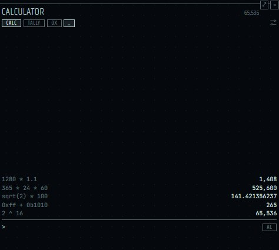
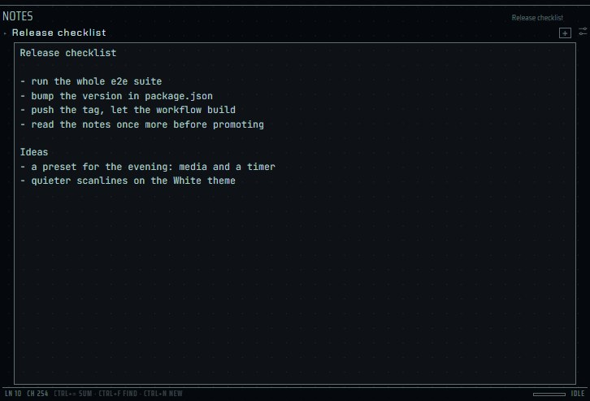
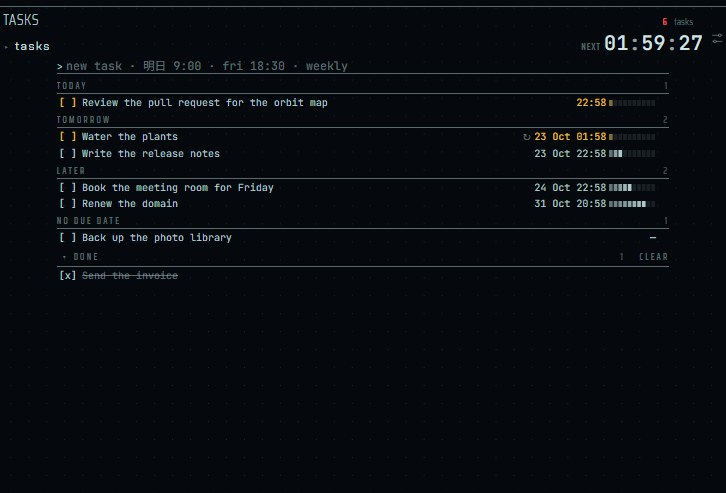
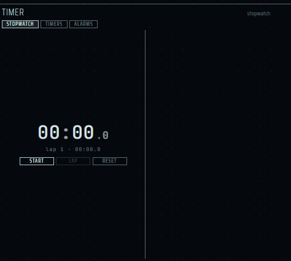
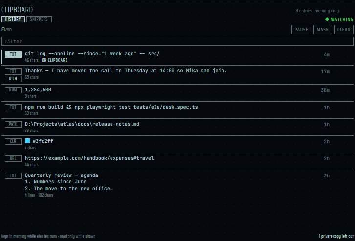
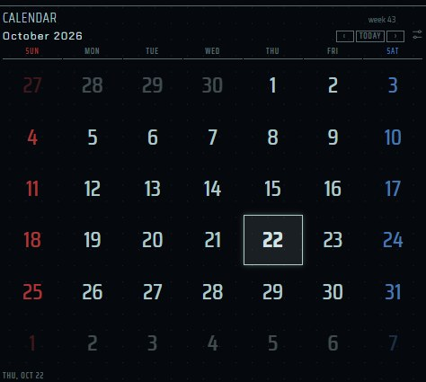
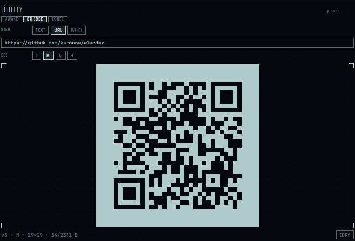

[English](panes-desk.md) | [日本語](panes-desk.ja.md) | 简体中文

# 桌面窗格 — elecdex

elecdex 是面向 Windows、macOS 和 Linux 的科幻风格终端模拟器兼系统监视器。本页介绍它的桌面窗格：**Calculator**（计算器，含表达式语法）、**Notes**（记事）、带提醒的 **Tasks**（任务）、带倒计时和闹钟的 **Timer**（计时器）、**Clipboard**（剪贴板历史与片段）、带节假日的 **Calendar**（日历），以及 **Utility**（实用工具：AWAKE、QR、CODEC）。本页说明每个窗格保存什么、保存在哪里（记事、任务、闹钟和片段是主进程拥有的文件，而不是窗格状态），剪贴板窗格读取什么、从不读取什么，以及提醒和闹钟如何调度。本页的窗格都不使用网络。elecdex 在 Windows 上开发和使用；macOS 和 Linux 只经过自动化测试的构建和运行，尚未经过充分的人工验证。

**本页内容**

- [desk 预设](#desk-预设)
- [Calculator](#calculator)
- [Notes](#notes)
- [Tasks](#tasks)
- [Timer](#timer)
- [Clipboard](#clipboard)
- [Calendar](#calendar)
- [Utility](#utility)
- [桌面数据保存在哪里](#桌面数据保存在哪里)
- [另请参阅](#另请参阅)

## desk 预设

  
   desk · Paper

**desk** 预设（Ctrl+Shift+F6）在系统栏旁边依次放着：记事及其下方的计时器和计算器；任务及其下方的剪贴板历史；日历及其下方的实用工具窗格（其后面的标签页是函数计算器 [ELEC-16](panes-retro.zh-CN.md#elec-16) SCI）。

- **桌面窗格** — 一个直接输入的计算器（全角数字和 3百万 这样的写法按原样识别，带纸带记录，还能对粘贴进来的一列数字做统计）；会自动保存的纯文本记事；截止时间画成仪表、无论窗格是否打开都会提醒的任务；以及一个计时器：秒表的分段像频谱一样堆叠，倒计时在旁边同时运行，还有围绕一天作息的闹钟。任务下方是剪贴板历史：列出它显示在屏幕上时你复制的内容，点一下即可放回剪贴板；日历下方是实用工具窗格（阻止休眠、二维码、编码与哈希）。
- **实用工具** — 把小工具放在一个窗格里：在你指定的时间内阻止休眠、生成二维码（文本、地址或 Wi-Fi）、编码、解码、哈希和时间转换。

**dev** 预设（Ctrl+Shift+F4）中也有一个剪贴板窗格，其后面的标签页是计时器和 shell。默认布局的右栏中有日历。

## Calculator

  
   计算器

| | |
| --- | --- |
| 位置 | **desk** 预设（Ctrl+Shift+F6），或选择器（Ctrl+Shift+A，"calculator"）；可以打开多个。不在默认布局中。可以以固定大小放大（Ctrl+Shift+Z）。 |
| 读取的内容 / 数据来源 | 你输入的内容。不会把任何东西当作代码执行：表达式解析器来自 elecxzy，未经修改，连同其测试一起内置。 |
| 隐私 | 不使用网络，也不使用文件。 |

在一行中输入，答案已经显示在下方；所有已算出的结果都记在纸带上，可以把数字再取回来用。全角数字、`×` `÷`、数字后的数量级（`3百万`、`5千`）以及千位分隔符（`1,234,567`；函数括号里的逗号仍是参数分隔）会按原样识别，所以不必离开日文输入法，也不必重打从文档里复制的数字，就能写表达式。

- `ans` 表示上一个答案；`rate = 8 * percent` 会把一个名称保存在寄存器行中供之后的行使用。
- `0x` 会在答案下方添加一张 32 列的位图（适用于能放进 32 位的整数；负数以二进制补码显示）。
- `C` 清空当前行，行为空时清空纸带；在空行输入 `?` 会显示计算器认识的所有内容，↑ 可以回溯输入历史。
- **tally** 模式会对粘贴进来的一列数字做统计——计数、总和、平均值、中位数、标准差、四分位数——附带直方图和箱线图，并且不会把日期的各部分误当作独立的数字。最多读取 20,000 个数字。
- 结果四舍五入到 12 位有效数字，带千位分隔符显示，有帮助时还附上十六进制和二进制。
- [Notes](#notes) 中的 `Ctrl+=` 和 [Timer](#timer) 中手动输入的时长都由同一个求值器计算。

### 表达式语法

| 元素 | 写法 |
| --- | --- |
| 数字 | `42`、`3.14`、`.5`、`1e-3`；`0x1F`、`0b1010`、`0o17`；`1,234,567` |
| 日文数量级 | 只能跟在数字后面：`十` `百` `千` `万` `億` `兆` 以及 `百万`、`千万`、`百億` 等组合（`3百万` 即 3,000,000）。单独的汉字数字（`三百万`）不识别。 |
| 全角输入 | `１２３`、`＋`、`×`、`÷` 按 `123`、`+`、`*`、`/` 识别 |
| 算术 | `+ - * / %`；除以零是错误，而不是无穷大 |
| 乘方 | `^`，从右向左结合（`2^3^2` 即 `2^9`）；`-2^2` 为 `-4` |
| 阶乘 | `5!`，最大到 `170!` |
| 位运算（32 位） | `&` `\|` `~` `<<` `>>`；异或写作 `xor(a, b)` |
| 括号 | `( )`，最多嵌套 64 层 |
| 名称 | `ans`；用 `name = 表达式` 设定的自定义名称 |

运算符优先级（从弱到强）：`|`、`&`、`<< >>`、`+ -`、`* / %`、一元 `+ - ~`、`!`、`^`。没有隐式乘法：`2tb` 是错误，应写成 `2 * tb`。一行最多 500 个字符。

| 函数 | 说明 |
| --- | --- |
| `sqrt cbrt abs exp sign pow` | |
| `ln log log2 log10` | `log(x)` 以 10 为底；`log(x, base)` |
| `sin cos tan asin acos atan atan2 sinh cosh tanh` | 弧度：`sin(rad(30))` |
| `rad deg` | 角度转弧度及反向 |
| `round floor ceil trunc` | `round(x, digits)` |
| `min max sum avg hypot` | 参数个数不限 |
| `gcd lcm fact` | |
| `and or xor not shl shr` | 32 位 |

| 常数 | 值 |
| --- | --- |
| `pi e tau phi` | 数学常数 |
| `percent permille bp` | 0.01、0.001、0.0001（`4800 * 12 * percent`） |
| `k thousand million billion trillion` | 10³ 到 10¹² |
| `man oku cho` | 万 億 兆（10⁴、10⁸、10¹²） |
| `kb mb gb tb` | 十进制字节（10³ …） |
| `kib mib gib tib` | 二进制字节（1024 …） |
| `minute hour day week` | 以秒计 |
| `tsubo` | 以平方米计 |

自定义名称：寄存器行最多 20 个，长度 1 到 16 个字符，由字母、数字或下划线组成，以字母或下划线开头。不能给常数、函数名或 `ans` 赋值。

示例：`1920 * 1080`、`2 * tb / (512 * gib)`、`3百万 / 12`、`round(2 / 3, 4)`、`(1 << 20) / kib`。

## Notes

  
   记事

| | |
| --- | --- |
| 位置 | **desk** 预设（Ctrl+Shift+F6），或选择器（Ctrl+Shift+A，"notes"）；可以打开多个。不在默认布局中。 |
| 数据 | 应用数据文件夹（userData）中的 `notes.json`，由主进程写入；不在布局中。 |
| 更新 | 停止输入半秒后保存。 |

纯文本，没有标记语法也不做渲染，停止输入半秒后保存——待写入时页脚的进度条会填满，写入完成时闪一下，所以静默的自动保存从不让人疑惑。

- 记事保存在应用 userData 下的 `notes.json` 中，而不在布局里，因此它们比窗格活得更久，两个窗格也可以显示同一条记事（第二个窗格会显示 *edited elsewhere*，而不会覆盖你正在输入的内容）。
- 第一行是记事的名称；标题栏列出所有记事，每条都有一个 × 可以删除（可撤销）。
- *Save as .md…* 和 *delete*（可撤销）在设置按钮下。

| 按键 | 作用 |
| --- | --- |
| Ctrl+= | 计算光标所在的表达式，并把答案写在它后面，不会动普通文字 |
| Ctrl+F | 在记事中查找（Esc 关闭查找） |
| Ctrl+N | 新建记事 |
| Ctrl+S | 立即保存 |

## Tasks

  
   任务

| | |
| --- | --- |
| 位置 | **desk** 预设（Ctrl+Shift+F6），或选择器（Ctrl+Shift+A，"tasks"）；可以打开多个。不在默认布局中。 |
| 数据 | 应用数据文件夹中的 `tasks.json`，由主进程写入。 |
| 更新 | 提醒由主进程用一个定时器等待下一个截止时间来调度；没有任何轮询。 |
| 设置 | 窗格的设置按钮：提醒（保存在 `settings.json` 中，所有任务窗格共用）。 |

一个列表，每个截止时间都画成一个仪表，显示任务的时限已经过去了多少，快到期时变为琥珀色，过期后变红，最近的截止时间在标题栏中倒计时。

- 输入 `歯医者 明日 9:00`、`review fri 18:30` 或 `毎週 掃除` 会从这行中读出日期和重复规则——并在添加任务前显示它的理解，这样误读当场就能发现；无法理解的行会原样保留。
- 任务在显示的地方直接修改：点击标题重命名，点击时间用同样的写法设置截止时间（留空则取消），用键盘时 Delete 删除任务、F2 重命名。
- 已完成的任务列在 DONE 下，需要时可以折叠。

### 提醒

下一个截止时间的提醒由应用自身调度：即使窗格已关闭、在另一个标签页，或者从未打开过，提醒也会到达——在角落显示一张带 *done*、*snooze* 和 *open* 的卡片，elecdex 不在前台时还会弹出系统通知。

| 设置 | 默认值 |
| --- | --- |
| remind me | 开启 |
| system notification when away | 开启 |
| sound（界面声音开启时） | 开启 |
| snooze | 10 分钟（1 到 1440） |
| warn … min early | 0 分钟（0 到 1440） |

- 只有一个定时器在等待所有任务中最近的截止时间；没有要等待的内容时，也就没有定时器在运行。
- 定时器只计算机器醒着的时间，所以电脑从睡眠中唤醒时会重新计算日程。
- 超过约 24.8 天的等待会分段进行，每个截止时间只提醒一次。

## Timer

  
   计时器

| | |
| --- | --- |
| 位置 | **desk** 预设（Ctrl+Shift+F6）、**dev** 预设（Ctrl+Shift+F4）中剪贴板后面的标签页，或选择器（Ctrl+Shift+A，"timer"）；可以打开多个。不在默认布局中。可以以固定大小放大（Ctrl+Shift+Z）。 |
| 数据 | 正在运行的计时器以墙上时钟的时刻保存在窗格状态中；闹钟保存在应用数据文件夹的 `alarms.json` 中，由主进程写入。 |
| 更新 | 读数由共享的 10 fps 循环绘制；闹钟由主进程调度。 |

一个窗格里有三种工具。

- **秒表。** 每个分段都是一根柱：计时中逐渐长高，记下时闪一下并锁定，标出最快和最慢，最高处有保持的峰值线。
- **倒计时。** 最多六个，各有自己的时长，沿着一排分段逐格熄灭，最后十秒闪烁，结束时以卡片通知。通过点击 `+1 +3 +5 +10 +25` 累加设定，旁边的输入框可以设定精确的分钟数。手动输入的时长会经过计算器处理，所以 `90/2` 就是四十五分钟。
- 秒表和倒计时是相互独立的，就像手机上那样：启动一个不会启动另一个，重置一个也不会影响另一个；当屏幕上显示秒表模式时，倒计时照样运行（到时照样响），每种模式都会在标题中注明。
- 按 Space 开始或停止屏幕上显示的那一个（焦点在窗格内任何位置都可以，输入框和按钮上除外）。
- 所有时间都记录为墙上时钟的时刻，而不是滴答计数，因此移动窗格、切换标签页、重新加载或重启都不会影响正在运行的计时器；读数显示到十分之一秒，这正是共享的 10 fps 绘制循环能如实显示的精度，而分段记录精确到毫秒。
- **闹钟。** 一天中的某个时刻加上标签，在你选择的日子响起，从列表中开关，而不必每次重新设置——起床、午饭开始。闹钟保存在 `alarms.json` 中并由应用调度，所以即使窗格已关闭或从未打开，它也会响起：以一张等待你处理的卡片呈现，elecdex 不在前台时还会弹出系统通知。一次性闹钟响过后会自动关闭；`07:30`、`1730`、`7`、`19.5` 和 `１９：３０` 都会被识别为时间。

## Clipboard

  
   剪贴板

| | |
| --- | --- |
| 位置 | **desk** 和 **dev** 预设，或选择器（Ctrl+Shift+A，"clipboard history"）。同一时间只能有一个。不在默认布局中。 |
| 读取的内容 / 数据来源 | 系统剪贴板，由主进程读取（页面从不读取）。 |
| 更新 | 每秒 4 次（每 0.25 秒的边界），且只在剪贴板窗格显示在屏幕上且未暂停时。剪贴板上有超过一百万字符的文本时，每 2 秒读取一次。 |
| 平台 | 可识别 Windows、macOS 和 KDE 的私密标记（见下）。macOS 和 Linux 尚未经过充分的人工验证。 |
| 隐私 | 没有剪贴板窗格显示在屏幕上时复制的内容从不保留。带私密标记的复制内容从不读取。历史只在内存中，退出 elecdex 即消失；插件无法访问。写入磁盘的只有你决定保留的片段。 |
| 设置 | 设置对话框中没有。窗格中有 **PAUSE**、**MASK**、**CLEAR**，以及 **history** / **snippets** 切换。 |

按从新到旧列出窗格显示在屏幕上时你复制的内容，并注明大小和多久以前。每一项都带有类型标签（TXT、URL、PATH、NUM，以及带色块的 CLR）；带格式复制的内容（HTML，或 Word 和写字板复制的 RTF）在其下方再标 RICH。

- 把指针停在某一项上（或用键盘移到它），会像 GIT 窗格的提交那样弹出卡片，显示完整内容（最多前 600 个字符）、随之复制的格式和复制时间。
- 点击某一项（或按 Enter）即可连同复制时的格式放回剪贴板，再粘贴到任何地方；↑ ↓ 在各项之间移动，Delete 或 × 删除一项。放回后该项在列表中的位置不变。
- 再次复制相同的文本时，它会移到最上面而不会出现两次；在终端里拖动出的选区（每移动一步都会复制一次）只算一项。
- **只在显示时读取。** 位于其他标签页之后、窗口最小化或收起，或按下 **PAUSE** 时，什么都不读，这期间复制的内容也不会保留。窗格出现的那一刻剪贴板上的内容会被收入列表。
- **私密的复制内容。** 带有密码管理器那种“私密”标记的复制内容只凭其格式列表识别；从不读取其文本，只计数（“N private copies left out”）：

| 系统 | 标记 |
| --- | --- |
| Windows | `ExcludeClipboardContentFromMonitorProcessing`、`Clipboard Viewer Ignore`、值为 0 的 `CanIncludeInClipboardHistory` |
| macOS | `org.nspasteboard.ConcealedType`、`org.nspasteboard.TransientType` |
| KDE | `x-kde-passwordManagerHint` |

- 最多 50 项保存在内存中，退出 elecdex 即消失——不写入磁盘，插件也无法访问。文本最多完整保存 200,000 个字符；更长的只显示开头，标为 NOT KEPT，不能放回。页面只收到每一项的预览；全文留在主进程中。
- **MASK** 隐藏内容（筛选框和卡片也不显示），**CLEAR**（按两次）清空列表，并一并清空剪贴板。
- 仅限文本：剪贴板上的图片和文件不会保留。窗格通过剪贴板文本的变化得知有新的复制，所以中间没有复制别的内容时，同一段文本复制两次只算一次。
- 它不会代你粘贴，也不与操作系统自带的剪贴板历史同步。

### 片段（snippets）

窗格的 **snippets** 切换按钮后面，是你决定保留的文本。

- 在某一项上按 **SNIP** 即连同格式保留下来（此后该项标有 ★）；其文本由主进程复制，从不经过页面。**+ NEW** 可以手写一条，名称可选（Ctrl+Enter 保存，Esc 取消）。相同的文本不会保留两次。
- **COPY** 把片段放到剪贴板上，但不加入历史。
- 拖动片段的编号（或 Alt+↑ ↓）调整顺序，**EDIT** 或 F2 修改——改了正文就会去掉复制时的格式——按两次 × 删除。
- 最多 100 条保存在设置所在文件夹的 `snippets.json` 中：与历史不同，它们会写入磁盘，但只写你决定保留的内容。MASK 同样作用于片段。插件无法访问。

## Calendar

  
   日历

| | |
| --- | --- |
| 位置 | 默认布局的右栏、**desk** 预设，或选择器（Ctrl+Shift+A，"calendar"）。 |
| 读取的内容 / 数据来源 | 无；节假日在本地计算。 |
| 设置 | 窗格的设置按钮：节假日日历（默认不选；保存在窗格状态中）。 |

显示当月并标出今天；‹ › 或鼠标滚轮切换月份，日期会朝切换方向扫入。空间足够时——宽窗格，或用 Ctrl+Shift+Z 放大窗格——上个月和下个月会以暗淡的样式出现在两侧，箭头会同时移动三个月。设置按钮可以勾选节假日日历（目前仅日本，在本地计算），下一个节假日的名称显示在月历下方。

- 日本的法定节假日根据《国民祝日法》的规则计算：固定日期、“快乐星期一”、用近似公式计算的春分和秋分、补休日、夹在两个节假日之间的“国民休息日”，并列出 2019 至 2021 年的特例调整。覆盖 2000 至 2099 年，并与日本内阁府公布的列表核对一致。不使用网络，也不需要每年更新数据。
- 星期六用主题的信息色绘制，星期日和节假日用警示（danger）色。无论语言设置如何，日历的文字都是英文。勾选多个国家时，节假日名称会带上国家标签。

## Utility

  
   实用工具

| | |
| --- | --- |
| 位置 | **desk** 预设，或选择器（Ctrl+Shift+A，"utility"）；可以打开多个。Ctrl+Shift+U 会聚焦布局中的实用工具窗格（再按一次切到下一个），布局中没有时以弹出方式打开，弹出时再按一次则关闭。可以以固定大小放大（Ctrl+Shift+Z）。 |
| 读取的内容 / 数据来源 | 不读取窗格以外的任何东西；全部在本机运行。 |
| 平台 | 在所有平台上，AWAKE 都通过 Electron 的节能阻止器实现。Linux 的 IBus 把 Ctrl+Shift+U 用于 Unicode 输入；按键无法到达时，请在 *Settings → Keyboard* 中改绑。macOS 和 Linux 尚未经过充分的人工验证。 |
| 隐私 | 不使用网络。插件无法访问。CODEC 的输入从不写入磁盘；Wi-Fi 密码只保存经系统加密封存的内容。 |
| 设置 | 在窗格中。显示的模块和各模块的选择保存在窗格状态中；AWAKE 的保持状态保存在 `awake.json` 中。 |

用切换按钮（`AWAKE | QR | CODEC`）一次显示一个小工具，也可以弹出显示。全部在本机运行，不使用网络，插件也无法访问。

### AWAKE

AWAKE 阻止休眠。

| 选项 | 效果 |
| --- | --- |
| OFF | 不阻止 |
| SYSTEM | 系统不休眠；屏幕可以关闭 |
| DISPLAY | 屏幕也保持开启（系统也不休眠） |
| 时长 | ∞、30M、1H、2H 或 4H；+30M 延长半小时（最多到现在起 24 小时） |

- 通过 Electron 的节能阻止器向系统请求，不启动任何程序。合上盖子或选择睡眠仍会休眠。
- 保持状态属于应用而不属于窗格：在关闭或时间到之前，即使关闭窗格或重新启动也会继续。elecdex 未运行期间不会阻止休眠（进程结束时，包括崩溃，操作系统会解除请求）。
- 保持期间，状态栏（`awake · system · until 15:42`，底边的标记会亮起；点击会弹出显示 AWAKE 的实用工具窗格）和通知区域的提示会说明，启动日志中也会显示。使用电池时窗格会注明，但不会自动解除保持。
- 到期时间由一个定时器等待，电脑从睡眠中唤醒时也会检查；没有任何持续计时的处理。

### QR

QR 为文本、地址（没有协议时会补上 `https://`）或 Wi-Fi 网络（手机摄像头一扫即可连接的格式）生成二维码。

- 纠错级别 L 到 H（默认 M）。输入为 UTF-8，所以中文和日文都可以。窗格会显示已用字节数与该纠错级别下最大二维码的容量（L 2953、M 2331、Q 1663、H 1273 字节），超出时显示 `OVER CAPACITY`。
- 使用主题颜色——始终是亮底暗模块，主题对比度不足时改为白底黑码——四周留出 4 个模块的空白区。COPY 以图片放到剪贴板。
- Wi-Fi 密码与 AI 密钥一样，只保存经系统加密封存的内容，包含密码的二维码在按下 REVEAL 前会被遮住（窗格被隐藏或移动后会再次遮住）。在另一台机器上封存的密码无法打开（`SEALED ON ANOTHER MACHINE`）；在没有 keyring 的 Linux 上根本不保存（`NOT SAVED · NO KEYRING`）。

### CODEC

| 操作 | 内容 |
| --- | --- |
| ENCODE | Base64、Base64URL、URL 编码、十六进制 |
| DECODE | Base64、URL 编码、十六进制；显示 JWT 内容（不验证签名） |
| HASH | SHA-1、SHA-256、SHA-512 |
| TIME | Unix 时间（秒或毫秒）与日期互相转换；为空时为当前时间 |
| WIDTH | 全角英数与半角互转，以及 NFKC |
| UUID | 每次生成一个新的版本 4 UUID |

- 结果随输入即时更新；失败时在结果栏中说明原因。COPY 复制结果；⇅ 把结果移到输入中，以便继续解码。
- 输入的内容不会写入磁盘（移动窗格后仍在，退出应用即消失）。输入最多 200,000 个字符。

## 桌面数据保存在哪里

| 内容 | 位置 | 写入者 |
| --- | --- | --- |
| 记事 | `notes.json` | 主进程 |
| 任务 | `tasks.json` | 主进程 |
| 闹钟 | `alarms.json` | 主进程 |
| 剪贴板片段 | `snippets.json` | 主进程 |
| AWAKE 的保持状态 | `awake.json` | 主进程 |
| 提醒设置 | `settings.json`（`reminders`） | 主进程 |
| 剪贴板历史 | 仅内存，退出即消失 | — |
| CODEC 的输入 | 仅页面内存，退出即消失 | — |
| 日历的节假日、实用工具的模块、QR 的输入、正在运行的计时器 | 窗格状态 | — |

所有文件都在应用数据文件夹（Electron 的 userData）中。窗格只保存显示选项和 id，所以记事、任务、闹钟和片段比显示它们的窗格活得更久，提醒和闹钟在没有窗格打开时也会响：它们都由主进程的一个 `setTimeout` 等待，从不轮询。

## 另请参阅

- [预设：desk](presets.zh-CN.md#desk)
- [键盘](keyboard.zh-CN.md)
- [设计：§5.14 剪贴板、§5.16 实用工具](../architecture.md)（日文）
- [决策记录](../decisions.md)（日文）：计算器的求值器、不渲染 Markdown 的记事、用一个定时器等待的提醒、闹钟。
- [内置的计算器](../../src/shared/calc/vendor/README.md)（英文）
