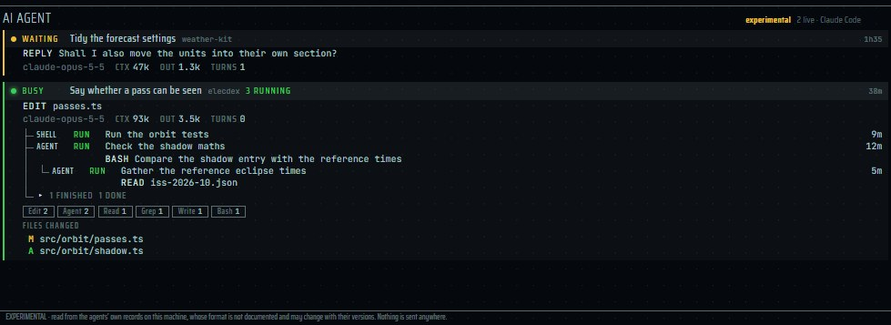
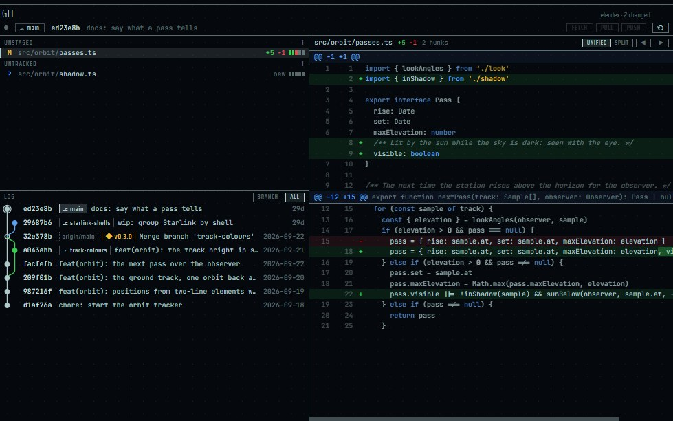
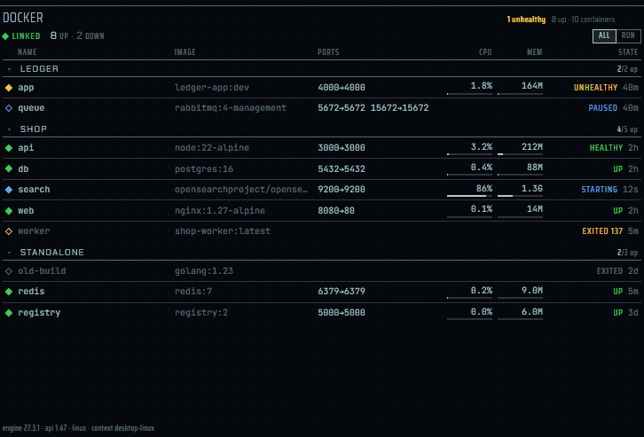
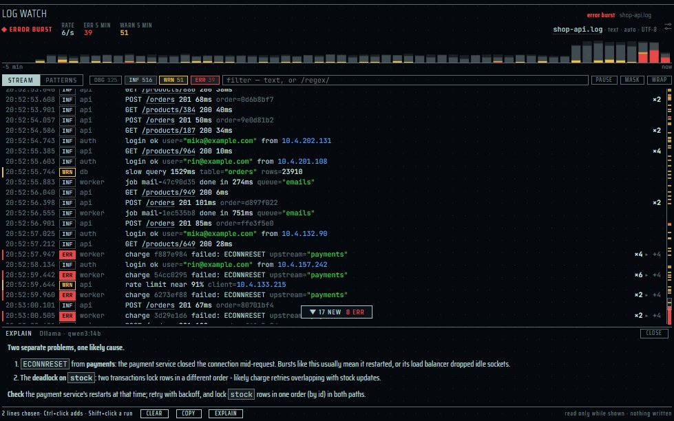

[English](panes-dev.md) | [日本語](panes-dev.ja.md) | 简体中文

# 开发窗格：AI Agent、Git、Docker 和 Log Watch — elecdex

elecdex 是一个科幻风格的终端模拟器和系统监视器，是用 Electron、Svelte 和 TypeScript 重写的 eDEX-UI。本页介绍它面向软件开发的四个窗格：**AI Agent**（从本地记录读取你电脑上正在运行的 Claude Code 会话）、**Git**（一个仓库的改动文件、diff、提交图，以及 FETCH、PULL 和 PUSH）、**Docker**（本机引擎的容器，可启动、停止、重启和暂停）和 **Log Watch**（跟随不断增长的日志文件，并让 AI 解释你选中的行）。对每个窗格，本页说明它读取什么、多久读取一次、绝不读取或绝不做什么，以及它的设置。elecdex 可在 Windows、macOS 和 Linux 上运行；它在 Windows 上开发和使用，macOS 和 Linux 只经过自动测试的构建和运行，尚未得到充分验证。

本页内容：

- [dev 预设](#dev-预设)
- [AI Agent](#ai-agent)
- [Git](#git)
- [Docker](#docker)
- [Log Watch](#log-watch)
- [共同的行为](#共同的行为)
- [设计文档](#设计文档)

## dev 预设

  
   dev · Phosphor
   
  ▶ <a href="https://youtu.be/YLxHhQ7wAyE">dev 布局使用演示视频</a>（1 分钟，英文字幕）

dev 预设（Ctrl+Shift+F4）摆放的是：工作中的代理、它们运行的容器，以及它们修改的仓库。

| 位置 | 窗格 |
| --- | --- |
| 左列 | 除 cockpit 和 blank 外所有预设共用的系统列 |
| 中间上方 | AI Agent |
| 中间中部 | Docker 在前，其后的标签页是一个 shell |
| 中间下方 | 剪贴板历史在前，其后的标签页是计时器和另一个 shell |
| 右侧（全高） | Git 在前（diff 需要高度），其后的标签页是 AI 聊天和 Log Watch |

- 放在前面的是只在显示于屏幕上时才读取的窗格（Docker 引擎、剪贴板），所以新打开的 dev 布局一开始就能看到它们在工作。
- 概要：**AI Agent** 显示你电脑上正在工作的 Claude Code 会话：每个会话此刻在做什么、承载了多少、它的子代理和后台任务，以及它改动的每个文件的 diff。**Git** 显示你选择的仓库，并随改动保持最新；有 FETCH、仅快进的 PULL 和从不强制的 PUSH；每个窗格一个仓库。**Docker** 按 Compose 项目显示引擎的容器，可在行上启动、停止、重启和暂停。**Log Watch** 跟随不断增长的日志文件，用 **EXPLAIN** 就你选中的行询问 AI 设置中的模型。
- 预设是模板：选择一个预设会添加一个已保存的布局，此后它跟随你的改动。新安装时包含全部十个预设；已有的布局列表不会被追加。

## AI Agent

  
   AI Agent・虚构的会话

| | |
| --- | --- |
| 位置 | dev 预设（Ctrl+Shift+F4）；选择器（Ctrl+Shift+A）中的 "ai agent"。每个布局只有一个：选择器会聚焦屏幕上已有的窗格。可以弹出（▣ pop up）和置前（Ctrl+Shift+Z）。 |
| 读取 | Claude Code 自己的本地记录，位于 `~/.claude`，或 `CLAUDE_CONFIG_DIR` 指定的文件夹 |
| 更新 | 只在 AI Agent 窗格打开时。监视文件夹；记录增长后 400 毫秒读取，只读自上次查看以来写入的部分。每分钟检查一次会话进程是否仍然存活。 |
| 平台 | Claude Code 存放这些记录的环境。尚未在 macOS 和 Linux 上手动验证。 |
| 隐私 | 只读取；不向任何地方发送任何东西，不启动也不停止任何东西。记录中的工具输出被跳过，不做解析。 |
| 设置 | `settings.json` 中的 `agents.sources`：读取哪些代理的记录（目前是 `claude-code`；只读取这里列出的代理） |
| 状态 | *实验性*：这些记录属于 Claude Code 且没有公开文档，所以 Claude Code 的新版本可能会改变可显示的内容。 |

会话卡片显示的内容：

- 每个运行中的 Claude Code 会话一张卡片：名称和文件夹、是否忙碌、最后做的事（用的工具及对象）、模型、上下文中和已写出的 token，以及它的回答。
- 卡片下方是它启动的子代理和留在后台运行的命令，各自标为 **RUN**、**DONE**、**FAIL** 或 **STOP**（未知时为 —），运行中的子代理还会显示它自己的最后一步。它们以树的形式挂在会话下面；子代理再启动的东西挂在它下面（最多四层）。
- 已结束的折叠成一行，写明它们如何结束（例如 *4 FINISHED 3 DONE 1 FAIL*），点击即可展开，并保留十分钟。运行中的全部显示，已结束的最多显示 12 个。已汇报完毕但自己的子代理仍在工作的子代理，按运行中计。
- 会话进程消失时仍在运行的任务显示为未知，绝不显示为已完成。
- 展开卡片可以看到它用过的工具和改动过的文件（最多 60 个，其中为子代理的文件预留 20 个）。打开文件会显示与 Claude Code 在该会话首次改动前保存的副本之间的 diff，使用与 Git 窗格相同的 diff 视图。子代理改动的标为 **SUB**，没有这样的副本，其 diff 会说明这一点。
- 窗格较宽时列表和 diff 并排，较窄时上下堆叠。两者之间的分隔条可以拖动，位置按窗格保存。

读取方式：

- 只在窗格打开时，从上次停下的地方以每次 1 MB 增量读取。超过 32 MB 的记录从最后 512 kB 读起，其计数会标为 *recent*。
- 在开发者电脑上的实测：完整解析一个 124 MB 的记录需要 944 毫秒；读取最后 64 kB 需要 0.27 毫秒。这就是改动时从不完整解析记录的原因。
- 只把模型自己的行，以及后台任务的结束通知和它正在等待的调用结果当作 JSON 解析；其他工具结果作为文本跳过。

限制：

- 目前只读取 Claude Code。OpenAI Codex 的数据源已有设计和原型，但尚未实现（[agents-codex.md](../agents-codex.md)，日文）。
- 由于格式没有公开文档，Claude Code 的更新可能会在 elecdex 更新之前改变或破坏显示的内容。

## Git

  
   Git

| | |
| --- | --- |
| 位置 | dev 预设（Ctrl+Shift+F4）；选择器（Ctrl+Shift+A）中的 "git status"。可以添加多个窗格，每个一个仓库。可以弹出和置前（Ctrl+Shift+Z）。 |
| 读取 | 用 **SELECT REPOSITORY** 选择的仓库，通过 `git` 程序读取（`PATH` 中必须有 git 2.31 或更高版本） |
| 更新 | 只在窗格显示时。每次改动后重新读取，最多每秒一次，没有改动时从不读取（不轮询）。 |
| 写入 | 只有 **FETCH**、**PULL**（仅快进）和 **PUSH**（从不强制），都要按两次。从不暂存、提交、检出、合并或变基。 |
| 平台 | Windows：`.cmd` 打开命令通过 `cmd.exe` 运行。其他系统上，设置了可执行位的文件不打开，而是在其文件夹中显示。尚未在 macOS 和 Linux 上手动验证。 |
| 隐私 | 布局只保存仓库的 id（路径保存在应用数据文件夹的 `git-repos.json` 中），因此保存的布局不含路径。窗格不与任何其他窗格联动。 |
| 设置 | `settings.json` 中的 `git.openCommand`（只能在那里设置，页面无法修改） |

显示的内容：

- 已暂存、未暂存、未跟踪和有冲突的文件，每个文件附增删行数。
- 所选文件的 diff，可选统一视图或并排视图，改动的词会高亮，并有语法着色。diff 中的文字作为文字绘制，从不作为 HTML 插入。未跟踪文件最多显示 512 KB；diff 超过 3,000 行的部分被截断。
- 改动的图片（PNG、JPEG、GIF、WebP、BMP、ICO、AVIF，最大 5 MB）以前后两张图代替 diff，并排或上下排列，取能画得更大的一种。点击其中一张单独查看：滚轮缩放、拖动移动，**BEFORE** / **AFTER** 在同一位置对比两者。SVG 作为文本做 diff。
- 提交图：分支的连线和每个提交上的名称（检出的分支、其他分支、远程、标签）。显示当前分支及其上游，或用 **ALL** 显示全部，每次一百个提交，用 **MORE** 加载更多（最多 2,000 个）。点击提交会打开它的文件和 diff；鼠标停在上面会显示一张卡片，包含提交说明、作者、日期和改动内容。
- 文件列表与 diff 之间、改动文件与提交图之间的分隔条可以拖动，双击恢复默认。位置按窗格保存。

FETCH、PULL 和 PUSH：

| 按钮 | 作用 | 拒绝的情况 |
| --- | --- | --- |
| **FETCH** | 从远程获取，并显示分支落后多少 | 仅限下面列出的、三者共同的情况 |
| **PULL** | `--ff-only`：只做快进，从不产生合并提交、冲突或编辑器 | 分支已分叉：显示 **DIVERGED**，合并或变基交给终端 |
| **PUSH** | 把分支推送到其配置（`branch.<名称>.remote` 和 `.merge`）指定的上游，写明唯一的 refspec，不推送标签，从不使用 `+` 或 `--force` | 远程已有新提交：**REJECTED**（先 FETCH 再 PULL）。没有上游：交给终端里的 `git push -u`。没有可推送的、落后或已分叉时：按钮不可用 |

- 仓库无法读取、处于合并或变基中、HEAD 游离，或分支没有上游时，三个按钮都不可用。elecdex 依据它自己对仓库的最后一次读取来判断。
- 每个按钮都要按两次。第一次按 PUSH 会说明把多少提交推送到哪里，以及不会运行钩子，例如 `push ↑2 to origin/main · no hooks`。
- **三者都不运行任何钩子**：`core.hooksPath` 指向 elecdex 自己的一个空文件夹。因此 push 会跳过 pre-push 检查（测试、lint），并在第二次按下前说明这一点。
- **仓库自身配置为传输指定了程序时，按钮会被拒绝**（例如该仓库的 `core.sshCommand`、`core.gitProxy`、git 未自带的凭据助手、`remote.<名称>.uploadpack`）。这样的仓库请在终端中同步。
- **只使用 https、http、ssh 和 git 协议**：不用本机上的文件夹、`ext::` 或远程助手。对这类远程（常见的是共享文件夹）按下时，会以 git 的 `transport 'file' not allowed` 失败，并提示在终端中运行同一命令。
- 认证、ssh 和代理使用你自己的全局和系统 git 配置。会告诉 git 没有可询问的终端；120 秒后仍在等待的传输会被停止，并显示 **TIMED OUT**。
- 结果以通知显示，短代码（`PULLED 3 COMMITS`、`FETCHED · 2 COMMITS BEHIND`、`PUSHED 2 COMMITS`、`DIVERGED`、`REJECTED`、`PULL FAILED`）旁附 git 自己的说明。每个仓库同一时间只运行一个操作，结束后窗格重新读取仓库。

只读取时也安全地调用 git：

- 每次调用都禁用 `core.fsmonitor`、日志中的签名检查、外部 diff 程序和 textconv。仓库自身配置中的 clean 过滤器被置空；用户的全局过滤器（例如 Git LFS）保持不变。
- 不读取子模块的工作树。`--no-optional-locks` 使 status 不写入 index，因此窗格不会和你自己的 git 争夺 `index.lock`。
- git 不存在或文件夹消失时，窗格每 30 秒重试一次。

打开文件：

- 双击打开文件（在 diff 的行上则定位到该行）。设置了 `git.openCommand` 时，该命令作为程序和参数运行，从不经过 shell，并填入 `{file}`、`{line}` 和 `{dir}`，例如 `code -g "{file}:{line}"`。
- 为空时，用系统默认的应用只打开不会被执行的文本、图片和 PDF（依据文件开头的字节和类型判断）；其他文件（例如刚克隆下来的 `setup.bat`）在其文件夹中显示。
- 只打开或显示工作树内、`.git` 之外的文件。

## Docker

  
   Docker

| | |
| --- | --- |
| 位置 | dev 预设（Ctrl+Shift+F4）；选择器（Ctrl+Shift+A）中的 "docker containers"。每个布局只有一个。可以弹出和置前（Ctrl+Shift+Z）。 |
| 读取 | 本机 Docker 引擎的 API，通过其套接字、命名管道或本机的 TCP 端口。从不运行 `docker` 命令。 |
| 更新 | 只在窗格显示在屏幕上时：保持一条事件流；事件后的下一个 0.25 秒边界和每十秒读取列表；每五秒读取运行中容器的 CPU 和内存。在其他标签页后面、窗口最小化或收起时，不询问引擎。 |
| 操作 | ▶ 启动、■ 停止、↻ 重启、❚❚ 暂停、▶ 恢复。从不删除、kill 或 prune。 |
| 平台 | Windows：Docker Desktop 的 `docker_engine` 管道。macOS：`~/.docker/run/docker.sock`、`/var/run/docker.sock`。Linux：`/var/run/docker.sock`、rootless 的 `$XDG_RUNTIME_DIR/docker.sock`、Docker Desktop 的 `~/.docker/desktop/docker.sock`。尚未在 macOS 和 Linux 上手动验证。 |
| 隐私 | 不写入磁盘或日志。不读取命令、挂载和环境变量；标签只读取 Compose 项目、服务和文件夹三项。插件无法访问。 |

查找引擎：与 `docker` 命令的顺序相同，但不运行该命令——`DOCKER_HOST`，然后是当前上下文（`DOCKER_CONTEXT`，或 `~/.docker/config.json` 中的 `currentContext`），然后是常用的套接字。这样可以连接到 Docker Desktop、Linux 守护进程、rootless Docker、colima 和 OrbStack。不使用其他机器上、经 TLS 或经 ssh 的引擎，页面也无法指定引擎。每次连接都会重新查找，因此切换上下文后从下一次连接开始生效。

显示的内容：

- 容器按 Compose 项目分组（点击项目可折叠），按项目、服务、名称排序。**容器状态改变时行的位置不变**，所以按钮不会从指针下跑开。
- 每个容器的状态及持续时间（UP、HEALTHY、UNHEALTHY、STARTING、PAUSED、RESTARTING、非零时带退出码的 EXITED、CREATED、DEAD）、镜像带有健康检查时的结果、公开的端口，以及运行中容器的 CPU 和内存。
- **ALL** 或 **RUN**（仅运行中）。窗格变窄时依次折叠列：先 IMAGE，再 CPU 和 MEM，然后 PORTS。
- 点击名称会复制名称；公开的 TCP 端口在浏览器中打开；`›_` 复制进入 shell 的 `docker exec -it <name> sh`。鼠标停在名称上会打开一张卡片，显示行中放不下的内容（完整镜像、Compose 项目和服务、文件夹、带地址的全部端口、内存上限、创建时间、ID）。
- 指针（或键盘）所在的行会给出该状态可接受的操作。停止、重启和暂停需要再按一次确认（第二次按下在三秒内有效）。停止和重启给容器通常的 10 秒宽限期。发送期间行会显示 STOPPING… 等，结果随下一次列表更新出现。
- 最多列出 100 个容器（优先运行中的，其次最新的）。最多读取 24 个运行中容器的占用。

标题行中的连接状态：

| 状态 | 含义 |
| --- | --- |
| STANDBY | 窗格不在屏幕上，因此不询问引擎 |
| LINKING / LINKED | 正在连接 / 已连接 |
| NO DAEMON | 没有响应：请启动 Docker Desktop 或服务 |
| DENIED | 当前用户无法打开套接字（Linux 上请加入 docker 组） |
| UNSUPPORTED | 引擎的 API 版本低于 1.24 |
| LINK ERROR | 引擎响应缓慢；屏幕上保留上一次的列表 |

不包含：容器日志、镜像、卷和网络的列表、Kubernetes、窗格内的 shell、远程引擎。

## Log Watch

  
   Log Watch・虚构日志，EXPLAIN 由替身回答

| | |
| --- | --- |
| 位置 | dev 预设（Ctrl+Shift+F4）中 Git 和 AI 聊天之后的第三个标签页；选择器（Ctrl+Shift+A）中的 "log watch"。可以添加多个窗格，每个一个文件。可以弹出和置前（Ctrl+Shift+Z）。 |
| 读取 | 每个窗格一个用 **SELECT LOG FILE** 选择的日志文件（只读文件；不读取 Windows 事件日志、journald 或 macOS 的 `log stream`） |
| 更新 | 只在窗格可见时：监视文件夹，并每秒检查一次文件；只读取追加的部分，每 0.25 秒把新行送到窗格。隐藏时什么也不做，也不发通知。 |
| 平台 | Windows：其他进程追加写入时通知可能延迟，网络驱动器或 `\\wsl$` 上可能根本没有通知——每秒一次的检查弥补这两种情况。Mac 上用 ⌘ 代替 Ctrl。尚未在 macOS 和 Linux 上手动验证。 |
| 隐私 | 从不写入文件，也不把其内容写到任何地方。**EXPLAIN** 只发送你选中的行，且只在按下 **SEND** 时发送。 |
| 设置 | 按窗格：编码、时间显示方式、WRAP、是否合并重复、CHART、ERROR BAR、MASK、EXPLAIN 的提供方和模型、已静音的模式。所有窗格共用：保留的行数和打开时读取的行数（`settings.json` 中的 `logWatch`）。 |

选择文件：

- **SELECT LOG FILE** 打开系统的文件选择器。之前选过的文件列在 RECENT 中（最多 40 个）。布局只保存 id；路径保存在应用数据文件夹的 `log-files.json` 中。
- **FOLLOW THE NEWEST LIKE IT** 跟随同一文件夹中名称仅数字不同的最新文件——适合每天或每次运行新建文件的日志（`2026-10-12T09_08_16_117Z-debug-0.log` 变为 `*-debug-*.log`）。出现更新的文件时窗格会切换过去，并标出切换。
- 前 8 KB 中含 NUL 字节的文件被视为二进制文件而拒绝。没有读取权限时显示 CANNOT READ 及原因；尚不存在的文件显示 WAITING FOR FILE，出现后即打开。
- 状态行中的文件名是一个按钮：鼠标停留显示完整路径，点击可选择另一个文件。

读取方式：

- 打开时读取末尾的若干行（默认 500 行；从末尾最多 4 MB），之后只读取追加的部分。
- 位于其他标签页之后或窗口收起时什么也不读。回来时，把期间写入的内容像其他行一样显示到最新（超过 4 MB 时取最后 4 MB）。
- 文件轮转或截断后从头重新读取，并标出 *rotated · reading from its start*。从不保持文件打开。
- 自动识别编码（UTF-8、UTF-16LE/BE、Shift_JIS、EUC-JP、Windows-1252），也可以手动选择。文字看起来是乱码时，状态行显示 **TEXT LOOKS GARBLED · CHOOSE THE ENCODING ▸**。

可识别的格式：JSON Lines（pino、bunyan、winston、Serilog 等）、logfmt、syslog（RFC 3164 和 5424）、Apache 和 nginx 访问日志、IIS 的 W3C 文件，以及常见的"时间 [级别] 正文"。其余按普通行读取，级别依据关键词推测。格式可以按文件手动指定。

显示的内容：

- 按级别着色；堆栈跟踪折叠在所属行之下（▸ +n 展开）；同一模式的连续行合并为 ×n；首次出现的模式标记 **NEW**；错误明显增多时点亮 **ERROR BURST**（最近 15 秒内至少 5 个错误，且至少为之前每 15 秒平均数的 4 倍加 1，并持续 2 秒）。
- 上方是按级别统计的 5 分钟行数（CHART）；右侧标出错误和警告的位置（ERROR BAR），点击即可跳转。
- 过滤（文本或 `/正则/`，Esc 清除）和级别开关；**PAUSE**（继续读取，只冻结画面，显示 *n HELD*）；**MASK**（隐藏 IP 地址、邮箱地址、密钥、`Bearer` 令牌，以及名称含 password、secret、token、key、auth、session 或 cookie 的值）；**WRAP**。
- **PATTERNS** 标签页显示各模式的计数、最近一分钟的走势和最后出现时间，并可 **MUTE**。
- 指针在列表上时列表不会自动滚动；新行计入 *▼ n NEW* 按钮。

EXPLAIN：

- 只在 *Settings → AI* 中有提供方时显示；否则按钮显示为 **EXPLAIN · SET UP AI**，点击打开这些设置。
- 点击行即可选中（Ctrl+单击添加一行，Shift+单击选择一段；Mac 上为 ⌘）。**EXPLAIN** 按发送时的原样显示文本；**SEND** 发送。**COPY** 复制同样的行。
- **只发送你选中的行**——包括它们的堆栈跟踪，但不发送前后的行、文件名或路径，也不发送识别出的格式。被过滤或级别隐藏的已选行既不发送也不复制。
- MASK 开启时先遮盖再发送；关闭时预览中显示 *MASK is off*。
- 最多 200 行、12,000 个字符。过长的选择会被拒绝，绝不截断。
- 回答以 markdown 呈现，从不作为 HTML 插入，只保存在窗格的内存中，不进入 AI 聊天的历史。同一时间只有一个请求，180 秒后停止。AI 设置中你自己的系统提示词附加在 EXPLAIN 自身的提示词之后。

保留与读取的行数：

| 设置 | 选项 | 默认值 |
| --- | --- | --- |
| 可回滚保留的行数（`logWatch.keepLines`） | 1k、5k、20k、50k | 5k |
| 打开时读取的行数（`logWatch.initialLines`） | 100、500、2k | 500 |

在开发者的 Windows 电脑上实测：每秒 1,000 行时，main 进程中的解析每 0.25 秒约 1 毫秒；保留 5k 行时，整个应用在 main 中占一个核心的 0.2%，在页面中占 2.4%（合并重复时页面为 0.3%）。

试用时，在仓库的检出目录中运行 `node scripts/log-feed.mjs [file] --format=jsonl|logfmt|generic|syslog|clf|plain --rate=20`，会写出包含堆栈跟踪、错误激增和轮转的虚构日志。

## 共同的行为

- **只在可见时读取。** 四个窗格都只在显示于屏幕上时读取（AI Agent 为打开时）。最后一个这样的窗格消失时，main 的监视、数据流和计时器都会停止；页面重新加载时也会释放它们。
- **访问网络的只有** Git 的 FETCH、PULL 和 PUSH，以及 Log Watch 的 EXPLAIN 发往你所设置的 AI 提供方的内容。
- **插件 API** 无法访问其中任何一个。
- **路径留在 main 中。** Git 和 Log Watch 通过 id 认识仓库和文件；页面从不发送路径。
- **文字作为文字绘制。** 文件内容、日志行和提交说明从不作为 HTML 插入。
- **面向开发者：** 测试从不触及本机。AI Agent 的测试把 `ELECDEX_CLAUDE_DIR` 指向虚构的文件夹，Docker 的测试使用替身引擎（`ELECDEX_DOCKER_STUB=1`），Git 和 Log Watch 的测试在临时文件夹中进行。

## 设计文档

以下为日文：

- [architecture.md](../architecture.md)：§5.9 Git、§5.11 AI Agent、§5.17 Docker、§5.21 Log Watch
- [logwatch.md](../logwatch.md)：Log Watch 的设计、决定和测量
- [agents-codex.md](../agents-codex.md)：Codex 数据源（已设计，未实现）
- [decisions.md](../decisions.md)：决定及其理由和测量数据
- [网络访问与数据来源](data-sources.zh-CN.md)
