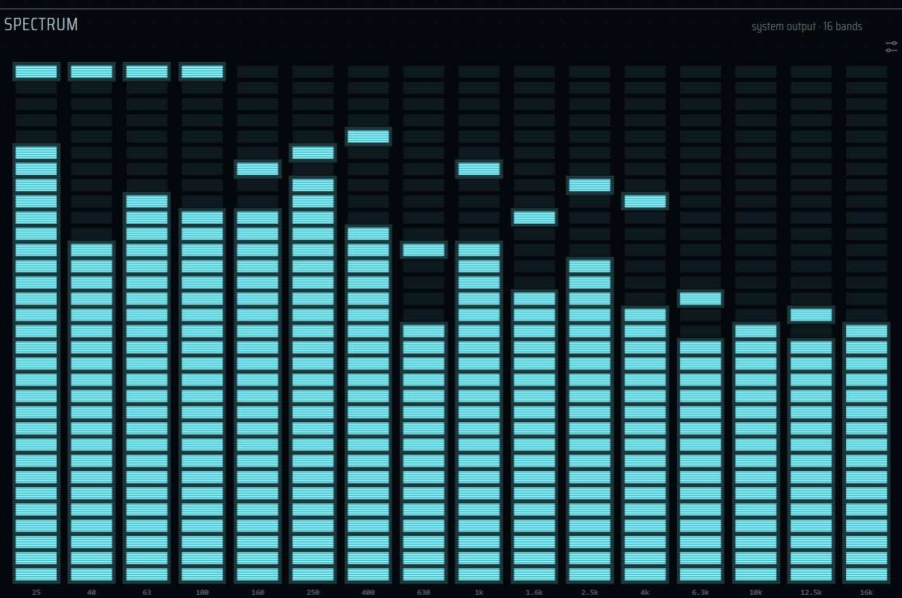
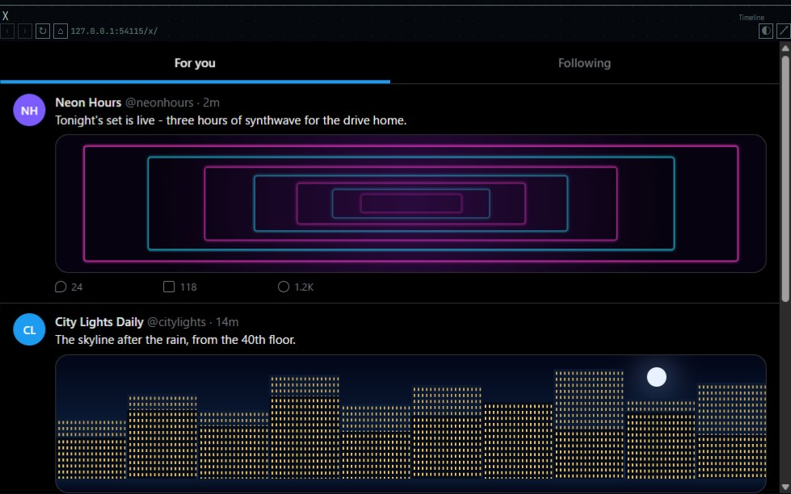
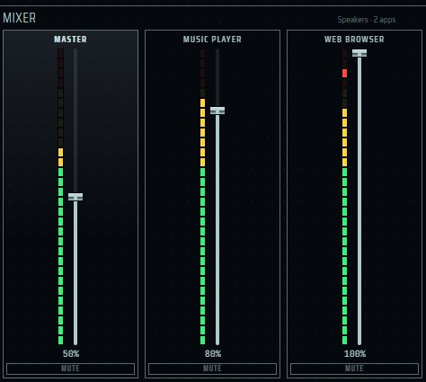
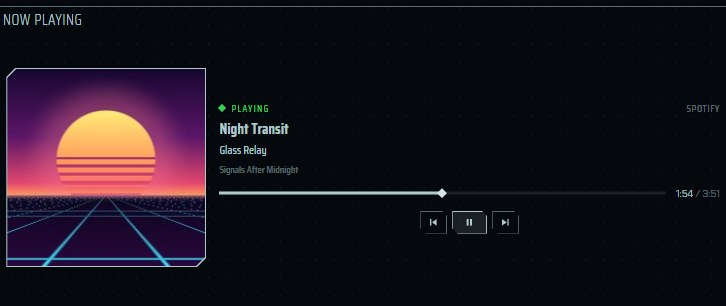

English | [日本語](panes-media.ja.md) | [简体中文](panes-media.zh-CN.md)

# Media panes — elecdex

elecdex is a science-fiction terminal emulator and system monitor, a rewrite of eDEX-UI on Electron. This page covers its media panes: **Spectrum** (a spectrum analyser of the sound the computer plays), the **Browser, YouTube and X** web panes, the **Mixer** (system and per-app volume) and **Now playing** (the current media session with previous, play/pause and next). It says what each pane reads, when, and what it never reads or sends, on Windows, macOS and Linux. elecdex is developed and used on Windows; macOS and Linux are built and run only by the tests on GitHub Actions and are not sufficiently verified by hand.

  
   media · White — the web panes show stand-in pages made for the picture

## On this page

- [The media preset](#the-media-preset)
- [Spectrum](#spectrum)
- [Browser, YouTube and X](#browser-youtube-and-x)
- [Mixer](#mixer)
- [Now playing](#now-playing)
- [Design documents](#design-documents)

## The media preset

| | |
|---|---|
| Where | Ctrl+Shift+F5, or the LAYOUTS dialog |
| Panes | YouTube (TV) with Now playing, Spectrum and Mixer in a row beneath it; X and RSS as tabs; the system column on the left |

The preset is a template: choosing it adds a saved layout that then follows your work. None of these panes is in the default layout; each can also be added from the pane picker (Ctrl+Shift+A). Shortcuts can be rebound in *Settings → Keyboard*. All presets: [presets.md](presets.md#media).

## Spectrum

  
   Spectrum

| | |
|---|---|
| Where | media and retro presets; picker: "spectrum"; can pop up over the workspace and be brought forward |
| Reads | the system's sound output (loopback capture), as levels only |
| Updates | only while the pane is on screen; 20 frames a second while there is sound, nothing drawn in silence |
| Platforms | Windows: tested. macOS: the same screen-capture route, needs the screen recording permission, untested. Linux: `parec` (pulseaudio-utils) on PulseAudio or PipeWire |
| Privacy | capture runs in a hidden window of its own; only the levels reach the pane; nothing is recorded |
| Settings | in the pane (settings button): style, band count, pattern, peak hold |

### How to use it

- Add it from the picker. It shows the system's sound output in 7, 10, 16 or 31 bands, as columns of segments with held peaks, like a 1990s car stereo's display.
- The settings button picks:
  - the style: VFD cyan (the default), VFD amber, LED, or the theme's colour;
  - the band count: 7, 10, 16 or 31;
  - the pattern: bars, a mirrored pattern, or peaks only;
  - peak hold.
- VFD and LED are drawn on a dark glass of their own, so they look the same on a light theme. Every choice is kept in the pane's state.
- A short status such as *no sound* sits on the settings button's row and never covers the bars; a longer reason (capture unavailable, a muted monitor) is shown above the display.

### How the sound is captured

- **Windows and macOS.** Chromium can read the sound being played only through a screen capture with loopback audio. elecdex does not give that permission to the workspace. The capture runs in a hidden window of its own (`main/audio/capture-window.ts`), with an in-memory session of its own (the only session allowed display capture), a preload that can only report frames and status, and a page with no network. The video track the capture requires is stopped at once.
- The hidden page turns a 4096-point FFT into 60 logarithmic bins from 20 Hz to 20 kHz and sends them 20 times a second. After 2.5 seconds of silence it stops sending and reads at 10 per second. Main accepts messages only from that window, checks their shape, and passes them to the panes subscribed.
- The pane groups the bins into its bands. The 31 bands are the ISO 1/3-octave bands from 20 Hz to 20 kHz.
- **Linux.** Electron has no loopback capture on Linux, so main runs `parec --device=@DEFAULT_MONITOR@` and records the monitor of the default output (never the default input, which would be a microphone). It analyses the samples itself, the same way the hidden page does.
  - If the monitor's volume is turned down in the system settings, the pane compensates, so the bars show the sound as it plays.
  - If the monitor is muted, the pane says so and shows an **unmute monitor** button. Only that click changes the system setting: main unmutes the monitor and sets it to 100%.
  - If `parec` is missing or stops, the pane says why; reopening the pane tries again.

### Cost and limits

- Listening stops when the pane is behind another tab, closed or in a minimised window: the hidden capture window stops with it.
- Measured on an i5-1335U: about a third of a core while sound plays, about a tenth while the pane is on screen and silent.
- macOS loopback capture is untested.

## Browser, YouTube and X

  
   Browser, YouTube and X · a stand-in page

| | |
|---|---|
| Where | media preset (YouTube (TV) and X); picker: "browser", "youtube (tv)", "x"; several of each can be placed; can be brought forward |
| Reads | the site, through a separate browser view that main owns |
| Updates | the page keeps running behind a tab and in a minimised window, so a video keeps playing |
| Platforms | Windows, macOS, Linux (macOS and Linux not verified by hand) |
| Privacy | no access to elecdex; no camera, microphone, location or notifications; no downloads; http(s) only; one sign-in per site shared by all web panes and kept apart from the rest of the app |
| Settings | *Settings → General → tint pages in the theme's colour* (off by default); *Settings → General → sign out of all sites*; the ◐ button per pane |

### The three panes

- **Browser** has an address bar and opens any http(s) page.
- **YouTube (TV)** opens YouTube's living-room interface (`youtube.com/tv`), driven by the arrow keys. It is the YouTube pane offered because it is the one that can be signed in: it shows a code, which you enter at yt.be/activate on a phone. Google refuses to sign in from an embedded browser ("this browser or app may not be secure"). elecdex uses the device sign-in Google provides for televisions and does not disguise the pane as Chrome.
- **X** opens x.com.
- YouTube (TV) and X keep to their site. A link to another site goes to your default browser only when you followed it: a click or a key in the pane, one tab for one press, within a few seconds of it. A page that tries to leave by itself is kept where it is.
- An older YouTube pane (the desktop site) is no longer offered in the picker, because it cannot sign in; a saved layout that names it still opens it.

### Using a web pane

- Each pane has back, forward, reload (home for the sites) and *open in your browser*. For a YouTube (TV) video, *open in your browser* passes the video's watch page.
- The right-click menu offers back, forward, reload, cut, paste (in text fields), copy, select all, copy link, and open link in your default browser.
- Each pane remembers its page across restarts. A remembered page outside the pane's site opens the site's home instead.
- Moving or re-tabbing a pane does not reload its page.
- App shortcuts work while a page has the keyboard; every other key goes to the page. A shortcut that would do nothing at that moment (for example the tab keys outside a tab group) is left to the page.
- The status bar and the fullscreen window controls do not appear while the pointer is over a page. Use the shortcuts, or move the pointer to another pane.
- A video's fullscreen button fills the elecdex window. The page leaves fullscreen before its pane is hidden.

### Colours

- Pages are shown in their own colours by default.
- The ◐ button on the right of the address draws that pane's pages in the theme's colour, as you watch.
- *Settings → General → tint pages in the theme's colour* is the default for panes that have not used their own button. The Business themes never tint.
- The page is told the theme's light or dark mode (`prefers-color-scheme`), and a page that declares no colours of its own is given the matching default colours, so its text stays readable on a dark theme.

### What the page can and cannot do

- The page is drawn by a separate, sandboxed browser view (an Electron `WebContentsView`) laid over the pane, never an iframe or `<webview>`. It has no preload and no access to elecdex; the workspace's own security settings are unchanged.
- Permissions: only writing to the clipboard (copy link) and fullscreen. The camera, microphone, location, notifications and everything else are refused.
- Every download is cancelled. Only http, https and `about:blank` are opened; `file:`, `javascript:` and similar are refused, also when typed in the address bar.
- The User-Agent leaves out the Electron and elecdex marks. Spell checking is off, so no dictionary is downloaded.
- A sign-in window for Google or Apple opens as a child window in the same session, at most one per pane, closed with the pane.

### Sign-in and site data

- All web panes share one session (`persist:web`) and nothing else in the app uses it. Signing in to YouTube once signs in every YouTube pane, and youtube.com in the Browser pane too.
- Because the session is shared, two accounts of the same site cannot be used side by side.
- *Settings → General → sign out of all sites* deletes that session's site data.

### Behind tabs and dialogs

- Web panes are the exception to "read only while seen": a page keeps playing behind another tab and in a minimised window. Its drawing and video decoding go on too, so a long-forgotten background tab still costs CPU and GPU time.
- While a dialog, a notice or a dragged pane is over a page, a still picture of it stands in for the page.

## Mixer

  
   Mixer

| | |
|---|---|
| Where | media preset; picker: "mixer"; can pop up over the workspace and be brought forward at a fixed size |
| Reads | the output device's volume and mute, and on Windows and Linux each app playing sound |
| Updates | only while the pane is on screen. Windows: state every second, peaks every 0.1 s; macOS and Linux: every 2 seconds |
| Platforms | Windows: master, apps, peak meters. macOS: master volume only. Linux: master and apps |
| Settings | none |

- Each strip has a fader and a mute button; on Windows, also a peak meter. Apps are grouped by process name, as Windows' own volume mixer does.
- How it reads:
  - **Windows**: one long-lived PowerShell running a Core Audio loop. It ends when the pane no longer needs it.
  - **macOS**: AppleScript, master volume only.
  - **Linux**: `pactl` (PulseAudio or PipeWire; pactl from PulseAudio 16 or later), which reads and changes the default sink and the apps. Where pactl is missing or too old to print JSON, WirePlumber's `wpctl` handles the master volume. If neither is there, the pane says so; if a tool fails, it shows the tool's first line of error.
- A change shows on screen at once, and a reading that has not yet caught up does not move the fader back.
- Measured on an i5-1335U: about 5% of a core, of which the PowerShell is 1.3%.

## Now playing

  
   Now playing

| | |
|---|---|
| Where | media preset; picker: "now playing"; can pop up over the workspace and be brought forward at a fixed size |
| Reads | the media session Windows calls current (System Media Transport Controls) |
| Updates | twice a second, only while the pane is on screen; nothing behind another tab, in a minimised window or put away |
| Platforms | **Windows only.** macOS and Linux are not supported yet: the pane shows UNSUPPORTED |
| Privacy | nothing written to disk or logged; no plugin can reach it; it never changes the volume |
| Settings | none |

### What it shows

- The media session Windows calls current: Spotify, a browser playing YouTube, Media Player, any player that tells the system what it plays. If no session is current, the first one playing.
- Its art, title, artist, album and application, and where the track is. The player reports its position only now and then; between reports the pane counts on each second, never past the end. A stream with no length shows no bar.
- A lamp: PLAYING, PAUSED, NO SESSION, STANDBY or UNSUPPORTED.
- When elecdex's own web pane is playing, the application is named `elecdex`.
- Resting the pointer on the art (or moving to it with the keyboard) opens a card with the art large and the whole title, artist and album, the player's name and Windows id, the length, the art's original size and how many other players there are.

### What you can press

- Previous, play/pause and next, each offered only when the player offers it. If the player refuses a press, the pane says so beside the buttons for three seconds.
- Where the player takes a new position, the bar has a head to drag, or ← → (5 seconds) and Home / End. The new position is sent once, when you let go. Where the player does not take one, the bar is a plain meter and does not look draggable.
- The page may press only these and seek, never change the volume (that is the Mixer's), and only while it shows the pane.
- No shortcut is bound to play/pause; a focused button takes Space or Enter.

### How it reads

- Main reads the session through one long-lived PowerShell. It is started when a pane first shows and closed 15 seconds after the last one goes, so moving a pane does not restart it. Measured on an i5-1335U: about 0.6 s to the first answer, then about 1 ms a reading.
- The art is made small in the reader and passed to the page as a checked JPEG. The card's larger copy stays in main's memory until a card opens. Nothing is written to disk.
- Now playing is not a metric source and is not part of the plugin API.
- macOS: Apple's media interface is private and no longer answers unsigned processes, so there is no reader. Linux (MPRIS over D-Bus) is not built yet.

## Design documents

In Japanese:

- [architecture.md §5.4 Web panes](../architecture.md#54-web-ペインブラウザ--youtube--x)
- [architecture.md §5.15 NOW PLAYING](../architecture.md#515-now-playing-ペイン再生中のメディア)
- [decisions.md](../decisions.md): the spectrum and mixer (v0.0.4), Linux capture with `parec` (v0.0.5), the monitor volume, and measured costs
