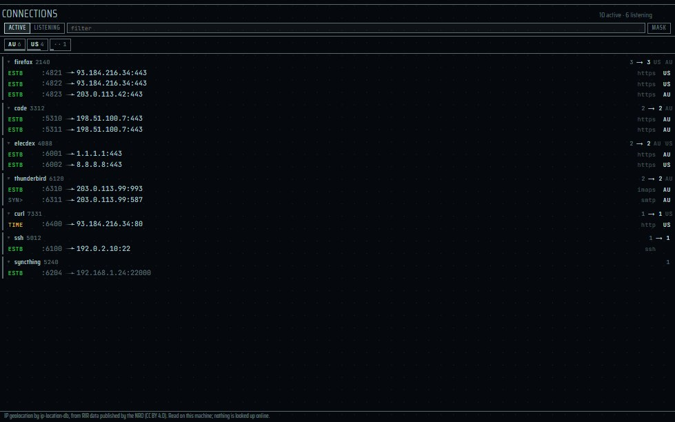
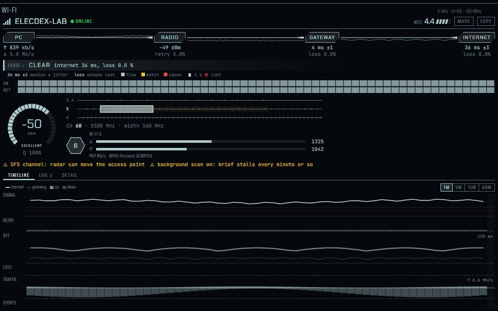
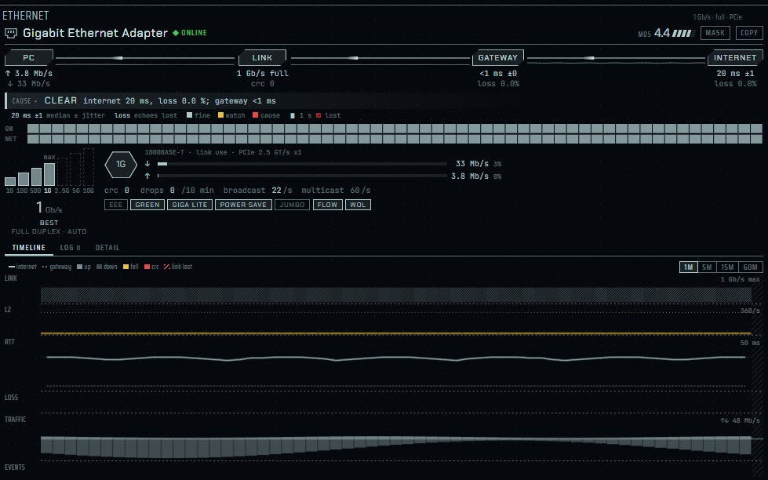

English | [日本語](panes-network.ja.md) | [简体中文](panes-network.zh-CN.md)

# Network panes — elecdex

elecdex is a science-fiction terminal emulator and system monitor for Windows, macOS and Linux, a rewrite of eDEX-UI on Electron. This page covers the panes about this machine's network: network status, network traffic, the world view of where connections go, the table of every TCP socket (Connections), and the two link diagnostics, Wi-Fi and Ethernet. For each pane it says what is read, on which platform, how often, and what is never read: no address is looked up online (a bundled GeoIP database places peers), and nothing behind the operating system's location permission is read (no Wi-Fi BSSID, no scan). elecdex is developed and used on Windows; macOS and Linux are built and run by the automated tests on GitHub Actions only and are not sufficiently verified by hand.

On this page:

- [How network readings are taken](#how-network-readings-are-taken)
- [Network status](#network-status)
- [Network traffic](#network-traffic)
- [World view](#world-view)
- [Connections](#connections)
- [Wi-Fi](#wi-fi)
- [Ethernet](#ethernet)

The other panes of the system column are on [System panes](panes-system.md). Every host elecdex contacts is listed on [Network access and data sources](data-sources.md).

## How network readings are taken

- The page (the renderer) has no network access. Every reading on this page is taken by the metrics collector, a separate utility process, and only while a pane subscribes to it ([System panes: how readings are taken](panes-system.md#how-readings-are-taken)).
- On Windows the frequent readings come from one long-lived PowerShell, the `WindowsSampler`, reading .NET and Win32 APIs (IP Helper, ICMP, the WLAN API, performance counters) in a loop - never a process per reading.
- **One echo serves three panes.** The internet echo goes to `1.1.1.1`. The network status pane, the Wi-Fi pane and the Ethernet pane read the same echo, so the host is never asked twice. It is sent every 5 seconds for network status alone, and every second while a Wi-Fi or Ethernet pane is on screen. Echoes are sent from the collector, never from the main process.
- **Private readings.** The socket table (`net.sockets`), the Wi-Fi readings (`net.wifi`, `net.wifi.events`) and the Ethernet reading (`net.ethernet`) can never be granted to a plugin: they say where this machine has been and what it talks to. Network status, traffic and the per-country connection counts can be.

| Source | Interval | Used by |
| --- | --- | --- |
| `net.interface` | 5 s on Windows, 30 s elsewhere | Network status, Cluster |
| `net.ping` | 5 s (every second while Wi-Fi or Ethernet is on screen, shared) | Network status, Network traffic, World view, Cluster |
| `net.throughput` | 1 s, kept sampled behind a tab | Network traffic, Cluster |
| `net.connections` | 5 s | World view, Cluster |
| `net.sockets` | 5 s on Windows, 3 s elsewhere; only while seen | Connections |
| `net.wifi` / `net.wifi.events` | 1 s / 5 s; only while seen | Wi-Fi |
| `net.ethernet` | 1 s; only while seen | Ethernet |

## Network status

| | |
| --- | --- |
| Where | System column (every preset but cockpit and blank); picker: *network status* |
| Reads | `net.interface` (the adapter that holds the default route) and `net.ping` |
| Platforms | Windows: the sampler (IP Helper for the interface, ICMP for the echo). macOS, Linux: systeminformation, or the Wi-Fi or Ethernet pane's running echo when there is one |

- Three figures: **STATE**, the interface's **IPV4** address, and **PING** to `1.1.1.1` in milliseconds. The subtitle names the interface.
- **ONLINE** means the interface is up *and* the ping host answered: an interface can be up on a network with no route out, and that is reported as **OFFLINE**. With no reading yet, **UNKNOWN**.
- With no default route, Windows falls back to any real adapter with an address (never loopback) and reports it down.
- The pane has no ⤢ button: a pane of a few figures gains nothing from filling the window.
- elecdex never calls systeminformation's Wi-Fi functions or its interface list on Windows: they run `netsh wlan`, which Windows 11 treats as location access and answers with a permission prompt.

## Network traffic

| | |
| --- | --- |
| Where | System column (every preset but cockpit and blank); picker: *network traffic* |
| Reads | `net.throughput` (1 s, kept sampled behind a tab) and `net.ping` |
| Platforms | Windows: the sampler's adapter byte counters, for the adapter that holds the default route. macOS, Linux: systeminformation's statistics for the default interface |

- Running totals (`OUT` and `IN`) over one graph labelled in MB/s: upload above the axis, download mirrored below it, on one scale set by the larger direction.
- The traffic goes on being sampled behind another tab or with the window put away, so the graph has no gap when the pane is seen again; the totals written on the pane are updated only while it is seen.

## World view

| | |
| --- | --- |
| Where | standard, network and earth presets; picker: *world view* |
| Reads | `net.connections` (5 s): the public peers of established TCP connections, placed by country with a bundled GeoIP database |
| Platforms | Windows: the sampler's TCP table. Linux: `/proc/net/tcp` and `/proc/net/tcp6`. macOS: `netstat -anp tcp` |
| Privacy | No address is sent anywhere. The OS location service is never asked |

  
   World view

- Connections by country on a turning globe, with the number of connections, the number of countries, and the six countries with the most connections.
- **"You are here"** is the country of the system time zone, or of the locale when the zone names none (marked *approx.*). The OS location service is never asked, because it would prompt you. eDEX-UI asked an online IP-lookup service instead. If neither gives a country, the pane says *location unavailable* once and still shows the connections.
- Earthquakes are marked on the globe while the earthquake list is being kept current anyway (quake alerts on, or a quakes pane seen); the globe never makes the app fetch it. See [World panes](panes-world.md).
- The globe takes one WebGL context and gives it back when the pane closes. It draws on the shared 10 fps frame loop, not on a timer of its own, draws nothing while the pane or window is hidden, and holds still when motion is reduced.
- Credits shown in the pane: **GeoIP: NRO, CC BY 4.0 · map: Natural Earth**. The database is [`@ip-location-db/geo-whois-asn-country-mmdb`](https://github.com/sapics/ip-location-db), data by the [NRO](https://www.nro.net/), under [CC BY 4.0](https://creativecommons.org/licenses/by/4.0/).

## Connections

| | |
| --- | --- |
| Where | network preset (under the world view); picker: *connections*; more than one can be open |
| Reads | `net.sockets`: the kernel's TCP table and the process holding each socket; countries from the same bundled GeoIP database |
| Updates | Every 5 s on Windows (the sampler's own tick), every 3 s elsewhere; only while the pane is on screen (nothing behind a tab) |
| Platforms | Windows: `GetExtendedTcpTable` in the sampler. Linux: `/proc/net/tcp*`, owners from `/proc/<pid>/fd`. macOS: `netstat`, which cannot name the owner |
| Privacy | Nothing is looked up online; the port of a listening program is never asked anything; the reading can never be granted to a plugin |

  
   Connections

- Every TCP socket this machine holds, grouped by the program holding it: the local port, the peer, what the port is known for, and the country the peer is in. A bar across the top sums the peers' countries.
- **ACTIVE** and **LISTENING** switch between connections and the listening sockets - the doors this machine leaves open. A filter field narrows the rows.
- A connection that opened and closed between two readings is still drawn once, struck through, so a short-lived one is not invisible.
- **MASK** hides the second half of every address, for a screenshot or a shared screen.
- A listening program says what it serves, told from its command line: `node` becomes `vite · my-app`. The command line of each listening process is read once and only the tool and project made of it are kept, never the line itself, which can carry a token as an argument. The port is never contacted.
- At most 240 rows are sent to the page.

| Platform | Table | Owner |
| --- | --- | --- |
| Windows | `GetExtendedTcpTable` (iphlpapi), called from C# inside the long-lived sampler | The process id, named from the process table the sampler reads on the same tick |
| Linux | `/proc/net/tcp` and `/proc/net/tcp6`, no process started | Found by matching socket inodes against `/proc/<pid>/fd` links, only for the inodes in the table, cached between readings |
| macOS | `netstat -an -p tcp` | Not available; the pane says so. `lsof` would cost a process and several hundred milliseconds every reading |

## Wi-Fi

| | |
| --- | --- |
| Where | network preset (over Ethernet), cockpit preset (right column); picker: *Wi-Fi status*; heading WI-FI |
| Reads | The wireless adapter's link and counters from the OS, an echo to the gateway and to `1.1.1.1` every second, the OS's log of connections (Windows) |
| Updates | Every second, only while the pane is on screen; nothing while it is hidden (the timeline shows the gap) |
| Platforms | Windows: the WLAN API and WinRT through the sampler. Linux and macOS: parsers unit-tested only, not used on real hardware |
| Privacy | Nothing behind the location permission: no BSSID and no scan of the networks around. Not available to plugins. **MASK** hides the network's name and the addresses |

  
   Wi-Fi

Where a wireless connection is failing - for a call that stutters, or a train's Wi-Fi that keeps dropping.

- **The path.** The way from this machine to the internet is measured a segment at a time: the radio's signal and retries, an echo to the gateway and one to the internet every second, and what the machine itself is sending. The pane names the segment at fault with the figures it rests on:

  | Verdict | Meaning |
  | --- | --- |
  | RADIO | Weak signal or many retries between the machine and the access point |
  | LOCAL LINK | The gateway answers slowly, unevenly or loses echoes |
  | UPSTREAM | The way beyond the gateway is slow, uneven or lossy |
  | UPSTREAM LOST | The access point answers, the way beyond does not (four internet echoes lost in a row with the gateway answering), as on a train in a tunnel |
  | OWN UPLOAD | This machine is sending enough (500 kB/s or more) to crowd out its own calls, with the round trip rising with it |
  | SIGN-IN NEEDED | A captive portal is waiting for a sign-in |

  It also gives an estimated call score (**MOS**), from a simplified ITU-T G.107 E-model. It is an estimate of voice quality, not a measurement.
- **Radio.** A signal gauge, the 2.4, 5 and 6 GHz bands with the channel and the DFS range, the standard and the PHY rates.
- **Timeline.** 1 to 60 minutes with a crosshair: signal, retries, round trips, loss, traffic and events. Time the pane was not watching is hatched and marked *NOT WATCHED*.
- **Log.** The drops the system logged in the last day, with their reasons (Windows), changes of access point, and the frame counters. Changes of access point are inferred from a channel change while connected, since the BSSID is not read. Drops at a nearly even interval are reported as "every N minutes" (a service's session limit is the likely cause).
- **MASK** hides the network's name and the addresses; **COPY** puts a report of the last minutes on the clipboard.
- **Cards.** Every figure explains itself when the pointer rests on it: what it is, the limits it is judged by, and what it reads now. A legend under the verdict says how to read the rest.
- **Wide.** Brought forward on a wide screen (**Ctrl+Shift+Z**), the pane goes to two columns, with each segment's last minute drawn on the wire between its stations and the last day of connections as a bar over the log.
- **Several adapters.** With more than one wireless adapter, chips under the header choose the one followed, each with its own gateway echo and history (up to four gateways are echoed).
- The history is kept in the page for up to 60 minutes, so it survives moving the pane.

Limits the verdict is judged by (`WIFI_LIMITS`, judged over the last minute, nearest segment first because a fault near the machine shows on everything beyond it):

| Figure | Warning | Bad |
| --- | --- | --- |
| Signal (RSSI) | -67 dBm | -75 dBm |
| Retries (shown only above 100 frames sent a second) | 15% | 30% |
| Gateway round trip | 20 ms | 60 ms |
| Gateway jitter | 10 ms | 30 ms |
| Gateway loss | 1% | 5% |
| Internet round trip | 120 ms | 250 ms |
| Internet jitter | 30 ms | 60 ms |
| Internet loss | 1% | 5% |

A gateway that never answers echoes is not counted as loss.

How it reads, per platform:

| Platform | What is read |
| --- | --- |
| Windows | Through the long-lived sampler: the SSID from WinRT's `WlanConnectionProfileDetails.GetConnectedSsid` (the API Microsoft names as the location-free alternative); authentication, cipher, connectivity (a captive portal is `ConstrainedInternetAccess`) and metering from the WinRT connection profile; RSSI, channel, radio state, background scan and media streaming mode from `wlanapi` opcodes; standard, link quality, rates, frequency and MLO from the real-time connection quality opcode (Windows 11 24H2 and later); retries and other frame counters from `WLAN_STATISTICS`; addresses, gateway, DNS, MTU and DHCP lease from .NET. Link and echoes every second; the profile and addresses only when the connection changes and every 10 seconds. The `Microsoft-Windows-WLAN-AutoConfig/Operational` log (events 8001, 8002, 8003: connect, failure, disconnect) is read for the last 24 hours, then only new records every 5 seconds; no administrator rights are needed, and only named fields leave the script. |
| Linux | `iw`, `/proc/net/wireless`, `/sys/class/net`; one long-running `ping -i 1` per host. No OS log: the log holds what the pane saw. |
| macOS | `system_profiler`, every 10 seconds; one long-running `ping` per host. Since macOS 14.4 the network's name is hidden (`<redacted>`) without Location Services, which elecdex never asks for. No OS log. |

- **Never read on Windows:** `WlanGetNetworkBssList`, `WlanGetAvailableNetworkList`, `WlanScan` and `WlanQueryInterface` opcode 7 (the current connection). Since Windows 11 24H2 they need the location permission and would show its prompt. A unit test holds the sampler's script to this. On macOS, CoreWLAN is never used.
- The gateway echo is sent from the adapter's own address (`IcmpSendEcho2Ex` on Windows, `ping -I` on Linux, `ping -S` on macOS), so a cable and Wi-Fi on the same router are told apart.
- Measured cost (i5-1335U, 1920x1080): the sampler went from 1.25% to 2.11% of one core while reading Wi-Fi, and the page about 1.3% more than a clock in its place.
- Design: [architecture.md §5.12](../architecture.md#512-wi-fi-ペイン) (Japanese).

## Ethernet

| | |
| --- | --- |
| Where | network preset (under Wi-Fi), cockpit preset (right column, under Wi-Fi); picker: *Ethernet status*; heading ETHERNET |
| Reads | The wired adapter's state, speed, duplex, counters and driver settings from the OS; an echo to the gateway (from the adapter's own address) and to `1.1.1.1` every second |
| Updates | Every second, only while the pane is on screen (the timeline shows the gap) |
| Platforms | Windows: IP Helper through the sampler. Linux: sysfs files. macOS: `ifconfig` and `netstat`, every 10 seconds. Linux and macOS have only been run on test data |
| Privacy | The driver's settings are read and never changed. The adapter's GUID and device ids, the connection profile's name, the DNS suffix and the DHCP server are not passed out of the reading script. Not available to plugins |

  
   Ethernet

The Wi-Fi pane's sibling for a cable: where a wired connection is failing, segment by segment - **PC, LINK, GATEWAY, INTERNET**.

- **What is judged.** A wired fault rarely stops traffic; it slows it, so the link is judged by what slows it:
  - a fall from the speed it had (1 Gb/s to 100 Mb/s: a damaged pair);
  - half duplex;
  - CRC errors, by a count *and* a share over ten minutes;
  - drops that come back within a minute (on Windows and Linux also those inside a second, from the system's own count);
  - a broadcast flood;
  - another machine claiming the adapter's address (Windows' Tcpip log, the last day).
- **BELOW MAX.** A link that was always slower than the adapter could go is the other end's, and only noted.
- **The link panel** shows the speed on a ladder (10M to 10G) with the adapter's best, the link's use each way, and the driver's settings - EEE, Green Ethernet, Gigabit Lite, jumbo frames, flow control - read and never changed. The ladder and the speed are coloured by the speed's judgement only. Power saving turns yellow only after a drop or a fall in speed was seen with it on.
- **The gateway** is echoed from the adapter's own address, so a cable and Wi-Fi on the same router are told apart. When the internet leaves by Wi-Fi or a VPN, the INTERNET station says *via Wi-Fi* or *via VPN* and is not judged.
- **The log.** No system keeps a log of a wired link's drops that every driver writes, so the log holds what the pane saw while on screen (LINK LOST, CONNECTED, SPEED, DUPLEX, UPSTREAM LOST and BACK, SIGN-IN, CRC ERRORS, BROADCAST), plus ADDRESS CONFLICT from Windows' log. On Linux, drops while the pane was not watching are counted from `carrier_down_count` as one line.
- **MASK**, **COPY**, the cards, the timeline and the two columns brought forward are the Wi-Fi pane's. COPY's report always hides the MAC and IPv6 addresses; with MASK on, the other addresses too.
- **Problems are said.** Anything it could not read - a driver that refused, a log that would not open - is said once as a toast, with the words to copy for a report. The pane goes on with what it could read.

Limits (`ETHER_LIMITS`; round trips over the last minute, link counters over the last ten minutes):

| Figure | Warning | Bad |
| --- | --- | --- |
| Speed | lower than the speed seen before on this adapter | 10 Mb/s, or half duplex |
| CRC errors (10 min) | 5 and 0.01% | 20 and 0.1% |
| Drops back within a minute (10 min) | 2 | 4 |
| Broadcast frames a second (median of 30 s) | 300 | 3000 |
| Gateway round trip | 5 ms | 20 ms |
| Gateway jitter | 5 ms | 15 ms |
| Gateway loss | 3% | 10% |
| Internet | as Wi-Fi: 120 / 250 ms, 30 / 60 ms jitter, 1 / 5% loss | |

- Multicast is shown and never judged (IPTV exceeds 1,000 frames a second). Discards and unknown protocols are this machine's side, marked `host`, and not judged.
- A link up without an address is given 45 seconds (a switch port's spanning tree) before it is a fault.
- On Linux, a USB adapter on a 480 Mb/s port whose traffic stays flat between 250 and 350 Mb/s for 20 seconds is flagged as a likely USB 2.0 port.

How it reads, per platform:

| Platform | What is read |
| --- | --- |
| Windows | Through the long-lived sampler, every second while seen: `GetIfTable2` rows of type 6, physical medium 14, a hardware interface and not a filter (one physical adapter, not the virtual and filter rows), with state, speed and counters, read by C# compiled once. Address, connectivity and the default route's interface (`GetBestInterface`) when the adapter changes and every 10 seconds. The duplex, bus and driver settings (`*SpeedDuplex`, `*EEE`, `*FlowControl`, `*JumboPacket`, Realtek's and Intel's power-saving keywords) are read by keyword - not by display name, which the driver translates - in a separate runspace of the sampler when the adapter appears and each time the link comes up, never on the sampler's loop. Two system sources, only while the pane is seen: NDIS's disconnect events (`MSNdis_StatusMediaDisconnect`, no administrator rights), only counted per adapter and never parsed, for drops shorter than a second; and System log event Tcpip 4199 (an address conflict), of which only its time and which wired address are kept, never the other machine's MAC. |
| Linux | sysfs only: `carrier`, `operstate` (dormant is 802.1X), `speed`, `duplex`, `carrier_down_count`, the `statistics/` counters (CRC, frame and length errors, drops, multicast, collisions), and the parent USB device's speed. The adapter's best speed, EEE and broadcast counts cannot be read. |
| macOS | `ifconfig`'s media line (speed, duplex, flow control, energy-efficient Ethernet), `netstat -I -b` and `route -n get default`, every 10 seconds because each starts a process; the last answer is used in between. |

**Limits, not yet checked** (architecture.md §5.23.1):

- It has not been used with a cable plugged in, so the speeds, counters and thresholds are untried on real faults, and the sampler's cost while the pane is seen has not been measured.
- Autonegotiation and the flow control actually in force are not read; only the driver's settings are. The count of drops inside a second has not been tried with a real unplug.
- A vendor's own `*SpeedDuplex` value for 2.5 or 5 Gb/s is ignored, so such an adapter's best may show lower. No 2.5G or 5G adapter has been tried.
- Windows cannot tell a USB 2.0 port; that check is Linux only.
- Drops while the pane was closed are unknown on Windows and macOS (address conflicts are read for the last day on Windows).
- On Linux and macOS it has only been run on test data: the parsers are unit-tested and the end-to-end tests pass on GitHub Actions with a stand-in.

Design: [architecture.md §5.23](../architecture.md#523-ethernet-ペイン有線-lan-の経路診断) (Japanese) and its mock, [ethernet-mock](../ethernet-mock/index.html).
