English | [日本語](panes-retro.ja.md) | [简体中文](panes-retro.zh-CN.md)

# Retro machines: CHIP-8 and ELEC-16 — elecdex

elecdex is a science-fiction terminal emulator and system monitor, a rewrite of eDEX-UI on Electron. This page covers its two emulator panes: **CHIP-8**, which plays CHIP-8, SUPER-CHIP and XO-CHIP programs on a machine written for elecdex, and **ELEC-16**, a 16-bit pocket computer of elecdex's own design with its own CPU, ROM, BASIC and machine-code monitor, which can also be made the game console **PLAY-320** or the scientific calculator **ELEC-16 SCI (SCI-128)**. Both run in a sandboxed 2D canvas, use no network of their own, and pause while out of sight, on Windows, macOS and Linux. elecdex is developed and used on Windows; macOS and Linux are built and run only by the tests on GitHub Actions and are not sufficiently verified by hand.

  
   retro · Tron · ELEC-16 SCI in front

## On this page

- [The retro preset](#the-retro-preset)
- [CHIP-8](#chip-8)
- [ELEC-16](#elec-16)
- [PLAY-320](#play-320)
- [ELEC-16 SCI](#elec-16-sci)
- [Manuals and guides](#manuals-and-guides)
- [Design documents](#design-documents)

## The retro preset

| | |
|---|---|
| Where | Ctrl+Shift+F9, or the LAYOUTS dialog |
| Panes | the system column on the left; one pane with ELEC-16, ELEC-16 SCI and CHIP-8 as tabs; the [Spectrum](panes-media.md#spectrum) at sixteen bands under it |

Choosing the preset adds a saved layout that then follows your work. The desk preset also has an ELEC-16 SCI tab, beside the utility pane. Both machines can be added from the pane picker (Ctrl+Shift+A), more than once, and brought forward with Ctrl+Shift+Z, where the screen grows. Neither pops up over the workspace: closing a popup for a dialog would stop a running machine. Shortcuts can be rebound in *Settings → Keyboard*. All presets: [presets.md](presets.md#retro).

## CHIP-8

  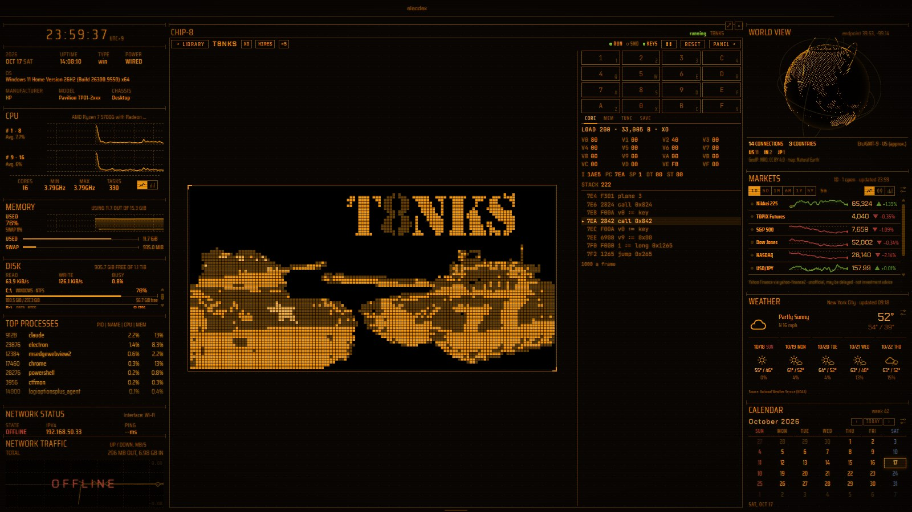
   CHIP-8 · Amber

| | |
|---|---|
| Where | retro preset (a tab); picker: "chip-8"; several panes; can be brought forward |
| Reads | its bundled library, and program files you import through main's file picker |
| Updates | runs only while it is running and the pane is seen; out of sight it pauses |
| Platforms | Windows, macOS, Linux (macOS and Linux not verified by hand) |
| Privacy | no network; the page never gets a file path |
| Settings | *Settings → General → chip-8*: show the core (on by default), buzzer volume (50% by default, silent when interface sounds are off); speed and quirks per program in TUNE |

### The machine

- A CHIP-8, SUPER-CHIP and XO-CHIP machine written in TypeScript for elecdex, drawn on a 2D canvas (never WASM or eval). It passes Timendus's chip8-test-suite on all three machines.
- Octo is the reference: every machine runs every instruction, and the machine decides only the memory (4 KB, or 64 KB for XO-CHIP) and the default quirks. An instruction no machine has stops the program with HALT and shows where.

### The library

- The 104 programs of chip8Archive (CC0): games, visual novels, rhythm games, toys and the Octojam title cards, each with its authors. Also the test suite's eight programs (DIAG).
- Tabs by kind: ACTION, PUZZLE, STORY, MUSIC, TOYS, SHOWCASE, DIAG and IMPORTED, plus ★ once a program is starred. A search looks through the whole library. The three machines can be shown or hidden.
- Every row has a frame of its screen, made when the library is built by running the program on the same machine for ten seconds.
- Resting on a row opens its card: the whole description, machine and screen, speed, quirks, keys, date, rotation and licence.
- The program chosen plays by itself beside its details while you use the library. It rests after half a minute without a pointer, key or search.
- The line between the list and the details can be dragged; a double-click puts it back to half.

### Playing

- The screen is drawn at a whole number of screen pixels a dot, with a phosphor afterglow and the gaps between dots. Both can be turned off, and FIT fills the room instead. Colours are the theme's (THEME) or the author's (ORIGINAL).
- The keypad is 1234 / QWER / ASDF / ZXCV by position. As in Octo, the arrows and Space press 5 7 8 9 and 6.
- The pane takes keys only while it has the focus, and never with Ctrl, Alt or a system key, Tab, Esc or a function key. A press on its buttons hands the focus back to the machine.
- **P** pauses; **Enter** runs one frame while paused.

### The panel

- **CORE** shows the registers, the stack and the code round the program counter, with **STEP** (one instruction) and **FRAME** (one frame).
- **MEM** shows the memory round the program counter or I, and the bytes at I drawn as a sprite.
- **TUNE** sets the speed and the quirks: VIP, SCHIP, XO, or each one by hand. They are kept for that program, in every pane, and **OWN** puts back the program's own.
- **SAVE** keeps three machines per program, each with its screen.

### Saves and imports

- Out of sight the pane pauses and waits for you when you come back. Moved in the layout, it goes on where it was.
- Where you left a program is kept (AUTO), written when play stops, never on a timer. **LOAD** becomes **CONTINUE**, or **NEW** to start again, even after a restart.
- **+ IMPORT** takes in a program file of your own (`.ch8`, `.c8`, `.sc8`, `.xo8`, `.bin` or any file, up to 65,024 bytes) through main's picker:
  - the machine is guessed from the instructions the program can reach;
  - its preview is made the same way as the library's;
  - its name and machine can be changed. Changing the machine forgets its tuning and saves.
  - **REMOVE** (two presses) deletes the file with its tuning, star and saves.
- A star puts a program in the ★ tab.
- What you keep is main's, in elecdex's user data folder: `chip8/library.json`, the imported files and the saves. It is never in a layout, which can be carried to another computer.

  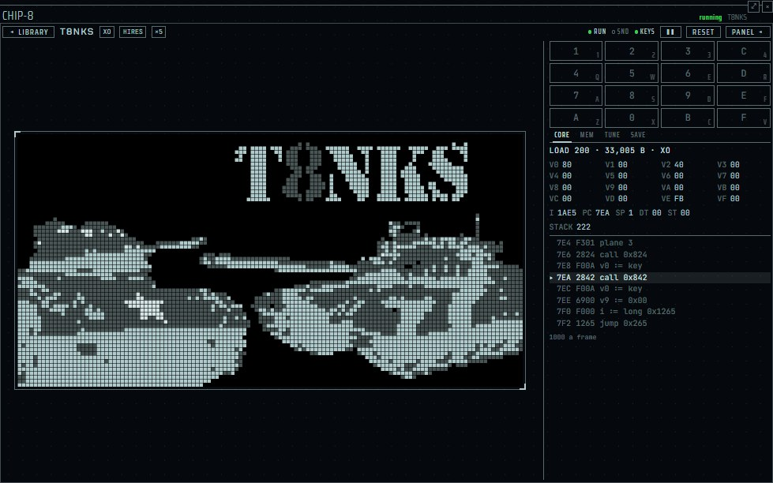
   CHIP-8

## ELEC-16

  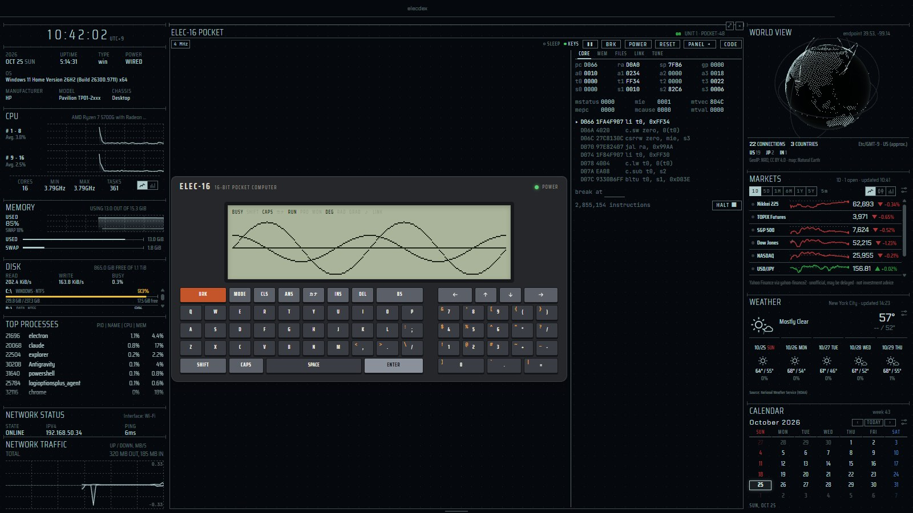
   ELEC-16 · CLASSIC skin

| | |
|---|---|
| Where | retro preset (tabs ELEC-16 and ELEC-16 SCI); desk preset (ELEC-16 SCI); picker: "elec-16" and "elec-16 sci"; several panes; can be brought forward |
| Reads | nothing outside the machine but what you import through main's picker; LINK reaches the AI only when you turn it on |
| Updates | runs only while switched on, awake and seen; sleeps at its prompt; the LCD is drawn at most 30 times a second |
| Platforms | Windows, macOS, Linux (macOS and Linux not verified by hand) |
| Privacy | a person's code runs only as the machine's code, never as JavaScript; an API key never reaches the page or the machine; LINK sends only the question, and only after a person's key press |
| Settings | *Settings → General → elec-16*: buzzer volume, skin of a new pane; per unit in the panel's TUNE and LINK |

A 16-bit pocket computer designed for elecdex, not a copy of any real one. Its CPU (E16, a RISC with 32- and 16-bit instructions), ROM, font and BASIC are all its own. The pane's tab names the kind of machine: ELEC-16 POCKET, HANDHELD, PLAY or SCI.

### Models

Each model is chosen in the panel's TUNE. A change restarts the machine.

| Model | Screen | Text | Starts in |
|---|---|---|---|
| POCKET-32 | 240×32, 1 bit | 40 columns, 4 rows | BASIC |
| POCKET-48 (default) | 240×48, 1 bit | 40 columns, 6 rows | BASIC |
| POCKET-64 | 240×64, 1 bit | 40 columns, 8 rows | BASIC |
| HANDHELD-160 | 160×144, four shades | 26 columns, 18 rows | BASIC |
| PLAY-320 | 320×288, colour | — | the start screen ([PLAY-320](#play-320)) |
| SCI-128 | 128×64, 1 bit | 21 columns, 8 rows | the calculator ([ELEC-16 SCI](#elec-16-sci)) |

- Between the POCKET and HANDHELD models the RAM is kept.
- To or from PLAY-320 or SCI-128 the RAM is cleared, so TUNE asks twice.

### The machine

| Part | |
|---|---|
| CPU | E16: 16-bit RISC, 16 registers, 32- and 16-bit instructions mixed |
| Clock | 4 MHz by default; 1, 2, 4, 8, 16 or 32 MHz, or MAX, per unit in TUNE. The timers and the clock follow the host's time, so `WAIT` and `TIME$` keep time at any speed |
| Memory | 32 KB of RAM, battery-backed (26,622 bytes free for BASIC at start); a machine-code area at 7000-7BFF (3 KB) |
| Other | buzzer, timer, clock, a decimal floating-point unit, a memory card |

### BASIC and the monitor

- It starts in **BASIC**. Type `3*4+SIN 30` for an answer, or numbered lines for a program (`LIST`, `RUN`, `AUTO`, `RENUM`).
- BASIC has strings, arrays, `DATA`, sound (`BEEP`), dots, lines and circles (`PSET`, `LINE`, `CIRCLE`), the clock (`TIME$`), and files on its memory card (`SAVE`, `LOAD`, `FILES`, `OPEN`).
- The dialect is its own; no maker's ROM, manual text or dialect is copied.
- `MON` opens the machine-code monitor: dump, write, run, disassemble, breakpoints.
- **BRK** (the red key, or Pause on the PC) always gets the machine back.

### Keys and PASTE

- The PC's keyboard types into the machine while the pane has the focus. In KANA mode, kana are typed by the JIS layout.
- The pane never takes Esc, Tab, function keys, or keys with Ctrl, Alt or the system key: those stay with the app.
- **PASTE** (or a right-click on the machine) types the clipboard as key presses. Text the machine cannot type is skipped and counted. Ctrl+V is not taken.

### The LCD and the skins

- The LCD is 240×48 by default. It is drawn dot by dot with the shadow, the slow fade and the contrast of a real one, at the machine's resolution and scaled crisp to whole screen pixels.
- The body is drawn whole or not at all: FULL (body and keyboard), COMPACT (the LCD and one row of keys) or LCD alone, chosen from the pane's size or fixed in TUNE. It is never stretched.
- Thirteen skins dress the case: ELEC, PLAIN, TRON, BUSINESS LIGHT, BUSINESS DARK, CLASSIC, IVORY, NIGHT, ALLOY, GRAPHITE, NEO, MOCHI and GLASS. PLAIN leaves the case out, for the app's own flat look in its theme.
- Five are modelled in light, each with keytops in a typeface of its own:
  - **ALLOY**: brushed metal with a black deck;
  - **GRAPHITE**: a matte graphite moulding with a near-white keypad;
  - **NEO**: a pocket computer made today, with low keys and a paper-like screen;
  - **MOCHI**: a cute one in sakura and polka dots with glazed pastel keys;
  - **GLASS**: a case of clear glass with the board seen deep inside, following the theme's mode and accent.
- None copies a real product.

<table>
  <tr>
    <td align="center" width="33%">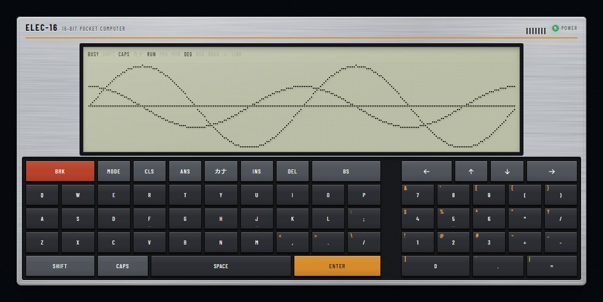 ALLOY</td>
    <td align="center" width="33%">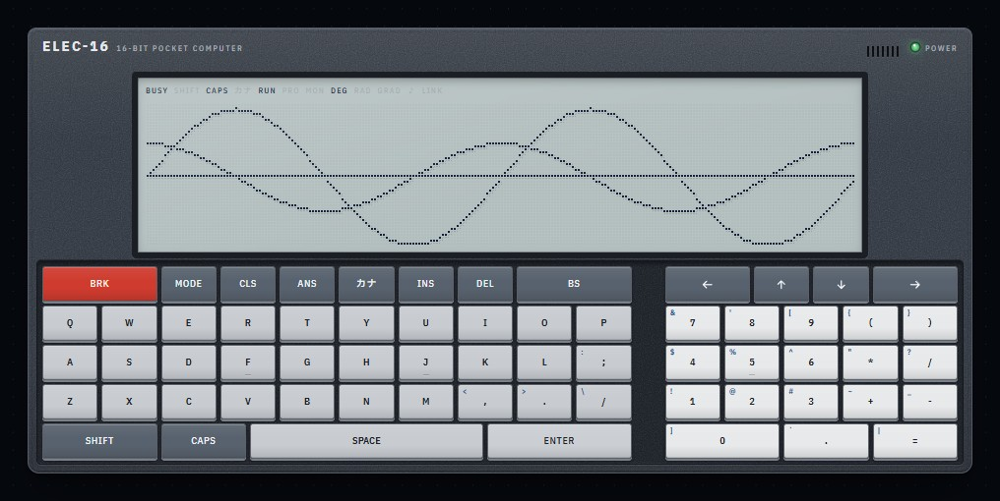 GRAPHITE</td>
    <td align="center" width="33%">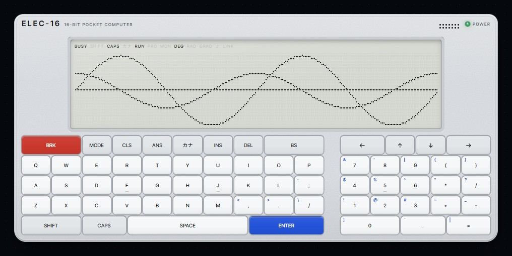 NEO</td>
  </tr>
  <tr>
    <td align="center" width="33%">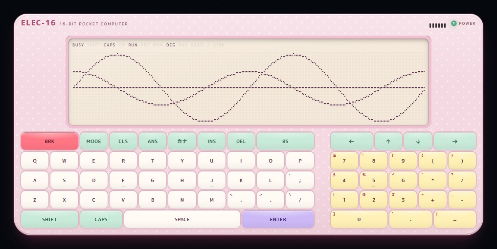 MOCHI</td>
    <td align="center" width="33%">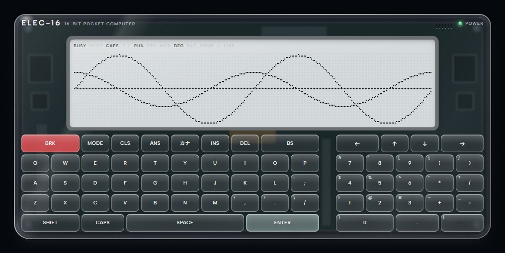 GLASS</td>
    <td align="center" width="33%">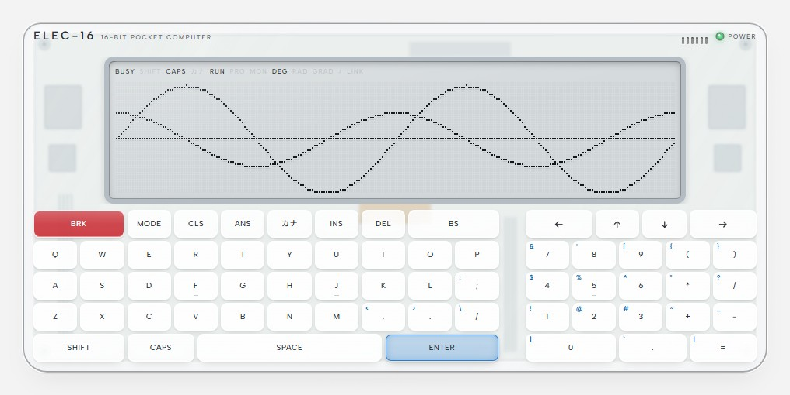 GLASS · light theme</td>
  </tr>
</table>

### Units, battery backup and the memory card

- Each machine is a **unit** that main keeps; a pane holds only the unit's id and display choices.
- The unit's RAM is battery-backed across restarts. The backup is written when the pane is hidden or closed, the machine is switched off, or the page goes, never on a timer.
- One pane runs a unit at a time. A second pane offers **MOVE HERE** (take it over) or **NEW UNIT**.
- The card holds the unit's files: names of up to 8+3 letters and digits, 32 KB a file, 256 KB a card.
- The panel's card view has **IMPORT** and **EXPORT** for `.bas` (text), `.asm` (assembled into a `.BIN` by main), binary and data files, all through main's picker.
- Auto power-off (10 minutes by default, 30, or never) counts only while the machine waits for a key; the RAM is kept.

### The panel

| Tab | |
|---|---|
| CORE | the registers and the code, with breakpoints, STEP and HALT |
| MEM | the memory, following PC, SP, VRAM or a free address |
| FILES | the card and the SOFT CARD; LOAD ▸ types the `LOAD` line for you |
| TUNE | PASTE, the clock (1 to 32 MHz, MAX), the model and LCD, the body, contrast, afterglow, the skin, auto power-off |
| LINK | a switch for LINK and for each service, the AI provider, requests sent, the last failure |
| GAMES | PLAY-320 only: the cartridge slot and the game shelf |

The bar above the machine has a CPU lamp (running, asleep, off), SND, KEYS (focus), pause, BRK, POWER, RESET (start the CPU again; the RAM is kept), PANEL and CODE.

### SOFT CARD

The SOFT CARD brings thirteen programs, laid read-only over every unit's card:

| Program | |
|---|---|
| SINEWAVE | a sine wave |
| BOUNCE | a bouncing ball |
| CLOCK | a clock |
| MAZE | a maze |
| PRIMES | prime numbers |
| HITBLOW | a number-guessing game |
| LANDER | a moon landing |
| CANNON | aim a cannon at a target |
| BIORHYTH | a biorhythm |
| UNITS | unit conversion |
| CHAT | a chat with the AI over LINK |
| ASMDEMO.BIN | a demo in machine code |
| TICKER.BIN | a ticker in machine code |

- From BASIC: `FILES "SOFT"` lists them, `LOAD "PRIMES"` loads one.
- In the panel's FILES, picking a program also shows how to use it.
- A file of the same name saved on your card is read instead.

### LINK

- **LINK** lets a program talk to the AI set in elecdex's AI settings, the same providers and keys as the [AI chat](panes-ai.md#ai-chat) pane.
  - `ASK Q$,A$` puts a question and takes the answer: in English, or, asked in kana, in kana, as the LCD has no kanji.
  - `ASK TYPE` picks how it answers: normal, a tutor, a BASIC helper, a quiz, a story, poems, fortunes, a dictionary, translation, a web search, the weather.
  - `ASK NEW` starts a new conversation.
- **Off until you turn it on** in the panel's LINK. LINK itself is on by default, the AI service off, CART (PLAY-320's cartridges, which stay inside the app) on.
- Only the question goes, with the unit's recent conversation, which is kept in main's memory and never written to disk; nothing else from the machine's memory.
- A program cannot send again until a person has pressed a key; keys typed by PASTE do not count. One request at a time per unit; it gives up after 180 seconds.
- The answer reaches the machine only as the LCD's characters. A search or the weather is the model's (a web search on the provider's side); nothing runs on this computer.
- The API key stays in main, encrypted. A provider with no key (a local model) may be chosen.

### CODE

- **CODE** compiles a program written in a subset of TypeScript (e16c) into the machine's code at three levels of optimisation side by side, with their bytes and cycles.
- **RUN ▸** puts it in the machine and runs it; **LOAD ▸** puts it there for the monitor. SAVE TO CARD keeps it as a `.BIN`.
- The compiler runs in a worker in the page. A person's code runs only as the machine's code, never as JavaScript.
- CODE works on every model; on PLAY-320 and SCI-128, RUN calls the program directly from the start screen or the calculator.

### Cost

- While the machine waits at its prompt, the CPU sleeps and the pane costs about what a paused one does.
- Out of sight it stops and writes its battery backup. A machine that was asleep at its prompt carries on when you come back; one that was running comes back paused.
- Measured on Windows (the whole app, share of one core): asleep at the prompt about 7%; 4 MHz with the screen changing every frame about 23-28%; 32 MHz about 40%.

  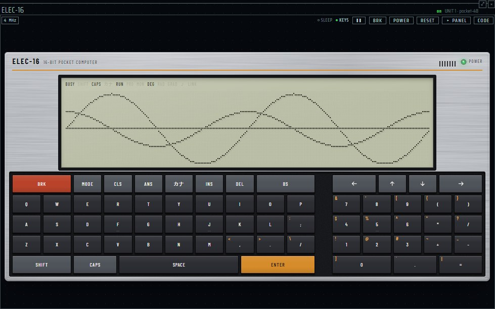
   ELEC-16

## PLAY-320

  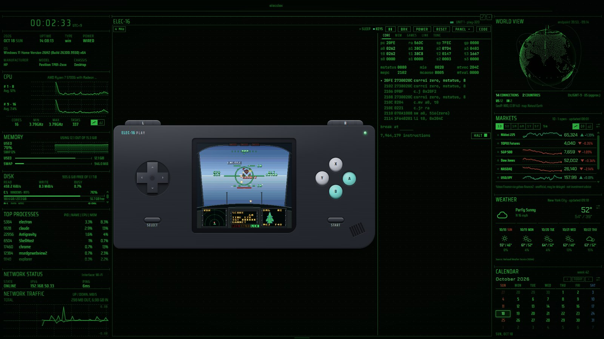
   ELEC-16 PLAY (PLAY-320) · ELECAIRCOMBAT · Phosphor · CORE beside it

| | |
|---|---|
| Where | an ELEC-16 pane's TUNE: model PLAY-320 (name plate ELEC-16 PLAY) |
| Reads | cartridges from main's game shelf; your own through main's picker or GAMES ▸ DEVELOP |
| Updates | 60 frames a second while running and seen |
| Platforms | Windows, macOS, Linux (macOS and Linux not verified by hand) |
| Privacy | no network: the CART service stays inside the app |
| Settings | TUNE: extended RAM, body, colour, clock; LINK: CART |

### The console

| Part | |
|---|---|
| Screen | 320×288, colours from a palette of 32,768 (RGB555), 60 frames a second |
| Graphics | a tile engine with two scrolled backgrounds, 128 sprites, sixteen palettes, a line interrupt and DMA |
| Sound | sixteen channels in stereo, with envelopes, slides and wave tables |
| Memory | 32 KB of RAM and extended RAM up to 512 KB, chosen in TUNE |
| Cartridges | ROM up to 1 MB, save RAM up to 32 KB, kept per game |
| Start | a start screen; no BASIC, no monitor, no automatic power-off |
| Body | tall or wide, twelve buttons (cross, A, B, X, Y, L, R, START, SELECT), in graphite, ivory or coral, or the screen alone |

### Controls

| PC key | Button |
|---|---|
| arrows | cross |
| Z / X / S / A | A / B / X / Y |
| Q / W | L / R |
| Enter / right Shift | START / SELECT |
| Pause | BRK |

- A gamepad with the standard layout works too, by button position, as does the left stick.
- Keys and the gamepad reach the machine only while the pane has the focus and is seen.

### Playing a game

- **GAMES** in the panel puts a cartridge from the shelf in the slot; **START** plays it. CODE runs a program on the console too.
- The shelf comes with four games of its own:
  - **ELECLANCE**: a vertical shooter with a lance, bombs, OVERDRIVE and two bosses ([manual](../elec16-eleclance.md));
  - **ELECAIRCOMBAT**: a one-on-one dogfight seen from the cockpit. The sky and sea are re-tiled every frame so the horizon rolls and pitches; an enemy fighter of our own is drawn from 17 views, 8 rotations and 7 sizes and streamed from the cartridge; gun, lock-on missiles and flares against five aces ([manual](../elec16-elecaircombat.md));
  - **ELECDRILL**: a block-digging puzzle. A colour's whole group goes at once, blocks left hanging wobble and fall, four of a colour that land together vanish in chains; mind your AIR through five strata to the core at 500 m ([manual](../elec16-elecdrill.md));
  - **ELECFIGHTER**: a one-on-one fighter in rounds between nameless humanoid slots, the training bodies of an industrial combat simulator. Wire-and-fill humans are drawn ahead of time from low-poly models, with light and heavy blows, guards by height, throws and their techs, chains, counters and dashes, against four opponent programs each with a mind of its own ([manual](../elec16-elecfighter.md)).
- How to play: [the PLAY-320 manual](../elec16-play-manual.md), in Japanese.
- A cartridge's ROM is never in the battery backup: the page puts it back from the shelf by its hash. If the same game is no longer on the shelf, the console returns to its start screen.

  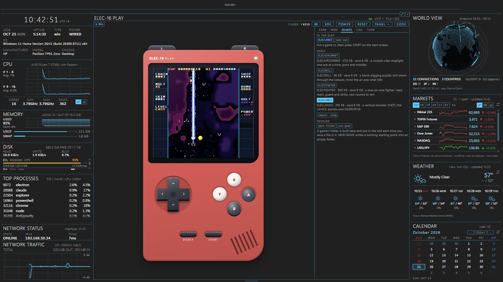
   ELEC-16 PLAY (PLAY-320) · ELECLANCE · Business (Dark)

  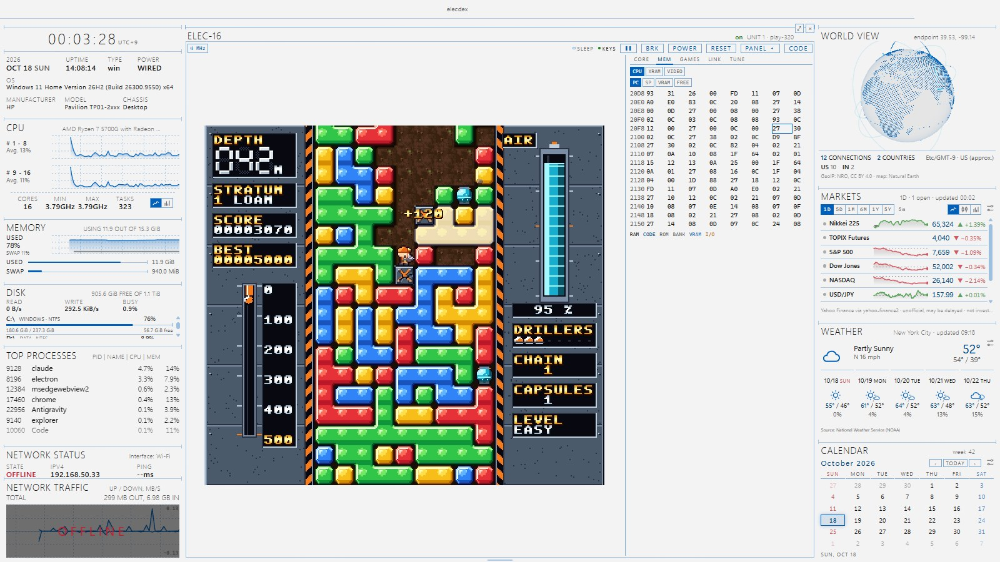
   ELEC-16 PLAY (PLAY-320) · ELECDRILL · Business (Light) · the screen alone, MEM beside it

  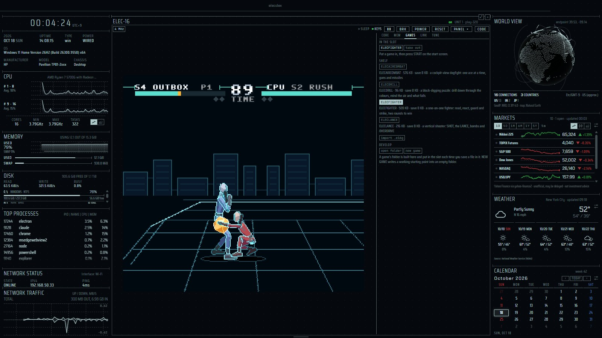
   ELEC-16 PLAY (PLAY-320) · ELECFIGHTER · Tron · the screen alone, GAMES beside it

### Making games

- Games are written in e16c with a game kit that takes PNG pictures and music written as text.
- **GAMES ▸ DEVELOP** opens a game's folder, or writes a new one from a template into an empty folder.
- The app builds the game, puts it in the slot, and builds it again each time a file is saved. No Node or repository is needed.
- Main reads only the files the game's `game.json` names, inside that folder. It writes back only `assets.e16.ts` and `compiled.s`. The build runs in the page's worker.
- A build never starts the game by itself: START needs a person.
- See [the game developer's guide](../elec16-kit.md), in Japanese.

## ELEC-16 SCI

  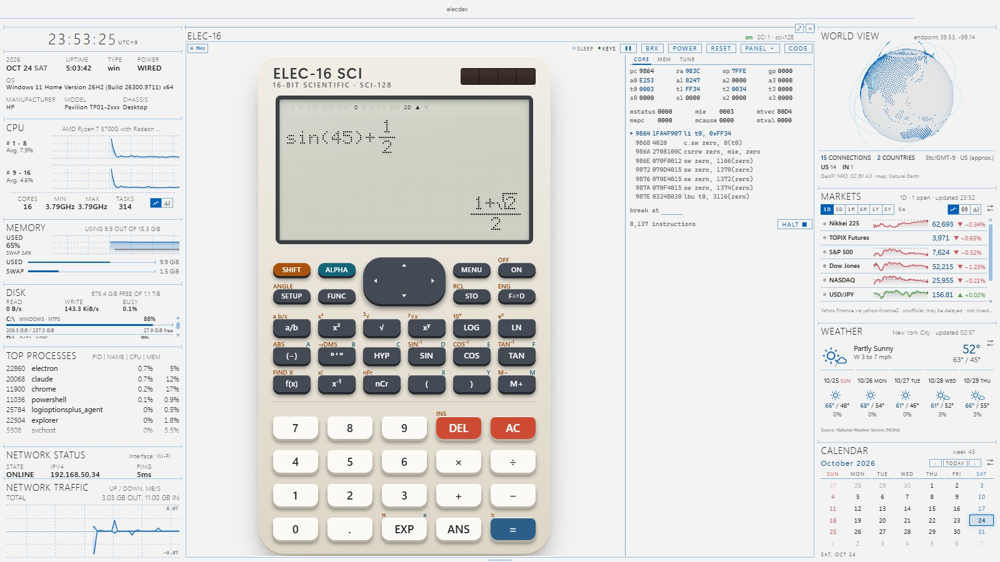
   ELEC-16 SCI (SCI-128) · CHALK · Business (Light)

| | |
|---|---|
| Where | retro and desk presets (a tab); picker: "elec-16 sci", which opens a new unit (SCI 1, SCI 2 …) so no one's BASIC is cleared |
| Reads | nothing outside the machine |
| Updates | sleeps while it waits for a key; auto power-off as the pocket models |
| Platforms | Windows, macOS, Linux (macOS and Linux not verified by hand) |
| Settings | TUNE: body (SLATE, CHALK, PLAIN), clock, auto power-off, FULL / COMPACT / LCD |

A scientific calculator of its own design, the model SCI-128, on a 128×64 LCD with a tall body: SLATE, CHALK, or PLAIN in the theme's colours. Its words are its own; no maker's names, spellings or key layouts.

### Typing and answers

- Lines are typed in 2D, with fractions, roots and powers set as a textbook sets them and a bar cursor that goes into them, or on one line.
- Answers are kept exact as fractions and `(p + r√s)/q` where they can be: sin 45° is √2/2, 1/3+1/6 is 1/2. F⇄D shows the decimal, in big digits.
- Variables, Ans, M and a history.
- **FUNC**: gcd, lcm, % (500+25% is 625), int, round, rand, dice, coin, pol, rec, and STATS' results and estimates in a line.
- Also: constant calculation, angle conversion, typing over, degrees-minutes-seconds, the hyperbolic functions, f(x) and FIND X.

### Modes

| Mode | |
|---|---|
| STATS | one variable or six regressions (line, quadratic, exponential, logarithmic, power, inverse), up to 40 rows |
| BASE | 32-bit HEX, DEC, OCT, BIN and base 5, with AND, OR, XOR, XNOR |
| TABLE | f(X) for up to 30 rows |
| EQUATION | two or three unknowns, quadratics with exact or complex roots, cubics |
| CPLX | complex numbers as a + bi or r∠θ |
| MATRIX | matrices and vectors up to 3×3: determinants, inverses, transposes, dot and cross products |
| PROG | four programs with input, output, conditions and jumps |

- **CONST** puts in twenty physical constants (CODATA 2022).
- **CONV** converts between twenty pairs of units.
- **Σ, d/dx and ∫** sum, differentiate and integrate a line in X. The sum is kept exact: Σ(1/X,1,4) is 25/12.
- New in v0.0.44:
  - `mod` and Π;
  - →PRIME, an answer as its prime factors (360 is 2³×3²×5);
  - SI prefixes (47k×220p; ENG pressed again shows 10.34μ);
  - the normal distribution (nlow, nmid, nup and →z);
  - EQUATION's quadratic and cubic inequalities (X²−X−6>0 is X<−2 and 3<X).

### Keys and the panel

- From the PC: digits, `+ - * / ^ ( ) .`, Enter (=), Backspace (DEL), Delete (AC) and the arrows.
- Letter keys type functions: `s` SIN, `c` COS, `t` TAN, `l` LN, `g` LOG, `r` √, `f` a/b, `e` EXP, `!` x!. Shift with a letter types that key's SHIFT face.
- The panel has CORE, MEM and TUNE; there is no FILES, GAMES, LINK or PASTE.
- Its screen reads back for a screen reader, as the other models' do.
- See [the SCI-128 manual](../elec16-sci-manual.md), in Japanese.

## Manuals and guides

The manuals are in Japanese.

| Document | |
|---|---|
| [BASIC](../elec16-basic.md) | ELEC-16 BASIC |
| [E16 machine code and the monitor](../elec16-e16.md) | the instruction set, the assembler, the monitor, ROM services |
| [e16c, TypeScript for CODE](../elec16-e16c.md) | the TypeScript subset and the CODE screen |
| [the SOFT CARD's programs](../elec16-soft.md) | how to run and play each program |
| [the PLAY-320](../elec16-play-manual.md) | the game console's user's manual |
| [making PLAY-320 games](../elec16-kit.md) | the game kit and GAMES ▸ DEVELOP |
| [ELECLANCE](../elec16-eleclance.md), [ELECAIRCOMBAT](../elec16-elecaircombat.md), [ELECDRILL](../elec16-elecdrill.md), [ELECFIGHTER](../elec16-elecfighter.md) | the four games |
| [the SCI-128](../elec16-sci-manual.md) | the calculator's user's manual |
| [pocket.html](../elec16-guide/pocket.html), [sci.html](../elec16-guide/sci.html) | HTML quick guides to the pocket computer and the calculator |

- On GitHub an HTML file shows as source. Open the quick guides from a checkout of the repository in a browser.
- In the machine, FILES also shows how to use the program picked.

## Design documents

In Japanese:

- [architecture.md §5.18 CHIP-8](../architecture.md#518-chip-8-ペインchip-8super-chipxo-chip-を遊ぶ)
- [architecture.md §5.19 ELEC-16](../architecture.md#519-elec-16-ペイン16-ビットポケコン設計済み作成中)
- [emu.md](../emu.md): the base the emulators share
- [elec16.md](../elec16.md): the machine, ROM, e16c, the pane, storage, LINK
- [elec16-play.md](../elec16-play.md): the PLAY-320 model
- [elec16-sci.md](../elec16-sci.md): the SCI-128 model
