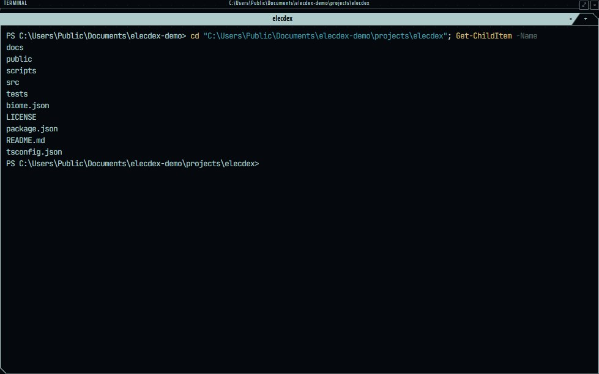
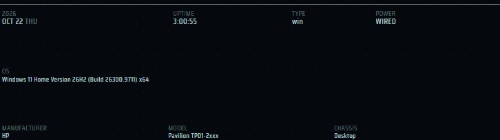
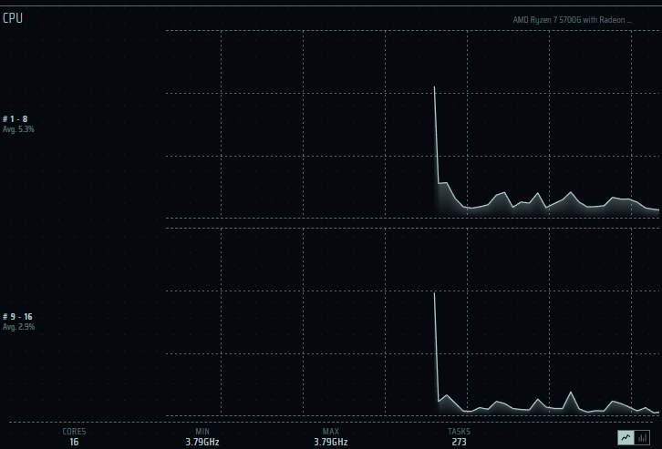
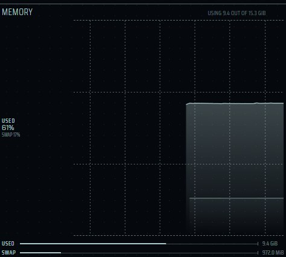
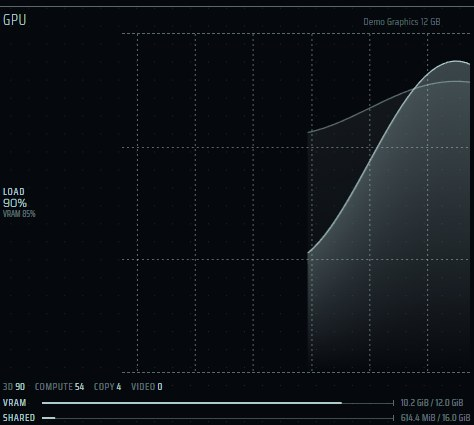
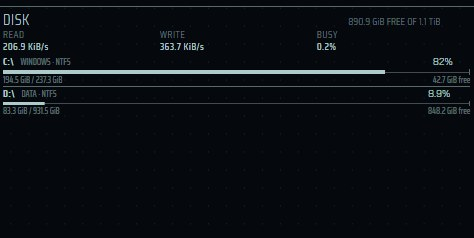
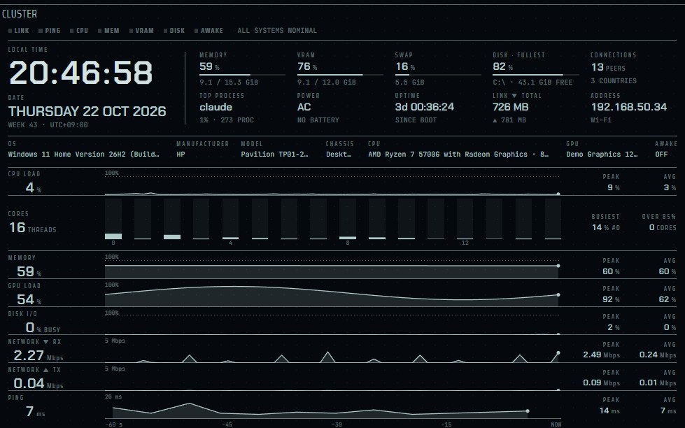
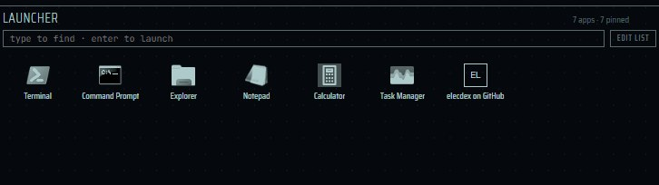
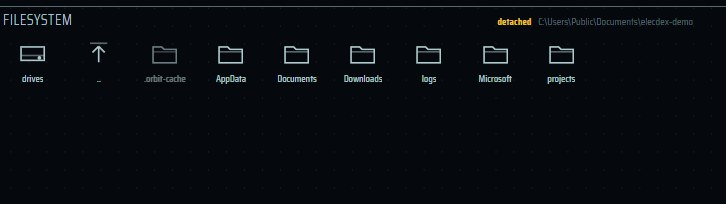

English | [日本語](panes-system.ja.md) | [简体中文](panes-system.zh-CN.md)

# System panes — elecdex

elecdex is a science-fiction terminal emulator and system monitor for Windows, macOS and Linux, a rewrite of eDEX-UI on Electron. This page covers the panes about the machine itself: the shell (Terminal), the clock, the system strip, CPU, memory, GPU, disk, top processes, the Cluster dashboard, the launcher and the file browser. For each pane it says what is read, on which platform, how often, and what is never read. elecdex is developed and used on Windows; macOS and Linux are built and run by the automated tests on GitHub Actions only and are not sufficiently verified by hand, so the platform notes for them describe the code, not long use.

On this page:

- [The default layout](#the-default-layout)
- [How readings are taken](#how-readings-are-taken)
- [Terminal](#terminal)
- [Clock](#clock)
- [System](#system)
- [CPU](#cpu)
- [Memory](#memory)
- [GPU](#gpu)
- [Disk](#disk)
- [Top processes](#top-processes)
- [Cluster](#cluster)
- [Launcher](#launcher)
- [Filesystem](#filesystem)

The network status and network traffic panes, which sit in the same column, are on [Network panes](panes-network.md).

## The default layout

The default layout is arranged by what the panes are for:

| Column | Panes |
| --- | --- |
| Left, this machine | [Clock](#clock), [System](#system), [CPU](#cpu), [Memory](#memory), [Disk](#disk), [Top processes](#top-processes), [Network status](panes-network.md#network-status) and [Network traffic](panes-network.md#network-traffic) |
| Centre, work | three [Terminal](#terminal) tabs over the [Launcher](#launcher) and the [Filesystem](#filesystem) browser |
| Right, the world outside | [World view](panes-network.md#world-view), Markets, Weather and Calendar ([World panes](panes-world.md)) |

<p align="center">
  
  <br><sub>The default layout (the standard preset), Tron theme</sub>
</p>

- The left column is the **system column**. Every [preset](presets.md) except [cockpit](presets.md#cockpit) and [blank](presets.md#blank) keeps it on the left at the same width and heights, so switching presets changes the rest and leaves the instruments where they were. Cockpit puts the [Cluster](#cluster) pane in its place.
- Every pane is an ordinary node of the layout: it can be moved, closed, or added again from the picker (**Ctrl+Shift+A**). See [Workspace](workspace.md).
- The default layout idles at about 13% of one core on Windows (measured on an i5-1335U; [decisions.md](../decisions.md), "Windows の収集方法").

## How readings are taken

All the panes on this page except Terminal, Clock, Launcher and Filesystem read **metric sources** from one collector, a separate Electron utility process (`src/services/metrics`).

- **Subscriptions are counted.** A source is polled only while at least one pane subscribes to it; two panes reading the same source cost one reading. When the last subscriber goes, polling stops.
- **Only while seen.** A pane in a background tab, or in a minimised window, keeps only the sources it charts (so its graph has no gap when it comes back). Everything else is let go until the pane is seen again.
- **Windows: no process per reading.** On Windows, systeminformation starts a new PowerShell, `wmic` or `ping.exe` for most calls. Measured system-wide, that made the default layout's monitoring cost about 144% of one core. elecdex instead keeps **one long-lived PowerShell** (the `WindowsSampler`) running a loop that reads through .NET and Win32 APIs (IP Helper, the process table, ICMP, `SystemInformation.PowerStatus`, performance counters) and writes one JSON line per reading. With it, the same layout measured 13.6%. The sampler reads only the kinds the collector asked for recently, so with the window put away and only charts sampling, no process table, socket table or ping is taken. It checks its parent process every second and does not outlive a killed app.
- **Static facts are read once.** The CPU model, the OS version and the machine's maker and model cannot change while the app runs, so they are collected once per collector, not polled.

Source intervals (from `src/services/metrics/sources.ts`):

| Source | Interval | Used by |
| --- | --- | --- |
| `cpu.load` | 1 s | CPU, Cluster |
| `cpu.speed` | 2 s | CPU |
| `cpu.temperature` | 5 s (never read on Windows) | CPU |
| `cpu.info`, `os.info`, `hardware.system`, `gpu.info` | once | System, CPU, Cluster |
| `mem.usage` | 1 s | Memory, Cluster |
| `mem.swap` | 10 s | Memory, Cluster |
| `gpu.usage` | 1 s | GPU, Cluster |
| `disk.io` | 2 s | Disk, Cluster |
| `disk.volumes` | 30 s | Disk, Cluster |
| `proc.list` | 5 s on Windows, 3 s elsewhere | Top processes, CPU (task count), Cluster |
| `os.uptime` | 5 s | System, Cluster |
| `power.battery` | 30 s | System, Cluster |

## Terminal

| | |
| --- | --- |
| Where | standard (three tabs), earth, dev (two), cockpit; picker: *terminal*; **Ctrl+Shift+S** focuses the shell (adds one if there is none). Any number can be open. |
| Reads | A pseudo-terminal (node-pty; ConPTY on Windows) running your shell |
| Platforms | Windows: PowerShell 7 if installed, else Windows PowerShell. macOS and Linux: the shell in `$SHELL` (bash, zsh and fish have folder tracking) |
| Settings | *Settings → General → Terminal*: start folder, bell, type size, paste confirmation (`terminal.*` in `settings.json`) |

<p align="center">
  
  <br><sub>Terminal</sub>
</p>

### Tabs and the header

- The pane is headed **TERMINAL** with the selected shell's full path.
- Each tab is named after its folder (the home folder too, by its own name). Parent folders are added only when two tabs would read the same. Hovering a tab shows the shell and the full path.
- A shell that has exited says so on its tab, with its exit code. A key press starts it again in the same folder.
- A shell that writes while its tab is in the background marks the tab with a dot until the tab is shown.
- A session keeps its scrollback when its pane is moved to another place in the layout or the page is reloaded: the pane reattaches to the running shell.

### Which shell runs

| Platform | Shell | How it is chosen |
| --- | --- | --- |
| Windows | PowerShell 7 (`pwsh`) | Used if `%ProgramFiles%\PowerShell\7\pwsh.exe` (the installer) or `%LOCALAPPDATA%\Microsoft\WindowsApps\pwsh.exe` (the Microsoft Store alias) exists. If it fails to start, Windows PowerShell is used instead. |
| Windows | Windows PowerShell | Used when PowerShell 7 is not installed |
| macOS, Linux | `$SHELL` | bash, zsh and fish get shell integration; other shells run without it |

- There is no setting for the shell, and the page cannot name a shell or its arguments: the main process decides from the environment. No PATH search is made and no login-shell environment is imported.
- The shell gets `TERM=xterm-256color`, `COLORTERM=truecolor` and `TERM_PROGRAM=elecdex`.

### How the shell's folder is followed (shell integration)

eDEX-UI polled `/proc/<pid>/cwd`, `lsof` and `ps` every second and could not follow the folder on Windows. elecdex has each shell **report its folder through a terminal escape sequence** after every prompt, and polls nothing.

| Sequence | Sent by | Meaning |
| --- | --- | --- |
| `OSC 7 ; file://<host><path> ST` | bash, zsh, fish | Current folder. The path is percent-encoded byte by byte as UTF-8, so non-ASCII folder names survive. |
| `OSC 9 ; 9 ; "<path>" ST` | PowerShell | Current folder, quoted, in the same form Windows Terminal reads. PowerShell sends `ProviderPath`, so a drive made with `New-PSDrive` is reported as the real path. In a non-filesystem provider (such as `HKLM:\`) it sends nothing. |
| `OSC 133 ; A/B/C/D ST` | all four | Prompt start, input start, command start, command end with exit code |

- **How the script is loaded.** bash gets `--init-file` (the script then sources your own `.bashrc`), zsh a temporary `ZDOTDIR` (your `.zshrc` is sourced back; the folder is removed when elecdex quits), fish an extra `XDG_DATA_DIRS` entry (its `vendor_conf.d` loads after your config), and PowerShell `-NoExit -Command` with the script passed in an environment variable. PowerShell's execution policy is not changed and no script file is run.
- **What is accepted.** The main process consumes these sequences (xterm.js never sees them). OSC 7 is accepted only when its host is empty, `localhost` or this machine's name, so an `ssh` session's folder is ignored. OSC 9;9 is accepted only as an absolute path. Other OSC 9 sequences (progress, notifications) pass through untouched.
- **What is refused.** A path with control characters, or one that begins with two separators (a network share such as `\\server\share`, `\\?\` or `//host`), is dropped. Any program's output can carry these sequences, and following a share would make Windows offer your NTLM credentials to that server. A shell on a share is therefore not followed; its tab says *network share*, and the [Filesystem](#filesystem) pane goes back to the home folder.
- If no sequence arrives within 10 seconds of start, the shell is treated as having no integration: the folder is not followed, and nothing is polled instead.
- The reported folder is kept in the pane's state as `cwd`. It is saved in `layout.json` and in saved layouts, so **a pane brought back at the next start, or by applying a layout, starts in its last folder**.

### Start folder

A new shell pane (from the picker, a new tab, a split or a preset) starts in the folder set under *Settings → General → Terminal* (`terminal.startDirectory`):

- Empty (the default) means the home folder; `~` at the start of a path stands for it.
- A folder that no longer exists, or one on a network share, falls back to home.
- The folder is checked without blocking the main process. If the check does not answer within 1.5 seconds (an unreachable drive), the shell starts in the fallback folder. A pane with a saved `cwd` goes through the same check before the start folder is used.

### Search, links, paste and the bell

- **Ctrl+Shift+F** opens a search bar over the pane. Matches are marked in the theme's colour and counted; Enter and Shift+Enter step through them; Escape closes. **Aa**, **ab** and **.*** match by case, by whole word and as a regular expression. A match the search moves to is not copied.
- A URL the shell prints is a link (OSC 8 hyperlinks too). Ctrl+click (⌘+click on macOS) opens it in your browser.
- Selecting text copies it and a right-click pastes, as in PuTTY or Windows Terminal; Ctrl+C stays the shell's interrupt.
- Pasting text of several lines asks first, because each line break runs a command; the dialog has a way to stop asking (`terminal.confirmPaste`). It also asks for text with control characters other than tab and line breaks.
- Programs may write to the clipboard with OSC 52; requests to read it get no answer.
- A bell (BEL) flashes the pane's edge and sounds, at most once every half second. *Settings → General → Terminal* chooses both, one, or neither (`terminal.bell`: `both`, `flash`, `sound`, `off`).
- **Ctrl+Shift+K** clears the scrollback. **Ctrl+Shift+=** and **Ctrl+Shift+-** make every shell's type larger or smaller (`terminal.fontSize`, 8 to 32 px, default 13); the size is also in the settings.

Shortcuts are written as bound by default; they can be rebound in *Settings → Keyboard* ([Keyboard shortcuts](keyboard.md)).

### Details

- The terminal is xterm.js 6 with the WebGL renderer. A shell in a hidden tab takes no WebGL context until it is shown; Chromium allows about 16 at once.
- A hidden pane is never resized, and transient sizes are not sent to the shell, because ConPTY rewraps the scrollback on every resize.
- The Terminal pane cannot be popped up over the workspace (*▣ pop up*): a shell needs a place in the layout.
- Design: [architecture.md §6](../architecture.md#6-ターミナル設計) (Japanese).

## Clock

| | |
| --- | --- |
| Where | System column (top); picker: *clock* |
| Reads | The system clock and time zone, in the page |
| Updates | Every second, on the second boundary, only while the pane is seen |

- The time in 24-hour `HH:MM:SS`, in large digits in fixed-width cells so the time does not jitter. A digit rolls as it changes; only the column that changed moves.
- Beside it is the time zone's abbreviation (for example `JST`); hovering it shows the full IANA zone name.
- It ticks on the shared second boundary, not on a timer of its own, so it does not drift behind the system clock. Behind a tab or with the window minimised it does not tick, and it is right again as soon as it is seen.
- The pane has no title bar; drag it by the rule along its top to move it.
- It can be brought forward (**Ctrl+Shift+Z**) to fill the window, and popped up from the picker.

## System

| | |
| --- | --- |
| Where | System column; picker: *system* |
| Reads | `os.info`, `hardware.system` (once), `os.uptime` (5 s), `power.battery` (30 s) |
| Platforms | Windows: OS version from the registry (`reg query`, once) and power from the sampler. macOS, Linux: systeminformation |

<p align="center">
  
  <br><sub>System</sub>
</p>

- Date and weekday, uptime, OS type, and power with a battery gauge (green; red below 20%).
- The full OS version and architecture, as `uname` or `winver` would put it.
- The machine's maker, model and chassis.
- What cannot change while the app runs is read once, not polled.
- Like the network status pane, it has no ⤢ button: a pane of a few figures gains nothing from filling the window.

## CPU

| | |
| --- | --- |
| Where | System column; picker: *cpu* |
| Reads | `cpu.info` (once), `cpu.load` (1 s), `cpu.speed` (2 s), `cpu.temperature` (5 s, not on Windows), `proc.list` (task count) |
| Updates | Load is kept sampled behind a tab, so the graph has no gap; the rest only while seen |

<p align="center">
  
  <br><sub>CPU</sub>
</p>

- Two graphs of the cores' average load (the cores split into two halves), or a bar per logical core, as Task Manager shows them. A toggle in the pane switches between them; the choice is kept in the pane's state.
- Under the graphs: the temperature (or the core count where no temperature can be read), minimum and maximum frequency, and the number of tasks.
- On Windows the temperature is not read: an unprivileged process gets nothing from WMI, and asking costs about 400 ms each time.
- The pane subtitle is the CPU's model name.

## Memory

| | |
| --- | --- |
| Where | System column; picker: *memory* |
| Reads | `mem.usage` (1 s), `mem.swap` (10 s); both kept sampled behind a tab |
| Platforms | Memory in use comes from Node's `os` module everywhere (no process). Swap: Windows from the sampler (the page file through WMI every 30 s); macOS and Linux from systeminformation |

<p align="center">
  
  <br><sub>Memory</sub>
</p>

- The share of memory in use and of swap over the last minute, scrolling in step with the CPU graphs (both are read every second), with bars for the amounts now.
- eDEX-UI asked for full memory statistics every 1.5 seconds, which on Windows starts a process each time. elecdex asks only for swap that way, and less often.

## GPU

| | |
| --- | --- |
| Where | ai preset (under the ELEC system pane); picker: *gpu* |
| Reads | `gpu.usage` (1 s, kept sampled behind a tab) |
| Platforms | Windows: WDDM performance counters through the sampler. Linux: the amdgpu driver's sysfs files only. macOS, and Linux with NVIDIA or Intel graphics: nothing |
| Privacy | `gpu.info` and `gpu.usage` are among the readings a plugin can be granted |

<p align="center">
  
  <br><sub>GPU</sub>
</p>

- The GPU's load and the share of its own memory (VRAM) in use over the last minute (VRAM as a fainter line), the load of each kind of engine (3D, compute, copy, video), and bars for the VRAM and the shared memory in use now.
- It shows the adapter with the most memory of its own: the graphics card, where there is one beside the processor's graphics.
- Load is counted as Task Manager does: the processes are summed per engine, and the busiest engine is the load.
- Where nothing can be read, the pane says **NO GPU READING ON THIS MACHINE**, and the Cluster pane leaves out its GPU lane, VRAM lamp and slot rather than drawing them dark.

| Platform | How it is read |
| --- | --- |
| Windows | The long-lived sampler reads the `GPU Engine` and `GPU Adapter Memory` performance counters. The engine table has one row per process and engine (hundreds of rows), so it is summed by C# compiled once. The adapters' names and memory sizes are read once through DXGI (WMI's `AdapterRAM` stops at 4 GB). The counters take 0.5 to 5 seconds to open the first time, so they are opened on a pool thread and never hold up the sampler's loop. Measured cost: about 0.3% of one core. |
| Linux | amdgpu's sysfs files only: `gpu_busy_percent`, `mem_info_vram_*`, `mem_info_gtt_*`. NVIDIA (nvidia-smi or NVML) and Intel would need a process per reading, so they are not read. |
| macOS | Not read: there is no way without a process per reading (`ioreg`). |

- When no pane subscribes, the sampler's GPU reading expires within 15 seconds and stops.
- Design: [architecture.md §5.22](../architecture.md#522-gpu-ペインgpu-の負荷と-vram) (Japanese).

## Disk

| | |
| --- | --- |
| Where | System column; picker: *disk* |
| Reads | `disk.volumes` (30 s), `disk.io` (2 s); only while seen |
| Platforms | Windows: the sampler (`DriveInfo`, and the `PhysicalDisk(_Total)` performance counters). Linux: `df` and `/proc/diskstats`. macOS: `df` only, no read/write rates |

<p align="center">
  
  <br><sub>Disk</sub>
</p>

- Each volume as a bar of used space against its size: amber from 90%, red from 97%. With it, space left, the filesystem, and whether the volume is removable or on the network.
- Above the volumes, the read and write rates and how busy the disks are. These are not shown on macOS, where the only reading is `ioreg`, a process each time.
- On Windows only fixed and removable drives are listed; network drives are left out, because an unreachable share can block for seconds.
- On Linux and macOS, `tmpfs`, `squashfs`, `/snap`, `/run`, `/boot/efi` and the macOS system volumes are left out, and volumes of one APFS container are shown once.
- Brought forward (**Ctrl+Shift+Z**), it comes forward as a panel in the middle rather than over the whole window.

## Top processes

| | |
| --- | --- |
| Where | System column; picker: *top processes* |
| Reads | `proc.list`: every 5 s on Windows (the sampler's process table), every 3 s elsewhere (systeminformation); only while seen |

- A table headed `PID | NAME | CPU | MEM` of the busiest programs, as many rows as fit (up to 12).
- A program's processes are summed into one row by name, so a browser is one entry, not forty. Rows are ordered by CPU, then memory.
- CPU is a share of the whole machine (all cores); memory is a share of physical memory.
- Brought forward, it comes forward as a panel in the middle.

## Cluster

| | |
| --- | --- |
| Where | cockpit preset (top left, in place of the system column); picker: *cluster dashboard* |
| Reads | Only sources other panes already read (CPU, memory, GPU, traffic, disk, ping, interface, swap, volumes, connections, processes, battery, uptime, the static facts), the AWAKE state, and the earthquake list when quake alerts are on |
| Updates | Each reading is drawn as it arrives. Behind a tab it keeps the four charted 1-second sources and the static ones, and lets the rest go |
| Privacy | It does not read the socket table, the Wi-Fi pane or the Ethernet pane's sources |
| Settings | None |

<p align="center">
  
  <br><sub>Cluster</sub>
</p>

The whole machine on one pane, like a car's instrument cluster.

- **Lamps.** LINK, PING, CPU, MEM, VRAM (where the GPU can be read), DISK, BATT (with a battery), AWAKE and QUAKE (with quake alerts on). A lamp that does not apply is left out, never shown dark. A lamp stays dark until its level has held for ten seconds; PING lights after two answers at that level, counting only answers of the last 15 seconds; LINK lights at once when the link goes down. A lamp goes out as soon as its reading falls back. Beside them, the **message line** says the worst lit lamp in words, with how many more (`+N MORE`); its card lists all of them.
- **A busy GPU lights nothing.** A GPU at 100% is doing its work; VRAM nearly full is what slows a model.
- **Clock and date** under the lamps.
- **Lanes.** Six lanes, CPU, memory, disk I/O, network down and up, and ping, seven with the GPU's under memory where it can be read. Each is a line over the last minute with its peak and average. CPU, memory, GPU and disk are drawn on 0-100%; the network (one scale for both directions) and the ping are scaled to the minute, the top of the scale written in the lane. The lanes are redrawn once per CPU sample without animation, and do not scroll on their own. Where there is room, every core's load now sits under CPU.
- **Figures.** Two rows of five: memory and VRAM as amounts, swap, the fullest disk, connections, the busiest program, power, uptime, the link's total and the IPv4 address with its interface.
- **Specification line.** Where there is room: OS, maker, model, chassis, CPU and GPU, as the system column says them, with what AWAKE is set to. The host name is not shown.
- **The link** is the adapter that carries the default route - the cable or Wi-Fi, whichever the internet leaves by - not the two added up. Its total counts from when that adapter came up.
- Each figure opens a card with what it has no room for.
- It lays itself out in five ways by its size (wide, medium, short, compact, narrow), from the full screen to a narrow column.
- A full screen of it idles at 10-15% of one core, less than CPU, memory, traffic and disk panes side by side (24.1% for those four and the clock, measured on Windows 11 at 1920x1080).

Levels (from `src/shared/cluster.ts`; the numbers, bars, cores, lamps and message line all follow one judgement):

| Reading | Warning | Danger |
| --- | --- | --- |
| CPU, memory | 85% | 95% |
| VRAM | 90% | 97% |
| Fullest disk volume | 90% | 95% |
| Disk I/O busy | 90% | - |
| Ping | 150 ms | no answer |
| Battery, discharging | 20% | 10% |

- Where disk busy time cannot be read (macOS), the disk I/O lane says so and the DISK lamp is not judged on it.
- In the Amber theme, whose warning yellow is close to its ground colour, warning and danger figures also carry ▲ and ◆.
- Design: [cluster.md](../cluster.md) and [architecture.md §5.20](../architecture.md#520-cluster-ペイン1-枚のダッシュボード) (Japanese).

## Launcher

| | |
| --- | --- |
| Where | standard preset (under the shells); picker: *launcher*; **Ctrl+Shift+L** searches the launcher, popping one up over the workspace if the layout has none |
| Reads | Windows: the Start Menu folders (all users and this user) and the packaged apps the shell lists. macOS: `.app` bundles in `/Applications`, `/System/Applications`, `~/Applications`. Linux: `.desktop` files in the XDG application folders. Plus your own entries |
| Settings | `launcher.items` and `launcher.showSystem` in `settings.json` (the pane's **EDIT LIST** button opens it) |

<p align="center">
  
  <br><sub>Launcher</sub>
</p>

- The platform's applications plus your own entries, most used first: elecdex counts successful launches and orders the list by them. Until something has been started, your own entries come first.
- Type to filter; Enter starts the first match.
- Icons take the theme's accent and show their own colours on hover (always, in the Business themes). Icons are fetched only for tiles that scroll into view.
- On Windows the icons are drawn by the Windows shell, and apps are named as the Start Menu shows them, packaged apps without a shortcut (Teams, Outlook, Terminal) included.
- The page launches an entry by an opaque id from the main process's own list, never by a path or a command, so a compromised page cannot run anything that is not in the list.
- A popped-up launcher goes away once it has started something.

Add entries under `launcher.items`:

```json
"launcher": {
  "showSystem": true,
  "items": [
    { "name": "Project notes", "target": "C:\\Users\\me\\notes.md" },
    { "name": "Docs", "target": "https://github.com/kurouna/elecdex" },
    { "name": "Node REPL", "target": "C:\\Program Files\\nodejs\\node.exe", "args": ["-i"] }
  ]
}
```

| Key | Meaning |
| --- | --- |
| `showSystem` | List the platform's own applications (default `true`) |
| `items[].name` | The label, up to 80 characters |
| `items[].target` | An http(s) URL, or a path to a program, document, folder or shortcut |
| `items[].args` | Optional. With it, the target is run as a program with these arguments |

Up to 200 entries are kept.

## Filesystem

| | |
| --- | --- |
| Where | standard preset (beside the launcher); picker: *filesystem* |
| Reads | The folder of the most recently focused shell, reported by [shell integration](#how-the-shells-folder-is-followed-shell-integration); watched for changes only while the pane is seen |

<p align="center">
  
  <br><sub>Filesystem</sub>
</p>

- The followed shell's directory as a grid. Click a folder to `cd` into it (the command is typed into that shell and run); click a file to type its quoted path at the prompt, for the next command.
- It follows `cd` on Windows too, which eDEX-UI could not.
- With no shell to follow, or one whose shell reports no folder, it browses on its own and is marked **detached**.
- A **drives** tile lists the drives with their free space.
- A shell on a network share is not followed: the pane goes back to the home folder. Main refuses share paths for listing and watching, for the reason given under [Terminal](#how-the-shells-folder-is-followed-shell-integration).
- The Filesystem pane cannot be popped up; it follows a shell in the layout.
