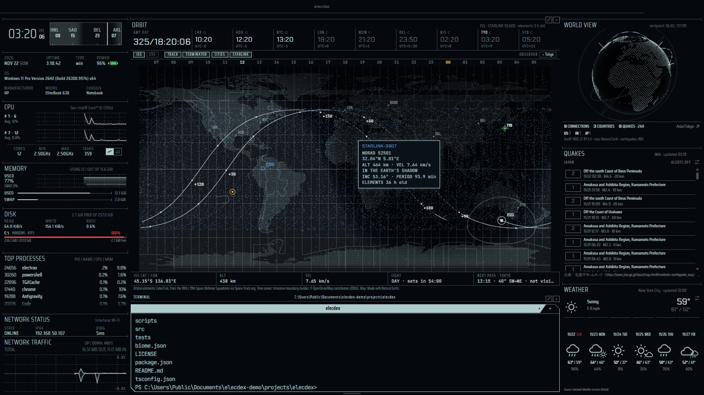
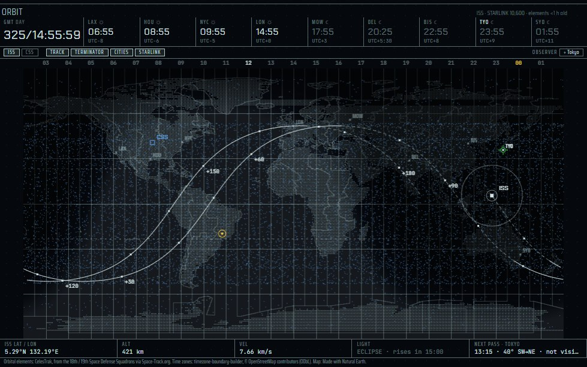
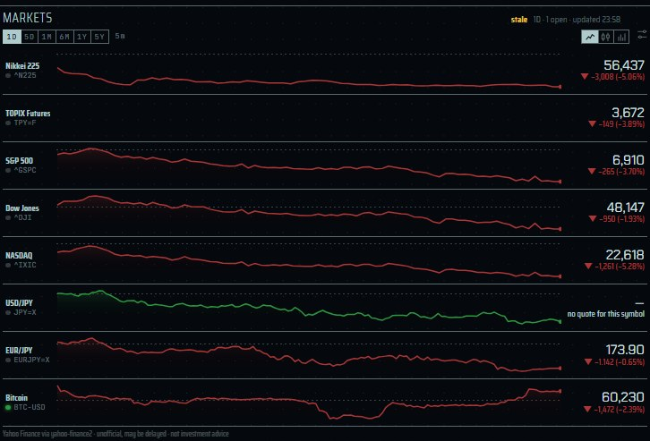
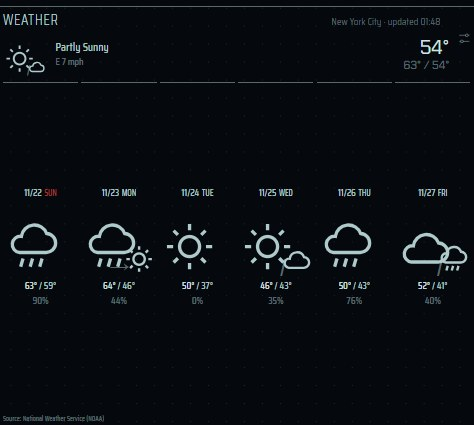
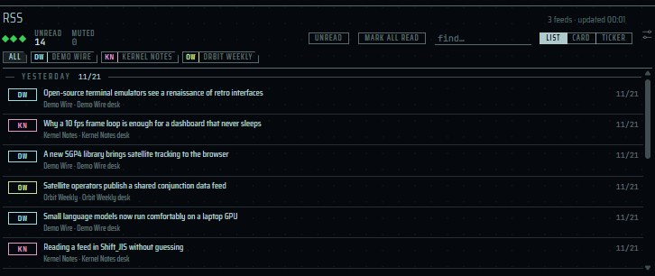
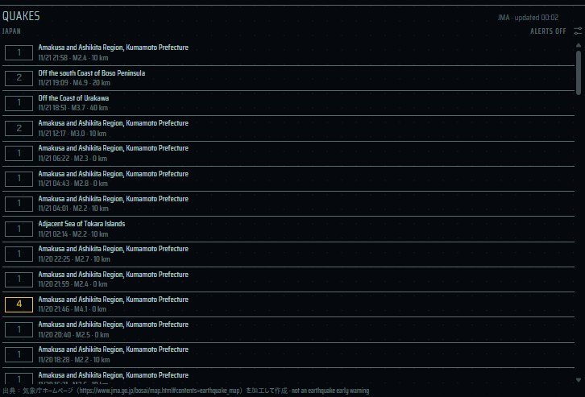

[English](panes-world.md) | 日本語 | [简体中文](panes-world.zh-CN.md)

# 外の世界のペイン: Orbit・Markets・Weather・RSS・Quakes・アラート — elecdex

elecdex は SF 風のターミナルエミュレーター兼システムモニターで、eDEX-UI を Electron・Svelte・TypeScript で作り直したものです。このページでは、コンピューターの外の世界を映すペインを説明します。**Orbit**（ISS、天宮、Starlink を世界地図に。CelesTrak の軌道要素からお使いのコンピューター上で計算）、**Markets**（Yahoo Finance の相場とチャート）、**Weather**（日本は気象庁、米国は National Weather Service、それ以外は MET Norway）、**RSS**（登録したフィードの見出し）、**Quakes**（気象庁または USGS の最近の地震）、そして **Earthquake and tsunami alerts**（地震・津波のアラート）です。それぞれについて、データソースとその利用条件・出典表示、いつどのくらいの頻度で取得するか、何を決して送らないかを示します。elecdex は Windows・macOS・Linux で動きます。開発と利用は Windows で行っており、macOS と Linux は自動テストでビルドと実行をしただけなので、十分には確認されていません。

このページの内容:

- [ネットワークの使い方](#ネットワークの使い方)
- [earth プリセット](#earth-プリセット)
- [Orbit](#orbit)
- [Markets](#markets)
- [Weather](#weather)
- [RSS](#rss)
- [Quakes](#quakes)
- [Earthquake and tsunami alerts](#earthquake-and-tsunami-alerts)
- [設計文書](#設計文書)

## ネットワークの使い方

このページのペインには、どれも同じ決まりが当てはまります。

- **接続するのはアプリの main プロセスだけ**で、ページは接続しません。ページはサンドボックス化され、コンテンツセキュリティポリシーがネットワークを許しません（`connect-src 'self'`）。テレメトリーはありません。
- **ペインがデータを必要とする間だけ取得します。** ペインが問い合わせるのは画面に出ている間（タブの裏や最小化したウィンドウの中でない間）です。例外は Quakes だけで、アラートがオンの間も地震の一覧を最新に保ちます。そのデータを必要とする最後のペインを閉じると、取得は止まります。
- **まとめて、条件付きで。** 同じものを表示する複数のペインは 1 つのリクエストを共有します（相場は全銘柄で 1 つ、フィードは 1 件につき 1 つ）。2 回目以降のリクエストには `If-None-Match` か `If-Modified-Since` を付けるので、変わっていなければ本文のない 304 が返ります。
- **失敗したら間隔を空け、最後の正常なデータを残します。** 失敗したリクエストは次第に間隔を延ばして再試行し、その間も最後に取れたデータを画面に残し、当てはまるペインには **STALE** と表示します。
- **名乗ります。** 天気、軌道要素、地震、フィードのリクエストは User-Agent `elecdex/<version> (+https://github.com/kurouna/elecdex)` で送ります。
- テストはこれらのサービスに接続しません。どの宛先も閉じたポートかローカルの代役に向けています。

すべての接続先とその利用条件の一覧は [ネットワークアクセスとデータソース](data-sources.ja.md) にあります。

## earth プリセット

  
   earth · Tron

earth プリセット（Ctrl+Shift+F3）は、頭上のステーション、足元の揺れ、そして空模様のレイアウトです。Orbit とその下にシェル、その横にワールドビュー、Quakes、Weather を、システムの列の隣に並べます。このページのほかのペインの場所:

| ペイン | 入っているプリセット | ピッカーでの名前（Ctrl+Shift+A） | レイアウトあたり |
| --- | --- | --- | --- |
| Orbit | earth（Ctrl+Shift+F3） | orbit | 複数可 |
| Markets | standard、既定のレイアウト（Ctrl+Shift+F1） | markets | 複数可 |
| Weather | standard（Ctrl+Shift+F1）、earth（Ctrl+Shift+F3） | weather | 複数可 |
| RSS | media（Ctrl+Shift+F5）、X の後ろのタブ | rss | 複数可 |
| Quakes | earth（Ctrl+Shift+F3） | quakes | 1 つ（ピッカーはそれにフォーカスを移します） |

どれもワークスペースの上にポップアップでき（ピッカーの ▣ pop up）、前面に出して画面いっぱいにできます（Ctrl+Shift+Z）。ショートカットは既定の割り当てで、*Settings → Keyboard* で変えられます。

## Orbit

  
   Orbit

| | |
| --- | --- |
| 場所 | earth プリセット（Ctrl+Shift+F3）、ピッカーの "orbit" |
| 読むもの | [CelesTrak](https://celestrak.org/) の軌道要素。ステーション（`GROUP=stations`、OMM JSON）と、求めたときだけ Starlink（`GROUP=starlink`、TLE）。位置はお使いのコンピューター上で計算し（SGP4）、どのサービスにも位置を尋ねません。 |
| 更新 | 軌道要素: ステーションは多くても 1 日 2 回、Starlink は多くても 1 日 1 回で、ペインが表示している間だけ。描画: 動くものは毎秒、夜の側は毎分。 |
| プライバシー | 位置情報は求めません。観測地は同梱の都市リストから選びます。 |
| 設定 | ペインごと: 注目するステーション（ISS か CSS）、TRACK、TERMINATOR、CITIES、STARLINK、OBSERVER |
| 出典 | CelesTrak（第 18・第 19 宇宙防衛飛行隊のデータを Space-Track.org 経由で提供）。時刻の境界: timezone-boundary-builder、© OpenStreetMap contributors（ODbL）。地図: Made with Natural Earth。ペインに表示します。 |

表示するもの（管制室の正面スクリーン）:

- 世界地図に、夜の側（天文薄明までなめらかに暗く）、今日の時刻の境目を示す細い線、上端には 15 度ごとのゾーンにその時刻を示し、真夜中と正午を明るくする目盛り。
- 見出しには、管制室の GMT の通日の時計と 9 都市の時計（LAX、HOU、NYC、LON、MOW、DEL、BJS、TYO、SYD）。それぞれ昼か夜かを示します。
- ISS と天宮（CSS）の現在位置。注目しているステーションの軌跡は 1 周回前から 2 周回先まで描かれ、日照中は明るく、地球の影の中では暗く、10 分ごとに印が付きます。その周りの輪は、そのステーションが見える地上の範囲です。
- 地図の下には、現在位置、高度と速度、次に地球の影に入る・出る時刻、観測地の上空を次に通過する時刻（肉眼で見えるかどうか）。
- **STARLINK** で約 10,000 基の Starlink 衛星を点で加えます。毎秒一部ずつ配置するので、各機は約 10 秒ごとに動きます。
- ステーションや Starlink の点の近くにポインターを置くと、名前、NORAD 番号、位置、高度と速度、日照か影か、軌道傾斜角と周期、軌道要素の古さが出ます（注目しているステーションには次の通過も）。

観測地はペイン自身のもので、**OBSERVER** で同梱の都市リストから選びます（既定はお使いのタイムゾーンで最大の都市、なければロンドン）。Weather ペインの地点は使わず、位置情報も求めません。

CelesTrak の[利用ポリシー](https://celestrak.org/usage-policy.php)に従う方法:

- CelesTrak のデータの更新は 2 時間ごとで、1 回の更新につきダウンロードは 1 回までと求めています。elecdex はステーションを手元の写しが 12 時間より古いときに、Starlink を 24 時間より古いときに、それもペインがそのセットを表示している間だけ取得します。
- 軌道要素は再起動をまたいでディスクに保持します（アプリのデータフォルダーの `orbits-stations.json`、`orbits-starlink.json`）。
- 200 以外の応答があった後は 1 日（ネットワークに届かなかったときは 1 時間）何も取得しません。この休止もディスクに保持するので、再起動で短くなりません。
- 設計時の大きさ: ステーションは約 9 KB、Starlink は 10,689 機で約 1.8 MB。

## Markets

  
   Markets

| | |
| --- | --- |
| 場所 | standard プリセット、既定のレイアウト（Ctrl+Shift+F1）、ピッカーの "markets" |
| 読むもの | [Yahoo Finance](https://finance.yahoo.com/)（yahoo-finance2 ライブラリ経由） |
| 更新 | マーケットペインが画面に出ている間だけ。表示している全銘柄の相場をまとめたリクエストを 1 分に 1 回（一覧のすべての市場が閉まっているときは 5 分に 1 回）。各チャートの足は 5 分ごと（1D）、15 分ごと（5D）、30 分ごと（1M）、1 時間ごと（6M 以上） |
| 設定 | ペインごと: 銘柄とラベルの一覧、期間、チャートの形、並び順 |
| 利用条件 | **非公式の API で、Yahoo が承認したものではありません。相場は遅れている可能性があり、投資助言ではありません。** ペインにもそう表示します: *Yahoo Finance via yahoo-finance2 · unofficial, may be delayed · not investment advice*。 |

使い方:

- 指数、通貨、そのほか Yahoo Finance が提示するあらゆる銘柄を、スパークライン、ローソク足、または変化率のバーで表示します（リストの順、または変化率順）。
- 行はペインを分け合い、幅が広いときは 2 列、高さが低いときは 1 行ずつになり、ローソク足は名前の下に行の幅いっぱいに並びます。
- 銘柄をクリックすると、そのチャートがペイン全体に広がります。価格軸、下端の時刻、期間の高値・安値・基準値、ポインターの下にあるバーの値の表示が付き、矢印でリストに戻るまでそのままです。
- ボードの上の帯で期間を選びます。

  | 期間 | 表示する範囲 | 足 |
  | --- | --- | --- |
  | 1D | 直近の 1 取引セッション | 5 分 |
  | 5D | 直近の 5 取引セッション | 30 分 |
  | 1M | 直近 1 か月 | 1 時間 |
  | 6M | 直近 6 か月 | 1 日 |
  | 1Y | 直近 1 年 | 1 週 |
  | 5Y | 直近 5 年 | 1 か月 |

- 1D と 5D は暦の日数ではなく取引セッションを数えます。通貨や Bitcoin のように休みなく取引される市場にはセッションがないので、直近 24 時間または 5 日間を表示します。期間より取引の歴史が短い銘柄（昨日上場した銘柄など）は、あるだけを表示します。
- 足は等間隔に並びます。夜・週末・休日は場所を取らず、ある足だけで幅いっぱいに広がります。*unreleased*: 新しい取引日（1M は週、6M と 1Y は月、5Y は年）の始まりに薄い線を引き、開いたチャートではその下に日付を表示します。ローカル時刻の深夜 0 時をまたぐセッション（東京から見たニューヨークなど）は 1 日として扱い、始まった日の日付を付けます。
- *unreleased*: 期間のボタンにポインターを置くと、表示する範囲と足の幅を表示します。足の幅はボタンの横にも表示します。
- 1D は前日の終値から、それより長い期間は期間の開始前の終値からの変化を測ります。
- 設定ボタンでリストを編集でき、各銘柄の後ろにはラベルを添えられます: `^N225 日経平均, JPY=X ドル円, 7203.T トヨタ`。
- 既定のボード: `^N225`、`TPY=F`、`^GSPC`、`^DJI`、`^IXIC`、`JPY=X`、`EURJPY=X`、`BTC-USD`。Yahoo にはリアルタイムの TOPIX 指数がないため、CME の円建て TOPIX 先物（`TPY=F`）を表示します。
- 組み込みの名前はアプリの言語に従います。`--lang=en-US` で英語に固定されます。

ネットワークの詳細:

- チャートのダウンロードの合間は、毎分の相場でチャートの足を延ばします。
- 失敗したときは最後のデータを画面に残してペインに **STALE** と表示し、1 分、2 分、以後 5 分の間隔で再試行します。
- どのペインも表示しなくなったチャートは、最大 1 時間（32 件まで）メモリに残すので、タブの裏から戻ったペインは何も問い合わせません。

## Weather

  
   Weather

| | |
| --- | --- |
| 場所 | standard（Ctrl+Shift+F1）と earth（Ctrl+Shift+F3）のプリセット、ピッカーの "weather" |
| 読むもの | 地点による。日本は気象庁、米国は National Weather Service（選べば MET Norway）、それ以外の地域は MET Norway |
| 更新 | ペインがその地点を表示している間だけ。気象庁は発表時刻の前後、NWS はおおむね 1 時間ごと、MET Norway は `Expires` より前には送らず（最低 30 分の間隔） |
| プライバシー | 地点のピッカーに入力した内容はどこにも送りません（都市リストは同梱）。MET Norway に送る座標は小数点以下 4 桁に丸めます。 |
| 設定 | ペインごと、設定ボタンの中: **place**、**source**（米国の地点）、**area**（日本）、**week**（週間予報の表示）、°C か °F |

使い方:

- 設定ボタン → **place** で、同梱の大都市・首都と気象庁の予報区の一覧から選ぶピッカーが開きます。`lat, lon` を入力することもできます。既定はニューヨーク市です。
- °C か °F かはペインごとに選べます。選んでいなければ、米国の地点は °F、それ以外は °C です。
- 予報をクリックすると、その地点についての提供元自身のページ（気象庁の予報ページ、NWS の地点予報、または yr.no）がブラウザーで開きます。
- `lat, lon` で入力した地点の日付は、システムのタイムゾーンで区切ります（タイムゾーンのデータを同梱していないため）。

地域ごとの提供元:

| 地域 | 提供元 | 内容 | 問い合わせるとき | 利用条件と出典 |
| --- | --- | --- | --- | --- |
| 日本 | [気象庁](https://www.jma.go.jp/)の予報 JSON（`/bosai/forecast/data/forecast/<office code>.json`） | 3 日分の天気文と 6 時間ごとの降水確率、週間予報 | 発表時刻の日本時間 0、5、11、17 時の前後（12 分前、3 分後、20 分後）に、条件付きで | 気象庁の[利用規約](https://www.jma.go.jp/jma/kishou/info/coment.html)。ペインに「出典：気象庁ホームページ（https://www.jma.go.jp/bosai/forecast/）を加工して作成」と表示します。 |
| 米国 | [National Weather Service](https://www.weather.gov/)（api.weather.gov） | 1 週間分の昼と夜の予報、現在の気温 | 地点の検索結果は 1 日保持し、予報はおおむね 1 時間ごと | オープンデータ。*Source: National Weather Service (NOAA)* と表示します。 |
| それ以外（米国も選べば） | [MET Norway](https://api.met.no/) Locationforecast 2.0 | 1 時間ごと、のち 6 時間ごとの約 9 日分。降水は量 | 直前の応答の `Expires` より前には送らず、最低 30 分の間隔で、`If-Modified-Since` を付け、全利用者が同時刻に集中しないよう最大 90 秒の固定のずれを足して | [CC BY 4.0](https://api.met.no/doc/License)。ペインに *Weather data: MET Norway, CC BY 4.0 (summarised by elecdex)* と表示します。リクエストは[利用条件](https://api.met.no/doc/TermsOfService)に従います。 |
| ピッカーの都市リスト | [GeoNames](https://www.geonames.org/)（人口 50 万人以上の都市と首都、1,323 件） | 名前、国、座標、タイムゾーン | 同梱。取得しません | [CC BY 4.0](https://creativecommons.org/licenses/by/4.0/) |

補足:

- 気象庁の予報 JSON は、気象庁自身の[予報ページ](https://www.jma.go.jp/bosai/forecast/)が読み込むデータで、公開された API ではありません。スクレイピングではなく JSON を直接読み、寛容に解析します。
- 降水は、提供元が確率を出すとき（気象庁、NWS）は %、出さないとき（北欧以外の MET Norway）は量（mm）で示します。
- 失敗したときは最後の予報を画面に残し、5 分、15 分、以後 30 分の間隔で再試行します。提供元が許すより早くは送りません。
- 最後の予報はディスク（アプリのデータフォルダーの `weather-cache.json`、`weather-cache-points.json`）に保持するので、再起動するとすぐに表示し、変わっているはずのない予報をダウンロードし直しません。

## RSS

  
   RSS

| | |
| --- | --- |
| 場所 | media プリセット（Ctrl+Shift+F5）の X の後ろのタブ、ピッカー（Ctrl+Shift+A）の "rss" |
| 読むもの | 登録した RSS 2.0、RSS 1.0、Atom のフィード（ペインあたり 10 件まで）。サイトのアドレス、フィードの URL、`github:owner/repo`、`youtube:@handle`、OPML ファイル、スターターパックから登録します |
| 更新 | そのフィードを登録したペインが表示されている間、15 分ごと。間隔を空けるのはフィード自身が求めるとき（Cache-Control、Expires、`<ttl>`）だけで、それでも 1 時間より長くはしません。フィードを探すためにページを読むのは **FIND** を押したときだけ。記事の画像を取得するのは CARD か記事ビューがそれを表示するときだけです |
| プライバシー | ページではなくアプリが取得します。Cookie なし。他のサイトには何も送りません。見出しはプレーンテキストとして表示します。要約もプレーンテキストで表示します。画像はアプリを通して受け取ります（最大 1 MB、ラスター形式だけ、メモリにだけ保持）。開いた見出しはこのコンピューターの `feeds-read.json` に記録します。**TRANSLATE** と **ASK AI** はクリップボードを使わずに記事を別のペインへ渡し、AI チャットはあなたが送るまで何も送りません |
| 設定 | ペインごと。設定ボタンの中の 4 つのタブ: **FEEDS**（順序、タグ、削除）、**ADD**（FIND、OPML）、**PACKS**、**KEYWORDS**（強調する語とミュートする語）。上部のバーで **LIST**、**CARD**、**TICKER**。どれもペインの状態に、フィードごとのマークと最後に見た時刻とともに保存します |

使い方:

- 最初はフィードがなく、**NO FEEDS** と ADD の入力欄とスターターパックを表示します。フィードを登録するまで何も取得しません。
- すべてのフィードを通じて最新の見出し 20 件を新しい順に、フィード名と時刻（今日）または日付（それ以前）とともに表示し、ペインが低いときはリストがスクロールします。
- 見出しの上のバーには、フィードごとのランプ（応答があれば点灯、失敗中は警告色、最初の応答までは中空）、**UNREAD**（20 件のうち、ミュートしたものを除く）、**MUTED**（フィードが保持しているすべての見出しについて）、検索欄、**LIST** / **CARD** / **TICKER** があります。フィードが 2 つ以上のときは、バーの下のチップでそのフィード自身の最新 20 件に絞れます。**ALL** ですべてのフィードに戻ります。LIST / CARD / TICKER を切り替えると、開いている記事は閉じます。ランプのツールチップにはフィード名と、失敗中はその理由が出ます。バーの **UNREAD** は未読の見出しだけを表示し（ペインに保存）、**MARK ALL READ** は表示中の見出しをまとめて既読にします（すべてのペインに反映）。狭いペインでは検索欄とこの 2 つのボタンを隠しますが、検索中は検索欄と解除の **×** を、UNREAD が有効な間は **UNREAD** を残し、FEEDS タブはフィードごとの状態とタグを別の行に出します。
- フィードにはそれぞれマークがあります。枠の中の 3 文字までのタグで、自分で書かない限り、フィードのタイトルの最初の 2 つのラテン文字の単語の頭文字、なければ最初の 2 文字です。枠の色はテーマのアクセントの色相をフィードごとに決まった角度だけ回したもので、登録した順に割り当てます。色のない Black テーマでは、マークはタグで見分けます。
- **LIST** は見出しを日の区切り（TODAY と YESTERDAY は日付つき、その前は月/日、日付のないものは最後に UNDATED）の下に並べ、区切りはその日をスクロールしている間、上端に留まります。各行はフィードのマーク、2 行のタイトル、フィード名と著者、時刻または日付です。前回ペインが表示されたときより前に公開された最初の見出しの前に、時刻つきの破線 **LAST SEEN** が入ります。
- ペインが開いている間に届いた見出しは、その位置に滑り込んで 3 秒間強調されます。リストを下へスクロールしているときは、読んでいる箇所は動かず、*↑ n new* のピルで上へ戻れます。LIST で。
- **CARD** は同じ見出しを同じ日の区切りの下にカードで並べます。記事の画像（届くまでと、ないときはフィードの色で描いた板）、2 行のタイトル、1 行の要約、フィード名と時刻です。
- **TICKER** は見出しを 1 件ずつ表示し、6 秒ごとに時計の格子に合わせて次へ進みます。進むのはペインが表示されていて記事を開いていない間だけで、ポインターが上にある間と、Tab でキーボードを移してきた間は止まります（‹ › のクリックで残るフォーカスでは止まりません）。**‹ ›** で手で進め、並んだ枠と *n/N* でリストのどこかを示します。チップと検索欄が無いので、切り替えると選んだフィードと検索は解除されます。
- 検索欄は、表示している 20 件だけでなく、フィードが保持しているすべての見出しと要約を探し、見つかった箇所を光らせます。検索欄で Esc を押すと、ポップアップや前面表示を閉じる前に検索が消えます。**MARK ALL READ** は、表示中の一覧に未読の見出しがあるときだけ押せます。
- どのビューでも見出しをクリックすると、ペインの右側（狭いときはペイン全体）に記事が開きます。画像、タイトル、公開日時、著者、サイト、フィードの要約（プレーンテキスト、400 文字まで）、カテゴリー（4 つまで）です。**OPEN** はブラウザーで開きます（以前はクリックでそうしていました）。**TRANSLATE** は見出し・要約・リンクを持って TRANSLATE ペインを呼び出し、訳します。**ASK AI** は "Summarise this article in a few lines." と見出し・要約・リンクを入力欄に入れて AI チャットを呼び出します。あなたが送るまで何も送りません。どちらもショートカットでペインを呼ぶのと同じく、レイアウトにあればそのペインにフォーカスし、なければポップアップします。**MARK READ** / **MARK UNREAD** で既読の印を変えます。Esc か **ESC** で記事を閉じ、キーボードは元の行に戻ります。**↑** / **↓** で前後の見出しの記事を開きます（UNREAD のときも、記事を開いてから読んで一覧から消えた記事を含めて前後をたどるので、位置を見失いません。それより前に読んだ記事は飛ばします）。ポップアップや前面表示のペインでは、最初の Esc で記事を、次の Esc でポップアップや前面表示を閉じます。**Ctrl+Shift+=** と **Ctrl+Shift+-** で、ほかの読むペインと同じく、見出しと要約をすべての RSS ペインで大きく・小さくします（`reading.rss`、80〜200 %）。情報欄とボタンの大きさは変わりません。
- 記事を開くと、すべての RSS ペインで既読になり、再起動しても既読のままです。既読の見出しは薄く、マークの枠は破線になります。

設定:

- **FEEDS** はフィードごとに、マーク、タイトル、URL、状態（**OK** と最後にダウンロードした時刻、**STALE** とエラー、最初の応答までは **WAIT**）、タグの欄（3 文字まで。空ならタイトルからのタグ）、並べ替えの **↑ ↓**、削除の **×** を並べます。
- **ADD** はサイトかフィードのアドレス（`https://` は省けます）、`github:owner/repo`（そのプロジェクトのリリースのフィード）、`youtube:@handle` / `youtube:UC…`（チャンネルの投稿）を受け付けます。**FIND** で見つかったフィードが並び、横の **ADD** で登録します。このタブと、フィードのないペインの最初の画面には **IMPORT OPML…**（アプリ自身のファイルダイアログで選んだ他のリーダーのエクスポートを読み（1 MB まで）、10 件の上限まで登録し、入らなかった数を示す）と、フィードがあるときは **EXPORT OPML…**（ペインのフィードを OPML として選んだ場所に保存する）もあります。
- **PACKS** には 4 つのスターターパックがあります: *tech*（英語: Hacker News、The GitHub Blog、Ars Technica、The Verge）、*テック*（日本語: Zenn、Qiita、ITmedia NEWS、Publickey、はてなブックマークのテクノロジー）、*science*（NASA、Nature、Science）、*dev releases*（Electron、Svelte、xterm.js、Node.js の GitHub のリリース）。どれも配信元自身の公開フィードで、登録するまで取得しません。**+** で 1 つ、**ADD ALL** でパックを 10 件の上限まで登録します。
- **KEYWORDS** には、どのビューでも見出しの中で光らせる強調語を 20 個まで、ミュートする語を 20 個まで置けます。ミュートする語を含む見出しは隠され（より古い見出しがその位置に入ります）、MUTED に数えられます。大文字小文字は区別しません。ラテン文字か数字で始まる・終わる語はその側で単語全体にだけ一致し、ほかの文字の語はどこでも一致します。

ネットワークの詳細:

- 条件付きリクエスト（`If-None-Match`、`If-Modified-Since`）なので、変わっていないフィードは再ダウンロードしません。同時に 2 件まで、1 件あたり最大 2 MB（それより大きいものは一部だけ解析せずに断ります）、User-Agent は上に挙げたものです。
- 同じフィードを登録した複数のペインは 1 つのリクエストを共有します。別のタブの後ろや最小化したウィンドウでは何も求めず、最後のペインを閉じると取得は止まります。
- 取得に失敗したフィードは最後の見出しを残し、ペインに **STALE** と表示します。5 分、15 分、30 分、以後 60 分の間隔で、サーバーの `Retry-After` がそれより長ければそれに従って（1 日まで）再試行します。
- フィードごとの最新の見出しはアプリのデータフォルダーの `feeds-cache.json` に保存するので、再起動するとすぐに表示します（30 日確認していないフィードは忘れ、保持するのは 50 フィードまで）。見出しごとの要約、画像のアドレス、著者、カテゴリーも保存します。
- **FIND** はページを 1 回取得します（10 秒、2 MB、Cookie なし、同じ User-Agent）。フィードならそれが答えです。Web ページなら、`<link rel="alternate">` タグが示す RSS と Atom のフィードと `rel="feed"` のリンクを並べます（8 件まで）。何も示さないページでは、そのサイトの `/feed`、`/rss.xml`、`/atom.xml`、`/index.xml`、`/feed.xml` を 1 つずつ試し、最初に見つかったフィードで止めます。応答のない場所があればそこで止め、サイトが応答しなくなったと示します。`github:` と `youtube:UC…` はフィードを探すために何も取得しません。`youtube:@handle` はチャンネルのページを読んでフィードを見つけます。
- ページは自分で画像を読み込めないので、アプリが取得します。取得するのは CARD か記事ビューが表示するときだけで、購読中のフィードが示す画像（`media:thumbnail`、画像の `media:content` か enclosure、Atom の `link rel="enclosure"`、要約の中の最初の画像）だけです。最大 1 MB、JPEG、PNG、WebP、GIF（SVG は取得しません）、ヘッダが示す大きさで 1 辺 8192 px・計 2400 万画素まで、同時に 2 件まで。この PC やローカルネットワーク上の画像は、同じホストのフィードのものだけを取得します。幅 480 px を超える PNG と JPEG は縮小します。画像はメモリにだけ保持し（最後の 60 件）、断ったもの（画像でない、大きすぎる、ローカルネットワーク上）はアプリを再起動するまで求め直しません。一時的な理由（応答がない、サーバーのエラー）で取れなかったものは 10 分後に求め直します。
- 既読の印はアプリのデータフォルダーの `feeds-read.json` に保存します。最大 3000 件で、それぞれ 120 日で忘れます。

## Quakes

  
   Quakes

| | |
| --- | --- |
| 場所 | earth プリセット（Ctrl+Shift+F3）、ピッカーの "quakes"。レイアウトに 1 つだけ。 |
| 読むもの | *Settings → Alerts* で選んだ情報源。**Japan**（気象庁の地震と津波の一覧）または **the world**（USGS のフィードと NOAA の津波警報センター） |
| 更新 | ペインが見えている（タブの裏や最小化した窓の中ではない）か、アラートがオンの間、1 分ごと。どちらでもなければ何も取得しません |
| 設定 | 情報源とアラートは *Settings → Alerts* で（ペインの設定ボタンでそこが開きます） |
| 出典 | 気象庁: ペインに「出典：気象庁ホームページ（URL）を加工して作成」。USGS と NOAA も名前を示します。 |

**緊急地震速報ではありません。** 情報は揺れの 1 分以上後に届きます。ペインとアラートにもそう表示します。

表示するもの:

- 最近の地震を新しい順に。各行には場所、時刻、マグニチュード、深さがあり、クリックすると情報源のページが開きます。

  | 情報源 | バッジ | 琥珀色 | 赤 |
  | --- | --- | --- | --- |
  | Japan（気象庁） | 最大震度（気象庁が発表する遠地地震も含む） | 3 から | 5- から |
  | the world（USGS） | マグニチュード 4.5 以上 | 5 から | 6 から |

- 発表中の津波警報・注意報などは、リストの上に帯で表示します。
- ペインにはアラートの設定状態が表示され、設定ボタンでその設定が開きます。
- 新しい地震はその色で強調されて滑り込み、リストを下へスクロールしているときは RSS ペインと同じ *↑ n new* のピルが出ます。
- 一覧を最新に保っている間、ワールドビューにはその日の地震が震央の位置に、マグニチュードに応じた大きさとリストと同じ色で示され、直近 1 時間の地震は脈打ちます。アラートがオンなら、CLUSTER ペインに QUAKE のランプが出ます。

情報源:

| データ | 提供元 | 備考 |
| --- | --- | --- |
| 地震（日本） | 気象庁の地震一覧 JSON（`/bosai/quake/data/list.json`） | 気象庁自身の[地震情報ページ](https://www.jma.go.jp/bosai/map.html#contents=earthquake_map)が読み込むデータ（約 1 か月分）。`max-age=60` の指定どおり 1 分に 1 回、`If-None-Match` 付きで取得します。気象庁の[利用規約](https://www.jma.go.jp/jma/kishou/info/coment.html)に従って利用します。緊急地震速報ではありません。 |
| 津波（日本） | 気象庁の津波一覧 JSON（`/bosai/tsunami/data/list.json`）と、そこに挙げられた各情報 | 地震一覧と一緒に確認します（通常は空の一覧で、初回以降は 304）。新しい情報の詳細は一度だけ取得します。対象は大津波警報・津波警報・津波注意報で、津波予報と解除は含みません。出典は地震と同様に表示します。 |
| 地震（世界） | [USGS](https://earthquake.usgs.gov/) のリアルタイムフィード `summary/4.5_day.geojson` | パブリックドメイン。1 分に 1 回（`max-age=60` に従い）、条件付きで。 |
| 津波（世界） | [NOAA Tsunami Warning Centers](https://www.tsunami.gov/): 太平洋（`PHEBAtom.xml`）と国内（`PAAQAtom.xml`）の Atom フィード | パブリックドメイン。それぞれセンターの最新の報が入っています。warning、watch、advisory、threat message が対象で、information statement は含みません。USGS のフィードと一緒に、条件付きで確認します。 |

- 地震の一覧の取得に失敗したときは最後の一覧を残してペインに **STALE** と表示し、1 分、2 分、5 分、以後 10 分の間隔で再試行します。津波の確認に失敗したときは最後の津波の状態を残し、次の 1 分にもう一度確かめます。

## Earthquake and tsunami alerts

| | |
| --- | --- |
| 場所 | *Settings → Alerts*（`settings.json` の `quakes`） |
| 既定 | **オフ** |
| 読むもの | Quakes ペインと同じ情報源。アラートがオンの間は、Quakes ペインがあってもなくても 1 分ごとに確認します |
| 出典 | どのバナーとカードも情報源を示します: 出典：気象庁 / 出典：USGS / 出典：NOAA 津波警報センター（英語では *Source: JMA*、*Source: USGS*、*Source: NOAA Tsunami Warning Centers*） |

設定:

| 設定 | 選択肢 | 既定 |
| --- | --- | --- |
| source | automatic（システムのタイムゾーンが東京かロケールが ja-JP なら日本、それ以外は世界）、Japan · Japan Meteorological Agency、world · USGS, tsunamis from NOAA | automatic |
| alerts | オン、オフ | オフ |
| earthquakes at a maximum intensity of（日本） | 1、2、3、4、5-、5+、6-、6+、7 | 5-（5弱） |
| earthquakes of magnitude（世界） | 4.5、5、5.5、6、6.5、7、7.5 | 6.0 |
| tsunami warnings, watches and advisories | オン、オフ | オン |
| system notification when elecdex is not in front | オン、オフ | オン |
| alert sound (with interface sounds on) | オン、オフ | オン |

オンのときに起きること:

- **地震:** 選んだ震度またはマグニチュード以上の地震で、画面上部に場所、震度またはマグニチュード、深さを示すバナーが表示され、続報が届くと更新されます。強い地震（震度 5- 以上、またはマグニチュード 6 以上）のバナーは閉じるまで残り、それより弱いものは 1 分で消えます。どのバナーにも「緊急地震速報ではありません」と表示します。
- **津波:** 警報・注意報など（日本は気象庁の大津波警報・津波警報・津波注意報、世界は NOAA の Pacific and National Tsunami Warning Centers）は、その段階、到達予想時刻と高さを添えた地域、発表元の見出しをカードで表示します。閉じると、発表中は小さなタブに折りたたまれ、解除されるとカードがそれを知らせます。段階が引き上げられると改めて知らせます。**カードは「避難の判断は自治体・気象庁の情報に従ってください」と示します**（英語では *follow local authorities*）。津波のアラートはオフにもできます。
- アラート音が鳴り（インターフェースの音がオンのとき）、elecdex が前面にないときはシステム通知が出ます。どちらもオフにできます。
- 各地震は一度だけ、それも新しいうち（日本は 30 分、世界は 1 時間）だけ知らせるので、後からアプリを起動しても古いニュースは知らせません。知らせたものはアプリのデータフォルダーの `quake-alerts.json` に記録するので、再起動しても同じものを知らせ直しません。

## 設計文書

- [architecture.md](../architecture.md): §5.10 Orbit、ネットワークの決まりは §11
- [weather-providers.md](../weather-providers.md): 天気の提供元、その利用条件と問い合わせ方
- [decisions.md](../decisions.md): 決定とその理由、測定値
- [ネットワークアクセスとデータソース](data-sources.ja.md)
