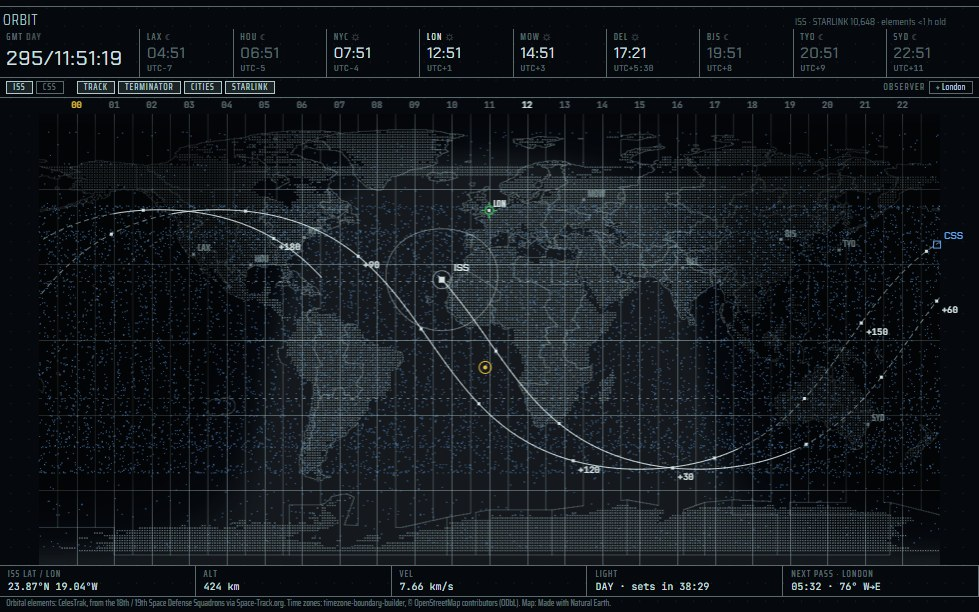
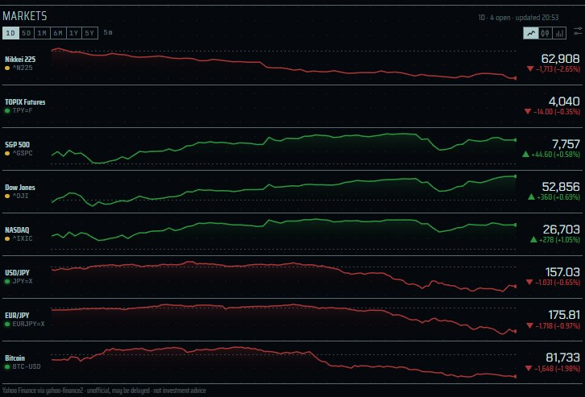
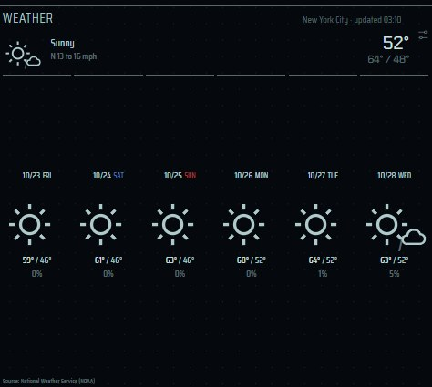
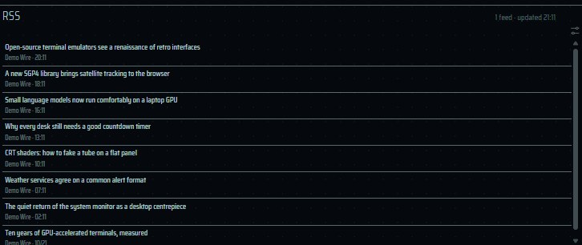
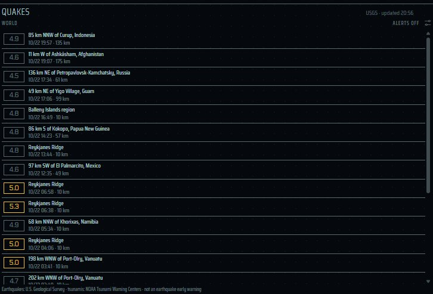

[English](panes-world.md) | [日本語](panes-world.ja.md) | 简体中文

# 外部世界窗格：Orbit、行情、天气、RSS、Quakes 与警报 — elecdex

elecdex 是一个科幻风格的终端模拟器和系统监视器，是用 Electron、Svelte 和 TypeScript 重写的 eDEX-UI。本页介绍显示电脑之外世界的窗格：**Orbit**（世界地图上的 ISS、天宫和 Starlink，依据 CelesTrak 的轨道根数在你的电脑上计算）、**Markets**（行情，Yahoo Finance 的报价和图表）、**Weather**（天气，日本用 JMA，美国用 National Weather Service，其他地区用 MET Norway）、**RSS**（你所列订阅源的标题）、**Quakes**（来自 JMA 或 USGS 的近期地震）以及 **Earthquake and tsunami alerts**（地震与海啸警报）。对每个窗格，本页说明数据来源及其条款和署名、何时以及多久获取一次，以及绝不发送什么。elecdex 可在 Windows、macOS 和 Linux 上运行；它在 Windows 上开发和使用，macOS 和 Linux 只经过自动测试的构建和运行，尚未得到充分验证。

本页内容：

- [这些窗格如何使用网络](#这些窗格如何使用网络)
- [earth 预设](#earth-预设)
- [Orbit](#orbit)
- [Markets](#markets)
- [Weather](#weather)
- [RSS](#rss)
- [Quakes](#quakes)
- [Earthquake and tsunami alerts](#earthquake-and-tsunami-alerts)
- [设计文档](#设计文档)

## 这些窗格如何使用网络

本页的每个窗格都遵循相同的规则：

- **只有应用的 main 进程连接网络**，页面从不连接：页面处于沙箱中，其内容安全策略不允许任何网络访问（`connect-src 'self'`）。没有遥测。
- **只在窗格需要数据时获取。** 窗格只在显示于屏幕上时（不在其他标签页之后、窗口未最小化）请求数据。唯一的例外是 Quakes：警报开启时也会保持地震列表为最新。关闭最后一个需要某数据源的窗格后，对它的请求即停止。
- **批量且有条件。** 显示同一内容的多个窗格共用一次请求（所有代码的报价合为一次请求，每个订阅源一次请求）。首次之后的请求带 `If-None-Match` 或 `If-Modified-Since`，因此未变化的回答是没有正文的 304。
- **失败时退避，保留最后的有效数据。** 失败的请求会以逐渐拉长的间隔重试；屏幕上保留最后一次成功获取的数据，适用的窗格会标为 **STALE**。
- **表明身份。** 天气、轨道根数、地震和订阅源的请求使用 User-Agent `elecdex/<version> (+https://github.com/kurouna/elecdex)`。
- 测试从不连接这些服务：每个地址都指向关闭的端口或本地替身。

所有连接及其条款的完整列表见[网络访问与数据来源](data-sources.zh-CN.md)。

## earth 预设

  
   earth · Tron

earth 预设（Ctrl+Shift+F3）展示头顶的空间站、脚下的震动和天空：Orbit 及其下方的 shell，旁边是世界视图、Quakes 和天气，位于系统列的右侧。本页其他窗格的位置：

| 窗格 | 所在预设 | 选择器中的名称（Ctrl+Shift+A） | 每个布局 |
| --- | --- | --- | --- |
| Orbit | earth（Ctrl+Shift+F3） | orbit | 可多个 |
| Markets | standard，即默认布局（Ctrl+Shift+F1） | markets | 可多个 |
| Weather | standard（Ctrl+Shift+F1）、earth（Ctrl+Shift+F3） | weather | 可多个 |
| RSS | media（Ctrl+Shift+F5），在 X 之后的标签页中 | rss | 可多个 |
| Quakes | earth（Ctrl+Shift+F3） | quakes | 一个（选择器会聚焦它） |

它们都可以弹出到工作区之上（选择器中的 ▣ pop up），也可以置前占满屏幕（Ctrl+Shift+Z）。快捷键为默认绑定，可在 *Settings → Keyboard* 中修改。

## Orbit

  
   Orbit

| | |
| --- | --- |
| 位置 | earth 预设（Ctrl+Shift+F3）；选择器中的 "orbit" |
| 读取 | 来自 [CelesTrak](https://celestrak.org/) 的轨道根数：空间站（`GROUP=stations`，OMM JSON），以及按需的 Starlink（`GROUP=starlink`，TLE）。位置在你的电脑上计算（SGP4）；不向任何服务询问任何物体的位置。 |
| 更新 | 轨道根数：空间站每天最多两次，Starlink 每天最多一次，且只在有窗格显示它时。绘制：移动的物体每秒一次，夜半球每分钟一次。 |
| 隐私 | 不询问你的位置：观测者是从内置列表中选择的城市。 |
| 设置 | 按窗格：聚焦的空间站（ISS 或 CSS）、TRACK、TERMINATOR、CITIES、STARLINK、OBSERVER |
| 署名 | CelesTrak（数据来自第 18 和第 19 太空防御中队，经由 Space-Track.org）；时区：timezone-boundary-builder，© OpenStreetMap contributors（ODbL）；地图：Made with Natural Earth。显示在窗格中。 |

显示的内容——任务控制中心的主屏幕：

- 一张世界地图，带夜半球（平滑地暗到天文晨昏）、标出今天各地时钟差异的细线，以及顶部的标尺：给出每个十五度时区的钟点，午夜和正午会被点亮。
- 标题行是任务控制中心的 GMT 年积日时钟和九座城市的时钟（LAX、HOU、NYC、LON、MOW、DEL、BJS、TYO、SYD），各自标明白天或黑夜。
- ISS 和天宫（CSS）的当前位置。聚焦的空间站轨迹向后画一圈、向前画两圈，在阳光下明亮、在地球阴影中暗淡，每十分钟一个标记；围绕它的圆圈是能看到它的地面范围。
- 地图下方：它在哪里、多高多快、下次何时进入或离开地球阴影，以及它下一次飞过观测者的时间——无论肉眼是否可见。
- **STARLINK** 以点的形式加入约 10,000 颗 Starlink 卫星。每秒放置一部分，因此每颗大约每十秒移动一次。
- 把指针停在空间站或 Starlink 点附近，可以看到名称、NORAD 编号、位置、高度和速度、处于阳光还是阴影中、轨道倾角和周期，以及轨道根数的新旧（聚焦的空间站还会显示下一次过境）。

观测者属于窗格本身，用 **OBSERVER** 从内置城市列表中选择（默认是你所在时区中最大的城市，没有时为伦敦）。不取自天气窗格，也不询问你的位置。

如何遵循 CelesTrak 的[使用政策](https://celestrak.org/usage-policy.php)：

- CelesTrak 每两小时更新一次数据，并要求每次更新最多下载一次。elecdex 在本地副本超过 12 小时时才获取空间站，超过 24 小时时才获取 Starlink，且只在有窗格显示该组时获取。
- 轨道根数保存在磁盘上并跨重启保留（应用数据文件夹中的 `orbits-stations.json` 和 `orbits-starlink.json`）。
- 收到非 200 的任何响应后，一天内不再请求（网络不可达时为一小时）。这一暂停也保存在磁盘上，所以重启不会缩短它。
- 设计时的数据大小：空间站约 9 KB；Starlink 共 10,689 颗，约 1.8 MB。

## Markets

  
   行情

| | |
| --- | --- |
| 位置 | standard 预设，即默认布局（Ctrl+Shift+F1）；选择器中的 "markets" |
| 读取 | [Yahoo Finance](https://finance.yahoo.com/)，通过 yahoo-finance2 库 |
| 更新 | 只在行情窗格显示在屏幕上时：所显示的全部代码每分钟一次批量报价请求（所列市场全部休市时每五分钟一次）；每张图表的 K 线每 5 分钟（1D）、15 分钟（5D）、30 分钟（1M）或每小时（6M 及更长）一次 |
| 设置 | 按窗格：代码和标签的列表、区间、图表样式、排序 |
| 条款 | **非官方 API，未获 Yahoo 认可。报价可能延迟，不构成投资建议。** 窗格中有注明：*Yahoo Finance via yahoo-finance2 · unofficial, may be delayed · not investment advice*。 |

使用方法：

- 指数、汇率以及 Yahoo Finance 提供报价的任何品种，可显示为迷你走势线、K 线或涨跌柱（按列表顺序，或按涨跌排序）。
- 各行共享窗格空间：窗格宽时分两栏，矮时每行一条，K 线横跨名称下方的整行。
- 点击某个代码，它的图表会占满整个窗格——带价格轴、底部的时间轴、区间的最高、最低和基准，以及指针下那根 K 线的读数——直到点击箭头回到列表。
- 看板上方的条带选择区间：

  | 区间 | K 线 |
  | --- | --- |
  | 1D | 5 分钟 |
  | 5D | 30 分钟 |
  | 1M | 1 小时 |
  | 6M | 1 天 |
  | 1Y | 1 周 |
  | 5Y | 1 个月 |

- 1D 相对前一收盘价计算，更长的区间相对区间开始前的收盘价计算。
- 设置按钮用于编辑列表，每个代码后面可以跟一个标签：`^N225 日経平均, JPY=X ドル円, 7203.T トヨタ`。
- 默认看板：`^N225`、`TPY=F`、`^GSPC`、`^DJI`、`^IXIC`、`JPY=X`、`EURJPY=X`、`BTC-USD`。Yahoo 没有实时的 TOPIX 指数，所以显示 CME 日元计价 TOPIX 期货（`TPY=F`）。
- 内置名称跟随应用语言；`--lang=en-US` 强制使用英文。

网络细节：

- 在两次图表下载之间，用每分钟的报价延伸图表的 K 线。
- 失败时屏幕上保留最后的数据，窗格标为 **STALE**，并在 1 分钟、2 分钟、此后每 5 分钟后重试。
- 不再有窗格显示的图表在内存中最多保留一小时（最多 32 张），因此从标签页后面回来的窗格无需发出任何请求。

## Weather

  
   天气

| | |
| --- | --- |
| 位置 | standard（Ctrl+Shift+F1）和 earth（Ctrl+Shift+F3）预设；选择器中的 "weather" |
| 读取 | 按地点：日本用 JMA，美国用 National Weather Service（也可选择 MET Norway），其他地区用 MET Norway |
| 更新 | 只在窗格显示该地点时：JMA 在其发布时刻前后，NWS 约每小时一次，MET Norway 不早于其 `Expires`（且至少间隔 30 分钟） |
| 隐私 | 在地点选择器中输入的内容不会发送到任何地方：城市列表是内置的。发给 MET Norway 的坐标四舍五入到四位小数。 |
| 设置 | 按窗格，在设置按钮中：**place**、**source**（美国地点）、**area**（日本）、**week**（是否显示一周预报）、°C 或 °F |

使用方法：

- 设置按钮 → **place** 会打开一个选择器，列出内置的大城市、各国首都以及 JMA 的预报区域，也可以输入 `lat, lon`。默认地点是纽约市。
- 每个窗格可以单独选择 °C 或 °F；未选择时，美国地点用 °F，其他用 °C。
- 点击预报会在浏览器中打开数据源自己对应该地点的页面——JMA 的预报页、NWS 的定点预报或 yr.no。
- 以 `lat, lon` 输入的地点按系统时区划分日期（因为没有内置时区数据）。

各地区的数据源：

| 地区 | 数据源 | 内容 | 何时请求 | 条款与署名 |
| --- | --- | --- | --- | --- |
| 日本 | [日本气象厅](https://www.jma.go.jp/)预报 JSON（`/bosai/forecast/data/forecast/<office code>.json`） | 三天的天气文字和每六小时的降水概率，以及一周预报 | 围绕发布时刻日本时间 0、5、11、17 点（提前 12 分钟、之后 3 分钟和 20 分钟），使用条件请求 | JMA 的[使用条款](https://www.jma.go.jp/jma/kishou/info/coment.html)。窗格中显示「出典：気象庁ホームページ（https://www.jma.go.jp/bosai/forecast/）を加工して作成」。 |
| 美国 | [National Weather Service](https://www.weather.gov/)（api.weather.gov） | 一周的白天和夜间时段，当前气温 | 定点查询结果保留一天；预报约每小时一次 | 开放数据。署名为 *Source: National Weather Service (NOAA)*。 |
| 其他地区（以及选择后的美国） | [MET Norway](https://api.met.no/) Locationforecast 2.0 | 先逐小时、后每六小时，约九天；降水为降水量 | 不早于上次响应的 `Expires`，至少间隔 30 分钟，带 `If-Modified-Since`，并加上最多 90 秒的固定偏移，避免所有用户同时请求 | [CC BY 4.0](https://api.met.no/doc/License)，窗格中署名 *Weather data: MET Norway, CC BY 4.0 (summarised by elecdex)*；请求遵循其[服务条款](https://api.met.no/doc/TermsOfService)。 |
| 选择器的城市列表 | [GeoNames](https://www.geonames.org/)：人口 50 万及以上的城市和各国首都（1,323 个） | 名称、国家、坐标、时区 | 内置；从不获取 | [CC BY 4.0](https://creativecommons.org/licenses/by/4.0/) |

说明：

- JMA 的预报 JSON 是 JMA 自己的[预报页面](https://www.jma.go.jp/bosai/forecast/)加载的数据，并非公开文档化的 API。直接以 JSON 读取而不是抓取网页，解析时较为宽松。
- 数据源提供概率时（JMA、NWS）降水显示为百分比，否则（北欧以外的 MET Norway）显示为降水量（mm）。
- 失败时屏幕上保留最后的预报，并在 5 分钟、15 分钟、此后每 30 分钟后重试——从不早于数据源允许的时间。
- 最后的预报保存在磁盘上（应用数据文件夹中的 `weather-cache.json` 和 `weather-cache-points.json`），因此重启后立即显示，也不会重新下载不可能变化的预报。

## RSS

  
   RSS

| | |
| --- | --- |
| 位置 | media 预设（Ctrl+Shift+F5）中 X 之后的标签页；选择器（Ctrl+Shift+A）中的 "rss" |
| 读取 | 你列出的 RSS 2.0、RSS 1.0 或 Atom 订阅源 URL（每个窗格最多 10 个） |
| 更新 | 只要有窗格列出该订阅源，就每 15 分钟一次；只有订阅源自己要求时（Cache-Control、Expires 或 `<ttl>`）才降低频率，且至少每小时一次 |
| 隐私 | 由应用获取，从不由页面获取；不带 cookie；不向任何其他网站发送任何东西。标题以纯文本显示。 |
| 设置 | 按窗格：在设置按钮中列出订阅源 URL，每行一个 |

使用方法：

- 它一开始是空的，在设置按钮中列出订阅源 URL 之前不会获取任何内容。
- 显示所有订阅源中最新的 20 条标题，每条附来源和时间（今天的）或日期（更早的），窗格较矮时列表可以滚动。点击会在浏览器中打开文章。
- 窗格打开期间到达的新标题会滑入到它的位置并高亮三秒；如果列表已向下滚动，正在阅读的内容保持不动，并出现一个 *↑ n new* 提示，点击可回到顶部。

网络细节：

- 使用条件请求（`If-None-Match`、`If-Modified-Since`），所以未更新的订阅源不会重复下载。同时最多获取两个，每个最大 2 MB（更大的会被拒绝，而不是只解析一部分），User-Agent 如上所述。
- 多个窗格列出同一订阅源时共用一次请求，最后一个关闭时即停止。
- 获取失败的订阅源保留最后的标题，并把窗格标为 **STALE**。在 5 分钟、15 分钟、30 分钟、此后每 60 分钟后重试；服务器的 `Retry-After` 要求更晚时按其要求（最长一天）。
- 每个订阅源最后的标题保存在应用数据文件夹的 `feeds-cache.json` 中，因此重启后立即显示（30 天未检查的订阅源会被遗忘；最多保留 50 个订阅源）。

## Quakes

  
   Quakes

| | |
| --- | --- |
| 位置 | earth 预设（Ctrl+Shift+F3）；选择器中的 "quakes"。每个布局只有一个。 |
| 读取 | 在 *Settings → Alerts* 中选择的数据来源：**Japan**（JMA 的地震和海啸列表）或 **the world**（USGS 的数据源和 NOAA 的海啸预警中心） |
| 更新 | 只要窗格可见（不在其他标签页之后、窗口未最小化）或警报开启，就每分钟一次；两者都没有时不获取任何内容 |
| 设置 | 数据来源和警报在 *Settings → Alerts* 中设置（窗格的设置按钮会打开它） |
| 署名 | JMA：窗格中注明「出典：気象庁ホームページ（URL）を加工して作成」。也会注明 USGS 和 NOAA。 |

**这不是地震预警。** 报告在震动发生一分钟或更久之后才到达，窗格和警报都会说明这一点。

显示的内容：

- 近期地震，最新的在前。每行包含地点、时间、震级和深度，点击会打开数据源的页面。

  | 数据来源 | 徽标 | 琥珀色起 | 红色起 |
  | --- | --- | --- | --- |
  | Japan（JMA） | 最大震度（shindo），也包括 JMA 报告的远地地震 | 3 | 5- |
  | the world（USGS） | 震级，4.5 及以上 | 5 | 6 |

- 生效中的海啸警报、注意报或预报会以条带形式显示在列表上方。
- 窗格会显示当前的警报设置，其设置按钮会打开警报设置。
- 新地震会以其颜色高亮滑入，列表向下滚动时也会出现与 RSS 窗格相同的 *↑ n new* 提示。
- 保持列表最新期间，世界视图会在震中位置标出当天的地震，大小按震级、颜色与列表一致，一小时内的地震会闪烁。警报开启时，CLUSTER 窗格会显示 QUAKE 指示灯。

数据来源：

| 数据 | 来源 | 说明 |
| --- | --- | --- |
| 地震（日本） | JMA 地震列表 JSON（`/bosai/quake/data/list.json`） | JMA 自己的[地震页面](https://www.jma.go.jp/bosai/map.html#contents=earthquake_map)加载的数据（约一个月的报告）。按其 `max-age=60` 的要求每分钟一次，带 `If-None-Match`。依据 JMA 的[使用条款](https://www.jma.go.jp/jma/kishou/info/coment.html)使用。并非紧急地震速报。 |
| 海啸（日本） | JMA 海啸列表 JSON（`/bosai/tsunami/data/list.json`）及其列出的各份报告 | 与地震列表一起检查（通常是空列表，首次请求之后为 304）；新报告的详情只获取一次。计入大海啸警报、海啸警报和注意报；预报和解除不计入。署名方式与地震相同。 |
| 地震（全球） | [USGS](https://earthquake.usgs.gov/) 实时数据源 `summary/4.5_day.geojson` | 公有领域。每分钟一次（按其 `max-age=60`），使用条件请求。 |
| 海啸（全球） | [NOAA 海啸预警中心](https://www.tsunami.gov/)：太平洋（`PHEBAtom.xml`）和国家（`PAAQAtom.xml`）的 Atom 源 | 公有领域。每个源包含该中心的最新公报；计入警报、观察、注意报和威胁信息，信息声明不计入。与 USGS 数据源一起检查，使用条件请求。 |

- 地震列表获取失败时保留最后的列表，窗格标为 **STALE**，并在 1、2、5 分钟、此后每 10 分钟后重试。海啸检查失败时保留最后的海啸状态，下一分钟再试。

## Earthquake and tsunami alerts

| | |
| --- | --- |
| 位置 | *Settings → Alerts*（`settings.json` 中的 `quakes`） |
| 默认 | **关闭** |
| 读取 | 与 Quakes 窗格相同的数据来源；警报开启时，无论有没有 Quakes 窗格，都每分钟检查一次 |
| 署名 | 每个横幅和卡片都注明来源：*Source: JMA*、*Source: USGS* 或 *Source: NOAA Tsunami Warning Centers*（日文为 出典：気象庁、出典：USGS、出典：NOAA 津波警報センター） |

设置：

| 设置 | 选项 | 默认值 |
| --- | --- | --- |
| source | automatic（系统时区为东京或区域设置为 ja-JP 时用日本，否则用全球）、Japan · Japan Meteorological Agency、world · USGS, tsunamis from NOAA | automatic |
| alerts | 开、关 | 关 |
| earthquakes at a maximum intensity of（日本） | 1、2、3、4、5-、5+、6-、6+、7 | 5-（5弱） |
| earthquakes of magnitude（全球） | 4.5、5、5.5、6、6.5、7、7.5 | 6.0 |
| tsunami warnings, watches and advisories | 开、关 | 开 |
| system notification when elecdex is not in front | 开、关 | 开 |
| alert sound (with interface sounds on) | 开、关 | 开 |

开启后会发生什么：

- **地震：** 达到所选震度或震级的地震会在屏幕顶部显示横幅，包含地点、震度或震级以及深度，并随后续报告更新。强震（震度 5- 及以上，或震级 6 及以上）的横幅会一直保留到手动关闭，较弱的一分钟后消失。每个横幅都注明 *not an earthquake early warning*（不是地震预警）。
- **海啸：** 警报、注意报或预报——日本为 JMA 的 大津波警報・津波警報・津波注意報，全球为 NOAA 的太平洋和国家海啸预警中心——会显示一张卡片，包含级别、预计到达时间和浪高的区域，以及发布方的标题。关闭卡片后，它在生效期间会折叠为一个小标签，解除时卡片会注明。级别提升时会再次通知。**卡片提示遵循当地政府的指示**（英文为 *follow local authorities*）。海啸警报可以关闭。
- 会播放警报音（在开启界面音效时），elecdex 不在前台时还会弹出系统通知；两者都可以关闭。
- 每次地震只通知一次，且只在它足够新时通知（日本 30 分钟，全球一小时），所以稍后才启动应用不会播报旧闻。已通知的内容记录在应用数据文件夹的 `quake-alerts.json` 中，因此重启后不会再次通知。

## 设计文档

以下为日文：

- [architecture.md](../architecture.md)：§5.10 Orbit，网络规则见 §11
- [weather-providers.md](../weather-providers.md)：天气数据源、其条款以及如何请求
- [decisions.md](../decisions.md)：决定及其理由和测量数据
- [网络访问与数据来源](data-sources.zh-CN.md)
