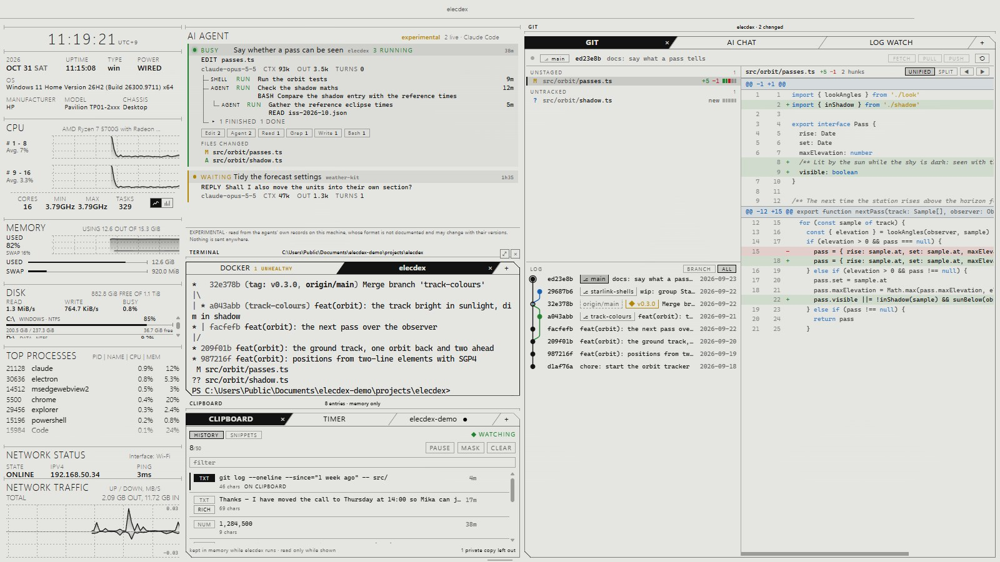

[English](themes-settings.md) | [日本語](themes-settings.ja.md) | 简体中文

# 主题与设置 — elecdex

elecdex 是面向 Windows、macOS 和 Linux 的科幻风格终端模拟器兼系统监视器，是对 eDEX-UI 的重写。本页介绍八种内置主题以及如何添加自己的主题、动效和声音设置、设置对话框、`settings.json` 的所有键及其默认值、各操作系统上应用保存文件的位置、布局文件，以及更新检查。macOS 和 Linux 只经过自动化测试的构建和运行，尚未经过充分的人工验证。

## 本页内容

- [主题](#主题)
- [添加主题](#添加主题)
- [动效](#动效)
- [声音](#声音)
- [设置对话框](#设置对话框)
- [settings.json](#settingsjson)
- [文件位置](#文件位置)
- [布局文件](#布局文件)
- [更新](#更新)

## 主题

| | |
| --- | --- |
| 位置 | *Settings → General → appearance → theme*；状态栏中的 *theme*；操作面板（Ctrl+Shift+P） |
| 设置 | `settings.json` 中的 `theme`（默认 `"tron"`；不存在的主题 id 会回退到它） |
| 文件 | 你自己的主题：应用数据文件夹中的 `themes` 文件夹 |

八种主题可实时切换，无需重新加载：页面把主题设置为 CSS 变量，画布类窗格会重新读取颜色。

| 主题 | id | 模式 | 外观 |
| --- | --- | --- | --- |
| Tron | `tron` | dark | eDEX-UI 的默认外观：近黑底上的低饱和青绿色，无扫描线和辉光。默认主题 |
| Amber | `amber` | dark | 单色琥珀终端，带扫描线和暖色辉光 |
| Phosphor | `phosphor` | dark | 绿色 P1 荧光粉，经典显示器，带扫描线和辉光 |
| White | `white` | dark | 冷白显示器：#0A0B0D 底上的 #D7E0EA 文字，带扫描线和柔和辉光 |
| Black | `black` | light | 把 White 反过来：浅色 #D7E0EA 底上的近黑 #0A080D 文字，同样的扫描线，只有一丝辉光 |
| Business (Dark) | `business-dark` | dark | Windows 11 深色模式的配色和默认蓝色强调色，Segoe UI 和 Cascadia Mono，Windows Terminal 的 Campbell 配色；无网格、扫描线和辉光，启动器图标显示原本颜色 |
| Business (Light) | `business-light` | light | 同上，采用 Windows 11 浅色模式和 One Half Light 配色 |
| Paper | `paper` | light | *unreleased*：像电子纸屏幕一样的单色简洁主题：灰色纸面（#D9D9D5，窗格 #E5E5E1）上的 #111111 墨色，无色相的强调色，终端的 16 种颜色是深浅各不相同的灰色，Segoe UI 和 Cascadia Mono，无网格、扫描线和辉光 |

- Tron、Amber、Phosphor 和 White 用于 HUD 风格；Business (Dark) 和 Business (Light) 适合日常办公；Paper 是单色而简洁的。
- 文字使用主题的强调色，除非主题像 Business 主题和 Paper 那样设置了文字颜色。
- 浅色主题（`mode: "light"`）的状态颜色更深，终端会把浅淡的颜色提高到 4.5:1 的对比度。
- Business 主题从不给网页窗格着色（见下面的 `web.tint`）。




每种主题都出现在某张截图里：Tron（standard、earth）、Amber（blank、CHIP-8）、Phosphor（dev）、White（network、media）、Black（cockpit）、Paper（desk 和上面的 dev）、Business (Dark)（ai）和 Business (Light)（函数计算器 ELEC-16 SCI）。

## 添加主题

要添加主题，把一个 JSON 文件放进 `settings.json` 旁边的 `themes` 文件夹（*Settings → General → themes folder* 会打开它）。主题会立即出现；`id` 与内置主题相同的文件会替换该主题。无法读取的文件会连同原因列在主题选择器下方，而不是悄无声息地缺席。

```json
{
  "id": "ice",
  "name": "Ice",
  "accent": { "h": 200, "s": 60, "l": 70 },
  "surfaces": { "s0": "#000000", "s1": "#010203", "s2": "#040506", "line": "#101820" },
  "terminal": { "ansiPull": 0.5, "ansi": { "red": "#ff5f56" } },
  "effects": { "scanlines": false, "glow": 0.2 }
}
```

| 字段 | 必需 | 值 |
| --- | --- | --- |
| `id` | 是 | 小写字母、数字和连字符 |
| `name` | 是 | 1 到 60 个字符，显示在选择器中 |
| `author` | 否 | 最多 60 个字符 |
| `mode` | 否 | `"dark"`（默认），或表示浅色背景的 `"light"`：状态颜色更深，终端会把浅淡的颜色提高到 4.5:1 |
| `accent` | 是 | `h` 0–360，`s` 和 `l` 0–100 |
| `surfaces` | 是 | `s0`、`s1`、`s2`（底色和凸起的面板）以及 `line`（网格），均为 `#rrggbb` |
| `text` | 否 | `primary` 和 `muted` 文字颜色；不设置时文字使用强调色，muted 为 primary 的一半强度 |
| `status` | 否 | `danger`、`warn`、`ok` 和 `info` 的色相（`info` 也用于日历中的星期六） |
| `fonts` | 否 | `display`、`ui` 和 `mono` 的字体族列表（只允许名称、引号和逗号） |
| `terminal.ansiPull` | 否 | 0 到 1：推导出的 ANSI 颜色向强调色靠拢的程度（默认 0.45） |
| `terminal.ansi` | 否 | 按名称指定 16 种 ANSI 颜色中的任意几种（`black` … `brightWhite`），均为 `#rrggbb`；逐个优先于推导出的调色板 |
| `effects.scanlines` | 否 | 覆盖整个屏幕的 CRT 扫描线 |
| `effects.glow` | 否 | 文字的荧光辉光，0 到 1 |
| `effects.iconTint` | 否 | `false` 使启动器图标显示其原本的颜色 |

颜色格式为 `#rrggbb`。主题会先经过校验，再转换为一组固定的 CSS 变量；其中的任何内容都不会被当作 CSS 或 HTML 解析。

## 动效

| | |
| --- | --- |
| 位置 | *Settings → General → appearance → motion* |
| 设置 | `motion`：`"system"`（默认）、`"full"` 或 `"reduced"` |

- `system` 跟随操作系统的减少动态效果设置；`full` 和 `reduced` 优先于它。
- 外观包括：先是一段展示本机真实信息的 Linux 风格启动日志，随后是 CRT 通电式的启动动画。之后添加的窗格同样会这样通电；关闭的窗格会断电，旁边的窗格随之延伸占据它的空间；切换到已保存布局时整个屏幕断电，再逐个窗格点亮下一个布局；对话框和通知也会断电。
- 简短的入场效果——每个月的日期如波浪般出现、天气预报升起、新标题和地震条目滑入并高亮三秒——遵循动效设置。
- 减少动效时，一切都不会动：这些效果和 CRT 过渡都会被跳过。
- 窗口被隐藏或最小化时，动画会暂停。

## 声音

| | |
| --- | --- |
| 位置 | *Settings → General → sound*；状态栏中的 *sound on / off* |
| 设置 | `sound.enabled`（默认 `true`），`sound.volume` 0 到 1（默认 `0.5`；对话框中显示为 0–100 %） |

- 界面音效由 WebAudio 合成，而不是录音：没有任何音频文件。
- 同一个开关也控制地震和海啸警报以及任务提醒的提示音，它们只在界面音效开启时播放。
- shell 的响铃单独设置：*Settings → General → terminal → bell*（`terminal.bell`：`both` 闪烁加声音、`flash`、`sound` 或 `off`；默认 `both`）。
- CHIP-8 和 ELEC-16 的蜂鸣器有各自的音量（`chip8.volume`、`elec16.volume`），与界面音效的音量分开。

## 设置对话框


| | |
| --- | --- |
| 位置 | Ctrl+Shift+.；状态栏中的 *settings*；操作面板中的设置分区 |
| 保存到 | `settings.json`，修改后立即保存 |

各分区依次为：

| 分区 | 内容 |
| --- | --- |
| general | appearance（主题、themes folder、动效）、sound、terminal（起始文件夹、字号、粘贴多行前询问、响铃）、git（打开文件的方式）、chip-8（显示核心、蜂鸣器音量）、elec-16（蜂鸣器音量、新窗格的皮肤）、layouts（切换布局前询问）、launcher（列出已安装的应用）、web panes（按主题颜色给页面着色、退出所有网站的登录） |
| window | 窗口之外的图标、最小化和关闭到图标、全局显示/隐藏快捷键、登录时启动和在后台启动。只在机器能提供某些功能时显示（[键盘与布局](keyboard.zh-CN.md#在后台运行)） |
| keyboard | 所有快捷键，可重新绑定（[键盘与布局](keyboard.zh-CN.md#重新绑定快捷键)） |
| alerts | 地震和海啸：数据源、警报、阈值、系统通知、提示音 |
| ai | AI 提供方、系统提示词、摘要，以及 ELEC system 的席位 |
| plugins | 已安装的插件、其权限和设置（[插件](plugins-use.zh-CN.md)） |
| updates | 版本、每日检查、*check now*（[更新](#更新)） |

对话框顶部的 *settings.json* 按钮会打开该文件。Escape 关闭对话框。

## settings.json

设置对话框中的所有内容都会立即保存到应用数据文件夹（见[文件位置](#文件位置)）中的 `settings.json`，应用运行时也可以手动编辑它：主进程会监视该文件并应用结果。无法解析的文件会保持原样（在修复之前使用默认值），并在应用的修改替换它之前复制为 `settings.json.bak`。

每个字段都有默认值，因此空文件或只写了一部分的文件也是有效的。示例：

```json
{
  "theme": "amber",
  "sound": { "enabled": true, "volume": 0.5 },
  "motion": "system",
  "terminal": { "startDirectory": "~/work" },
  "keybindings": { "app.quit": null },
  "window": { "minimizeToTray": false, "closeToTray": true, "globalShortcut": true, "startInBackground": false },
  "updates": { "check": true },
  "layout": { "confirmSwitch": true },
  "web": { "tint": false },
  "quakes": { "source": "auto", "notify": true, "minIntensity": "5-", "minMagnitude": 6, "tsunami": true, "system": true, "sound": true },
  "reminders": { "notify": true, "system": true, "sound": true, "snoozeMinutes": 10, "leadMinutes": 0 }
}
```

各键及其默认值（来自 `src/shared/settings.ts`）：

| 键 | 默认值 | 取值与含义 |
| --- | --- | --- |
| `version` | `1` | 文件格式 |
| `theme` | `"tron"` | 主题 id（见[主题](#主题)） |
| `sound.enabled` | `true` | 界面音效 |
| `sound.volume` | `0.5` | 0 到 1 |
| `motion` | `"system"` | `system`、`full`、`reduced` |
| `terminal.startDirectory` | `""` | 新 shell 的起始文件夹；为空表示主目录，开头的 `~` 代表主目录。文件夹不存在（或是网络共享）时，shell 改从主目录启动 |
| `terminal.fontSize` | `13` | shell 的字号（像素），8 到 32 |
| `terminal.confirmPaste` | `true` | 粘贴多于一行的文本前询问（每个换行都会执行一条命令） |
| `terminal.bell` | `"both"` | `both`、`flash`、`sound`、`off` |
| `launcher.showSystem` | `true` | 列出平台自己的应用 |
| `launcher.items` | `[]` | 手动添加的启动器条目（`name`、`target`，可选 `args`；最多 200 个）；只能在此文件中编辑 |
| `keybindings` | `{}` | 快捷键覆盖：操作 id → 按键，或 `null` 表示不绑定（见[键盘与布局](keyboard.zh-CN.md#重新绑定快捷键)） |
| `window.trayIcon` | `false` | 在窗口之外显示图标 |
| `window.minimizeToTray` | `false` | 最小化时把窗口隐藏到通知区域 |
| `window.closeToTray` | `false` | 关闭窗口时隐藏到那里，elecdex 继续运行 |
| `window.globalShortcut` | `false` | 显示/隐藏快捷键在任何应用中都有效 |
| `window.startInBackground` | `false` | 登录时启动的 elecdex 以隐藏状态开始 |
| `layout.confirmSwitch` | `true` | 有 shell 打开时，应用已保存布局前询问 |
| `web.tint` | `false` | 用主题的强调色绘制网页 |
| `updates.check` | `true` | 每天向 GitHub 查询一次是否有更新的版本 |
| `quakes.source` | `"auto"` | `auto`（系统为日本设置时使用日本）、`jma`、`usgs` |
| `quakes.notify` | `false` | 地震警报；开启期间，无论是否打开了地震窗格，每分钟都会检查数据源 |
| `quakes.minIntensity` | `"5-"` | 日本：发出提醒的最低最大震度（`1` … `7`） |
| `quakes.minMagnitude` | `6` | 全球：发出提醒的最小震级（4.5 到 9） |
| `quakes.tsunami` | `true` | 海啸警报、警戒和注意报，不受地震阈值限制 |
| `quakes.system` | `true` | 窗口不在前台时也发出系统通知 |
| `quakes.sound` | `true` | 提示音（界面音效开启时） |
| `reminders.notify` | `true` | 任务提醒 |
| `reminders.system` | `true` | 窗口不在前台时也发出系统通知 |
| `reminders.sound` | `true` | 声音（界面音效开启时） |
| `reminders.snoozeMinutes` | `10` | *snooze* 推迟任务的时长，1 到 1440 分钟 |
| `reminders.leadMinutes` | `0` | 在截止时间前多少分钟提醒，0 到 1440 |
| `ai.providers` | `[]` | 你列出的 AI 提供方；密钥不保存在这里 |
| `ai.systemPrompt` | `""` | 在每段对话之前发送 |
| `ai.compact` | `false` | 对话超出提供方的窗口时，请模型生成摘要 |
| `agents.sources` | `["claude-code"]` | AI AGENT 窗格读取谁的记录 |
| `git.openCommand` | `""` | git 窗格打开双击文件的方式（填入 `{file}`、`{line}`、`{dir}`；作为程序运行，从不经过 shell）；为空则使用系统的应用。只能在此文件中设置 |
| `logWatch.keepLines` | `5000` | 可回滚的行数：1000、5000、20000 或 50000 |
| `logWatch.initialLines` | `500` | 窗格打开文件时从末尾读取的行数：100、500 或 2000 |
| `chip8.core` | `true` | 新的 CHIP-8 窗格显示 CORE 视图 |
| `chip8.volume` | `0.5` | CHIP-8 蜂鸣器，0 到 1 |
| `elec16.volume` | `0.5` | ELEC-16 蜂鸣器，0 到 1 |
| `elec16.skin` | `"elec"` | 新 ELEC-16 窗格使用的皮肤 |
| `elec16.link.on` | `true` | LINK 整体开关 |
| `elec16.link.ai.on` | `false` | LINK 的 AI 服务 |
| `elec16.link.ai.provider` | `""` | LINK 使用的 AI 提供方 |
| `elec16.link.cart.on` | `true` | LINK 的 CART 服务 |
| `elec` | — | ELEC system 的席位、立场、决议规则（默认 `majority`）和轮数（默认 1） |
| `plugins` | `{}` | 按插件 id：是否开启、你同意的权限、设置值（见[插件](plugins-use.zh-CN.md)） |

- 部分分组（ELEC system、LINK、ELEC-16 和 CHIP-8 的值、终端的较新字段）手动编辑出错时，只有出错的那个值会回退为默认值。
- AI API 密钥不在此文件中：它们由操作系统加密后存入 `ai-keys.json`，因此 `settings.json` 可以复制到另一台机器。

## 文件位置

应用数据文件夹是 Electron 为应用名 `elecdex` 使用的 userData 文件夹：

| 操作系统 | 文件夹 |
| --- | --- |
| Windows | `%APPDATA%\elecdex`（通常为 `C:\Users\<用户名>\AppData\Roaming\elecdex`） |
| macOS | `~/Library/Application Support/elecdex` |
| Linux | `$XDG_CONFIG_HOME/elecdex`，通常为 `~/.config/elecdex` |

macOS 和 Linux 的路径遵循 Electron 的默认值，尚未经过充分的人工验证。

其中的内容：

| 文件或文件夹 | 内容 |
| --- | --- |
| `settings.json`（`settings.json.bak`） | 设置 |
| `themes/` | 你自己的主题 |
| `layout.json`（`layout.json.bak`） | 实时布局 |
| `layouts.json`（`layouts.json.bak`） | 已保存布局 |
| `plugins/`、`plugin-data/` | 插件及其各自保存的数据（见[插件](plugins-use.zh-CN.md#文件放在哪里)） |
| `notes.json`、`tasks.json`、`alarms.json` | 记事、任务和闹钟的数据 |
| `snippets.json` | 剪贴板窗格的片段 |
| `ai-keys.json` | AI API 密钥，由操作系统加密 |
| `chats/`、`elec/` | AI 对话和 ELEC system 的审议记录 |
| `git-repos.json`、`log-files.json` | 在 git 和 LOG WATCH 窗格中选择的仓库和日志文件，以 id 标识 |
| `awake.json` | 实用工具窗格的 AWAKE 保持状态 |
| `feeds-cache.json` | 每个订阅源最近的 RSS 标题 |
| `Partitions/web` | 网页窗格的 Cookie 和网站数据，直到 *sign out of all sites* |

## 布局文件

| 文件 | 内容 |
| --- | --- |
| `layout.json` | 唯一的实时排布 |
| `layouts.json` | 按名称保存的布局，外加当前所在布局的 id |

- 布局保存在 `settings.json` 旁边的 `layout.json` 中：唯一的实时排布，手动编辑后会在加载时校验，无法读取时会被移到 `layout.json.bak`，而不是丢弃。
- 已保存布局存放在 `layouts.json` 中，按名称保存每个布局，外加当前所在布局的 id。它不包含任何属于本机的信息——终端的会话 id 在写入时会被去除——因此**这个文件可以原样复制到另一台电脑**。它会保留每个网页窗格最后打开的页面，包括 YouTube 窗格正在看的视频。新开的 shell 永远不会改写它。
- 无法读取的单个条目会被单独丢弃，其余保留；整个文件都无法读取时，会被移到 `layouts.json.bak`。

```json
{
  "version": 1,
  "active": "k3f9d1ab",
  "items": [
    { "id": "k3f9d1ab", "name": "work", "tree": { "version": 1, "root": { "kind": "pane", "id": "p1", "widget": "terminal" } } }
  ]
}
```

已保存布局和预设的行为：见[键盘与布局](keyboard.zh-CN.md#已保存布局)。

## 更新

| | |
| --- | --- |
| 位置 | *Settings → Updates* |
| 读取 | [GitHub Releases API](https://docs.github.com/rest/releases/releases#get-the-latest-release)：最新发布的版本 |
| 更新频率 | 启动 15 秒后一次，之后每天一次（设置开启期间）；*check now* 可随时检查 |
| 设置 | `updates.check`（默认 `true`） |
| 隐私 | 只请求一次最新版本；不下载也不安装任何东西 |

- 有更新的版本时会显示通知；*open release page* 会在浏览器中打开其页面。安装由你自己完成。
- 检查会忽略预发布：只有当某个版本从预发布转为正式发布后才会提示。
- elecdex 连接的所有地方：见[网络访问与数据来源](data-sources.zh-CN.md)。

另见：[键盘与布局](keyboard.zh-CN.md) · [插件](plugins-use.zh-CN.md) · [开发](develop.zh-CN.md)
