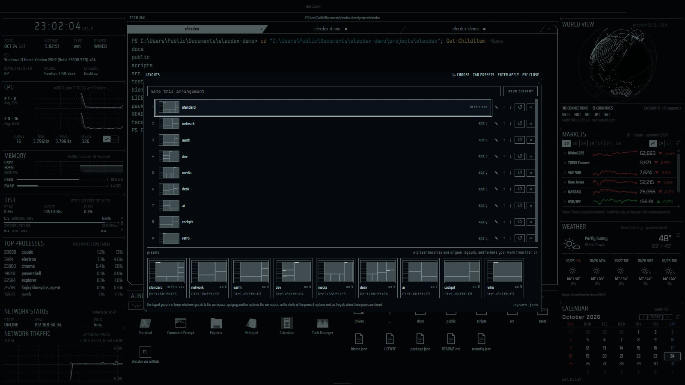
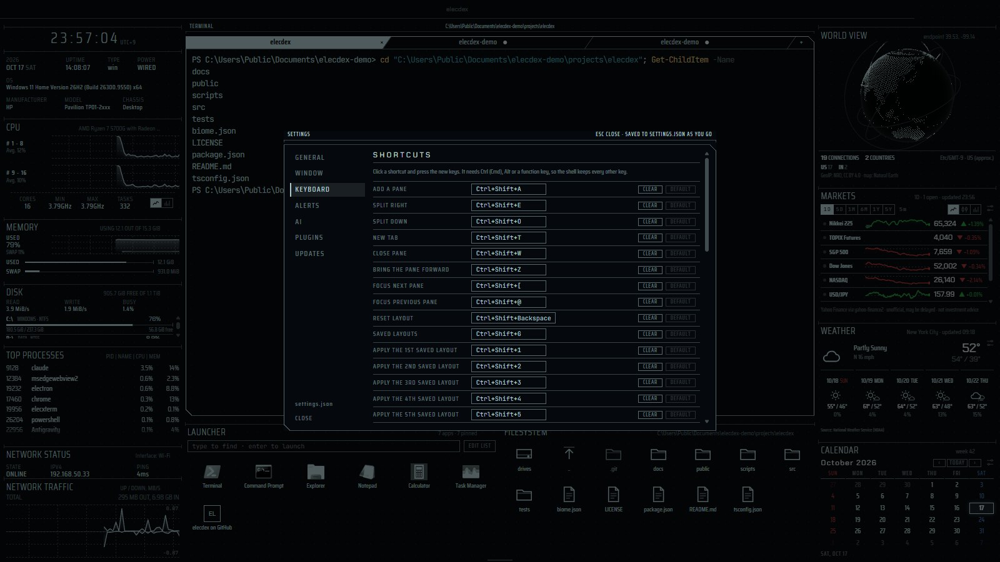
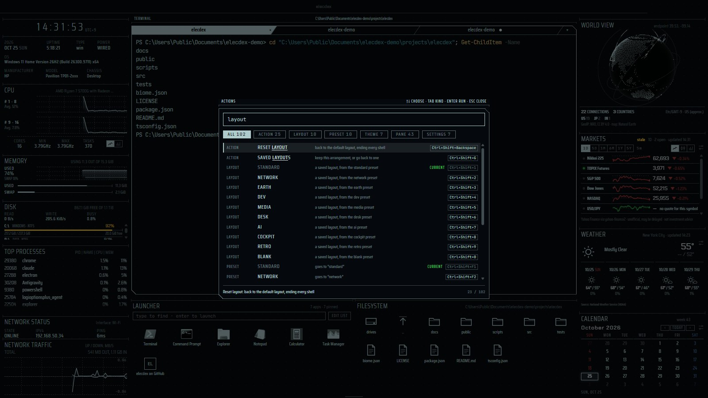

[English](workspace.md) | [日本語](workspace.ja.md) | 简体中文

# 工作区 — elecdex

elecdex 是一款科幻风格的桌面终端模拟器兼系统监视器，用 Electron、Svelte 和 TypeScript 重写了 eDEX-UI。本页介绍它的
工作区：窗格、分屏和标签页，移动、关闭和把窗格放到前面，弹出窗格，已保存布局，CRT 过渡效果和动效设置，主题，设置
对话框，操作面板，后台运行，以及全部默认键盘快捷键。elecdex 可在 Windows、macOS 和 Linux 上运行；它在 Windows 上
开发和使用，macOS 和 Linux 只在 GitHub Actions 的自动化测试中运行过，因此尚未经过充分验证。

## 本页内容

- [窗格、分屏和标签页](#窗格分屏和标签页)
- [移动窗格和调整大小](#移动窗格和调整大小)
- [添加和关闭窗格](#添加和关闭窗格)
- [把窗格放到前面](#把窗格放到前面)
- [弹出窗格](#弹出窗格)
- [已保存布局](#已保存布局)
- [外观与体验](#外观与体验)
- [设置](#设置)
- [操作面板](#操作面板)
- [插件](#插件)
- [在后台运行](#在后台运行)
- [实用工具](#实用工具)
- [键盘快捷键](#键盘快捷键)
- [状态栏和窗口](#状态栏和窗口)

  
   布局 (Ctrl+Shift+G) · Tron

**布局** — 每个窗格都可以拖动标题来移动，也可以关闭、分屏、放入标签页、调整大小并恢复；布局会被保存，也可以重置。
一种排布可以命名保存以便日后回到它（Ctrl+Shift+G，或状态栏中的 *layouts*），也可以从十个[预设](presets.zh-CN.md)
之一开始。

## 窗格、分屏和标签页

| | |
| --- | --- |
| 保存位置 | `layout.json`（当前的排布，可手动编辑）；`layouts.json`（已保存布局） |
| 设计 | [architecture.md §5.1](../architecture.md)（日文） |

- 工作区是一棵树。它的叶子是**窗格**，每个窗格放一个小部件——shell、监视器、网页和插件都一样。**分屏**把子节点按
  比例横向或纵向排列；**标签页组**把共用一个位置的窗格放在一起。
- 标签页组可以容纳任何窗格，不限于 shell，所以偶尔用到的窗格可以与 shell 共用一个位置，而不必单独占地方——例如把
  RSS 或天气放在 shell 标签页后面。点击标签页即可切换；后台标签页中的 shell 会继续运行，切回来时会话和屏幕都还在。
- 标签页组不能嵌套：一个标签页只放一个窗格。
- 分屏没有标题栏。shell 保留它的 TERMINAL 标题栏，它同时是所在组的拖动把手，并显示 shell 所在的文件夹。
- 位于后台标签页或最小化窗口中的窗格会停止读取不需要的数据：大多数窗格只在可见时获取数据，并保留最后显示的内容。
  不可见时仍继续运行的有：shell、正在生成的回答、计时器和闹钟、地震警报、插件和网页。
- **移动窗格会重新挂载它。** 需要在移动后保留的内容保存在窗格状态或主进程中：移动后的 shell 保留其会话和回滚缓冲区。
- 如果某个窗格出错，只有这个窗格会停下并显示 **RETRY**，同时有一条红色通知说明出了什么问题；**COPY DETAILS** 只
  复制错误消息、版本和平台。

## 移动窗格和调整大小

- **拖动窗格的标题**（没有标题的窗格，例如时钟，拖动其顶部的细线），把它放到另一个窗格上：它会放在那个窗格旁边，
  位于离指针最近的一侧。
- 放下时按住 **Ctrl**（macOS 上为 **Cmd**），则改为作为标签页加入那个窗格，位置由指针在标签条上所指决定。在标签页
  已经所在的组上，同样按住 Ctrl 可以重新排序。
- shell 标签页可以单独拖出，标签页组的标题栏会移动整个组。
- **Escape** 取消拖动。移动后的 shell 保留其会话。
- *unreleased*：拖动时，窗格将占据的区域四角会出现括号。放下的窗格从原来的位置飞到落点，与它交换位置的窗格也一样
  飞过去；作为标签页放进组里的窗格会在那里闪一下点亮。
- **调整大小**：拖动两个窗格之间的分隔线，或让分隔线获得焦点后用**方向键**（按住 **Shift** 步长更大）。**双击**
  分隔线会让两侧的两个窗格平分空间。分隔线只移动它两侧的两个窗格。

## 添加和关闭窗格

  
   空布局上的添加窗格选择器 · Amber

- **Ctrl+Shift+A**（或状态栏中的添加按钮）打开**添加窗格选择器**：列出每个小部件及其说明，顶部是放置方式
  **right**、**below**、**⧉ new tab** 和 **▣ pop up**（**Tab** 循环切换）。新窗格放在当前获得焦点的窗格旁边。
- 要把窗格放进某个组，可以按住 Ctrl 把它拖到组上；或者让组中的某个窗格获得焦点，打开选择器，在选小部件之前先选
  **⧉ new tab**。
- 只能存在一个且已在布局中的小部件，无论选哪种放置方式，都会转到那个窗格，不会再建第二个。
- **Ctrl+Shift+E** 把当前窗格向右分屏，**Ctrl+Shift+O** 向下分屏（标签页则是整个组），**Ctrl+Shift+T** 在当前窗格
  旁边新建一个标签页。
- **Ctrl+Shift+W** 关闭当前窗格，窗格的 **×** 按钮（鼠标悬停时出现）也一样。标签页组的 × 关闭组中所有标签页；
  标签页自身的 × 只关闭那一个。被关闭的窗格会断电，旁边的窗格随之延伸占据它的空间。
- *unreleased*：关闭可以撤销。通知中的 **undo** 在 6 秒内、下一次改动布局之前可用；只保留最后一次关闭。恢复的 shell
  保留其会话和回滚内容；Web 页面会在原来显示的地址重新打开。
- 任何布局关闭最后一个窗格后都会变空：*no panes in this layout* 下方的 **+ add pane** 会打开选择器，选中的第一个
  窗格铺满整个屏幕。在空布局中，拆分和新标签页的按键会放入一个 shell。
- **Ctrl+Shift+Backspace** 重置为默认布局。有 shell 打开时会像切换布局一样先询问；状态栏中的重置按钮则改为通过
  第二次点击来确认。

## 把窗格放到前面

| | |
| --- | --- |
| 快捷键 | **Ctrl+Shift+Z**（再按一次放回）；窗格 × 旁边的 ⤢ 按钮 |
| 保存 | 从不保存：应用启动时每个窗格都在原位 |
| 设计 | [architecture.md §5.5](../architecture.md)（日文） |

想看得更清楚的窗格可以放到前面：按 **Ctrl+Shift+Z**，或点击右上角 × 旁边的 **⤢** 按钮（标签页组也有同样的角）。它会
盖住窗口的大部分，其他窗格在暗幕后保持原位。

- 大多数窗格放到前面后占工作区的约 90%。计算器、计时器、混音器、正在播放、磁盘、进程列表和实用工具则以居中的面板
  （最大 880x560）出现，而不是盖住整个窗口。系统条和网络状态没有 ⤢。
- 在前面时，它会被一个框围住——把 shell 的切角边框放大一号，四角有括号，底边写着 `ESC · RETURN`——框画在窗格边缘
  之外，所以窗格保有分给它的全部空间。
- **Escape**、再按一次快捷键、按钮或点击暗幕都会把它放回。窗格在前面时，角上只有 **⤡**（放回），旁边不会出现 ×；
  要关闭前面的窗格请按 **Ctrl+Shift+W**。
- 标签页会连同它的组一起放到前面，所以仍可切换到组内其他标签页。
- 不会重新排列，也不会保存：shell 保留会话，网页窗格保留页面。后面的窗格一个像素也不会动，因此其他 shell 的大小
  不变。任何改变树的操作（拆分、移动、重置、关闭其他窗格）、开始拖动或让其他窗格获得焦点，都会把它放回。
- 减少动效时，它不带飞行动画地出现和返回。

## 弹出窗格

| | |
| --- | --- |
| 位置 | 添加窗格选择器中的 **▣ pop up**；操作面板的 PANE 行；布局中没有对应窗格时的 **Ctrl+Shift+L**（启动器）和 **Ctrl+Shift+U**（实用工具） |
| 保存 | 从不保存（窗格和位置都不保存）；其中的选择保留到应用退出 |
| 设计 | [architecture.md §5.13](../architecture.md)（日文） |

**▣ pop up** 把小部件显示在工作区之上，布局保持原样。它的框只有一个 ×，不会被保存；**Escape**、× 或点击旁边都会
收起它。

- 它没有放大、拖动、拆分和标签页。打开任何对话框都会收起它。
- 除以下几种外，所有内置窗格都可以弹出：shell（没有窗格持有的会话会被结束）、计时器（收起的倒计时无法响铃）、
  文件浏览器（它跟随布局中的 shell）、CHIP-8 和 ELEC-16；网页和插件也不行。选择器中这些会标为 *pane only*。
- 在弹出窗格中所做的选择，在应用退出之前，下次弹出时仍然保留。
- 布局中没有启动器时，**Ctrl+Shift+L** 会同样弹出启动器，启动某个程序后启动器即消失。**Ctrl+Shift+U** 转到实用
  工具窗格：布局中有就转到下一个，没有就弹出；再按一次收起。
- 唯一能在弹出窗格之上打开的是天气窗格的地点选择器。

## 已保存布局

| | |
| --- | --- |
| 快捷键 | **Ctrl+Shift+G**（LAYOUTS 对话框）；**Ctrl+Shift+1** … **9**、**0**（前十个）；**Ctrl+Shift+F1** … **F10**（预设） |
| 保存位置 | `layouts.json`，最多 20 项 |
| 设置 | *Settings → General → Layouts* → *ask before switching layout*（默认开启） |
| 设计 | [architecture.md §5.6](../architecture.md)（日文） |

值得保留的排布可以命名保存——**Ctrl+Shift+G**，或状态栏中的 *layouts*——以后再回到它；前十个对应 Ctrl+Shift+1 到 9
和 0，也对应状态栏左侧的编号按钮。

- **布局跟随工作。** 当前所在的布局会被标记，你对工作区所做的一切都保存在其中，回来时一切如你离开时一样。它不是
  快照。
- 重置布局不会删除任何已保存布局；之后的排布在你保存或应用某个布局之前不属于任何一个。
- 在对话框中可以重命名布局，也可以上下移动——它在列表中的位置*就是*它的数字键。最多保存 20 个；第十个之后的没有
  按键，从对话框中应用。
- **应用布局会替换工作区**，被替换窗格中的 shell 会结束，就像关闭这些窗格一样。有 shell 打开时会先询问，问题中附有
  不再询问的方法（*Settings → General → Layouts*）。所应用布局中的 shell 会重新启动。
- 旧的排布像显像管一样断电，新的排布像启动时那样逐个窗格点亮——shell 先亮，其他窗格随后不分先后，用时约为启动时的
  三分之一；减少动效时没有这些效果。
- 切换前会先写出尚未保存的改动，所以刚才的操作不会丢失。
- 已保存布局集中在一个文件里，其中不含任何属于本机的内容（shell 的会话已去除）：**把 `layouts.json` 复制到另一台
  电脑，你的排布就跟着过去了。** 对话框中的 *layouts.json* 按钮会在文件管理器中显示它。文件中损坏的条目只丢弃该
  条，其余保留。
- 列表下方的架子上有十个**预设**。选择一个会添加由它生成的布局；见[布局预设](presets.zh-CN.md#预设如何工作)。

## 外观与体验

**外观与体验** — 七种可实时切换的主题：用于 HUD 风格的 Tron、Amber、Phosphor、White，以及把 White 反过来、在浅色底上
用近黑文字并带同样扫描线的 Black，以及采用 Windows 11 配色、系统字体和全彩图标、适合日常办公的 Business (Dark) 和
Business (Light)——[预设](presets.zh-CN.md)页面的截图里每一种都出现过。

- 先是一段展示本机真实信息的 Linux 风格启动日志，随后是 **CRT 通电式的启动动画**。
- **窗格会通电和断电。** 之后添加的窗格同样会这样通电；关闭的窗格会断电，旁边的窗格随之延伸占据它的空间；切换到
  已保存布局时整个屏幕断电，再逐个窗格点亮下一个布局；对话框、通知和弹出窗格也会通电和断电。
- *unreleased*：分屏或移动使窗格变小时，移动的边上会划过一道光线；标签页被带到组的前面时，会像换台一样闪一下点亮；
  键盘移到的窗格（**Ctrl+Shift+]** / **[** 和方向键、shell 的按键、窗格各自的快捷键）边框会亮一次。用鼠标点击的窗格不会亮。
- 扫描线和辉光、合成的界面音效、主题化的标题栏，以及从底边滑出的状态栏。
- 简短的入场效果——每个月的日期如波浪般出现、天气预报升起、新标题和地震条目滑入并高亮三秒——遵循动效设置。
- **动效**在 *Settings → General → Appearance* 中：**system**（跟随操作系统的减少动态效果设置，默认）、**full** 或
  **reduced**。减少动效时（或系统开启了减少动态效果），一切都不会动：CRT 过渡、窗格放到前面的飞行动画和入场效果都会
  省略。
- 窗口隐藏或最小化时，常驻动画会暂停。
- 浅色主题（Black 和 Business (Light)）使用更深的状态颜色，并保证 shell 的最低对比度。

## 设置

| | |
| --- | --- |
| 快捷键 | **Ctrl+Shift+.**；状态栏中的设置按钮 |
| 保存位置 | `settings.json`，可手动编辑 |

  
   Settings → Keyboard · Tron

**设置** — 设置对话框涵盖主题、动效、声音、终端起始文件夹、已保存布局、启动器、可重新绑定的键盘快捷键和更新检查，
全部保存在可手动编辑的 `settings.json` 中。各分区如下：

| 分区 | 内容 |
| --- | --- |
| *General* | appearance（主题、动效）、sound、terminal、git、chip-8、elec-16、layouts、launcher、web panes |
| *Window* | 窗口外的图标、最小化和关闭到图标、全局显示/隐藏快捷键，以及 startup；只在本机能做到其中任一项时显示 |
| *Keyboard* | 所有快捷键，可重新绑定 |
| *Alerts* | 地震与海啸 |
| *AI* | AI 提供方及其密钥、聊天的长对话和系统提示词、ELEC system 的立场 |
| *Plugins* | 插件 |
| *Updates* | 更新检查：每天一次向 GitHub 查询最新版本；不会下载或安装任何东西 |

## 操作面板

| | |
| --- | --- |
| 快捷键 | **Ctrl+Shift+P** |
| 设计 | [docs/palette.md](../palette.md)（日文）、[architecture.md §5.24](../architecture.md) |

**操作面板** — 按 Ctrl+Shift+P，输入文字即可查找并执行所有快捷键操作、已保存布局、预设、主题、窗格和设置分区，每一行
都显示当前的按键。当前无法执行的行会变暗并注明原因；无法撤销的操作需按两次 Enter。

  
   操作面板（Ctrl+Shift+P） · Tron

| 类别 | 按 Enter 做什么 |
| --- | --- |
| ACTION | 与该操作的快捷键相同，可否执行也用同样的判断（以打开面板前获得焦点的窗格为准） |
| LAYOUT | 应用该已保存布局；与数字键一样，有 shell 打开时先询问 |
| PRESET | 与 Ctrl+Shift+F1 … F10 一样，转到由该预设生成的布局，没有就添加一个 |
| THEME | 应用该主题 |
| PANE | 能弹出的就弹出，否则添加到右侧；只能有一个且已在布局中的窗格则转到它 |
| SETTINGS | 在该分区打开设置对话框 |

- 输入即筛选，名称中匹配的字母带下划线。什么都没输入时，最近用过的五行排在最前（只保留到页面重新加载），然后按类别
  分标题列出。
- **↑** / **↓** 选择，**PageUp** / **PageDown** 一次移动八行，**Tab** / **Shift+Tab** 切换类别，**Enter** 执行，
  **Escape** 关闭。也可以用鼠标选择和点击。
- 当前无法执行的行会变暗并注明原因——例如 Next tab 显示 *not in a tab group*，Clear the shell's scrollback 显示
  *only from a shell*。在这样的行上按 Enter 不会有任何动作。
- **按两次 Enter**：Quit、Clear the shell's scrollback，以及确认对话框不会出现时（没有 shell，或
  *ask before switching layout* 关闭）的 Reset layout。该行变红并显示 *ENTER AGAIN*；移动选择或输入文字即解除。
- 面板打开期间，除 Quit 和全屏外，其他快捷键都不起作用；再按 Ctrl+Shift+P 也不会有动作。它可以在弹出窗格之上打开
  （弹出窗格会收起），网页窗格获得焦点时也能打开。
- 没有主题预览、单项设置切换，也没有让插件添加行的接口；插件的窗格与选择器中一样列在 PANE 下。

## 插件

**插件** — 用一个 TypeScript 文件做出你自己的窗格，运行在沙箱化的 worker 中，只拥有你授予的权限。见
[使用插件](plugins-use.zh-CN.md)。

## 在后台运行

| | |
| --- | --- |
| 设置 | *Settings → Window*（显示图标、最小化到图标、关闭窗口后继续运行、在任何应用中显示或隐藏 elecdex）；*Settings → Window → Startup*（登录时启动 elecdex、在后台启动） |
| 默认 | 全部关闭，直到你开启 |
| 平台 | 只提供本机实际能做到的（见下表）；macOS 和 Linux 尚未经过充分验证 |

**在后台运行** — 通知区域、菜单栏或托盘中的图标；全局的显示/隐藏快捷键；以及登录时启动。提供哪些选项取决于这台机器
实际能做到什么，因此各平台不同：Windows 额外支持最小化和关闭到通知区域；macOS 把这些交给 Dock（关闭窗口本来就会让
elecdex 继续运行），其登录项也无法以隐藏方式启动；Linux 上托盘和快捷键取决于桌面环境——两者都不支持的会话会直接
说明，而不是显示一个毫无作用的开关。全部默认关闭，需在 *Settings → Window* 中开启。

| | Windows | macOS | Linux |
| --- | --- | --- | --- |
| 窗口外的图标 | 通知区域 | 菜单栏 | 桌面环境有系统托盘时（原版 GNOME 需要扩展） |
| 最小化/关闭到图标 | 支持 | 不支持——关闭窗口后 elecdex 本来就会继续运行，可从 Dock 找回 | 桌面环境有放图标的地方时 |
| 全局显示/隐藏快捷键 | 支持 | 支持 | 仅 X11；Wayland 会话会自己保留这些按键，因此选项会说明这一点 |
| 登录时启动 | Run 键条目，卸载程序会删除它 | 应用的登录项（macOS 可能要求你允许） | `~/.config/autostart/elecdex.desktop` |
| *start in the background* | 支持 | 不支持——登录项不接受参数 | 支持 |

- 图标：单击打开 elecdex，右键菜单可以打开设置或退出。在 Windows 上，新图标可能被收在任务栏的 **^** 里。窗口隐藏时
  图标也总会显示，因此隐藏的窗口随时都能找回。
- **在任何应用中显示或隐藏 elecdex**：默认 **Ctrl+Alt+Shift+E**，在其开关旁设置。它只接受字母、数字和功能键；如果
  其他应用已经占用了这组按键，它会附上说明并重新关闭。*reset all shortcuts* 不会改动它；录制快捷键期间它会让出按键，
  所以它本身也能被录制。开启后，与它按键相同的应用内快捷键会在 *Settings → Keyboard* 中被标出：操作系统会先把按键
  交给 elecdex 的窗口快捷键。elecdex 在最前面时，它会把 elecdex 收起（开启了托盘选项则收到图标，否则收到任务栏）；
  在其他任何地方，它会把 elecdex 带到最前面。
- *登录时启动*：如果系统把它关掉了（Windows 上是任务管理器的启动应用），设置中也会显示为已关闭。只有安装版应用可用。
  *start in the background* 让 elecdex 在登录时以隐藏方式启动。
- **Ctrl+Shift+Q** 会退出，即使关闭窗口只是把 elecdex 收到通知区域时也是如此。明确的退出总是会退出。
- 无论发生什么，再次启动 elecdex 都会把正在运行的那个带回来，所以窗口永远不会找不到。

## 实用工具

**实用工具** — 把小工具放在一个窗格里：在你指定的时间内阻止休眠、生成二维码（文本、地址或 Wi-Fi）、编码、解码、哈希
和时间转换。**Ctrl+Shift+U** 转到它或把它弹出。见[实用工具](panes-desk.zh-CN.md#utility)。

## 键盘快捷键

除分隔线的按键外，所有快捷键都可以在 *Settings → Keyboard* 中重新绑定：点击一项，然后按下新的按键。快捷键必须包含
**Ctrl**（macOS 上为 **Cmd**）、**Alt** 或功能键，这样其他按键都能到达 shell；已被占用的组合会被标出。按键按美式
键盘上的印字命名；在其他键盘上是同一位置的键（在日文键盘上，Ctrl+Shift+= 是 Ctrl+Shift+^，Ctrl+Shift+[ / ] 是
Ctrl+Shift+@ / [）。应用自己的列表和提示会按你的键盘印字显示当前的绑定。

| 快捷键 | 操作 |
| --- | --- |
| Ctrl+Shift+A | 添加窗格：任意小部件，放在当前窗格的右侧、下方、旁边的标签页，或弹出 |
| Ctrl+Shift+E | 把当前窗格（标签页则为整个组）向右分屏 |
| Ctrl+Shift+O | 把当前窗格（标签页则为整个组）向下分屏 |
| Ctrl+Shift+T | 在当前窗格旁新建标签页 |
| Ctrl+Shift+W | 关闭当前窗格，或放在前面的窗格 |
| Ctrl+Shift+Z | 把当前窗格放到工作区前面，再按放回（Escape 也可以） |
| Ctrl+Shift+] / [ | 焦点移到下一个／上一个窗格 |
| Ctrl+Shift+← / → / ↑ / ↓ | *unreleased*：焦点移到该方向的窗格；该方向没有窗格时，按键传给窗格 |
| Ctrl+Shift+Backspace | 重置为默认布局（有 shell 打开时先询问） |
| Ctrl+Shift+G | 已保存布局 |
| Ctrl+Shift+1 … 9、0 | 按对话框中的顺序应用前十个已保存布局（0 为第十个）；空位时按键留给当前窗格 |
| Ctrl+Shift+F1 … F10 | 转到预设：standard、network、earth、dev、media、desk、ai、cockpit、retro、blank |
| Ctrl+Shift+L | 搜索启动器（布局中没有时弹出一个） |
| Ctrl+Shift+U | 实用工具窗格：布局中的下一个，没有则弹出；再按一次收起（Linux 上 IBus 可能占用这组按键来按编码输入字符：请重新绑定） |
| Ctrl+Shift+S | 聚焦所选标签页中的 shell（没有 shell 窗格时添加一个） |
| Ctrl+Shift+F | 在 shell 的回滚缓冲区中查找（Enter / Shift+Enter 下一个和上一个，Escape 关闭） |
| Ctrl+Shift+K | 清空 shell 的回滚缓冲区 |
| Ctrl+Shift+= / - | 放大或缩小所有 shell 的字号 |
| Ctrl+Tab / Ctrl+Shift+Tab | 当前标签页组（例如 shell 的标签页）中的下一个／上一个标签页（*unreleased*：原为 Ctrl+Shift+→ / ←） |
| Ctrl+Alt+Shift+→ / ← | 在 shell 中：下一个／上一个 shell 窗格（或 shell 标签页组） |
| Ctrl+Shift+. | 设置 |
| Ctrl+Shift+P | 操作面板 |
| F11 | 切换全屏 |
| Ctrl+Shift+M | 最小化窗口（Windows、Linux） |
| Ctrl+Shift+Q | 退出 |
| Ctrl+Alt+Shift+E | 在任何应用中显示或隐藏 elecdex（在 *Settings → Window* 中开启前为关闭；Wayland 会话中不可用） |
| 分隔线上的方向键 | 调整大小（Shift 步长更大） |
| 双击分隔线 | 两侧的两个窗格平分空间 |

- 在 shell 中，选中文本即复制，右键粘贴，与 PuTTY 或 Windows Terminal 相同；Ctrl+C 仍是 shell 的中断键。搜索栏跳到
  的匹配项不会被复制——只有你自己选中的才会。左右没有相邻窗格时，Ctrl+Shift+← / → 仍会传给 shell，PSReadLine 用它
  按词选择。
- 在当前位置不适用的快捷键会把按键留给窗格：例如在不能放到前面的窗格上按 Ctrl+Shift+Z，或在标签页组之外按标签页的
  按键。

## 状态栏和窗口

- 把指针移到屏幕底边时，**状态栏**会滑出。它左侧是每个已保存布局的编号按钮——编号就是应用它的按键——随后是添加窗格、
  已保存布局、重置布局、设置、主题、声音和退出的按钮。
- 在 Windows 和 Linux 的全屏模式下，把指针移到右上角会落下最小化、退出全屏和关闭按钮；如果设置为在通知区域继续运行，
  关闭会把 elecdex 收到那里，否则会先询问再退出。
- 启动参数：`--windowed`（不全屏）、`--no-intro`（跳过启动动画）。
